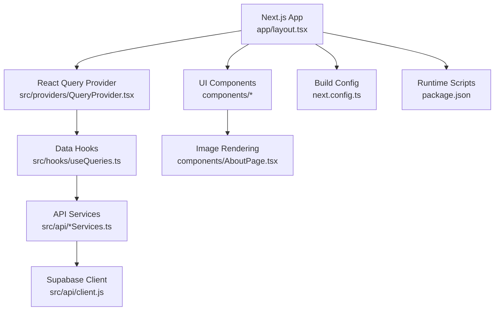
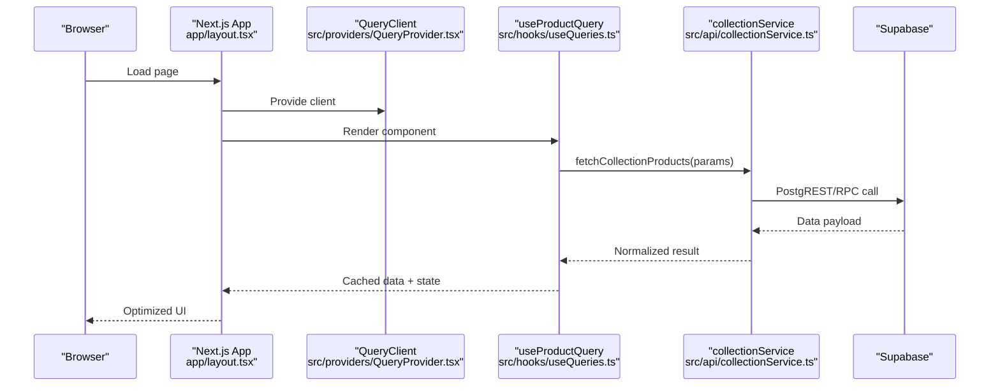
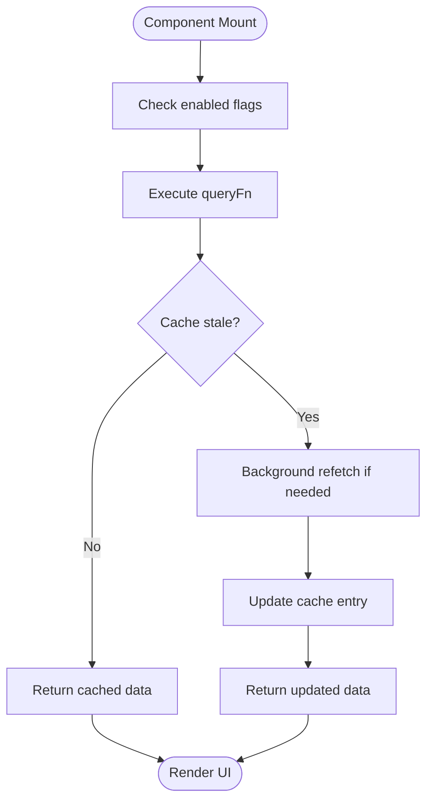
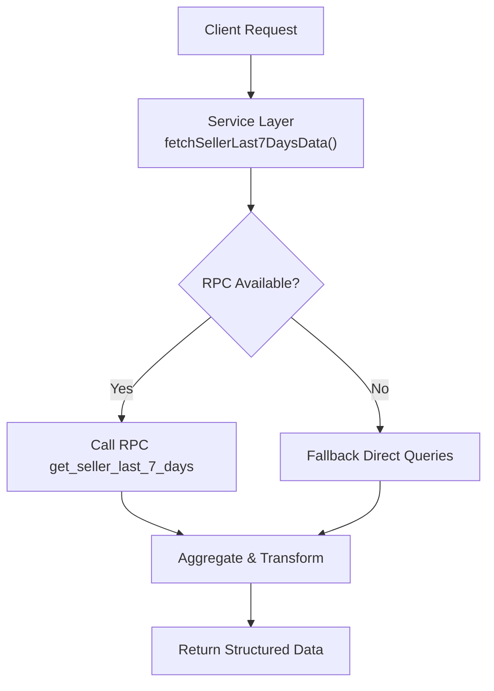
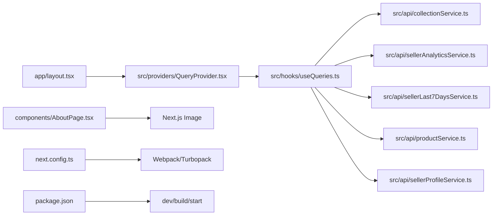

# Performance & Optimization

<cite>
**Referenced Files in This Document**
- [next.config.ts](file://next.config.ts)
- [package.json](file://package.json)
- [app/layout.tsx](file://app/layout.tsx)
- [src/providers/QueryProvider.tsx](file://src/providers/QueryProvider.tsx)
- [src/hooks/useQueries.ts](file://src/hooks/useQueries.ts)
- [components/AboutPage.tsx](file://components/AboutPage.tsx)
- [src/api/sellerProfileService.ts](file://src/api/sellerProfileService.ts)
- [src/api/productService.ts](file://src/api/productService.ts)
- [src/api/collectionService.ts](file://src/api/collectionService.ts)
- [src/api/sellerAnalyticsService.ts](file://src/api/sellerAnalyticsService.ts)
- [src/api/sellerLast7DaysService.ts](file://src/api/sellerLast7DaysService.ts)
</cite>

## Table of Contents
1. [Introduction](#introduction)
2. [Project Structure](#project-structure)
3. [Core Components](#core-components)
4. [Architecture Overview](#architecture-overview)
5. [Detailed Component Analysis](#detailed-component-analysis)
6. [Dependency Analysis](#dependency-analysis)
7. [Performance Considerations](#performance-considerations)
8. [Troubleshooting Guide](#troubleshooting-guide)
9. [Conclusion](#conclusion)

## Introduction
This document explains performance optimization strategies across the platform, focusing on Next.js build configuration, code splitting and bundle optimization, React Query caching patterns, image optimization and lazy loading, asset delivery, database query optimization, index and caching strategies, monitoring, profiling, and best practices for maintaining optimal performance at scale.

## Project Structure
The project is a Next.js application with:
- App Router pages under `app/`
- Shared UI components under `components/`
- Data access and hooks under `src/api/` and `src/hooks/`
- Global React Query provider under `src/providers/`
- Build and runtime configuration under `next.config.ts` and `package.json`

**Diagram sources**
- [app/layout.tsx:1-20](file://app/layout.tsx#L1-L20)
- [src/providers/QueryProvider.tsx:1-25](file://src/providers/QueryProvider.tsx#L1-L25)
- [src/hooks/useQueries.ts:1-30](file://src/hooks/useQueries.ts#L1-L30)
- [src/api/sellerAnalyticsService.ts:1-10](file://src/api/sellerAnalyticsService.ts#L1-L10)
- [components/AboutPage.tsx:1-25](file://components/AboutPage.tsx#L1-L25)
- [next.config.ts:1-12](file://next.config.ts#L1-L12)
- [package.json:1-34](file://package.json#L1-L34)

**Section sources**
- [next.config.ts:1-12](file://next.config.ts#L1-L12)
- [package.json:1-34](file://package.json#L1-L34)

## Core Components
- Next.js build configuration enables experimental package import optimization and strict mode.
- React Query provider sets global defaults including stale time and refetch behavior.
- Data hooks centralize query keys, stale times, and GC policies for product, collection, seller, and analytics data.
- Image rendering uses Next.js Image component with priority for hero assets.
- Monitoring integrates Vercel Analytics at the app layout level.

**Section sources**
- [next.config.ts:3-9](file://next.config.ts#L3-L9)
- [src/providers/QueryProvider.tsx:6-17](file://src/providers/QueryProvider.tsx#L6-L17)
- [src/hooks/useQueries.ts:44-82](file://src/hooks/useQueries.ts#L44-L82)
- [components/AboutPage.tsx:71-84](file://components/AboutPage.tsx#L71-L84)
- [app/layout.tsx:1-20](file://app/layout.tsx#L1-L20)

## Architecture Overview
The frontend renders pages using Next.js App Router. Data fetching is centralized through React Query hooks that wrap API services calling Supabase. Images are rendered via Next.js Image for optimized delivery. Monitoring is enabled via Vercel Analytics.

**Diagram sources**
- [app/layout.tsx:1-20](file://app/layout.tsx#L1-L20)
- [src/providers/QueryProvider.tsx:6-17](file://src/providers/QueryProvider.tsx#L6-L17)
- [src/hooks/useQueries.ts:76-82](file://src/hooks/useQueries.ts#L76-L82)
- [src/api/collectionService.ts:467-500](file://src/api/collectionService.ts#L467-L500)

## Detailed Component Analysis

### Next.js Build Configuration and Bundle Optimization
- Experimental package import optimization is configured for specific libraries to reduce bundle size by importing only used exports.
- Strict mode is enabled to catch potential issues during development.
- Development scripts use Turbo mode for faster dev server startup.

Recommendations:
- Add additional heavy libraries to `optimizePackageImports` where appropriate.
- Consider enabling static generation or incremental static regeneration for content-heavy routes.
- Use dynamic imports for large third-party charts or heavy UI libraries.

**Section sources**
- [next.config.ts:3-9](file://next.config.ts#L3-L9)
- [package.json:5-11](file://package.json#L5-L11)

### React Query Configuration and Stale-While-Revalidate Patterns
- Global defaults set a 60-second stale time and disable refetch on window focus to reduce unnecessary network requests.
- Per-query stale times vary by data volatility:
  - Product detail and collection queries use 3-minute stale times.
  - Seller overview and analytics queries use 1-minute stale times.
  - Brand names and category queries use 10-minute stale times.
- GC times are defined for long-lived seller product lists and product information to free memory after inactivity.

Best practices applied:
- Stable query keys per resource and parameters.
- Disabled refetch on window focus to avoid noisy background refetches.
- Fire-and-forget mutations (e.g., view increments) without invalidating related queries to prevent re-renders.

**Diagram sources**
- [src/providers/QueryProvider.tsx:6-17](file://src/providers/QueryProvider.tsx#L6-L17)
- [src/hooks/useQueries.ts:44-82](file://src/hooks/useQueries.ts#L44-L82)
- [src/hooks/useQueries.ts:159-193](file://src/hooks/useQueries.ts#L159-L193)
- [src/hooks/useQueries.ts:276-327](file://src/hooks/useQueries.ts#L276-L327)

**Section sources**
- [src/providers/QueryProvider.tsx:6-17](file://src/providers/QueryProvider.tsx#L6-L17)
- [src/hooks/useQueries.ts:44-82](file://src/hooks/useQueries.ts#L44-L82)
- [src/hooks/useQueries.ts:159-193](file://src/hooks/useQueries.ts#L159-L193)
- [src/hooks/useQueries.ts:276-327](file://src/hooks/useQueries.ts#L276-L327)

### Image Optimization and Lazy Loading
- Hero images use the Next.js Image component with `priority` to prioritize critical above-the-fold assets.
- Other images are loaded lazily by default when not marked as priority.
- Server-side image compression and resizing are handled automatically by Next.js Image.

Recommendations:
- Reserve `priority` for truly critical images (hero banners).
- Use responsive sizes and formats (AVIF/WebP) via Next.js Image configuration.
- Avoid inline base64 images for large assets; prefer external URLs or CDN-hosted images.

**Section sources**
- [components/AboutPage.tsx:71-84](file://components/AboutPage.tsx#L71-L84)
- [components/AboutPage.tsx:124-131](file://components/AboutPage.tsx#L124-L131)
- [components/AboutPage.tsx:314-321](file://components/AboutPage.tsx#L314-L321)

### Asset Delivery Optimization
- The project includes audio assets under `public/audio`, which should be served via a CDN for efficient distribution.
- For large media files, consider offloading to object storage and serving through a CDN.
- Minimize payload size by compressing assets and avoiding unnecessary bundling of static resources.

[No sources needed since this section provides general guidance]

### Database Query Optimization and Index Strategies
- Queries leverage Supabase PostgREST and RPC functions where available.
- Some services implement fallback logic when schema cache or function resolution fails, improving resilience.
- Aggregation and bucketing are performed client-side for analytics dashboards, reducing repeated complex joins.

Optimization strategies:
- Prefer RPC endpoints for complex aggregations to move computation to the database layer.
- Ensure indexes exist on frequently filtered columns (e.g., `seller_id`, `created_at`).
- Limit returned fields to reduce payload size.
- Use pagination and cursor-based navigation for large datasets.

**Diagram sources**
- [src/api/sellerLast7DaysService.ts:83-110](file://src/api/sellerLast7DaysService.ts#L83-L110)
- [src/api/sellerLast7DaysService.ts:212-311](file://src/api/sellerLast7DaysService.ts#L212-L311)

**Section sources**
- [src/api/productService.ts:260-274](file://src/api/productService.ts#L260-L274)
- [src/api/productService.ts:829-841](file://src/api/productService.ts#L829-L841)
- [src/api/productService.ts:1600-1637](file://src/api/productService.ts#L1600-L1637)
- [src/api/sellerLast7DaysService.ts:83-110](file://src/api/sellerLast7DaysService.ts#L83-L110)
- [src/api/sellerLast7DaysService.ts:212-311](file://src/api/sellerLast7DaysService.ts#L212-L311)

### Caching Mechanisms
- React Query caches responses based on query keys and stale times.
- Long-lived queries (brand names, categories) use longer stale times to minimize network traffic.
- Edit flows force fresh data on mount to ensure consistency.

Best practices:
- Keep query keys stable and granular.
- Use `gcTime` to control memory usage for inactive queries.
- Avoid unnecessary invalidations; invalidate only affected queries after mutations.

**Section sources**
- [src/hooks/useQueries.ts:276-327](file://src/hooks/useQueries.ts#L276-L327)
- [src/hooks/useQueries.ts:141-151](file://src/hooks/useQueries.ts#L141-L151)

### Monitoring Approaches and Performance Profiling
- Vercel Analytics is integrated at the app layout level to capture user interactions and performance metrics.
- Use browser DevTools and React DevTools to profile component render performance and identify bottlenecks.
- Monitor network waterfall and Largest Contentful Paint (LCP) for critical rendering paths.

Recommendations:
- Instrument key user journeys with custom events.
- Track slow queries and failed RPC calls.
- Set up error boundaries and logging for unhandled exceptions.

**Section sources**
- [app/layout.tsx:1-20](file://app/layout.tsx#L1-L20)

## Dependency Analysis
The following diagram shows how core modules depend on each other:

**Diagram sources**
- [app/layout.tsx:1-20](file://app/layout.tsx#L1-L20)
- [src/providers/QueryProvider.tsx:1-25](file://src/providers/QueryProvider.tsx#L1-L25)
- [src/hooks/useQueries.ts:1-30](file://src/hooks/useQueries.ts#L1-L30)
- [src/api/collectionService.ts:467-500](file://src/api/collectionService.ts#L467-L500)
- [src/api/sellerAnalyticsService.ts:1-10](file://src/api/sellerAnalyticsService.ts#L1-L10)
- [src/api/sellerLast7DaysService.ts:83-110](file://src/api/sellerLast7DaysService.ts#L83-L110)
- [src/api/productService.ts:260-274](file://src/api/productService.ts#L260-L274)
- [src/api/sellerProfileService.ts:217-266](file://src/api/sellerProfileService.ts#L217-L266)
- [components/AboutPage.tsx:1-25](file://components/AboutPage.tsx#L1-L25)
- [next.config.ts:1-12](file://next.config.ts#L1-L12)
- [package.json:1-34](file://package.json#L1-L34)

**Section sources**
- [src/hooks/useQueries.ts:1-30](file://src/hooks/useQueries.ts#L1-L30)
- [src/api/collectionService.ts:467-500](file://src/api/collectionService.ts#L467-L500)
- [src/api/sellerAnalyticsService.ts:1-10](file://src/api/sellerAnalyticsService.ts#L1-L10)
- [src/api/sellerLast7DaysService.ts:83-110](file://src/api/sellerLast7DaysService.ts#L83-L110)
- [src/api/productService.ts:260-274](file://src/api/productService.ts#L260-L274)
- [src/api/sellerProfileService.ts:217-266](file://src/api/sellerProfileService.ts#L217-L266)
- [components/AboutPage.tsx:1-25](file://components/AboutPage.tsx#L1-L25)
- [next.config.ts:1-12](file://next.config.ts#L1-L12)
- [package.json:1-34](file://package.json#L1-L34)

## Performance Considerations
- Code Splitting:
  - Leverage Next.js automatic code splitting for routes and components.
  - Dynamically import heavy libraries (charts, modals) to reduce initial bundle size.
- Bundle Optimization:
  - Continue adding large libraries to `optimizePackageImports`.
  - Remove unused dependencies and tree-shake effectively.
- Data Fetching:
  - Use React Query’s stale-while-revalidate to balance freshness and performance.
  - Prefer server-side aggregation via RPC where possible.
- Images and Assets:
  - Use Next.js Image for automatic optimization and lazy loading.
  - Serve static assets via CDN; compress and modernize formats.
- Database:
  - Add indexes on high-cardinality filter columns.
  - Limit selected fields and paginate results.
- Monitoring:
  - Enable analytics and track key performance indicators (LCP, FID, CLS).
  - Log errors and slow operations for continuous improvement.

[No sources needed since this section provides general guidance]

## Troubleshooting Guide
Common issues and resolutions:
- Schema cache or function not found errors:
  - Ensure migrations and RPC functions are executed in Supabase SQL editor.
  - Handle PGRST202 or schema cache messages gracefully with user-friendly errors.
- Fallback behaviors:
  - When embedding relationships fails, use parallel fallback queries within the same request to maintain performance.
- Storage cleanup:
  - After successful updates, remove orphaned storage objects identified by the database to keep storage lean.

Actionable steps:
- Validate migration execution status before deployment.
- Wrap RPC calls with try/catch and provide clear error messages.
- Monitor storage usage and periodically clean orphaned files.

**Section sources**
- [src/api/productService.ts:260-274](file://src/api/productService.ts#L260-L274)
- [src/api/productService.ts:829-841](file://src/api/productService.ts#L829-L841)
- [src/api/productService.ts:1600-1637](file://src/api/productService.ts#L1600-L1637)

## Conclusion
The platform applies several performance optimizations:
- Next.js build configuration with experimental package import optimization.
- Centralized React Query caching with tuned stale times and disabled refetch on focus.
- Efficient image rendering with priority for critical assets.
- Resilient database queries with fallbacks and structured error handling.
- Integrated monitoring via Vercel Analytics.

To sustain performance at scale:
- Continuously monitor bundle size and LCP.
- Expand code splitting and lazy loading for heavy features.
- Optimize database queries and add indexes where necessary.
- Maintain disciplined caching strategies and avoid unnecessary invalidations.

[No sources needed since this section summarizes without analyzing specific files]