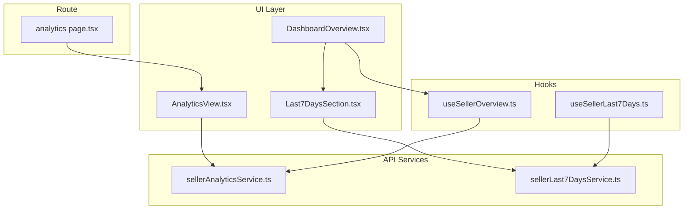
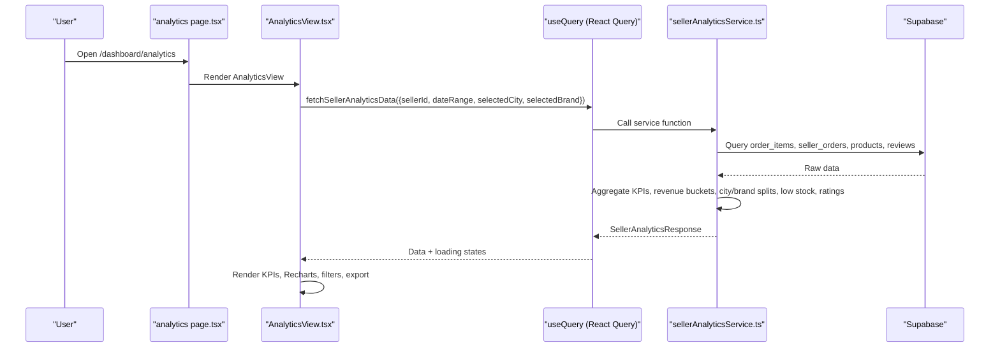
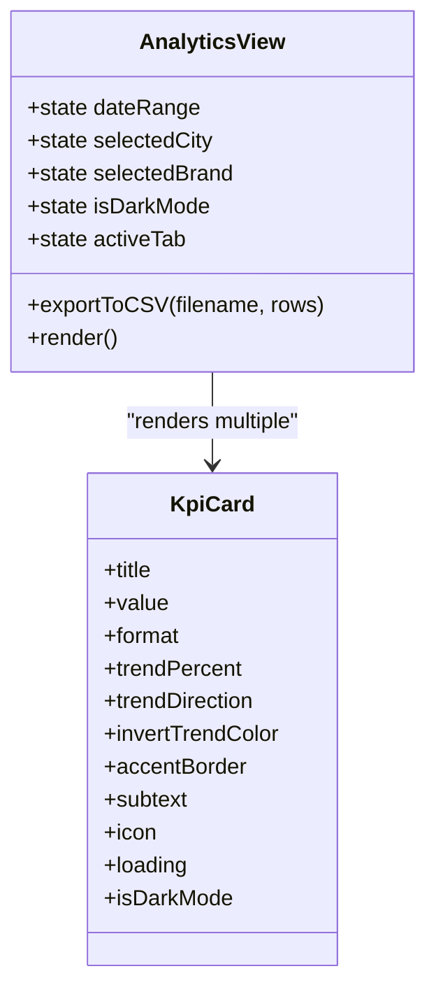
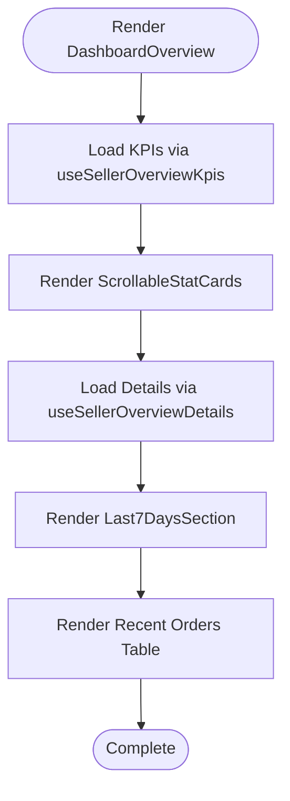
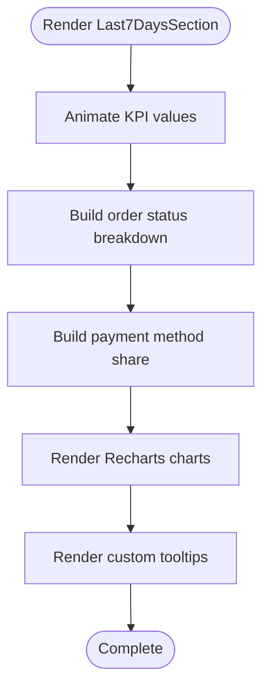
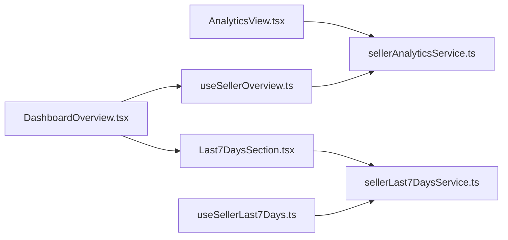

# Analytics & Reporting

<cite>
**Referenced Files in This Document**
- [AnalyticsView.tsx](file://components/reseller/components/AnalyticsView.tsx)
- [DashboardOverview.tsx](file://components/reseller/components/DashboardOverview.tsx)
- [Last7DaysSection.tsx](file://components/reseller/components/Last7DaysSection.tsx)
- [sellerAnalyticsService.ts](file://src/api/sellerAnalyticsService.ts)
- [sellerLast7DaysService.ts](file://src/api/sellerLast7DaysService.ts)
- [useSellerOverview.ts](file://src/hooks/useSellerOverview.ts)
- [useSellerLast7Days.ts](file://src/hooks/useSellerLast7Days.ts)
- [analytics page.tsx](file://app/dashboard/analytics/page.tsx)
</cite>

## Table of Contents
1. [Introduction](#introduction)
2. [Project Structure](#project-structure)
3. [Core Components](#core-components)
4. [Architecture Overview](#architecture-overview)
5. [Detailed Component Analysis](#detailed-component-analysis)
6. [Dependency Analysis](#dependency-analysis)
7. [Performance Considerations](#performance-considerations)
8. [Troubleshooting Guide](#troubleshooting-guide)
9. [Conclusion](#conclusion)

## Introduction
This document explains the analytics and reporting features for the reseller dashboard. It focuses on:
- AnalyticsView: a comprehensive business insights dashboard with KPIs, sales charts, inventory insights, and review moderation.
- DashboardOverview: a high-level performance overview with key metrics and recent orders.
- Last7DaysSection: a trailing 7-day activity tracker with animated KPIs and multiple Recharts visualizations.

The system uses Recharts for data visualization, TanStack Query for caching and refetching, and Supabase RPC or PostgREST queries for data aggregation. Export to CSV is supported for business intelligence reporting.

## Project Structure
The analytics feature spans UI components, hooks, API services, and a Next.js route page:
- UI layer:
  - AnalyticsView.tsx
  - DashboardOverview.tsx
  - Last7DaysSection.tsx
- Data layer:
  - sellerAnalyticsService.ts
  - sellerLast7DaysService.ts
- Hooks:
  - useSellerOverview.ts
  - useSellerLast7Days.ts
- Route:
  - app/dashboard/analytics/page.tsx

**Diagram sources**
- [AnalyticsView.tsx:183-204](file://components/reseller/components/AnalyticsView.tsx#L183-L204)
- [DashboardOverview.tsx:18-36](file://components/reseller/components/DashboardOverview.tsx#L18-L36)
- [Last7DaysSection.tsx:79-87](file://components/reseller/components/Last7DaysSection.tsx#L79-L87)
- [sellerAnalyticsService.ts:195-207](file://src/api/sellerAnalyticsService.ts#L195-L207)
- [sellerLast7DaysService.ts:83-114](file://src/api/sellerLast7DaysService.ts#L83-L114)
- [useSellerOverview.ts:27-46](file://src/hooks/useSellerOverview.ts#L27-L46)
- [useSellerLast7Days.ts:15-34](file://src/hooks/useSellerLast7Days.ts#L15-L34)
- [analytics page.tsx:6-8](file://app/dashboard/analytics/page.tsx#L6-L8)

**Section sources**
- [AnalyticsView.tsx:183-204](file://components/reseller/components/AnalyticsView.tsx#L183-L204)
- [DashboardOverview.tsx:18-36](file://components/reseller/components/DashboardOverview.tsx#L18-L36)
- [Last7DaysSection.tsx:79-87](file://components/reseller/components/Last7DaysSection.tsx#L79-L87)
- [sellerAnalyticsService.ts:195-207](file://src/api/sellerAnalyticsService.ts#L195-L207)
- [sellerLast7DaysService.ts:83-114](file://src/api/sellerLast7DaysService.ts#L83-L114)
- [useSellerOverview.ts:27-46](file://src/hooks/useSellerOverview.ts#L27-L46)
- [useSellerLast7Days.ts:15-34](file://src/hooks/useSellerLast7Days.ts#L15-L34)
- [analytics page.tsx:6-8](file://app/dashboard/analytics/page.tsx#L6-L8)

## Core Components
- AnalyticsView:
  - Displays KPI cards, revenue trends, city breakdowns, payment method splits, top brands, stitching status, low stock alerts, rating distribution, and recent reviews.
  - Supports date range filters (7D, 30D, 90D, ALL), city and brand filters, dark mode toggle, and CSV export.
  - Uses Recharts AreaChart, BarChart, and PieChart for visualizations.
- DashboardOverview:
  - Shows Phase 1 KPIs (revenue, payable commission, active listings, pending dispatch, delivered orders, average reviews).
  - Integrates Last7DaysSection for trailing 7-day metrics and graphs.
  - Presents recent orders in a responsive table.
- Last7DaysSection:
  - Animated KPIs for last 7 days (revenue, orders, AOV, pending fulfillment, new reviews, units sold).
  - Visualizes daily revenue trajectory, order volume, order status breakdown, top products, and payment method share.

**Section sources**
- [AnalyticsView.tsx:46-175](file://components/reseller/components/AnalyticsView.tsx#L46-L175)
- [AnalyticsView.tsx:183-204](file://components/reseller/components/AnalyticsView.tsx#L183-L204)
- [AnalyticsView.tsx:208-221](file://components/reseller/components/AnalyticsView.tsx#L208-L221)
- [AnalyticsView.tsx:512-636](file://components/reseller/components/AnalyticsView.tsx#L512-L636)
- [DashboardOverview.tsx:18-36](file://components/reseller/components/DashboardOverview.tsx#L18-L36)
- [DashboardOverview.tsx:102-183](file://components/reseller/components/DashboardOverview.tsx#L102-L183)
- [DashboardOverview.tsx:189-197](file://components/reseller/components/DashboardOverview.tsx#L189-L197)
- [DashboardOverview.tsx:202-229](file://components/reseller/components/DashboardOverview.tsx#L202-L229)
- [Last7DaysSection.tsx:47-77](file://components/reseller/components/Last7DaysSection.tsx#L47-L77)
- [Last7DaysSection.tsx:79-87](file://components/reseller/components/Last7DaysSection.tsx#L79-L87)
- [Last7DaysSection.tsx:96-121](file://components/reseller/components/Last7DaysSection.tsx#L96-L121)
- [Last7DaysSection.tsx:123-241](file://components/reseller/components/Last7DaysSection.tsx#L123-L241)
- [Last7DaysSection.tsx:243-420](file://components/reseller/components/Last7DaysSection.tsx#L243-L420)

## Architecture Overview
The analytics pipeline connects UI components to data services via hooks and React Query. The flow supports real-time refreshes, filtering, and fallback mock data when live data is unavailable.

**Diagram sources**
- [analytics page.tsx:6-8](file://app/dashboard/analytics/page.tsx#L6-L8)
- [AnalyticsView.tsx:183-204](file://components/reseller/components/AnalyticsView.tsx#L183-L204)
- [sellerAnalyticsService.ts:195-207](file://src/api/sellerAnalyticsService.ts#L195-L207)
- [sellerAnalyticsService.ts:209-302](file://src/api/sellerAnalyticsService.ts#L209-L302)
- [sellerAnalyticsService.ts:331-359](file://src/api/sellerAnalyticsService.ts#L331-L359)
- [sellerAnalyticsService.ts:361-378](file://src/api/sellerAnalyticsService.ts#L361-L378)
- [sellerAnalyticsService.ts:380-420](file://src/api/sellerAnalyticsService.ts#L380-L420)
- [sellerAnalyticsService.ts:422-438](file://src/api/sellerAnalyticsService.ts#L422-L438)
- [sellerAnalyticsService.ts:440-487](file://src/api/sellerAnalyticsService.ts#L440-L487)
- [sellerAnalyticsService.ts:489-500](file://src/api/sellerAnalyticsService.ts#L489-L500)
- [sellerAnalyticsService.ts:502-533](file://src/api/sellerAnalyticsService.ts#L502-L533)
- [sellerAnalyticsService.ts:535-566](file://src/api/sellerAnalyticsService.ts#L535-L566)

## Detailed Component Analysis

### AnalyticsView Component
AnalyticsView provides a full-featured analytics dashboard:
- KPI Cards:
  - Total Revenue, Total Orders, Average Order Value, Active Listings, Sold Out Products, Pending Fulfillment, Cancellation Rate, Average Rating.
  - Each card supports trend indicators, formatting (currency, number, percent, rating), icons, and dark mode.
- Filters and Controls:
  - Date Range Selector (7D, 30D, 90D, ALL).
  - City and Brand dropdowns populated from available data.
  - Refresh button triggers manual refetch.
  - Dark Mode toggle.
  - Export CSV button exports revenue trend data.
- Tabs:
  - Sales & Revenue: Area chart for revenue trend (total vs COD), bar chart for revenue by city, pie chart for payment method split.
  - Product & Inventory: Bar chart for top brands, pie chart for stitching status, low stock alert widget.
  - Reviews & Rating: Star rating distribution bars and recent approved reviews list.

**Diagram sources**
- [AnalyticsView.tsx:46-175](file://components/reseller/components/AnalyticsView.tsx#L46-L175)
- [AnalyticsView.tsx:183-204](file://components/reseller/components/AnalyticsView.tsx#L183-L204)
- [AnalyticsView.tsx:208-221](file://components/reseller/components/AnalyticsView.tsx#L208-L221)
- [AnalyticsView.tsx:365-486](file://components/reseller/components/AnalyticsView.tsx#L365-L486)
- [AnalyticsView.tsx:488-510](file://components/reseller/components/AnalyticsView.tsx#L488-L510)
- [AnalyticsView.tsx:512-636](file://components/reseller/components/AnalyticsView.tsx#L512-L636)
- [AnalyticsView.tsx:638-732](file://components/reseller/components/AnalyticsView.tsx#L638-L732)
- [AnalyticsView.tsx:734-782](file://components/reseller/components/AnalyticsView.tsx#L734-L782)

**Section sources**
- [AnalyticsView.tsx:46-175](file://components/reseller/components/AnalyticsView.tsx#L46-L175)
- [AnalyticsView.tsx:183-204](file://components/reseller/components/AnalyticsView.tsx#L183-L204)
- [AnalyticsView.tsx:208-221](file://components/reseller/components/AnalyticsView.tsx#L208-L221)
- [AnalyticsView.tsx:365-486](file://components/reseller/components/AnalyticsView.tsx#L365-L486)
- [AnalyticsView.tsx:488-510](file://components/reseller/components/AnalyticsView.tsx#L488-L510)
- [AnalyticsView.tsx:512-636](file://components/reseller/components/AnalyticsView.tsx#L512-L636)
- [AnalyticsView.tsx:638-732](file://components/reseller/components/AnalyticsView.tsx#L638-L732)
- [AnalyticsView.tsx:734-782](file://components/reseller/components/AnalyticsView.tsx#L734-L782)

### DashboardOverview Component
DashboardOverview presents a phased loading strategy:
- Phase 1: Fast KPI numbers using useSellerOverviewKpis.
- Phase 2: Graphs and recent orders details using useSellerOverviewDetails.
- Integrates Last7DaysSection for trailing 7-day metrics and charts.
- Recent orders are shown in a responsive table with dispatch status badges.

**Diagram sources**
- [DashboardOverview.tsx:18-36](file://components/reseller/components/DashboardOverview.tsx#L18-L36)
- [DashboardOverview.tsx:102-183](file://components/reseller/components/DashboardOverview.tsx#L102-L183)
- [DashboardOverview.tsx:189-197](file://components/reseller/components/DashboardOverview.tsx#L189-L197)
- [DashboardOverview.tsx:202-229](file://components/reseller/components/DashboardOverview.tsx#L202-L229)

**Section sources**
- [DashboardOverview.tsx:18-36](file://components/reseller/components/DashboardOverview.tsx#L18-L36)
- [DashboardOverview.tsx:102-183](file://components/reseller/components/DashboardOverview.tsx#L102-L183)
- [DashboardOverview.tsx:189-197](file://components/reseller/components/DashboardOverview.tsx#L189-L197)
- [DashboardOverview.tsx:202-229](file://components/reseller/components/DashboardOverview.tsx#L202-L229)

### Last7DaysSection Component
Last7DaysSection tracks trailing 7-day performance:
- Animated KPIs using a custom count-up hook.
- Charts:
  - Daily Revenue Trajectory (AreaChart).
  - Daily Order Volume (BarChart).
  - 7-Day Order Status Breakdown (PieChart).
  - Top 5 Products Sold (Horizontal BarChart).
  - Payment Method Share (PieChart).
- Custom tooltips for each chart type.

**Diagram sources**
- [Last7DaysSection.tsx:47-77](file://components/reseller/components/Last7DaysSection.tsx#L47-L77)
- [Last7DaysSection.tsx:96-121](file://components/reseller/components/Last7DaysSection.tsx#L96-L121)
- [Last7DaysSection.tsx:123-241](file://components/reseller/components/Last7DaysSection.tsx#L123-L241)
- [Last7DaysSection.tsx:243-420](file://components/reseller/components/Last7DaysSection.tsx#L243-L420)
- [Last7DaysSection.tsx:426-500](file://components/reseller/components/Last7DaysSection.tsx#L426-L500)

**Section sources**
- [Last7DaysSection.tsx:47-77](file://components/reseller/components/Last7DaysSection.tsx#L47-L77)
- [Last7DaysSection.tsx:96-121](file://components/reseller/components/Last7DaysSection.tsx#L96-L121)
- [Last7DaysSection.tsx:123-241](file://components/reseller/components/Last7DaysSection.tsx#L123-L241)
- [Last7DaysSection.tsx:243-420](file://components/reseller/components/Last7DaysSection.tsx#L243-L420)
- [Last7DaysSection.tsx:426-500](file://components/reseller/components/Last7DaysSection.tsx#L426-L500)

## Dependency Analysis
The analytics feature depends on:
- UI components consuming hooks and services.
- Hooks wrapping React Query for caching and refetching.
- Services aggregating data from Supabase RPC or PostgREST queries.

**Diagram sources**
- [AnalyticsView.tsx:183-204](file://components/reseller/components/AnalyticsView.tsx#L183-L204)
- [DashboardOverview.tsx:18-36](file://components/reseller/components/DashboardOverview.tsx#L18-L36)
- [Last7DaysSection.tsx:79-87](file://components/reseller/components/Last7DaysSection.tsx#L79-L87)
- [useSellerOverview.ts:27-46](file://src/hooks/useSellerOverview.ts#L27-L46)
- [useSellerLast7Days.ts:15-34](file://src/hooks/useSellerLast7Days.ts#L15-L34)
- [sellerAnalyticsService.ts:195-207](file://src/api/sellerAnalyticsService.ts#L195-L207)
- [sellerLast7DaysService.ts:83-114](file://src/api/sellerLast7DaysService.ts#L83-L114)

**Section sources**
- [AnalyticsView.tsx:183-204](file://components/reseller/components/AnalyticsView.tsx#L183-L204)
- [DashboardOverview.tsx:18-36](file://components/reseller/components/DashboardOverview.tsx#L18-L36)
- [Last7DaysSection.tsx:79-87](file://components/reseller/components/Last7DaysSection.tsx#L79-L87)
- [useSellerOverview.ts:27-46](file://src/hooks/useSellerOverview.ts#L27-L46)
- [useSellerLast7Days.ts:15-34](file://src/hooks/useSellerLast7Days.ts#L15-L34)
- [sellerAnalyticsService.ts:195-207](file://src/api/sellerAnalyticsService.ts#L195-L207)
- [sellerLast7DaysService.ts:83-114](file://src/api/sellerLast7DaysService.ts#L83-L114)

## Performance Considerations
- Caching:
  - All hooks use TanStack Query with a staleTime of 60 seconds to reduce network calls.
- Phased Loading:
  - DashboardOverview separates fast KPI rendering from detailed graphs and tables.
- Fallback Data:
  - Services provide mock data for demo mode or when live data fails, ensuring UI remains functional.
- Chart Rendering:
  - Recharts charts are wrapped in ResponsiveContainer for adaptive sizing.
- Manual Refresh:
  - AnalyticsView exposes a refresh button; DashboardOverview exposes a combined refresh for KPIs and details.

[No sources needed since this section provides general guidance]

## Troubleshooting Guide
Common issues and resolutions:
- Unable to fetch live analytics data:
  - AnalyticsView displays an error banner and falls back to offline metrics.
  - Check sellerId validity and network connectivity.
- Empty or incomplete charts:
  - Verify that data arrays (e.g., revenueTrend, revenueByCity, paymentMethodSplit) are populated.
  - Ensure filters (city, brand) are not overly restrictive.
- RPC unavailability:
  - sellerLast7DaysService falls back to direct PostgREST queries if RPC is unavailable.
- Export CSV:
  - Ensure rows array is non-empty before exporting.

**Section sources**
- [AnalyticsView.tsx:206-221](file://components/reseller/components/AnalyticsView.tsx#L206-L221)
- [sellerLast7DaysService.ts:91-114](file://src/api/sellerLast7DaysService.ts#L91-L114)
- [sellerLast7DaysService.ts:307-310](file://src/api/sellerLast7DaysService.ts#L307-L310)

## Conclusion
The analytics and reporting suite delivers comprehensive business insights through well-structured components, robust data aggregation, and interactive visualizations. AnalyticsView offers deep-dive analysis with filters and exports, DashboardOverview provides quick performance snapshots, and Last7DaysSection tracks recent activity with animated metrics. The architecture leverages React Query for efficient data handling and Supabase for reliable data access, ensuring scalability and maintainability.

[No sources needed since this section summarizes without analyzing specific files]