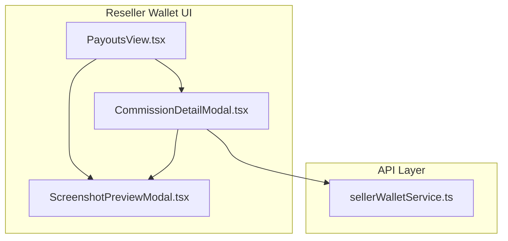
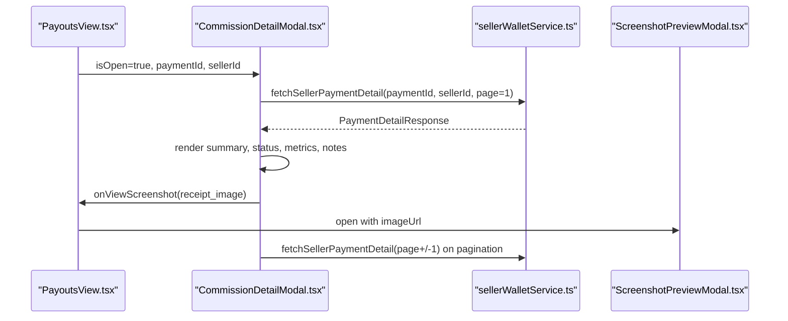
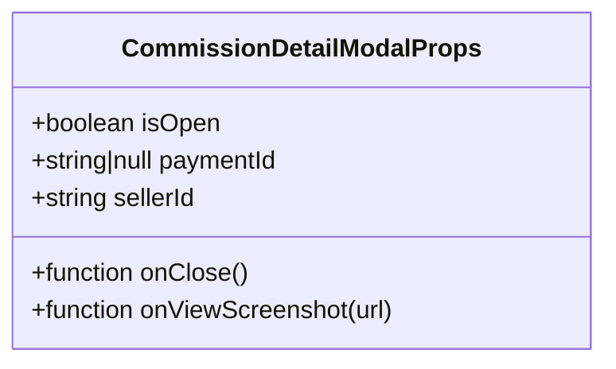
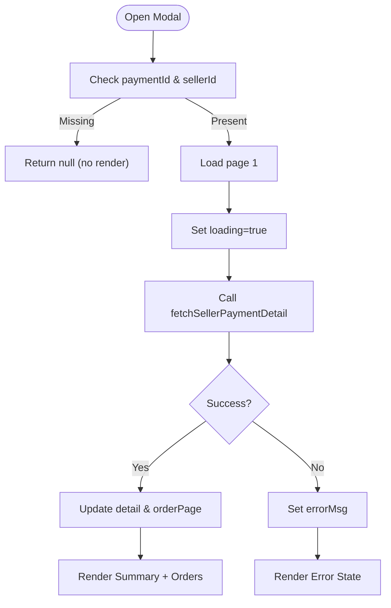
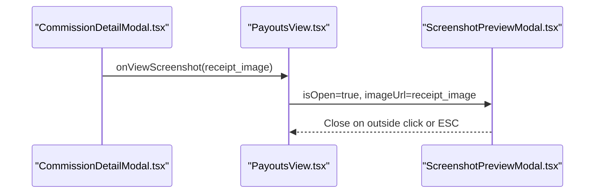
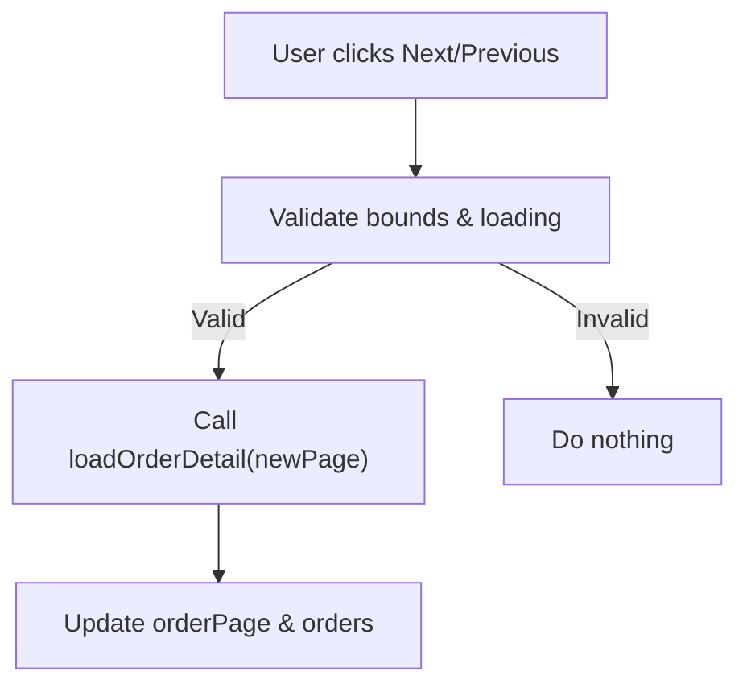
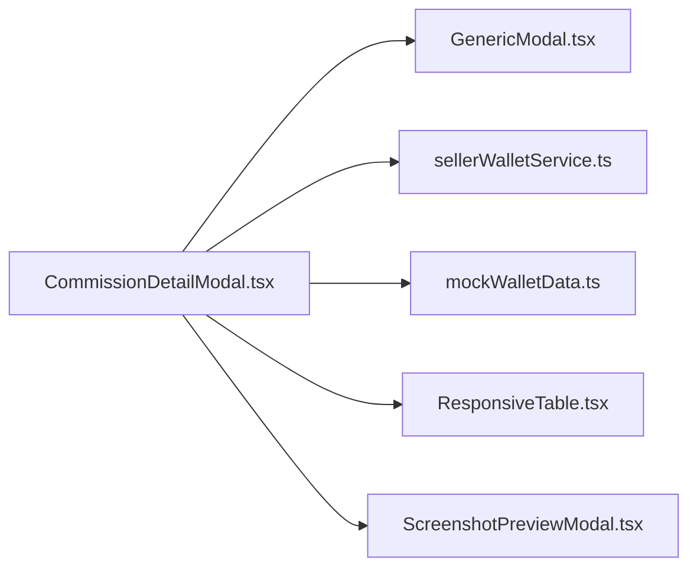

# Commission Detail Modal

<cite>
**Referenced Files in This Document**
- [CommissionDetailModal.tsx](file://components/reseller/components/wallet/CommissionDetailModal.tsx)
- [ScreenshotPreviewModal.tsx](file://components/reseller/components/wallet/ScreenshotPreviewModal.tsx)
- [PayoutsView.tsx](file://components/reseller/components/PayoutsView.tsx)
- [sellerWalletService.ts](file://src/api/sellerWalletService.ts)
- [mockWalletData.ts](file://components/reseller/data/mockWalletData.ts)
</cite>

## Table of Contents
1. [Introduction](#introduction)
2. [Project Structure](#project-structure)
3. [Core Components](#core-components)
4. [Architecture Overview](#architecture-overview)
5. [Detailed Component Analysis](#detailed-component-analysis)
6. [Dependency Analysis](#dependency-analysis)
7. [Performance Considerations](#performance-considerations)
8. [Troubleshooting Guide](#troubleshooting-guide)
9. [Conclusion](#conclusion)

## Introduction
The CommissionDetailModal component displays detailed information about an individual commission payment, including payment summary, verification status, timestamps, related orders, and associated screenshots. It is used inside the seller payouts workflow to inspect a specific payment record and navigate between paginated order items linked to that commission.

Key responsibilities:
- Fetch and display a single commission payment detail.
- Show verification status, gross/net amounts, commission percentage, notes, and receipt image preview.
- Render a paginated list of related marketplace order items.
- Integrate with ScreenshotPreviewModal for viewing full-size payment receipts.
- Handle loading, empty, and error states gracefully.

## Project Structure
The modal lives under the reseller wallet components and integrates with the broader PayoutsView page. Data comes from the seller wallet API service, which provides both RPC-based and relational fallback implementations.

**Diagram sources**
- [PayoutsView.tsx:331-343](file://components/reseller/components/PayoutsView.tsx#L331-L343)
- [CommissionDetailModal.tsx:1-7](file://components/reseller/components/wallet/CommissionDetailModal.tsx#L1-L7)
- [sellerWalletService.ts:532-659](file://src/api/sellerWalletService.ts#L532-L659)

**Section sources**
- [PayoutsView.tsx:1-349](file://components/reseller/components/PayoutsView.tsx#L1-L349)
- [CommissionDetailModal.tsx:1-329](file://components/reseller/components/wallet/CommissionDetailModal.tsx#L1-L329)
- [sellerWalletService.ts:1-702](file://src/api/sellerWalletService.ts#L1-L702)

## Core Components
- CommissionDetailModal: Displays commission details, status, metrics, notes, and paginated related orders. It also triggers screenshot preview via a callback prop.
- ScreenshotPreviewModal: Renders a full-resolution image with an external link option.
- PayoutsView: Orchestrates modals, manages active screenshot URL and active payment ID, and wires up data fetching for history and KPIs.
- sellerWalletService: Provides typed interfaces and functions for fetching wallet KPIs, commission history, and payment details, including inner order pagination.

**Section sources**
- [CommissionDetailModal.tsx:8-22](file://components/reseller/components/wallet/CommissionDetailModal.tsx#L8-L22)
- [ScreenshotPreviewModal.tsx:5-17](file://components/reseller/components/wallet/ScreenshotPreviewModal.tsx#L5-L17)
- [PayoutsView.tsx:331-343](file://components/reseller/components/PayoutsView.tsx#L331-L343)
- [sellerWalletService.ts:72-94](file://src/api/sellerWalletService.ts#L72-L94)

## Architecture Overview
The modal follows a lazy-loading pattern: it only fetches data when opened with a valid paymentId and sellerId. The parent view controls visibility and passes a screenshot viewer callback.

**Diagram sources**
- [PayoutsView.tsx:337-343](file://components/reseller/components/PayoutsView.tsx#L337-L343)
- [CommissionDetailModal.tsx:29-65](file://components/reseller/components/wallet/CommissionDetailModal.tsx#L29-L65)
- [sellerWalletService.ts:532-659](file://src/api/sellerWalletService.ts#L532-L659)

## Detailed Component Analysis

### CommissionDetailModal Props Interface
The component accepts:
- isOpen: boolean controlling visibility.
- onClose: function to close the modal.
- paymentId: string or null identifying the payment.
- sellerId: string identifying the seller.
- onViewScreenshot: optional callback to open the screenshot preview modal with a receipt image URL.

**Diagram sources**
- [CommissionDetailModal.tsx:8-14](file://components/reseller/components/wallet/CommissionDetailModal.tsx#L8-L14)

**Section sources**
- [CommissionDetailModal.tsx:8-22](file://components/reseller/components/wallet/CommissionDetailModal.tsx#L8-L22)

### Data Binding Patterns
- State variables:
  - detail: holds the fetched PaymentDetailResponse.
  - loading / loadingOrders: control initial load and pagination loading indicators.
  - orderPage: tracks current page for related orders.
  - errorMsg: captures user-facing errors.
- Derived values:
  - payment: extracted from detail.payment_summary.
  - cycle: extracted from detail.cycle_summary.
  - orders: array of related orders.
  - ordersPag: pagination metadata with safe defaults if missing.

Data binding flow:
- When isOpen becomes true and identifiers are present, the component calls the API to fetch detail.
- On success, it updates state and renders the summary and orders.
- On failure, it sets an error message and shows an error state.

**Section sources**
- [CommissionDetailModal.tsx:23-78](file://components/reseller/components/wallet/CommissionDetailModal.tsx#L23-L78)

### Interaction Flows

#### Opening and Loading Details

**Diagram sources**
- [CommissionDetailModal.tsx:29-65](file://components/reseller/components/wallet/CommissionDetailModal.tsx#L29-L65)

#### Viewing Receipt Image
- If a receipt image exists, the modal exposes a button to call onViewScreenshot with the image URL.
- The parent PayoutsView handles opening ScreenshotPreviewModal with the provided URL.

**Diagram sources**
- [CommissionDetailModal.tsx:233-243](file://components/reseller/components/wallet/CommissionDetailModal.tsx#L233-L243)
- [PayoutsView.tsx:331-343](file://components/reseller/components/PayoutsView.tsx#L331-L343)
- [ScreenshotPreviewModal.tsx:12-50](file://components/reseller/components/wallet/ScreenshotPreviewModal.tsx#L12-L50)

#### Paginating Related Orders
- The modal uses an internal pagination mechanism for related orders, defaulting to 5 per page.
- Previous/Next buttons update orderPage and trigger another API call.

**Diagram sources**
- [CommissionDetailModal.tsx:280-309](file://components/reseller/components/wallet/CommissionDetailModal.tsx#L280-L309)

### Status and Timestamps
- Verification status is mapped to visual badges with icons and labels:
  - Pending/Submitted: “Submitted for Verification”
  - Verified: “Verified & Confirmed”
  - Rejected: “Submission Rejected”
- Timestamps:
  - Submission date shown in subtitle and formatted date in header.
  - Cycle info includes month/year and status.

**Section sources**
- [CommissionDetailModal.tsx:80-105](file://components/reseller/components/wallet/CommissionDetailModal.tsx#L80-L105)
- [CommissionDetailModal.tsx:165-211](file://components/reseller/components/wallet/CommissionDetailModal.tsx#L165-L211)

### Metrics and Notes
- Key metrics include:
  - Gross Sales Sum
  - Commission Rate
  - Paid Amount (net_amount or commission_amount fallback)
  - Payment Proof link to view receipt image
- Optional verification notes are displayed with contextual styling based on status.

**Section sources**
- [CommissionDetailModal.tsx:213-256](file://components/reseller/components/wallet/CommissionDetailModal.tsx#L213-L256)

### Related Orders Display
- Columns:
  - Suit Image & Title: thumbnail and product title with fallback placeholder.
  - Brand: brand name with default fallback.
  - Sold Qty: quantity.
  - Price: formatted currency using format$.
  - Status: badge with color coding for Delivered/Shipped/Cancelled/Other.
- Empty state:
  - Shows “No Related Orders” with explanatory subtitle.

**Section sources**
- [CommissionDetailModal.tsx:109-163](file://components/reseller/components/wallet/CommissionDetailModal.tsx#L109-L163)
- [CommissionDetailModal.tsx:259-278](file://components/reseller/components/wallet/CommissionDetailModal.tsx#L259-L278)

### Example Commission Detail Structures
The API layer defines the expected response shape for the detail modal:

- PaymentSummary fields: id, gross_amount, commission_percentage, commission_amount, net_amount, status, receipt_image, notes, created_at, verified_at.
- CycleSummary fields: month, year, due_date, extended_date, status.
- Orders array: product_id, product_title, brand, quantity, price, status, thumbnail_url.
- OrdersPagination: total_orders, page, page_size, total_pages, has_more.

These structures are consumed by the modal to render the UI.

**Section sources**
- [sellerWalletService.ts:72-94](file://src/api/sellerWalletService.ts#L72-L94)

### Image Preview Functionality
- Placeholder image is used when thumbnails are missing or fail to load.
- Receipt images can be viewed via the parent’s ScreenshotPreviewModal through the onViewScreenshot callback.

**Section sources**
- [CommissionDetailModal.tsx:107-126](file://components/reseller/components/wallet/CommissionDetailModal.tsx#L107-L126)
- [CommissionDetailModal.tsx:233-243](file://components/reseller/components/wallet/CommissionDetailModal.tsx#L233-L243)
- [ScreenshotPreviewModal.tsx:12-50](file://components/reseller/components/wallet/ScreenshotPreviewModal.tsx#L12-L50)

### Accessibility Features
- Buttons use semantic HTML elements with type="button".
- Images include alt attributes for product titles and receipt screenshots.
- Pagination controls have descriptive titles for screen readers.
- Modal content is wrapped in a generic modal container that manages focus and backdrop behavior.

**Section sources**
- [CommissionDetailModal.tsx:288-306](file://components/reseller/components/wallet/CommissionDetailModal.tsx#L288-L306)
- [ScreenshotPreviewModal.tsx:37-48](file://components/reseller/components/wallet/ScreenshotPreviewModal.tsx#L37-L48)

### Responsive Design Considerations
- Grid layouts adapt from two columns on small screens to four on larger screens.
- Typography scales from text-xs to text-sm across breakpoints.
- Modal width is constrained with max-w-4xl for readability on large screens.
- Order table uses a responsive table component to handle mobile layouts.

**Section sources**
- [CommissionDetailModal.tsx:191-244](file://components/reseller/components/wallet/CommissionDetailModal.tsx#L191-L244)
- [CommissionDetailModal.tsx:165-172](file://components/reseller/components/wallet/CommissionDetailModal.tsx#L165-L172)

### Error Handling for Missing or Invalid Data
- If paymentId or sellerId are missing, the modal does not render.
- Network or API errors set an error message and show a user-friendly error state with a close button.
- Fallback defaults are applied for pagination metadata when server data is incomplete.
- Image onError handlers replace broken thumbnails with a placeholder.

**Section sources**
- [CommissionDetailModal.tsx:29-56](file://components/reseller/components/wallet/CommissionDetailModal.tsx#L29-L56)
- [CommissionDetailModal.tsx:180-189](file://components/reseller/components/wallet/CommissionDetailModal.tsx#L180-L189)
- [CommissionDetailModal.tsx:72-78](file://components/reseller/components/wallet/CommissionDetailModal.tsx#L72-L78)
- [CommissionDetailModal.tsx:116-126](file://components/reseller/components/wallet/CommissionDetailModal.tsx#L116-L126)

## Dependency Analysis
The modal depends on:
- GenericModal for base modal behavior.
- sellerWalletService.fetchSellerPaymentDetail for data retrieval.
- mockWalletData.format$ for consistent currency formatting.
- ResponsiveTable for rendering related orders.
- ScreenshotPreviewModal via parent integration for image previews.

**Diagram sources**
- [CommissionDetailModal.tsx:1-6](file://components/reseller/components/wallet/CommissionDetailModal.tsx#L1-L6)
- [PayoutsView.tsx:331-343](file://components/reseller/components/PayoutsView.tsx#L331-L343)

**Section sources**
- [CommissionDetailModal.tsx:1-6](file://components/reseller/components/wallet/CommissionDetailModal.tsx#L1-L6)
- [sellerWalletService.ts:532-659](file://src/api/sellerWalletService.ts#L532-L659)

## Performance Considerations
- Lazy loading: Data is fetched only when the modal opens with valid identifiers.
- Pagination: Related orders are loaded in batches of five to reduce payload size.
- Conditional loading flags: Separate loading states for initial load and pagination prevent UI confusion.
- Fallbacks: Safe defaults for pagination metadata ensure stable rendering even with incomplete server responses.

[No sources needed since this section provides general guidance]

## Troubleshooting Guide
Common issues and resolutions:
- Modal does not open: Ensure paymentId and sellerId are provided and non-null.
- Error message appears: Check network connectivity and API availability; verify that the paymentId belongs to the seller.
- Receipt image not visible: Confirm that receipt_image is present and accessible; verify parent’s ScreenshotPreviewModal integration.
- Orders not loading: Verify orders_pagination structure and that orderPage is within bounds.

**Section sources**
- [CommissionDetailModal.tsx:29-56](file://components/reseller/components/wallet/CommissionDetailModal.tsx#L29-L56)
- [CommissionDetailModal.tsx:180-189](file://components/reseller/components/wallet/CommissionDetailModal.tsx#L180-L189)
- [sellerWalletService.ts:532-659](file://src/api/sellerWalletService.ts#L532-L659)

## Conclusion
CommissionDetailModal provides a robust, accessible, and responsive interface for inspecting individual commission payments. It integrates cleanly with the seller payouts workflow, supports paginated related orders, and offers seamless screenshot preview functionality. Its error handling and fallback logic ensure a resilient user experience even when data is incomplete or unavailable.

[No sources needed since this section summarizes without analyzing specific files]