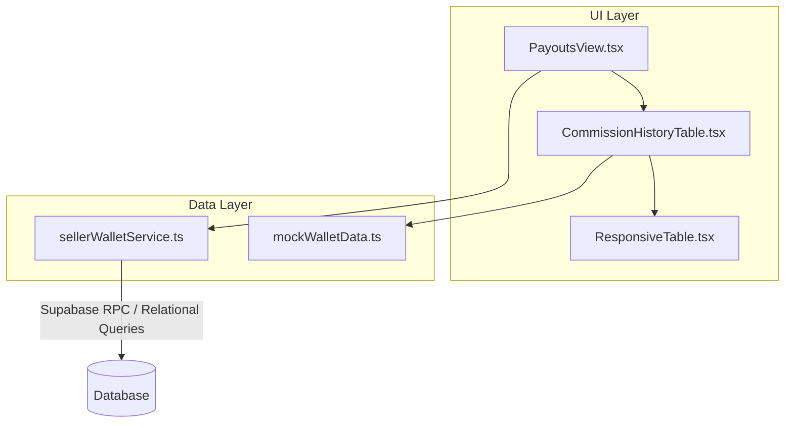
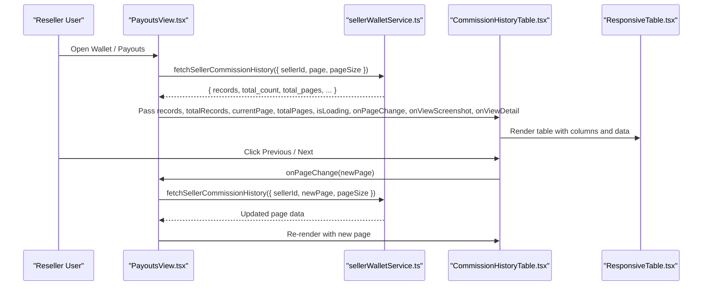
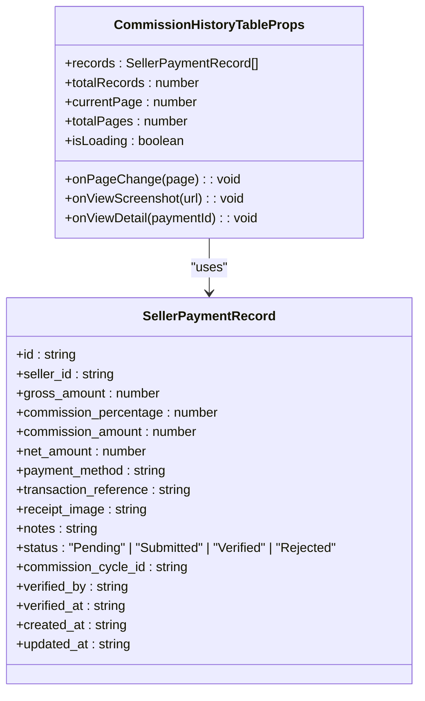
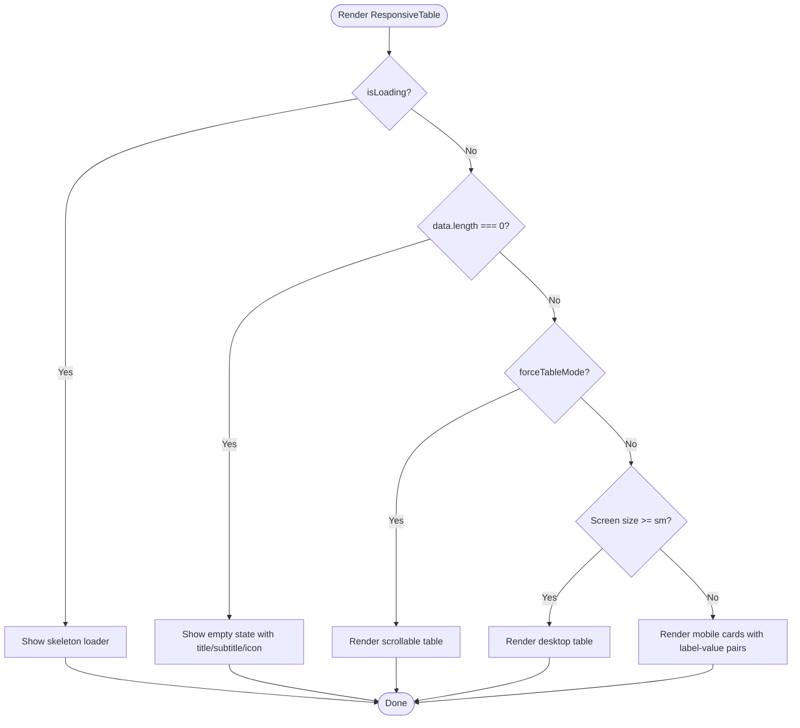
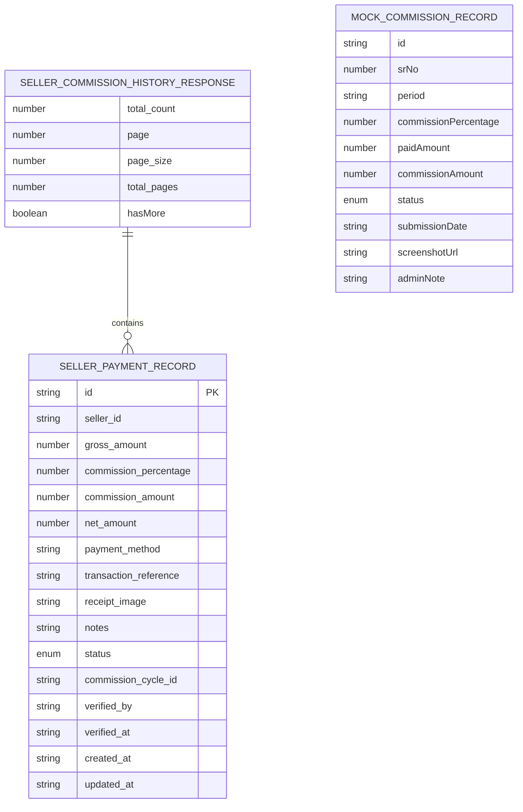
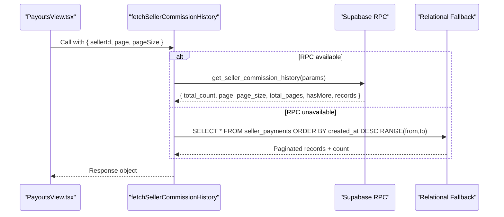
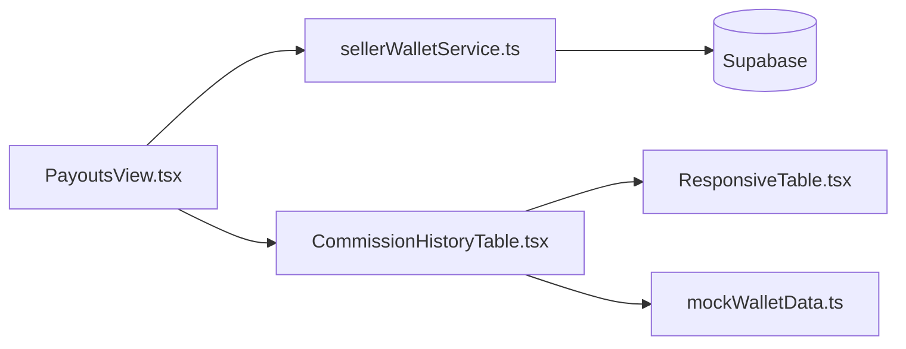

# Commission History Table

<cite>
**Referenced Files in This Document**
- [CommissionHistoryTable.tsx](file://components/reseller/components/wallet/CommissionHistoryTable.tsx)
- [ResponsiveTable.tsx](file://components/reseller/components/common/ResponsiveTable.tsx)
- [sellerWalletService.ts](file://src/api/sellerWalletService.ts)
- [mockWalletData.ts](file://components/reseller/data/mockWalletData.ts)
- [PayoutsView.tsx](file://components/reseller/components/PayoutsView.tsx)
</cite>

## Table of Contents
1. [Introduction](#introduction)
2. [Project Structure](#project-structure)
3. [Core Components](#core-components)
4. [Architecture Overview](#architecture-overview)
5. [Detailed Component Analysis](#detailed-component-analysis)
6. [Dependency Analysis](#dependency-analysis)
7. [Performance Considerations](#performance-considerations)
8. [Troubleshooting Guide](#troubleshooting-guide)
9. [Conclusion](#conclusion)

## Introduction
The Commission History Table component displays a paginated list of commission payment records for resellers. It renders key financial fields, status indicators, screenshot viewing, and detail navigation. The table is powered by the wallet service layer that fetches data from Supabase RPC functions or relational queries with pagination.

This documentation explains:
- How the table displays commission records
- Pagination behavior
- Status indicators
- Column definitions and rendering logic
- Integration with the wallet service
- Customization options via props and shared table utilities
- Responsive behavior
- Performance considerations for large datasets

## Project Structure
The commission history feature spans three main areas:
- UI component: `CommissionHistoryTable`
- Shared table renderer: `ResponsiveTable`
- Data layer: `sellerWalletService.ts`
- Mock data helpers used for formatting and example structures
- Parent view wiring state and fetching data: `PayoutsView.tsx`

**Diagram sources**
- [CommissionHistoryTable.tsx:1-209](file://components/reseller/components/wallet/CommissionHistoryTable.tsx#L1-L209)
- [ResponsiveTable.tsx:1-191](file://components/reseller/components/common/ResponsiveTable.tsx#L1-L191)
- [sellerWalletService.ts:458-526](file://src/api/sellerWalletService.ts#L458-L526)
- [mockWalletData.ts:22-34](file://components/reseller/data/mockWalletData.ts#L22-L34)
- [PayoutsView.tsx:66-81](file://components/reseller/components/PayoutsView.tsx#L66-L81)

**Section sources**
- [CommissionHistoryTable.tsx:1-209](file://components/reseller/components/wallet/CommissionHistoryTable.tsx#L1-L209)
- [ResponsiveTable.tsx:1-191](file://components/reseller/components/common/ResponsiveTable.tsx#L1-L191)
- [sellerWalletService.ts:458-526](file://src/api/sellerWalletService.ts#L458-L526)
- [mockWalletData.ts:22-34](file://components/reseller/data/mockWalletData.ts#L22-L34)
- [PayoutsView.tsx:66-81](file://components/reseller/components/PayoutsView.tsx#L66-L81)

## Core Components
- CommissionHistoryTable: Presents commission records with columns, status badges, actions, and pagination controls.
- ResponsiveTable: A generic table renderer supporting desktop tables and mobile card views, loading states, and empty states.
- sellerWalletService: Provides typed interfaces and functions to fetch commission history and related details.
- mockWalletData: Provides example data structures and currency formatting helper used by the table.
- PayoutsView: Orchestrates data fetching using TanStack Query and passes props to CommissionHistoryTable.

Key responsibilities:
- Rendering: Columns, status badges, date formatting, action buttons.
- State handling: Pagination props are controlled externally; the component emits page changes.
- Data integration: Uses SellerPaymentRecord type from the wallet service.
- Responsiveness: Delegates layout to ResponsiveTable with forceTableMode enabled.

**Section sources**
- [CommissionHistoryTable.tsx:7-16](file://components/reseller/components/wallet/CommissionHistoryTable.tsx#L7-L16)
- [CommissionHistoryTable.tsx:71-150](file://components/reseller/components/wallet/CommissionHistoryTable.tsx#L71-L150)
- [ResponsiveTable.tsx:4-24](file://components/reseller/components/common/ResponsiveTable.tsx#L4-L24)
- [sellerWalletService.ts:26-52](file://src/api/sellerWalletService.ts#L26-L52)
- [mockWalletData.ts:22-34](file://components/reseller/data/mockWalletData.ts#L22-L34)
- [PayoutsView.tsx:66-81](file://components/reseller/components/PayoutsView.tsx#L66-L81)

## Architecture Overview
The commission history flow connects the parent view, the table component, and the data service.

**Diagram sources**
- [PayoutsView.tsx:66-81](file://components/reseller/components/PayoutsView.tsx#L66-L81)
- [sellerWalletService.ts:458-526](file://src/api/sellerWalletService.ts#L458-L526)
- [CommissionHistoryTable.tsx:152-209](file://components/reseller/components/wallet/CommissionHistoryTable.tsx#L152-L209)
- [ResponsiveTable.tsx:26-103](file://components/reseller/components/common/ResponsiveTable.tsx#L26-L103)

## Detailed Component Analysis

### CommissionHistoryTable Component
Responsibilities:
- Define column definitions for sales, commission percentage, paid amount, commission amount, status, image, action, and date.
- Render status badges with distinct colors and icons for Submitted/Pending, Verified, and Rejected.
- Format dates safely and display “N/A” when missing.
- Provide “View Screenshot” and “View Details” actions.
- Render pagination controls for previous and next pages.

Column definitions:
- Sr #: Computed index based on current page and row index.
- Sales: Gross amount formatted with currency helper.
- Commission %: Percentage value with fallback default.
- Paid Amount: Net amount or computed net if not provided.
- Commission Amount: Platform fee displayed prominently.
- Status: Badge with icon and color per status.
- Image: Button to open screenshot modal.
- Action: Eye button to open detail modal.
- Date: Formatted created_at timestamp.

Status mapping:
- Submitted or Pending: Amber badge with clock icon.
- Verified: Emerald badge with check icon.
- Rejected: Red badge with X icon.

Pagination:
- Controlled externally via props.
- Disables buttons when at first/last page or while loading.
- Displays current page and total pages.

Integration points:
- Uses SellerPaymentRecord type from wallet service.
- Uses format$ helper from mock data for currency formatting.
- Delegates rendering to ResponsiveTable with forceTableMode enabled.

Customization options:
- Props allow passing records, totals, pagination state, loading state, and callbacks for screenshot and detail views.
- Column rendering can be extended by modifying the columns array.

Responsive behavior:
- Uses ResponsiveTable which supports both table and mobile card layouts.
- forceTableMode ensures consistent table presentation across breakpoints.

Error handling:
- Safe date parsing with fallback to raw string.
- Empty state handled by ResponsiveTable with custom title and subtitle.

**Diagram sources**
- [CommissionHistoryTable.tsx:7-16](file://components/reseller/components/wallet/CommissionHistoryTable.tsx#L7-L16)
- [sellerWalletService.ts:26-43](file://src/api/sellerWalletService.ts#L26-L43)

**Section sources**
- [CommissionHistoryTable.tsx:28-69](file://components/reseller/components/wallet/CommissionHistoryTable.tsx#L28-L69)
- [CommissionHistoryTable.tsx:71-150](file://components/reseller/components/wallet/CommissionHistoryTable.tsx#L71-L150)
- [CommissionHistoryTable.tsx:152-209](file://components/reseller/components/wallet/CommissionHistoryTable.tsx#L152-L209)

### ResponsiveTable Component
Responsibilities:
- Render loading skeleton when isLoading is true.
- Render empty state with customizable title, subtitle, and optional icon.
- Support two modes:
  - Desktop/tablet: horizontal table with headers and rows.
  - Mobile: stacked cards with label-value pairs per column.
- Allow custom mobile card header/footer.
- Force table mode to always render a table regardless of breakpoint.

Key behaviors:
- When forceTableMode is true, it renders a scrollable table with min-width constraints.
- On mobile without forceTableMode, each column is rendered as a labeled row within a card.

Customization options:
- columns: Array of ColumnDef objects defining headers, cell renderers, and styling.
- data: Array of items to render.
- keyExtractor: Unique identifier generator for rows.
- emptyTitle/emptySubtitle: Customize empty state messaging.
- mobileCardHeader/mobileCardFooter: Inject custom content into mobile cards.

**Diagram sources**
- [ResponsiveTable.tsx:26-103](file://components/reseller/components/common/ResponsiveTable.tsx#L26-L103)
- [ResponsiveTable.tsx:105-191](file://components/reseller/components/common/ResponsiveTable.tsx#L105-L191)

**Section sources**
- [ResponsiveTable.tsx:4-24](file://components/reseller/components/common/ResponsiveTable.tsx#L4-L24)
- [ResponsiveTable.tsx:26-103](file://components/reseller/components/common/ResponsiveTable.tsx#L26-L103)
- [ResponsiveTable.tsx:105-191](file://components/reseller/components/common/ResponsiveTable.tsx#L105-L191)

### Data Model and Types
Primary data model for commission records:
- SellerPaymentRecord defines all fields required by the table, including identifiers, amounts, status, timestamps, and references to cycles and verification metadata.

Response wrapper:
- SellerCommissionHistoryResponse includes pagination metadata and an array of SellerPaymentRecord entries.

Example mock structure:
- mockWalletData.ts provides a simplified CommissionRecord interface for demonstration purposes, including period, percentages, amounts, statuses, submission date, screenshot URL, admin notes, and related orders.

Currency formatting:
- format$ helper formats numbers consistently across components.

**Diagram sources**
- [sellerWalletService.ts:26-52](file://src/api/sellerWalletService.ts#L26-L52)
- [mockWalletData.ts:22-34](file://components/reseller/data/mockWalletData.ts#L22-L34)

**Section sources**
- [sellerWalletService.ts:26-52](file://src/api/sellerWalletService.ts#L26-L52)
- [mockWalletData.ts:22-34](file://components/reseller/data/mockWalletData.ts#L22-L34)
- [mockWalletData.ts:323-325](file://components/reseller/data/mockWalletData.ts#L323-L325)

### Integration with Wallet Service
Fetching commission history:
- PayoutsView uses TanStack Query to call fetchSellerCommissionHistory with sellerId, page, and pageSize.
- The service attempts an RPC function first; if unavailable, it falls back to relational queries with pagination.
- Returns records and pagination metadata consumed by CommissionHistoryTable.

Detail and screenshot flows:
- onViewScreenshot triggers a modal to preview the receipt image URL stored in SellerPaymentRecord.receipt_image.
- onViewDetail opens a detail modal showing payment summary, cycle info, and related orders (handled elsewhere).

**Diagram sources**
- [PayoutsView.tsx:66-81](file://components/reseller/components/PayoutsView.tsx#L66-L81)
- [sellerWalletService.ts:458-526](file://src/api/sellerWalletService.ts#L458-L526)

**Section sources**
- [PayoutsView.tsx:66-81](file://components/reseller/components/PayoutsView.tsx#L66-L81)
- [sellerWalletService.ts:458-526](file://src/api/sellerWalletService.ts#L458-L526)

### Filtering and Search Functionality
Current implementation:
- No built-in filtering or search functionality is present in CommissionHistoryTable.
- Filtering/search would require additional state and either client-side filtering of records or server-side query parameters.

Recommendations:
- Add a search input that filters by sales amount, status, or date range on the client side for small datasets.
- For larger datasets, extend fetchSellerCommissionHistory to accept filter parameters and implement server-side filtering.

[No sources needed since this section provides general guidance]

### Sorting Options
Current implementation:
- No sorting controls are implemented in CommissionHistoryTable.
- Default ordering is applied by the data service (created_at descending).

Recommendations:
- Add sortable column headers for numeric fields like gross_amount, commission_amount, and net_amount.
- Persist sort state and pass sort parameters to the data service for server-side sorting.

[No sources needed since this section provides general guidance]

### Status Indicators
Status types supported:
- Submitted or Pending: Amber badge with clock icon.
- Verified: Emerald badge with check icon.
- Rejected: Red badge with X icon.

Rendering logic:
- Status is mapped to a styled badge with appropriate icon and text.
- Unknown statuses return null.

**Section sources**
- [CommissionHistoryTable.tsx:28-55](file://components/reseller/components/wallet/CommissionHistoryTable.tsx#L28-L55)

### Examples of Commission Data Structures
Mock example structure:
- CommissionRecord includes fields such as id, period, commissionPercentage, paidAmount, commissionAmount, status, submissionDate, screenshotUrl, adminNote, and related orders.

Real data structure:
- SellerPaymentRecord includes comprehensive fields for payments, including identifiers, amounts, method, reference, receipt image, notes, status, cycle association, verification metadata, and timestamps.

Currency formatting:
- format$ formats values consistently for display.

**Section sources**
- [mockWalletData.ts:22-34](file://components/reseller/data/mockWalletData.ts#L22-L34)
- [sellerWalletService.ts:26-43](file://src/api/sellerWalletService.ts#L26-L43)
- [mockWalletData.ts:323-325](file://components/reseller/data/mockWalletData.ts#L323-L325)

### Customization Options
Component props:
- records: Array of SellerPaymentRecord to display.
- totalRecords: Total number of submissions for header summary.
- currentPage/currentPages: Pagination state.
- isLoading: Loading indicator passed to ResponsiveTable.
- onPageChange: Callback to update page state.
- onViewScreenshot/onViewDetail: Callbacks for user actions.

Table customization:
- Modify columns array to add/remove fields or change rendering.
- Use ResponsiveTable’s mobileCardHeader/mobileCardFooter for mobile-specific content.
- Toggle forceTableMode to switch between responsive card layout and forced table layout.

**Section sources**
- [CommissionHistoryTable.tsx:7-16](file://components/reseller/components/wallet/CommissionHistoryTable.tsx#L7-L16)
- [CommissionHistoryTable.tsx:168-176](file://components/reseller/components/wallet/CommissionHistoryTable.tsx#L168-L176)
- [ResponsiveTable.tsx:13-24](file://components/reseller/components/common/ResponsiveTable.tsx#L13-L24)

### Responsive Behavior
Behavior:
- With forceTableMode enabled, the table renders as a horizontal table across all screen sizes.
- Without forceTableMode, ResponsiveTable switches to mobile cards below the sm breakpoint.

Accessibility:
- Buttons include titles for screen readers.
- Status badges use semantic icons and contrasting colors.

**Section sources**
- [CommissionHistoryTable.tsx:168-176](file://components/reseller/components/wallet/CommissionHistoryTable.tsx#L168-L176)
- [ResponsiveTable.tsx:67-103](file://components/reseller/components/common/ResponsiveTable.tsx#L67-L103)
- [ResponsiveTable.tsx:142-191](file://components/reseller/components/common/ResponsiveTable.tsx#L142-L191)

### Performance Considerations
- Pagination: Default page size is 5 records per page, reducing payload size and improving initial load time.
- Server-side ordering: Records are ordered by created_at descending to ensure newest submissions appear first.
- RPC vs fallback: RPC calls are attempted first for performance; relational fallback ensures resilience.
- Client-side rendering: ResponsiveTable avoids unnecessary re-renders by leveraging React keys and minimal DOM updates.
- Large datasets: Consider adding server-side filtering and sorting to avoid heavy client-side processing.

**Section sources**
- [sellerWalletService.ts:458-526](file://src/api/sellerWalletService.ts#L458-L526)
- [ResponsiveTable.tsx:26-103](file://components/reseller/components/common/ResponsiveTable.tsx#L26-L103)

## Dependency Analysis
Relationships:
- CommissionHistoryTable depends on:
  - SellerPaymentRecord type from sellerWalletService.
  - format$ helper from mockWalletData.
  - ResponsiveTable for rendering.
- PayoutsView depends on:
  - fetchSellerCommissionHistory from sellerWalletService.
  - CommissionHistoryTable for displaying results.

**Diagram sources**
- [PayoutsView.tsx:66-81](file://components/reseller/components/PayoutsView.tsx#L66-L81)
- [CommissionHistoryTable.tsx:1-5](file://components/reseller/components/wallet/CommissionHistoryTable.tsx#L1-L5)
- [ResponsiveTable.tsx:1-4](file://components/reseller/components/common/ResponsiveTable.tsx#L1-L4)
- [sellerWalletService.ts:458-526](file://src/api/sellerWalletService.ts#L458-L526)

**Section sources**
- [PayoutsView.tsx:66-81](file://components/reseller/components/PayoutsView.tsx#L66-L81)
- [CommissionHistoryTable.tsx:1-5](file://components/reseller/components/wallet/CommissionHistoryTable.tsx#L1-L5)
- [ResponsiveTable.tsx:1-4](file://components/reseller/components/common/ResponsiveTable.tsx#L1-L4)
- [sellerWalletService.ts:458-526](file://src/api/sellerWalletService.ts#L458-L526)

## Performance Considerations
- Prefer RPC endpoints where available to reduce client-side computation and network overhead.
- Keep page size small (e.g., 5) to balance usability and performance.
- Avoid client-side filtering on large arrays; move filtering to the server when possible.
- Use stable keys (record.id) to optimize reconciliation in React lists.
- Debounce any future search inputs to minimize re-renders and API calls.

[No sources needed since this section provides general guidance]

## Troubleshooting Guide
Common issues and resolutions:
- Empty table:
  - Ensure sellerId is valid and enabled in the query.
  - Verify that fetchSellerCommissionHistory returns non-empty records.
  - Check ResponsiveTable’s emptyTitle and emptySubtitle for helpful messaging.
- Incorrect pagination:
  - Confirm currentPage and totalPages are correctly passed to CommissionHistoryTable.
  - Validate onPageChange updates state and triggers refetch.
- Status not rendering:
  - Ensure SellerPaymentRecord.status matches expected values.
  - Review renderStatusBadge mapping for unknown statuses.
- Date shows raw string:
  - Check created_at format; handle invalid dates gracefully.
- Screenshot not visible:
  - Verify receipt_image URL is accessible and not expired.
- Detail modal not opening:
  - Ensure onViewDetail callback is wired and receives a valid paymentId.

**Section sources**
- [CommissionHistoryTable.tsx:28-69](file://components/reseller/components/wallet/CommissionHistoryTable.tsx#L28-L69)
- [CommissionHistoryTable.tsx:118-149](file://components/reseller/components/wallet/CommissionHistoryTable.tsx#L118-L149)
- [ResponsiveTable.tsx:51-65](file://components/reseller/components/common/ResponsiveTable.tsx#L51-L65)

## Conclusion
The Commission History Table component provides a clear, responsive, and paginated view of commission payment records. It integrates tightly with the wallet service for reliable data fetching and offers actionable UI elements for reviewing screenshots and detailed order information. While filtering and sorting are not currently implemented, the component’s design allows straightforward extension. For large datasets, server-side filtering and sorting are recommended to maintain performance and usability.

[No sources needed since this section summarizes without analyzing specific files]