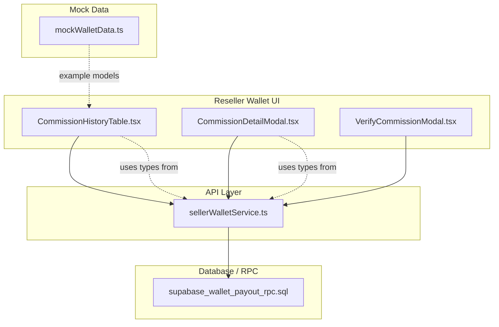
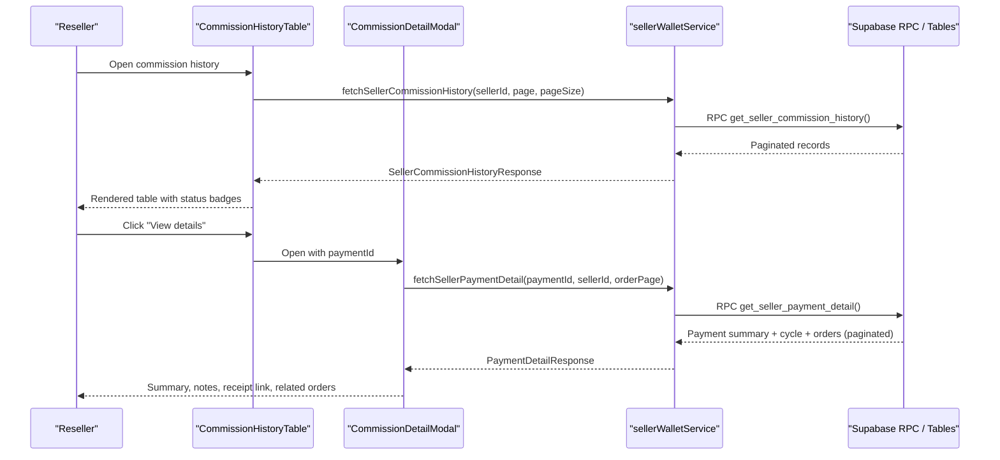
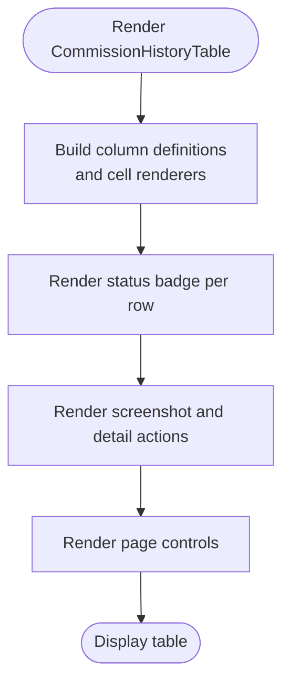
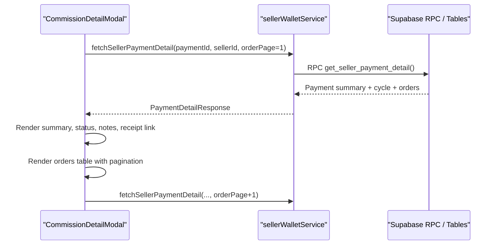
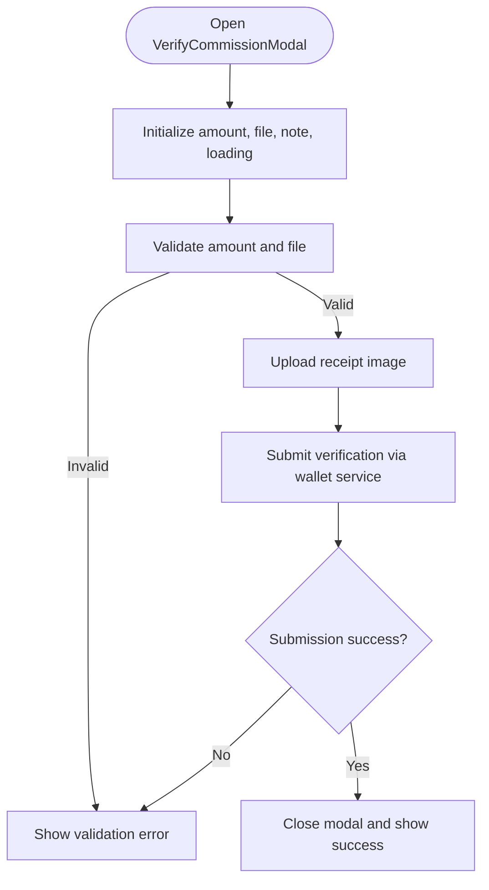
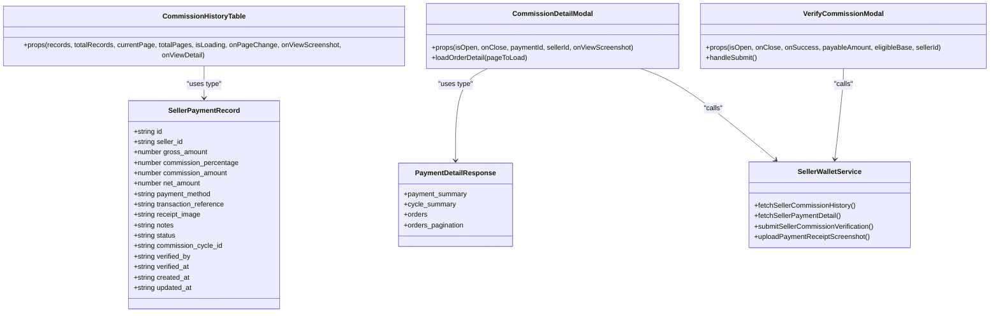

# Commission Tracking

<cite>
**Referenced Files in This Document**
- [CommissionHistoryTable.tsx](file://components/reseller/components/wallet/CommissionHistoryTable.tsx)
- [CommissionDetailModal.tsx](file://components/reseller/components/wallet/CommissionDetailModal.tsx)
- [VerifyCommissionModal.tsx](file://components/reseller/components/wallet/VerifyCommissionModal.tsx)
- [sellerWalletService.ts](file://src/api/sellerWalletService.ts)
- [mockWalletData.ts](file://components/reseller/data/mockWalletData.ts)
- [supabase_wallet_payout_rpc.sql](file://supabase_wallet_payout_rpc.sql)
</cite>

## Table of Contents
1. [Introduction](#introduction)
2. [Project Structure](#project-structure)
3. [Core Components](#core-components)
4. [Architecture Overview](#architecture-overview)
5. [Detailed Component Analysis](#detailed-component-analysis)
6. [Dependency Analysis](#dependency-analysis)
7. [Performance Considerations](#performance-considerations)
8. [Troubleshooting Guide](#troubleshooting-guide)
9. [Conclusion](#conclusion)

## Introduction
This document explains the commission tracking system used by resellers to submit, view, and audit platform commission payments. It focuses on:
- The `CommissionHistoryTable` component for paginated commission records, status badges, screenshot previews, and detail navigation.
- The `CommissionDetailModal` for viewing a single payment’s summary, cycle context, verification notes, receipt image, and related orders with inner pagination.
- The commission data model, including statuses such as Pending, Submitted, Verified, and Rejected.
- The integration with the wallet service layer that communicates with Supabase RPCs or relational queries.
- Example record structures, table customization options, and modal interaction patterns.

## Project Structure
The commission tracking feature is implemented under the reseller wallet area:
- UI components live under `components/reseller/components/wallet`.
- Data access and API contracts are defined in `src/api/sellerWalletService.ts`.
- Mock data and example structures are provided in `components/reseller/data/mockWalletData.ts`.
- Database-level behavior and RPC fallback logic are reflected in `supabase_wallet_payout_rpc.sql`.

**Diagram sources**
- [CommissionHistoryTable.tsx:1-210](file://components/reseller/components/wallet/CommissionHistoryTable.tsx#L1-L210)
- [CommissionDetailModal.tsx:1-329](file://components/reseller/components/wallet/CommissionDetailModal.tsx#L1-L329)
- [VerifyCommissionModal.tsx:1-326](file://components/reseller/components/wallet/VerifyCommissionModal.tsx#L1-L326)
- [sellerWalletService.ts:1-702](file://src/api/sellerWalletService.ts#L1-L702)
- [mockWalletData.ts:1-326](file://components/reseller/data/mockWalletData.ts#L1-L326)
- [supabase_wallet_payout_rpc.sql:203-238](file://supabase_wallet_payout_rpc.sql#L203-L238)

**Section sources**
- [CommissionHistoryTable.tsx:1-210](file://components/reseller/components/wallet/CommissionHistoryTable.tsx#L1-L210)
- [CommissionDetailModal.tsx:1-329](file://components/reseller/components/wallet/CommissionDetailModal.tsx#L1-L329)
- [VerifyCommissionModal.tsx:1-326](file://components/reseller/components/wallet/VerifyCommissionModal.tsx#L1-L326)
- [sellerWalletService.ts:1-702](file://src/api/sellerWalletService.ts#L1-L702)
- [mockWalletData.ts:1-326](file://components/reseller/data/mockWalletData.ts#L1-L326)
- [supabase_wallet_payout_rpc.sql:203-238](file://supabase_wallet_payout_rpc.sql#L203-L238)

## Core Components
- `CommissionHistoryTable`: Displays paginated commission submissions with columns for sales, commission percentage, paid amount, commission amount, status badge, screenshot preview, detail action, and date. It integrates with `ResponsiveTable` and exposes page navigation callbacks.
- `CommissionDetailModal`: Loads a specific payment detail via the wallet service, shows payment summary, cycle info, verification notes, receipt image link, and an inner-paginated list of related orders.
- `VerifyCommissionModal`: Allows sellers to enter a paid amount, upload a receipt screenshot, add optional notes, and submit verification through the wallet service.

Key responsibilities:
- Rendering and formatting commission records.
- Handling pagination at both table and modal levels.
- Integrating with the wallet service for fetching and submitting data.
- Providing user feedback for loading, errors, and success states.

**Section sources**
- [CommissionHistoryTable.tsx:7-16](file://components/reseller/components/wallet/CommissionHistoryTable.tsx#L7-L16)
- [CommissionHistoryTable.tsx:71-150](file://components/reseller/components/wallet/CommissionHistoryTable.tsx#L71-L150)
- [CommissionDetailModal.tsx:8-14](file://components/reseller/components/wallet/CommissionDetailModal.tsx#L8-L14)
- [CommissionDetailModal.tsx:29-65](file://components/reseller/components/wallet/CommissionDetailModal.tsx#L29-L65)
- [VerifyCommissionModal.tsx:6-13](file://components/reseller/components/wallet/VerifyCommissionModal.tsx#L6-L13)

## Architecture Overview
The commission tracking flow connects UI components to a wallet service layer that interacts with Supabase RPCs or relational queries.

**Diagram sources**
- [CommissionHistoryTable.tsx:118-143](file://components/reseller/components/wallet/CommissionHistoryTable.tsx#L118-L143)
- [CommissionDetailModal.tsx:29-65](file://components/reseller/components/wallet/CommissionDetailModal.tsx#L29-L65)
- [sellerWalletService.ts:458-526](file://src/api/sellerWalletService.ts#L458-L526)
- [sellerWalletService.ts:532-659](file://src/api/sellerWalletService.ts#L532-L659)

## Detailed Component Analysis

### CommissionHistoryTable
Purpose:
- Display a paginated list of commission submission records.
- Show status indicators using color-coded badges.
- Provide actions to view screenshots and open the detail modal.

Key behaviors:
- Status rendering maps values like Submitted/Pending, Verified, and Rejected to distinct badges.
- Date formatting handles invalid dates gracefully.
- Columns include serial number, sales, commission percentage, paid amount, commission amount, status, screenshot button, detail button, and date.
- Pagination controls call `onPageChange` and disable buttons when appropriate.

Customization options:
- Column definitions can be extended or reordered by modifying the `columns` array.
- Empty state text can be customized via props passed to `ResponsiveTable`.
- Page size and total pages are controlled by parent state; this component renders based on `currentPage`, `totalPages`, and `records`.

Example usage pattern:
- Parent provides `records`, `totalRecords`, `currentPage`, `totalPages`, `isLoading`, `onPageChange`, `onViewScreenshot`, and `onViewDetail`.

**Diagram sources**
- [CommissionHistoryTable.tsx:28-55](file://components/reseller/components/wallet/CommissionHistoryTable.tsx#L28-L55)
- [CommissionHistoryTable.tsx:71-150](file://components/reseller/components/wallet/CommissionHistoryTable.tsx#L71-L150)
- [CommissionHistoryTable.tsx:178-206](file://components/reseller/components/wallet/CommissionHistoryTable.tsx#L178-L206)

**Section sources**
- [CommissionHistoryTable.tsx:7-16](file://components/reseller/components/wallet/CommissionHistoryTable.tsx#L7-L16)
- [CommissionHistoryTable.tsx:28-55](file://components/reseller/components/wallet/CommissionHistoryTable.tsx#L28-L55)
- [CommissionHistoryTable.tsx:71-150](file://components/reseller/components/wallet/CommissionHistoryTable.tsx#L71-L150)
- [CommissionHistoryTable.tsx:152-209](file://components/reseller/components/wallet/CommissionHistoryTable.tsx#L152-L209)

### CommissionDetailModal
Purpose:
- Show detailed information for a selected commission payment.
- Display payment summary, cycle context, verification notes, and receipt image link.
- List related orders with inner pagination.

Key behaviors:
- Fetches detail data via `fetchSellerPaymentDetail` when opened.
- Handles loading and error states.
- Renders a status badge with label mapping for Pending, Submitted, Verified, and Rejected.
- Provides a “View Receipt Image” button that calls `onViewScreenshot`.
- Shows related orders in a table with pagination controls.

Interaction patterns:
- Controlled by `isOpen`, `paymentId`, and `sellerId`.
- Uses `GenericModal` for layout and close behavior.
- Inner pagination triggers re-fetch with updated `orderPage`.

**Diagram sources**
- [CommissionDetailModal.tsx:29-65](file://components/reseller/components/wallet/CommissionDetailModal.tsx#L29-L65)
- [CommissionDetailModal.tsx:80-105](file://components/reseller/components/wallet/CommissionDetailModal.tsx#L80-L105)
- [CommissionDetailModal.tsx:165-324](file://components/reseller/components/wallet/CommissionDetailModal.tsx#L165-L324)
- [sellerWalletService.ts:532-659](file://src/api/sellerWalletService.ts#L532-L659)

**Section sources**
- [CommissionDetailModal.tsx:8-14](file://components/reseller/components/wallet/CommissionDetailModal.tsx#L8-L14)
- [CommissionDetailModal.tsx:29-65](file://components/reseller/components/wallet/CommissionDetailModal.tsx#L29-L65)
- [CommissionDetailModal.tsx:80-105](file://components/reseller/components/wallet/CommissionDetailModal.tsx#L80-L105)
- [CommissionDetailModal.tsx:165-324](file://components/reseller/components/wallet/CommissionDetailModal.tsx#L165-L324)

### VerifyCommissionModal
Purpose:
- Allow sellers to submit a commission payment verification.
- Validate amount, file type, and file size.
- Upload receipt image and submit verification request.

Key behaviors:
- Pre-fills payable amount if available.
- Validates numeric input and ensures amount meets payable threshold.
- Accepts JPG, PNG, WEBP images up to 5MB.
- Calls `uploadPaymentReceiptScreenshot` then `submitSellerCommissionVerification`.
- Shows success message via `onSuccess` and resets form state.

**Diagram sources**
- [VerifyCommissionModal.tsx:31-40](file://components/reseller/components/wallet/VerifyCommissionModal.tsx#L31-L40)
- [VerifyCommissionModal.tsx:72-92](file://components/reseller/components/wallet/VerifyCommissionModal.tsx#L72-L92)
- [VerifyCommissionModal.tsx:105-158](file://components/reseller/components/wallet/VerifyCommissionModal.tsx#L105-L158)
- [sellerWalletService.ts:282-309](file://src/api/sellerWalletService.ts#L282-L309)
- [sellerWalletService.ts:315-452](file://src/api/sellerWalletService.ts#L315-L452)

**Section sources**
- [VerifyCommissionModal.tsx:6-13](file://components/reseller/components/wallet/VerifyCommissionModal.tsx#L6-L13)
- [VerifyCommissionModal.tsx:31-40](file://components/reseller/components/wallet/VerifyCommissionModal.tsx#L31-L40)
- [VerifyCommissionModal.tsx:72-92](file://components/reseller/components/wallet/VerifyCommissionModal.tsx#L72-L92)
- [VerifyCommissionModal.tsx:105-158](file://components/reseller/components/wallet/VerifyCommissionModal.tsx#L105-L158)

## Dependency Analysis
Component-to-service relationships:
- `CommissionHistoryTable` depends on `SellerPaymentRecord` type and formats currency using mock helper utilities.
- `CommissionDetailModal` depends on `PaymentDetailResponse` and calls `fetchSellerPaymentDetail`.
- `VerifyCommissionModal` depends on `uploadPaymentReceiptScreenshot` and `submitSellerCommissionVerification`.

Service-layer responsibilities:
- Defines all TypeScript interfaces for wallet KPIs, payment records, cycles, and responses.
- Implements RPC-first strategy with relational query fallbacks.
- Provides functions for KPIs, history, detail, submission, and payable amount calculation.

**Diagram sources**
- [sellerWalletService.ts:26-94](file://src/api/sellerWalletService.ts#L26-L94)
- [CommissionHistoryTable.tsx:7-16](file://components/reseller/components/wallet/CommissionHistoryTable.tsx#L7-L16)
- [CommissionDetailModal.tsx:8-14](file://components/reseller/components/wallet/CommissionDetailModal.tsx#L8-L14)
- [VerifyCommissionModal.tsx:6-13](file://components/reseller/components/wallet/VerifyCommissionModal.tsx#L6-L13)

**Section sources**
- [sellerWalletService.ts:26-94](file://src/api/sellerWalletService.ts#L26-L94)
- [sellerWalletService.ts:458-526](file://src/api/sellerWalletService.ts#L458-L526)
- [sellerWalletService.ts:532-659](file://src/api/sellerWalletService.ts#L532-L659)
- [sellerWalletService.ts:315-452](file://src/api/sellerWalletService.ts#L315-L452)

## Performance Considerations
- RPC-first approach: The wallet service attempts Supabase RPCs first for performance and consistency, falling back to relational queries when RPCs are unavailable.
- Pagination: Both commission history and detail modal orders use pagination to limit payload sizes and improve responsiveness.
- Lazy loading: Detail modal loads only when a user clicks into a specific payment, avoiding unnecessary network requests.
- Image handling: Receipt images are uploaded to storage with public URL retrieval; object URL fallbacks ensure resilience during failures.

Recommendations:
- Keep page sizes small (e.g., 5 items) for faster initial renders.
- Debounce rapid pagination clicks to avoid redundant requests.
- Cache recent payment details locally while navigating within the modal to reduce repeated fetches.

[No sources needed since this section provides general guidance]

## Troubleshooting Guide
Common issues and resolutions:
- Missing or invalid sellerId/paymentId:
  - Ensure IDs are valid UUIDs before calling RPCs; the service validates IDs and falls back to relational queries otherwise.
- Storage upload failures:
  - If storage upload fails, the service returns an object URL fallback; verify bucket permissions and CORS settings.
- Amount validation errors:
  - The verification modal enforces numeric-only input and minimum payable amount checks; ensure users enter exact amounts.
- Empty commission history:
  - If no records exist, the table displays an empty state; guide users to submit their first commission verification.
- Detail modal load errors:
  - On failure, the modal shows an error message and a close button; retry after confirming network connectivity and correct IDs.

Operational tips:
- Use console logs in the service layer to trace RPC vs fallback paths.
- Validate Supabase RLS policies for `seller_payments`, `seller_commission_monthly_cycles`, and storage buckets.
- Confirm that RPC functions like `get_seller_commission_history`, `get_seller_payment_detail`, and `submit_seller_commission_verification` are deployed.

**Section sources**
- [sellerWalletService.ts:96-98](file://src/api/sellerWalletService.ts#L96-L98)
- [sellerWalletService.ts:282-309](file://src/api/sellerWalletService.ts#L282-L309)
- [VerifyCommissionModal.tsx:42-67](file://components/reseller/components/wallet/VerifyCommissionModal.tsx#L42-L67)
- [VerifyCommissionModal.tsx:105-158](file://components/reseller/components/wallet/VerifyCommissionModal.tsx#L105-L158)
- [CommissionDetailModal.tsx:49-55](file://components/reseller/components/wallet/CommissionDetailModal.tsx#L49-L55)

## Conclusion
The commission tracking system provides a robust, user-friendly interface for resellers to manage commission submissions and audits. The `CommissionHistoryTable` offers clear visibility into submission statuses and actions, while `CommissionDetailModal` delivers comprehensive details and related order context. The wallet service layer ensures reliable data access through RPCs with resilient fallbacks, and `VerifyCommissionModal` streamlines the submission workflow with strong validation and feedback. Together, these components form a cohesive system for commission management, integrating seamlessly with the underlying database and storage infrastructure.

[No sources needed since this section summarizes without analyzing specific files]