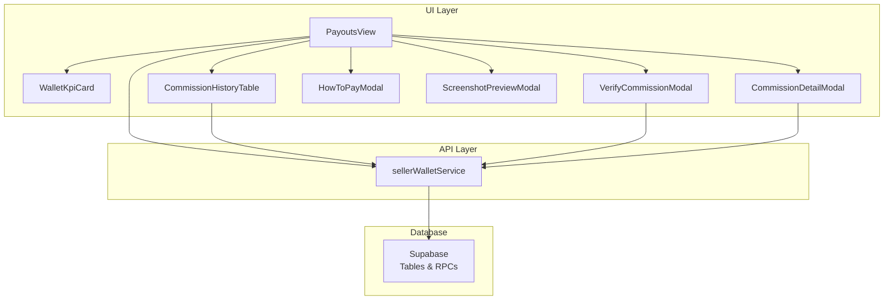
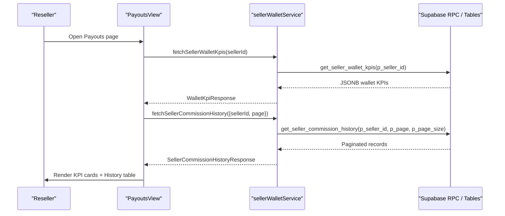
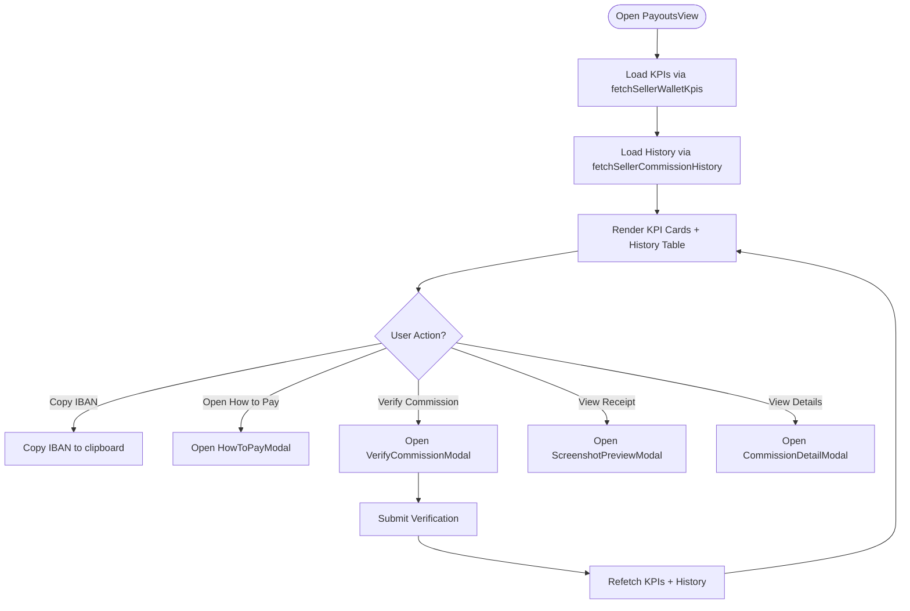
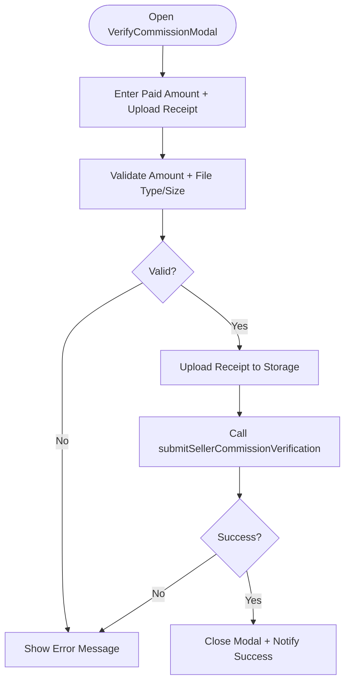
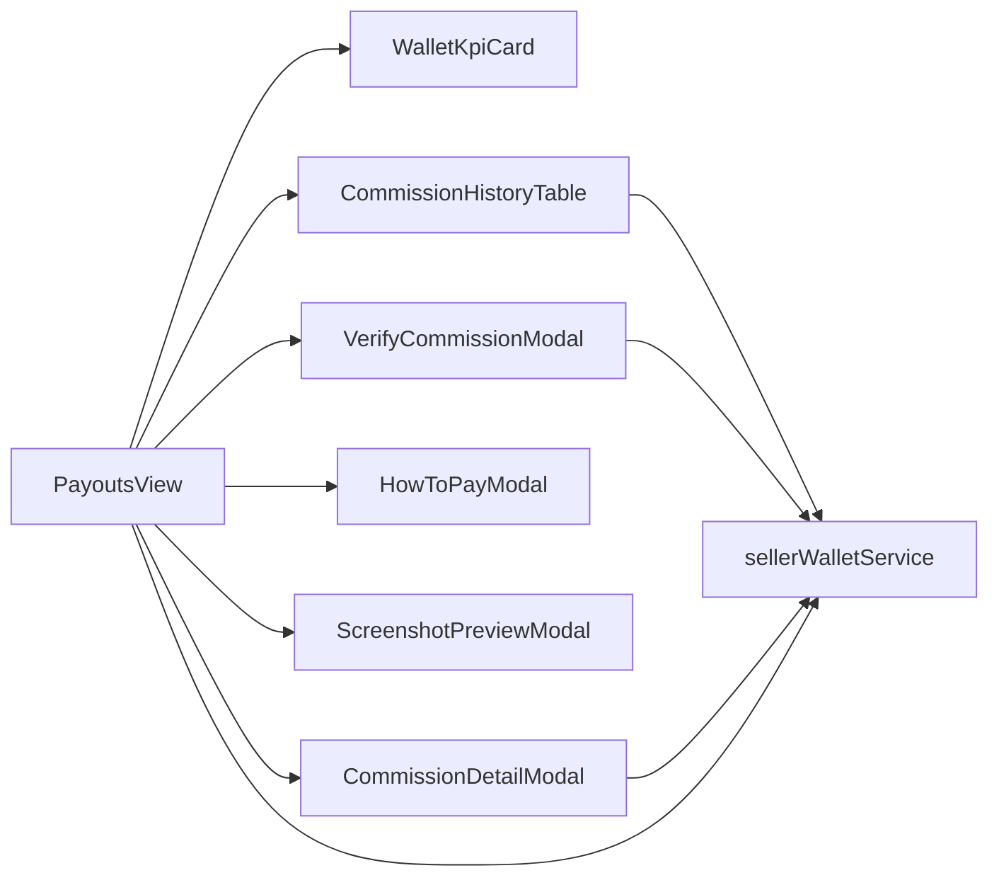
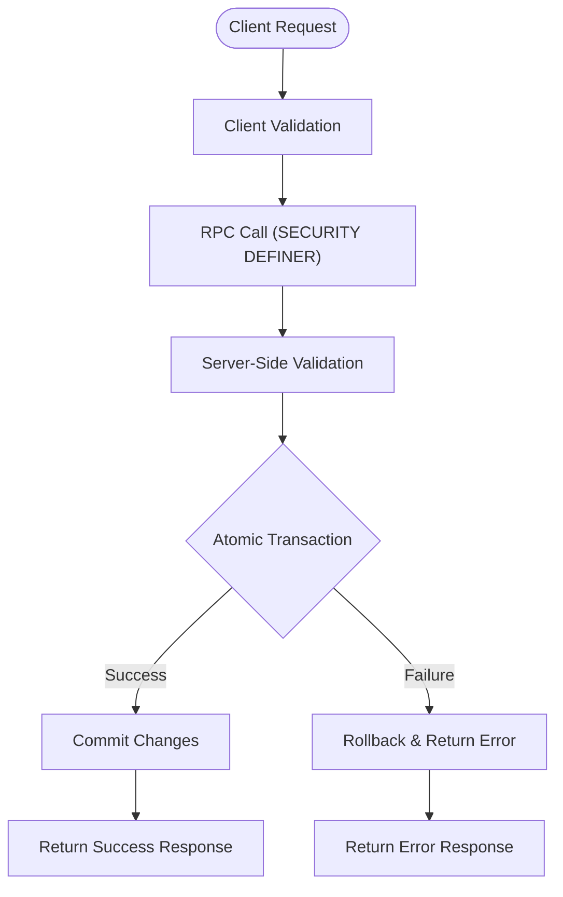

# Financial Management

<cite>
**Referenced Files in This Document**
- [PayoutsView.tsx](file://components/reseller/components/PayoutsView.tsx)
- [WalletKpiCard.tsx](file://components/reseller/components/wallet/WalletKpiCard.tsx)
- [CommissionHistoryTable.tsx](file://components/reseller/components/wallet/CommissionHistoryTable.tsx)
- [CommissionDetailModal.tsx](file://components/reseller/components/wallet/CommissionDetailModal.tsx)
- [VerifyCommissionModal.tsx](file://components/reseller/components/wallet/VerifyCommissionModal.tsx)
- [HowToPayModal.tsx](file://components/reseller/components/wallet/HowToPayModal.tsx)
- [ScreenshotPreviewModal.tsx](file://components/reseller/components/wallet/ScreenshotPreviewModal.tsx)
- [sellerWalletService.ts](file://src/api/sellerWalletService.ts)
- [mockWalletData.ts](file://components/reseller/data/mockWalletData.ts)
- [supabase_wallet_payout_rpc.sql](file://supabase_wallet_payout_rpc.sql)
- [supabase_seller_shipping_payment_migration.sql](file://supabase_seller_shipping_payment_migration.sql)
</cite>

## Table of Contents
1. [Introduction](#introduction)
2. [Project Structure](#project-structure)
3. [Core Components](#core-components)
4. [Architecture Overview](#architecture-overview)
5. [Detailed Component Analysis](#detailed-component-analysis)
6. [Dependency Analysis](#dependency-analysis)
7. [Performance Considerations](#performance-considerations)
8. [Troubleshooting Guide](#troubleshooting-guide)
9. [Security and Compliance](#security-and-compliance)
10. [Conclusion](#conclusion)

## Introduction
This document explains the financial management system for resellers, focusing on payout history, wallet statistics, commission tracking, and verification workflows. It covers:
- PayoutsView as the main dashboard for wallet KPIs and commission payment history
- WalletKpiCard for displaying key financial metrics
- CommissionHistoryTable for paginated commission records
- Commission-related modals for instructions, verification, screenshot preview, and detailed order breakdowns
- The wallet data layer that integrates with Supabase RPC functions and relational fallbacks
- Database schema, RLS policies, and atomic transactions for integrity
- Security considerations for financial data and transaction safety

## Project Structure
The financial module is implemented under the reseller components and API layers:
- UI components: PayoutsView orchestrates the page; supporting wallet components render KPIs, tables, and modals
- Data layer: sellerWalletService provides typed queries and mutations with RPC-first strategy and relational fallbacks
- Database: supabase_wallet_payout_rpc.sql defines tables, indexes, RLS policies, helper functions, and RPCs
- Utilities: mockWalletData provides currency formatting and sample data structures used by UI components

**Diagram sources**
- [PayoutsView.tsx:1-349](file://components/reseller/components/PayoutsView.tsx#L1-L349)
- [sellerWalletService.ts:1-702](file://src/api/sellerWalletService.ts#L1-L702)
- [supabase_wallet_payout_rpc.sql:1-541](file://supabase_wallet_payout_rpc.sql#L1-L541)

**Section sources**
- [PayoutsView.tsx:1-349](file://components/reseller/components/PayoutsView.tsx#L1-L349)
- [sellerWalletService.ts:1-702](file://src/api/sellerWalletService.ts#L1-L702)
- [supabase_wallet_payout_rpc.sql:1-541](file://supabase_wallet_payout_rpc.sql#L1-L541)

## Core Components
- PayoutsView: Main dashboard that loads wallet KPIs and commission history, manages modal states, and coordinates user actions (copy IBAN, open How to Pay, verify commission).
- WalletKpiCard: Reusable card component for financial metrics with accent-based styling and optional badges.
- CommissionHistoryTable: Paginated table showing submission status, amounts, receipt image preview, and detail view entry points.
- VerifyCommissionModal: Form to enter paid amount, upload receipt screenshot, add notes, and submit verification.
- HowToPayModal: Instructional modal with bank details, IBAN copy, bilingual steps, and navigation to verification.
- ScreenshotPreviewModal: Full-screen viewer for uploaded receipts.
- CommissionDetailModal: Detail view for a specific payment, including cycle summary, payment metrics, notes, and related orders with pagination.

**Section sources**
- [PayoutsView.tsx:31-349](file://components/reseller/components/PayoutsView.tsx#L31-L349)
- [WalletKpiCard.tsx:1-123](file://components/reseller/components/wallet/WalletKpiCard.tsx#L1-L123)
- [CommissionHistoryTable.tsx:1-210](file://components/reseller/components/wallet/CommissionHistoryTable.tsx#L1-L210)
- [VerifyCommissionModal.tsx:1-326](file://components/reseller/components/wallet/VerifyCommissionModal.tsx#L1-L326)
- [HowToPayModal.tsx:1-182](file://components/reseller/components/wallet/HowToPayModal.tsx#L1-L182)
- [ScreenshotPreviewModal.tsx:1-53](file://components/reseller/components/wallet/ScreenshotPreviewModal.tsx#L1-L53)
- [CommissionDetailModal.tsx:1-329](file://components/reseller/components/wallet/CommissionDetailModal.tsx#L1-L329)

## Architecture Overview
The system uses a layered architecture:
- Presentation layer: React components manage state, user interactions, and display
- Service layer: Typed API functions encapsulate RPC calls and relational fallbacks
- Persistence layer: Supabase database with RLS policies and security-definer RPCs ensuring safe operations

**Diagram sources**
- [PayoutsView.tsx:58-86](file://components/reseller/components/PayoutsView.tsx#L58-L86)
- [sellerWalletService.ts:118-277](file://src/api/sellerWalletService.ts#L118-L277)
- [sellerWalletService.ts:458-526](file://src/api/sellerWalletService.ts#L458-L526)
- [supabase_wallet_payout_rpc.sql:133-254](file://supabase_wallet_payout_rpc.sql#L133-L254)
- [supabase_wallet_payout_rpc.sql:375-430](file://supabase_wallet_payout_rpc.sql#L375-L430)

## Detailed Component Analysis

### PayoutsView
Responsibilities:
- Loads wallet KPIs and commission history using TanStack Query
- Manages modal visibility and user feedback via toast messages
- Provides IBAN copy functionality and navigates to verification flow
- Renders KPI cards and history table, and wires up detail and screenshot previews

Key behaviors:
- Two independent queries: KPIs and history, both with staleTime caching
- Cycle metadata derived from current_cycle to compute payable amount and month/year label
- Actions trigger refresh of both queries after successful verification

**Diagram sources**
- [PayoutsView.tsx:58-95](file://components/reseller/components/PayoutsView.tsx#L58-L95)
- [PayoutsView.tsx:140-171](file://components/reseller/components/PayoutsView.tsx#L140-L171)
- [PayoutsView.tsx:239-343](file://components/reseller/components/PayoutsView.tsx#L239-L343)

**Section sources**
- [PayoutsView.tsx:31-349](file://components/reseller/components/PayoutsView.tsx#L31-L349)

### WalletKpiCard
Responsibilities:
- Displays a single metric with label, formatted amount, icon, subtext, and optional badge
- Uses accent color mapping for consistent visual hierarchy across cards

Design highlights:
- Accent styles define background, border, icon colors, and badge text
- Currency formatting via format$ utility

**Section sources**
- [WalletKpiCard.tsx:1-123](file://components/reseller/components/wallet/WalletKpiCard.tsx#L1-L123)
- [mockWalletData.ts:323-325](file://components/reseller/data/mockWalletData.ts#L323-L325)

### CommissionHistoryTable
Responsibilities:
- Renders paginated commission records with status badges, formatted amounts, and action buttons
- Supports viewing receipt screenshots and opening detail modal for each record

Key logic:
- Status badge mapping for Submitted/Pending, Verified, Rejected
- Date formatting with error handling
- Pagination controls integrated with parent state

**Section sources**
- [CommissionHistoryTable.tsx:1-210](file://components/reseller/components/wallet/CommissionHistoryTable.tsx#L1-L210)

### VerifyCommissionModal
Responsibilities:
- Validates numeric paid amount against payable amount
- Accepts image uploads with type and size checks
- Uploads receipt to storage and submits verification
- Provides user feedback and resets form on success

Validation rules:
- Only digits allowed in input
- Amount must be positive and not less than payable amount
- Image must be JPG/PNG/WEBP and under 5MB

Submission flow:
- Optional upload to storage; if unavailable, falls back to object URL
- Calls submitSellerCommissionVerification with sellerId, paidAmount, receiptImage, notes

**Diagram sources**
- [VerifyCommissionModal.tsx:42-158](file://components/reseller/components/wallet/VerifyCommissionModal.tsx#L42-L158)
- [sellerWalletService.ts:315-452](file://src/api/sellerWalletService.ts#L315-L452)

**Section sources**
- [VerifyCommissionModal.tsx:1-326](file://components/reseller/components/wallet/VerifyCommissionModal.tsx#L1-L326)

### HowToPayModal
Responsibilities:
- Shows payable amount, bank account title, and IBAN
- Provides bilingual step-by-step instructions
- Offers quick navigation to verification modal

Features:
- Clipboard copy for IBAN
- Clear call-to-action to proceed to verification

**Section sources**
- [HowToPayModal.tsx:1-182](file://components/reseller/components/wallet/HowToPayModal.tsx#L1-L182)

### ScreenshotPreviewModal
Responsibilities:
- Displays full-resolution receipt images
- Provides link to open original image in new tab

**Section sources**
- [ScreenshotPreviewModal.tsx:1-53](file://components/reseller/components/wallet/ScreenshotPreviewModal.tsx#L1-L53)

### CommissionDetailModal
Responsibilities:
- Fetches payment detail and related orders with pagination
- Displays payment summary, cycle info, status, notes, and receipt link
- Renders related orders with thumbnails and statuses

Data flow:
- Lazy load when opened
- Inner pagination for orders (default 5 per page)
- Fallback thumbnail mapping for product images

**Section sources**
- [CommissionDetailModal.tsx:1-329](file://components/reseller/components/wallet/CommissionDetailModal.tsx#L1-L329)

## Dependency Analysis
Component relationships:
- PayoutsView depends on all wallet components and sellerWalletService
- CommissionHistoryTable depends on SellerPaymentRecord types and formatting utilities
- VerifyCommissionModal depends on storage upload and verification mutation
- CommissionDetailModal depends on payment detail query and order pagination

**Diagram sources**
- [PayoutsView.tsx:1-349](file://components/reseller/components/PayoutsView.tsx#L1-L349)
- [sellerWalletService.ts:1-702](file://src/api/sellerWalletService.ts#L1-L702)

**Section sources**
- [PayoutsView.tsx:1-349](file://components/reseller/components/PayoutsView.tsx#L1-L349)
- [sellerWalletService.ts:1-702](file://src/api/sellerWalletService.ts#L1-L702)

## Performance Considerations
- Query caching: Both KPI and history queries use staleTime to reduce network requests
- Pagination: History and detail orders are paginated to limit payload sizes
- RPC-first strategy: Primary path uses efficient server-side functions; relational fallbacks ensure resilience
- Conditional rendering: Loading skeletons prevent layout shifts while data loads
- Image handling: Object URLs used as fallbacks to avoid blocking UI when storage fails

[No sources needed since this section provides general guidance]

## Troubleshooting Guide
Common issues and resolutions:
- Empty or zero KPIs: Ensure sellerId is valid and RPC function exists; check fallback queries and database rows
- History not loading: Verify pagination parameters and seller_id filters; inspect RPC errors and fallback query results
- Verification submission fails: Check amount validation, file type/size limits, and storage bucket permissions; review RPC transaction logs
- Payment detail empty: Confirm paymentId and sellerId match; ensure cycle items exist or fallback order join works
- IBAN copy failures: Browser may block clipboard access; handle errors gracefully and inform users

**Section sources**
- [sellerWalletService.ts:118-277](file://src/api/sellerWalletService.ts#L118-L277)
- [sellerWalletService.ts:315-452](file://src/api/sellerWalletService.ts#L315-L452)
- [sellerWalletService.ts:458-526](file://src/api/sellerWalletService.ts#L458-L526)
- [sellerWalletService.ts:532-659](file://src/api/sellerWalletService.ts#L532-L659)
- [VerifyCommissionModal.tsx:72-158](file://components/reseller/components/wallet/VerifyCommissionModal.tsx#L72-L158)

## Security and Compliance
- Row Level Security (RLS): Policies restrict sellers to their own cycles, payments, and cycle items
- Security Definer RPCs: Functions execute with elevated privileges but validate inputs and enforce business rules
- Atomic Transactions: Verification submission updates cycle and inserts payment atomically; rollback on failure
- Input Validation: Client-side checks for amount and file constraints; server-side validation in RPCs
- Storage Access: Receipts stored in a dedicated bucket; public URLs generated safely; object URL fallbacks do not expose sensitive data
- Payment Method Configuration: Shipping and advance payment flags are constrained via database checks to prevent invalid configurations

**Diagram sources**
- [supabase_wallet_payout_rpc.sql:259-370](file://supabase_wallet_payout_rpc.sql#L259-L370)
- [supabase_wallet_payout_rpc.sql:69-97](file://supabase_wallet_payout_rpc.sql#L69-L97)
- [supabase_seller_shipping_payment_migration.sql:1-35](file://supabase_seller_shipping_payment_migration.sql#L1-L35)

**Section sources**
- [supabase_wallet_payout_rpc.sql:69-97](file://supabase_wallet_payout_rpc.sql#L69-L97)
- [supabase_wallet_payout_rpc.sql:259-370](file://supabase_wallet_payout_rpc.sql#L259-L370)
- [supabase_seller_shipping_payment_migration.sql:1-35](file://supabase_seller_shipping_payment_migration.sql#L1-L35)

## Conclusion
The financial management system provides a robust, secure, and user-friendly interface for resellers to monitor wallet KPIs, track commission submissions, and verify payments. It leverages RPC functions for performance and reliability, enforces strict RLS policies for data isolation, and includes comprehensive client-side validations. The modular component design ensures maintainability and clarity, while the database schema and transactions guarantee data integrity throughout the payout workflow.

[No sources needed since this section summarizes without analyzing specific files]