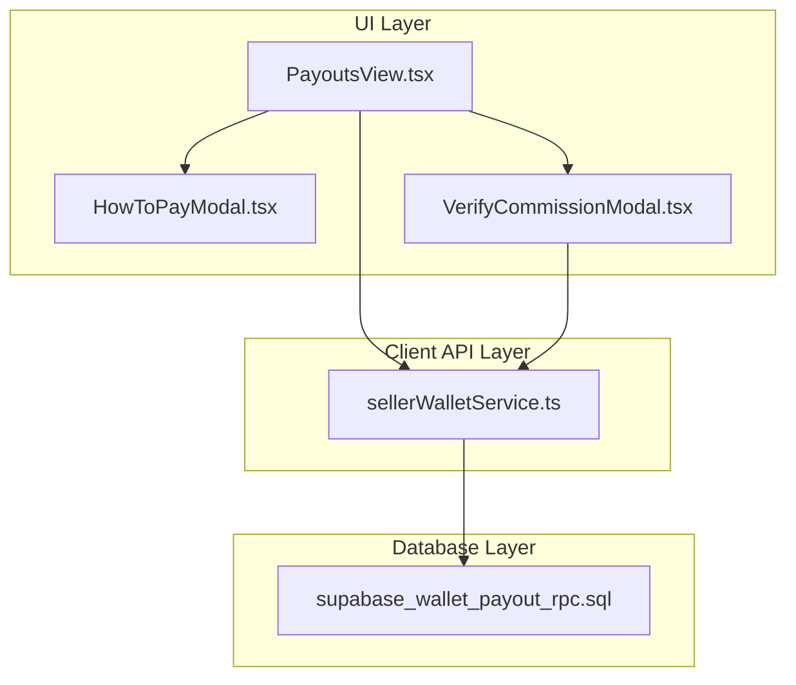
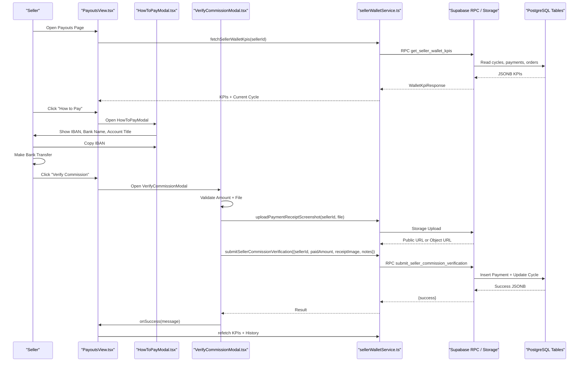
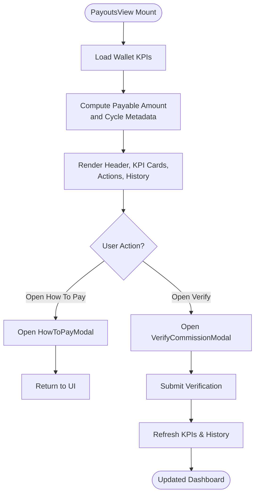
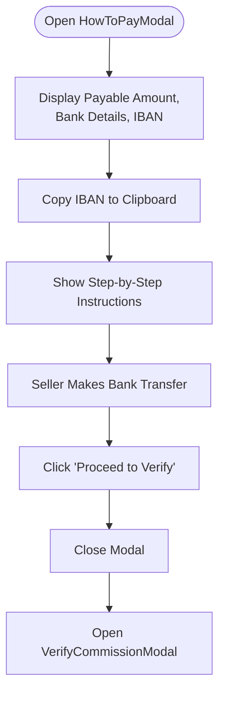
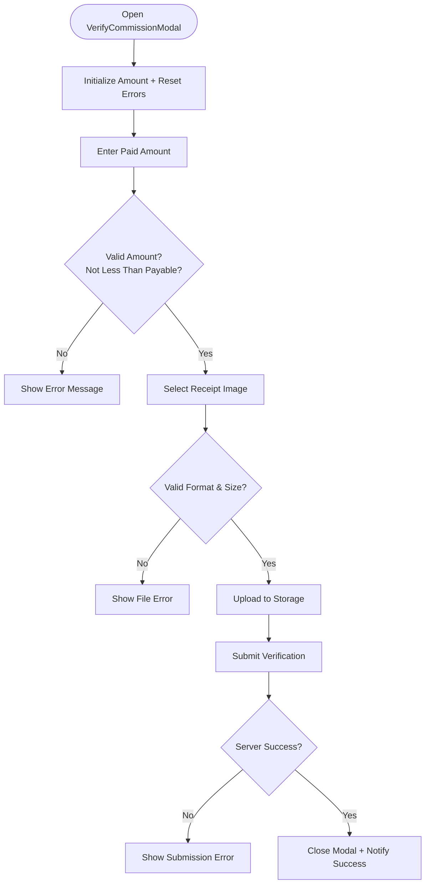
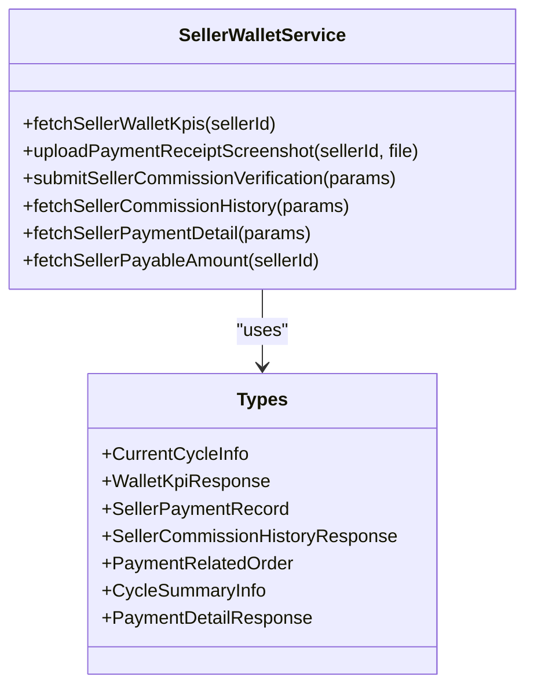
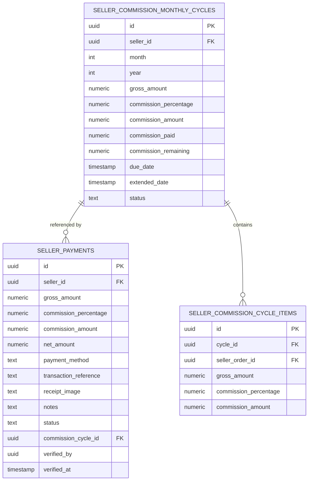
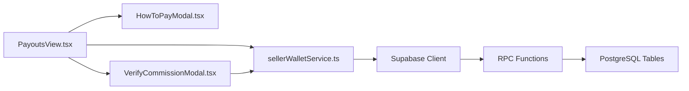

# Payout Processing

<cite>
**Referenced Files in This Document**
- [PayoutsView.tsx](file://components/reseller/components/PayoutsView.tsx)
- [HowToPayModal.tsx](file://components/reseller/components/wallet/HowToPayModal.tsx)
- [VerifyCommissionModal.tsx](file://components/reseller/components/wallet/VerifyCommissionModal.tsx)
- [sellerWalletService.ts](file://src/api/sellerWalletService.ts)
- [supabase_wallet_payout_rpc.sql](file://supabase_wallet_payout_rpc.sql)
</cite>

## Table of Contents
1. [Introduction](#introduction)
2. [Project Structure](#project-structure)
3. [Core Components](#core-components)
4. [Architecture Overview](#architecture-overview)
5. [Detailed Component Analysis](#detailed-component-analysis)
6. [Dependency Analysis](#dependency-analysis)
7. [Performance Considerations](#performance-considerations)
8. [Security Considerations](#security-considerations)
9. [Troubleshooting Guide](#troubleshooting-guide)
10. [Conclusion](#conclusion)

## Introduction
This document explains the payout processing workflow for seller commission settlement. The system guides sellers through a bank transfer to an official IBAN account, then allows them to upload proof of payment and submit it for verification. The main entry point is the `PayoutsView`, which orchestrates wallet KPIs, commission history, the bank transfer guidance modal, and the verification submission flow.

The lifecycle is:
1. Seller opens the payouts page.
2. System loads current payable commission and previous month cycle data.
3. Seller uses `HowToPayModal` to copy IBAN details and make a bank transfer.
4. Seller uploads a receipt screenshot via `VerifyCommissionModal`.
5. Frontend validates inputs, uploads the image, and submits verification.
6. Backend RPC or relational fallback creates or updates the monthly commission cycle and inserts a submitted payment record.
7. UI refreshes KPIs and history after successful submission.

## Project Structure
The payout feature spans three layers:
- UI layer: React components under `components/reseller/components` and `components/reseller/components/wallet`.
- Client API layer: `src/api/sellerWalletService.ts` with TanStack Query usage and Supabase calls.
- Database layer: `supabase_wallet_payout_rpc.sql` defining tables, Row Level Security policies, indexes, and RPC functions.

**Diagram sources**
- [PayoutsView.tsx:1-349](file://components/reseller/components/PayoutsView.tsx#L1-L349)
- [HowToPayModal.tsx:1-182](file://components/reseller/components/wallet/HowToPayModal.tsx#L1-L182)
- [VerifyCommissionModal.tsx:1-326](file://components/reseller/components/wallet/VerifyCommissionModal.tsx#L1-L326)
- [sellerWalletService.ts:1-702](file://src/api/sellerWalletService.ts#L1-L702)
- [supabase_wallet_payout_rpc.sql:1-541](file://supabase_wallet_payout_rpc.sql#L1-L541)

**Section sources**
- [PayoutsView.tsx:1-349](file://components/reseller/components/PayoutsView.tsx#L1-L349)
- [sellerWalletService.ts:1-702](file://src/api/sellerWalletService.ts#L1-L702)
- [supabase_wallet_payout_rpc.sql:1-541](file://supabase_wallet_payout_rpc.sql#L1-L541)

## Core Components
- `PayoutsView`: Main dashboard for wallet and commission settlement. It displays KPI cards, shows the assigned settlement bank account and IBAN, provides “How to Pay” and “Verify Commission” actions, and renders commission history.
- `HowToPayModal`: Guides sellers through copying IBAN details, making a bank transfer, capturing a receipt screenshot, and proceeding to verification.
- `VerifyCommissionModal`: Validates paid amount, accepts a receipt screenshot, uploads it to storage, and submits verification to the backend.
- `sellerWalletService.ts`: Provides typed interfaces and functions for fetching wallet KPIs, commission history, uploading receipts, and submitting verification. It prefers RPC functions and falls back to relational queries when RPCs are unavailable.
- `supabase_wallet_payout_rpc.sql`: Defines core tables (`seller_commission_monthly_cycles`, `seller_payments`, `seller_commission_cycle_items`), RLS policies, indexes, helper functions, and RPCs for KPIs, history, detail, and atomic verification submission.

**Section sources**
- [PayoutsView.tsx:31-349](file://components/reseller/components/PayoutsView.tsx#L31-L349)
- [HowToPayModal.tsx:6-182](file://components/reseller/components/wallet/HowToPayModal.tsx#L6-L182)
- [VerifyCommissionModal.tsx:6-326](file://components/reseller/components/wallet/VerifyCommissionModal.tsx#L6-L326)
- [sellerWalletService.ts:3-94](file://src/api/sellerWalletService.ts#L3-L94)
- [supabase_wallet_payout_rpc.sql:11-64](file://supabase_wallet_payout_rpc.sql#L11-L64)

## Architecture Overview
The payout architecture combines a Next.js frontend with Supabase RPCs and storage.

**Diagram sources**
- [PayoutsView.tsx:58-95](file://components/reseller/components/PayoutsView.tsx#L58-L95)
- [PayoutsView.tsx:239-329](file://components/reseller/components/PayoutsView.tsx#L239-L329)
- [HowToPayModal.tsx:27-40](file://components/reseller/components/wallet/HowToPayModal.tsx#L27-L40)
- [VerifyCommissionModal.tsx:105-158](file://components/reseller/components/wallet/VerifyCommissionModal.tsx#L105-L158)
- [sellerWalletService.ts:118-277](file://src/api/sellerWalletService.ts#L118-L277)
- [sellerWalletService.ts:282-309](file://src/api/sellerWalletService.ts#L282-L309)
- [sellerWalletService.ts:315-452](file://src/api/sellerWalletService.ts#L315-L452)
- [supabase_wallet_payout_rpc.sql:133-254](file://supabase_wallet_payout_rpc.sql#L133-L254)
- [supabase_wallet_payout_rpc.sql:259-370](file://supabase_wallet_payout_rpc.sql#L259-L370)

## Detailed Component Analysis

### PayoutsView
`PayoutsView` is the central controller for the payout experience. It:
- Loads wallet KPIs and commission history using TanStack Query.
- Displays the assigned settlement account (bank name, IBAN, account title).
- Provides action buttons to open `HowToPayModal` and `VerifyCommissionModal`.
- Renders commission history and supports viewing screenshots and payment details.
- Refreshes data on successful verification.

Key responsibilities:
- State management for modals, pagination, toast messages, and active screenshot/detail IDs.
- Data fetching for KPIs and history with caching and refetch triggers.
- Computation of payable amount and cycle metadata from current cycle data.

**Diagram sources**
- [PayoutsView.tsx:58-95](file://components/reseller/components/PayoutsView.tsx#L58-L95)
- [PayoutsView.tsx:97-103](file://components/reseller/components/PayoutsView.tsx#L97-L103)
- [PayoutsView.tsx:239-329](file://components/reseller/components/PayoutsView.tsx#L239-L329)

**Section sources**
- [PayoutsView.tsx:31-349](file://components/reseller/components/PayoutsView.tsx#L31-L349)

### HowToPayModal
`HowToPayModal` educates sellers about the IBAN-based transfer process. It:
- Shows the payable amount prominently.
- Displays bank name, account title, and IBAN with a copy-to-clipboard action.
- Provides bilingual step-by-step instructions (English and Urdu).
- Offers a direct path to open the verification modal after the seller completes their bank transfer.

Important behaviors:
- Clipboard copy attempts to strip whitespace from IBAN before copying.
- Proceeding closes this modal and opens the verification modal.

**Diagram sources**
- [HowToPayModal.tsx:27-40](file://components/reseller/components/wallet/HowToPayModal.tsx#L27-L40)
- [HowToPayModal.tsx:50-157](file://components/reseller/components/wallet/HowToPayModal.tsx#L50-L157)
- [HowToPayModal.tsx:159-177](file://components/reseller/components/wallet/HowToPayModal.tsx#L159-L177)

**Section sources**
- [HowToPayModal.tsx:6-182](file://components/reseller/components/wallet/HowToPayModal.tsx#L6-L182)

### VerifyCommissionModal
`VerifyCommissionModal` handles the verification submission flow. It:
- Pre-fills the paid amount if a payable amount exists.
- Restricts input to numeric digits only.
- Validates that the entered amount is not less than the payable amount.
- Requires a valid image file (JPG, PNG, WEBP) up to 5MB.
- Uploads the screenshot to Supabase storage and obtains a public URL.
- Submits verification with seller ID, paid amount, receipt image URL, and optional notes.
- Handles success by closing the modal and invoking a success callback; handles errors by displaying user-facing messages.

**Diagram sources**
- [VerifyCommissionModal.tsx:31-40](file://components/reseller/components/wallet/VerifyCommissionModal.tsx#L31-L40)
- [VerifyCommissionModal.tsx:42-70](file://components/reseller/components/wallet/VerifyCommissionModal.tsx#L42-L70)
- [VerifyCommissionModal.tsx:72-103](file://components/reseller/components/wallet/VerifyCommissionModal.tsx#L72-L103)
- [VerifyCommissionModal.tsx:105-158](file://components/reseller/components/wallet/VerifyCommissionModal.tsx#L105-L158)

**Section sources**
- [VerifyCommissionModal.tsx:6-326](file://components/reseller/components/wallet/VerifyCommissionModal.tsx#L6-L326)

### sellerWalletService.ts
This service encapsulates all client-side interactions with Supabase:
- Interfaces define types for wallet KPIs, payment records, history responses, and detail payloads.
- `fetchSellerWalletKpis` tries the RPC first, then falls back to relational queries to compute totals, remaining commission, submitted/verified sums, and current cycle info.
- `uploadPaymentReceiptScreenshot` uploads images to the `payment-receipts` bucket and returns a public URL or object URL fallback.
- `submitSellerCommissionVerification` performs an atomic transaction via RPC or relational fallback: it ensures a cycle exists, inserts a payment row, and updates cycle status and amounts.
- `fetchSellerCommissionHistory` paginates payment records.
- `fetchSellerPaymentDetail` lazily loads joined order data for a specific payment.
- `fetchSellerPayableAmount` computes total unpaid payable amounts across cycles.

**Diagram sources**
- [sellerWalletService.ts:3-94](file://src/api/sellerWalletService.ts#L3-L94)
- [sellerWalletService.ts:118-277](file://src/api/sellerWalletService.ts#L118-L277)
- [sellerWalletService.ts:282-309](file://src/api/sellerWalletService.ts#L282-L309)
- [sellerWalletService.ts:315-452](file://src/api/sellerWalletService.ts#L315-L452)
- [sellerWalletService.ts:458-526](file://src/api/sellerWalletService.ts#L458-L526)
- [sellerWalletService.ts:532-659](file://src/api/sellerWalletService.ts#L532-L659)
- [sellerWalletService.ts:665-700](file://src/api/sellerWalletService.ts#L665-L700)

**Section sources**
- [sellerWalletService.ts:1-702](file://src/api/sellerWalletService.ts#L1-L702)

### Database Schema and RPCs
The database layer defines:
- Tables:
  - `seller_commission_monthly_cycles`: Tracks per-seller monthly commission cycles, including gross amount, commission percentage, amounts paid/remaining, due dates, and status.
  - `seller_payments`: Records individual payment submissions with receipt images, notes, status, and links to cycles.
  - `seller_commission_cycle_items`: Junction table linking cycles to seller orders and order items.
- Row Level Security policies restrict access to seller-specific rows.
- Indexes optimize queries by seller, month/year, created_at, and cycle_id.
- Helper function `get_previous_month_year` computes previous calendar month/year server-side.
- RPCs:
  - `get_seller_wallet_kpis`: Aggregates sales, remaining commission, submitted/verified payments, and current cycle.
  - `submit_seller_commission_verification`: Atomic transaction ensuring cycle existence, inserting payment, updating cycle status and amounts.
  - `get_seller_commission_history`: Paginated history of payment records.
  - `get_seller_payment_detail`: Lazy-loaded detail with cycle summary and order items pagination.

**Diagram sources**
- [supabase_wallet_payout_rpc.sql:11-64](file://supabase_wallet_payout_rpc.sql#L11-L64)

**Section sources**
- [supabase_wallet_payout_rpc.sql:11-64](file://supabase_wallet_payout_rpc.sql#L11-L64)
- [supabase_wallet_payout_rpc.sql:69-105](file://supabase_wallet_payout_rpc.sql#L69-L105)
- [supabase_wallet_payout_rpc.sql:110-128](file://supabase_wallet_payout_rpc.sql#L110-L128)
- [supabase_wallet_payout_rpc.sql:133-254](file://supabase_wallet_payout_rpc.sql#L133-L254)
- [supabase_wallet_payout_rpc.sql:259-370](file://supabase_wallet_payout_rpc.sql#L259-L370)
- [supabase_wallet_payout_rpc.sql:375-430](file://supabase_wallet_payout_rpc.sql#L375-L430)
- [supabase_wallet_payout_rpc.sql:435-541](file://supabase_wallet_payout_rpc.sql#L435-L541)

## Dependency Analysis
The payout workflow has clear dependencies:
- UI depends on the service layer for data and mutations.
- Service layer depends on Supabase client, RPCs, and storage.
- RPCs depend on PostgreSQL tables and RLS policies.

**Diagram sources**
- [PayoutsView.tsx:1-349](file://components/reseller/components/PayoutsView.tsx#L1-L349)
- [HowToPayModal.tsx:1-182](file://components/reseller/components/wallet/HowToPayModal.tsx#L1-L182)
- [VerifyCommissionModal.tsx:1-326](file://components/reseller/components/wallet/VerifyCommissionModal.tsx#L1-L326)
- [sellerWalletService.ts:1-702](file://src/api/sellerWalletService.ts#L1-L702)
- [supabase_wallet_payout_rpc.sql:1-541](file://supabase_wallet_payout_rpc.sql#L1-L541)

**Section sources**
- [PayoutsView.tsx:1-349](file://components/reseller/components/PayoutsView.tsx#L1-L349)
- [sellerWalletService.ts:1-702](file://src/api/sellerWalletService.ts#L1-L702)
- [supabase_wallet_payout_rpc.sql:1-541](file://supabase_wallet_payout_rpc.sql#L1-L541)

## Performance Considerations
- Two independent queries are used:
  - Wallet KPIs load immediately.
  - Commission history loads afterward without blocking KPIs.
- RPCs are preferred for performance; relational fallbacks exist for resilience.
- Pagination limits history to small pages (default 5) to reduce payload size.
- Detail modal is lazy-loaded only when a specific payment row is inspected.
- Storage upload includes error handling with object URL fallback to avoid blocking UI.

[No sources needed since this section provides general guidance]

## Security Considerations
- Row Level Security policies ensure sellers can only view and modify their own cycles and payments.
- RPCs are defined with `SECURITY DEFINER`, enforcing server-side checks and preventing client-side bypass.
- Payment receipts are uploaded to a dedicated storage bucket with controlled access.
- Input validation occurs both client-side and server-side:
  - Numeric-only amount input.
  - File type and size restrictions.
  - Server-side parameter validation in RPCs.
- IBAN display and copy operations do not expose sensitive credentials beyond the official escrow account details.

**Section sources**
- [supabase_wallet_payout_rpc.sql:69-97](file://supabase_wallet_payout_rpc.sql#L69-L97)
- [supabase_wallet_payout_rpc.sql:133-136](file://supabase_wallet_payout_rpc.sql#L133-L136)
- [supabase_wallet_payout_rpc.sql:259-267](file://supabase_wallet_payout_rpc.sql#L259-L267)
- [VerifyCommissionModal.tsx:72-92](file://components/reseller/components/wallet/VerifyCommissionModal.tsx#L72-L92)
- [sellerWalletService.ts:282-309](file://src/api/sellerWalletService.ts#L282-L309)

## Troubleshooting Guide
Common issues and resolutions:

- IBAN copy fails:
  - Symptom: Clipboard write throws an error.
  - Resolution: Ensure browser permissions allow clipboard access; verify environment supports `navigator.clipboard`.

- Payable amount mismatch:
  - Symptom: Entered amount is less than payable amount.
  - Resolution: Use the exact payable amount shown in the header and modal; check current cycle data.

- Invalid receipt file:
  - Symptom: Error message indicates invalid format or size.
  - Resolution: Upload JPG, PNG, or WEBP files under 5MB.

- Storage upload failure:
  - Symptom: Storage upload warning or error.
  - Resolution: Check Supabase storage bucket configuration and permissions; object URL fallback will still allow submission but may affect persistence.

- Verification submission fails:
  - Symptom: Error message after clicking “Submit Verification”.
  - Resolution: Confirm required fields are filled, amount is valid, and receipt is attached; retry once; check network connectivity.

- KPIs or history not refreshing:
  - Symptom: Dashboard does not reflect new submission.
  - Resolution: Trigger manual refresh or wait for automatic refetch; ensure seller ID is present and queries are enabled.

- Cycle not found:
  - Symptom: Fallback logic creates a new cycle.
  - Resolution: This is expected behavior; the system calculates gross amounts from orders and initializes a new cycle for the previous month.

**Section sources**
- [PayoutsView.tsx:151-158](file://components/reseller/components/PayoutsView.tsx#L151-L158)
- [HowToPayModal.tsx:27-35](file://components/reseller/components/wallet/HowToPayModal.tsx#L27-L35)
- [VerifyCommissionModal.tsx:72-92](file://components/reseller/components/wallet/VerifyCommissionModal.tsx#L72-L92)
- [VerifyCommissionModal.tsx:105-158](file://components/reseller/components/wallet/VerifyCommissionModal.tsx#L105-L158)
- [sellerWalletService.ts:282-309](file://src/api/sellerWalletService.ts#L282-L309)
- [sellerWalletService.ts:315-452](file://src/api/sellerWalletService.ts#L315-L452)

## Conclusion
The payout processing workflow integrates a guided seller experience with robust backend transactions. Sellers receive clear instructions for IBAN transfers, can upload proof of payment, and see real-time updates to their commission status. The system prioritizes security through RLS and RPCs, maintains performance via RPC-first design and pagination, and provides resilient fallbacks for database operations. For operational stability, monitor storage configurations, validate inputs consistently, and ensure proper seller identity enforcement.

[No sources needed since this section summarizes without analyzing specific files]