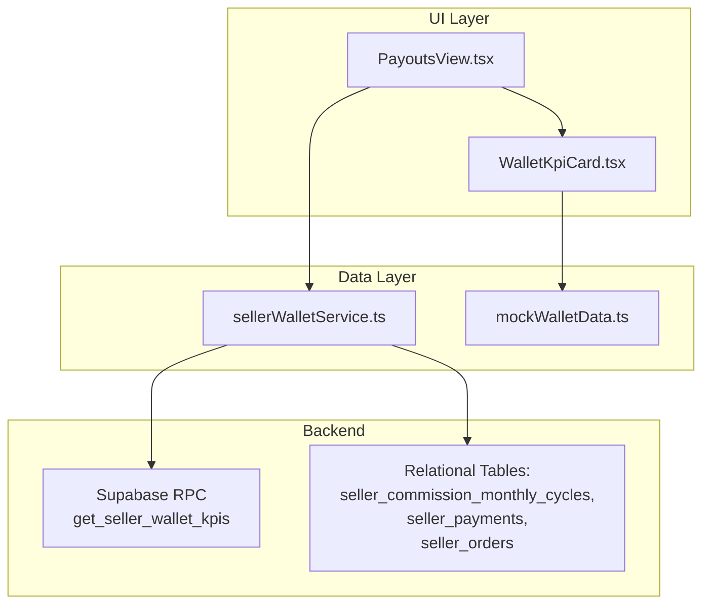
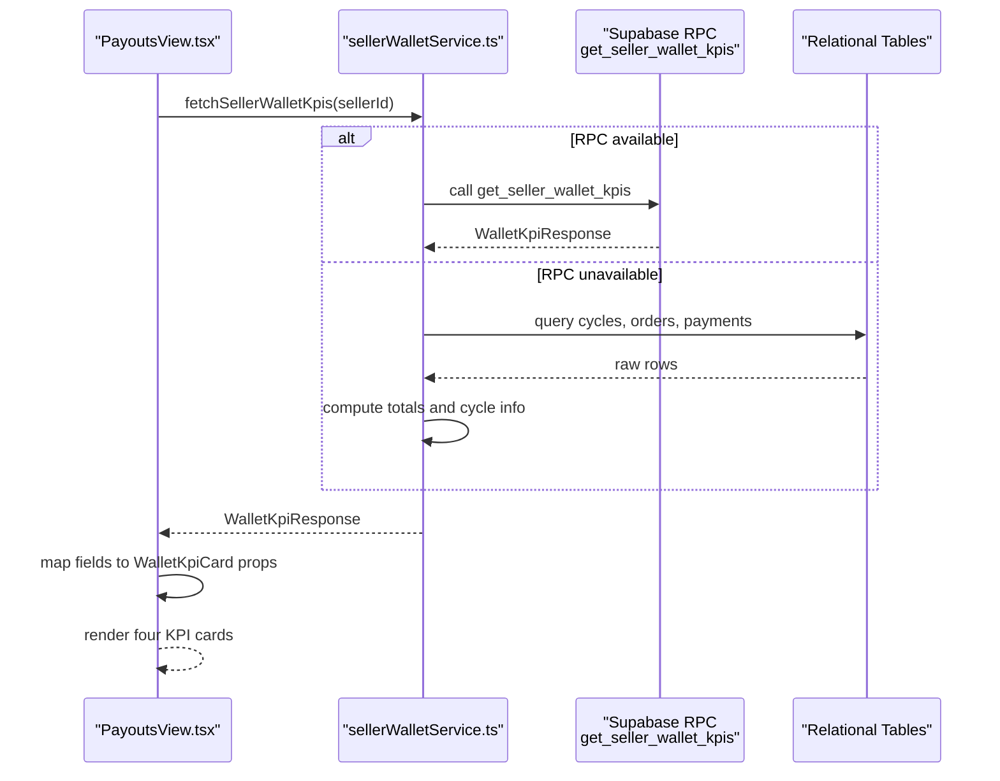
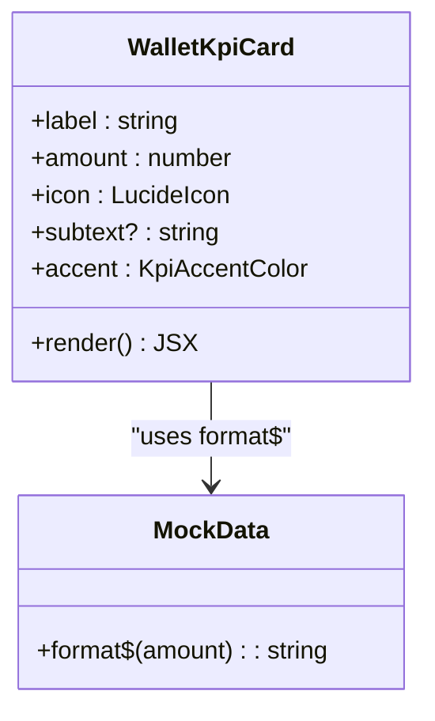
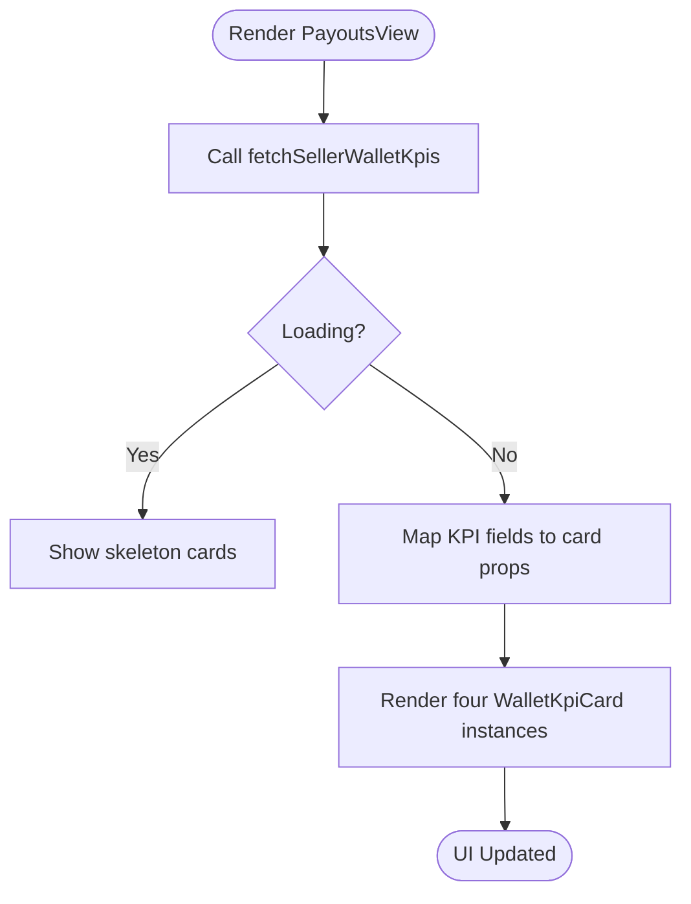
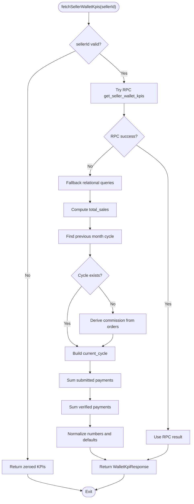
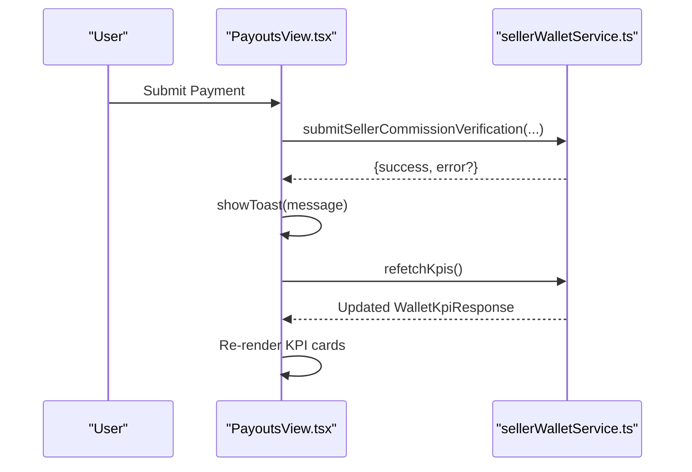
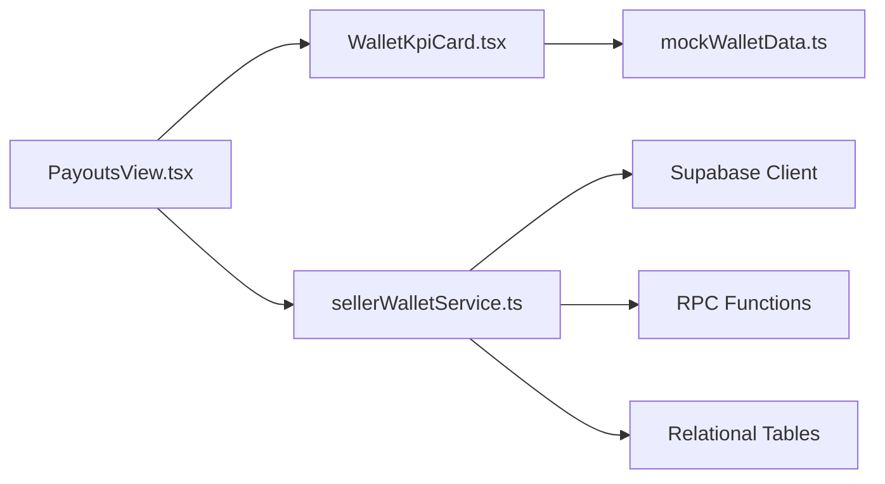

# Wallet System

<cite>
**Referenced Files in This Document**
- [WalletKpiCard.tsx](file://components/reseller/components/wallet/WalletKpiCard.tsx)
- [PayoutsView.tsx](file://components/reseller/components/PayoutsView.tsx)
- [sellerWalletService.ts](file://src/api/sellerWalletService.ts)
- [mockWalletData.ts](file://components/reseller/data/mockWalletData.ts)
- [supabase_wallet_payout_rpc.sql](file://supabase_wallet_payout_rpc.sql)
</cite>

## Table of Contents
1. [Introduction](#introduction)
2. [Project Structure](#project-structure)
3. [Core Components](#core-components)
4. [Architecture Overview](#architecture-overview)
5. [Detailed Component Analysis](#detailed-component-analysis)
6. [Dependency Analysis](#dependency-analysis)
7. [Performance Considerations](#performance-considerations)
8. [Troubleshooting Guide](#troubleshooting-guide)
9. [Conclusion](#conclusion)

## Introduction
This document explains the wallet system component focused on the WalletKpiCard and its surrounding data flow. The wallet KPIs display four financial metrics:
- Total Sales
- Payable Commission
- Submitted Payments
- Verified Payments

The system fetches wallet statistics from a backend service layer, supports RPC-based queries with relational fallbacks, and renders responsive cards for sellers to monitor their commission cycle and payment status.

## Project Structure
The wallet UI is implemented as a small set of components and services:
- A presentation-only card component that formats and displays each KPI metric.
- A parent view that composes the four KPI cards and orchestrates data fetching.
- An API service layer that calls Supabase RPC functions or falls back to relational queries.
- Mock data utilities used by the card for currency formatting.

**Diagram sources**
- [PayoutsView.tsx:174-227](file://components/reseller/components/PayoutsView.tsx#L174-L227)
- [WalletKpiCard.tsx:1-123](file://components/reseller/components/wallet/WalletKpiCard.tsx#L1-L123)
- [sellerWalletService.ts:118-277](file://src/api/sellerWalletService.ts#L118-L277)
- [mockWalletData.ts:320-325](file://components/reseller/data/mockWalletData.ts#L320-L325)

**Section sources**
- [PayoutsView.tsx:174-227](file://components/reseller/components/PayoutsView.tsx#L174-L227)
- [WalletKpiCard.tsx:1-123](file://components/reseller/components/wallet/WalletKpiCard.tsx#L1-L123)
- [sellerWalletService.ts:118-277](file://src/api/sellerWalletService.ts#L118-L277)
- [mockWalletData.ts:320-325](file://components/reseller/data/mockWalletData.ts#L320-L325)

## Core Components
- WalletKpiCard: A presentational React component that renders a single KPI tile with label, amount, icon, optional subtext, and an accent theme. It uses a shared currency formatter to display amounts consistently.
- PayoutsView: The container that composes the four KPI cards, maps wallet KPI fields to card props, and manages loading states and refresh actions.
- sellerWalletService: The data access layer providing typed interfaces and functions to fetch wallet KPIs, including total sales, payable commission, submitted payments, and verified payments. It prefers RPC endpoints and falls back to relational queries when needed.
- mockWalletData: Provides a currency formatter used by the card and contains mock data structures for development and simulation.

Key responsibilities:
- Data fetching and normalization are handled by the service layer.
- UI composition and user interaction are handled by the view layer.
- Presentation and styling are isolated in the card component.

**Section sources**
- [WalletKpiCard.tsx:1-123](file://components/reseller/components/wallet/WalletKpiCard.tsx#L1-L123)
- [PayoutsView.tsx:174-227](file://components/reseller/components/PayoutsView.tsx#L174-L227)
- [sellerWalletService.ts:17-24](file://src/api/sellerWalletService.ts#L17-L24)
- [mockWalletData.ts:320-325](file://components/reseller/data/mockWalletData.ts#L320-L325)

## Architecture Overview
The wallet KPI data flows from the backend through a service layer into the UI. The preferred path is via a Supabase RPC function; if unavailable, the service computes values using relational tables.

**Diagram sources**
- [PayoutsView.tsx:174-227](file://components/reseller/components/PayoutsView.tsx#L174-L227)
- [sellerWalletService.ts:118-277](file://src/api/sellerWalletService.ts#L118-L277)

## Detailed Component Analysis

### WalletKpiCard Component
WalletKpiCard is a stateless React component responsible for rendering one KPI tile. It accepts:
- label: descriptive title for the metric
- amount: numeric value formatted with a currency helper
- icon: Lucide icon component
- subtext: optional contextual text (for example, cycle period)
- accent: visual theme controlling colors and optional badge text

The component applies Tailwind utility classes for responsive sizing, hover effects, and scroll-snap alignment within a horizontal row. It also conditionally renders a badge based on the selected accent theme.

**Diagram sources**
- [WalletKpiCard.tsx:1-123](file://components/reseller/components/wallet/WalletKpiCard.tsx#L1-L123)
- [mockWalletData.ts:320-325](file://components/reseller/data/mockWalletData.ts#L320-L325)

**Section sources**
- [WalletKpiCard.tsx:1-123](file://components/reseller/components/wallet/WalletKpiCard.tsx#L1-L123)
- [mockWalletData.ts:320-325](file://components/reseller/data/mockWalletData.ts#L320-L325)

### PayoutsView Integration
PayoutsView composes the four KPI cards and maps wallet KPI fields to card props:
- Total Sales: mapped to total_sales or total_available_payout
- Payable Commission: mapped to remaining_commission
- Submitted Payments: mapped to submitted_payments
- Verified Payments: mapped to verified_payments

It also derives cycle context such as month/year and status from current_cycle and shows loading placeholders while data is being fetched.

**Diagram sources**
- [PayoutsView.tsx:174-227](file://components/reseller/components/PayoutsView.tsx#L174-L227)

**Section sources**
- [PayoutsView.tsx:174-227](file://components/reseller/components/PayoutsView.tsx#L174-L227)

### Wallet KPI Data Structure and Calculation Logic
The service layer defines a typed response structure for wallet KPIs:
- total_sales: sum of gross sales
- remaining_commission: payable commission for the previous calendar month
- submitted_payments: sum of net_amount for submitted payments
- verified_payments: sum of net_amount for verified payments
- total_available_payout: all-time available payout, derived from total_sales when not provided by RPC
- current_cycle: detailed cycle metadata including due dates, percentages, and statuses

Calculation logic:
- Preferred path: RPC function returns normalized KPI values and current cycle.
- Fallback path:
  - Compute total_sales by aggregating gross_amount from monthly cycles or orders.
  - Determine previous month and year, then locate the matching cycle.
  - If no cycle exists, derive commission from orders with a default percentage.
  - Sum submitted and verified payments filtered by seller and optionally by cycle.

**Diagram sources**
- [sellerWalletService.ts:118-277](file://src/api/sellerWalletService.ts#L118-L277)

**Section sources**
- [sellerWalletService.ts:17-24](file://src/api/sellerWalletService.ts#L17-L24)
- [sellerWalletService.ts:118-277](file://src/api/sellerWalletService.ts#L118-L277)
- [supabase_wallet_payout_rpc.sql:203-238](file://supabase_wallet_payout_rpc.sql#L203-L238)

### Real-Time Updates and Refresh Flow
PayoutsView exposes a refresh action that re-fetches both KPIs and commission history. After successful submission of a commission verification, it triggers a toast notification and refreshes data to reflect updated balances and statuses.

**Diagram sources**
- [PayoutsView.tsx:83-95](file://components/reseller/components/PayoutsView.tsx#L83-L95)
- [sellerWalletService.ts:315-452](file://src/api/sellerWalletService.ts#L315-L452)

**Section sources**
- [PayoutsView.tsx:83-95](file://components/reseller/components/PayoutsView.tsx#L83-L95)
- [sellerWalletService.ts:315-452](file://src/api/sellerWalletService.ts#L315-L452)

## Dependency Analysis
The wallet system has clear separation between UI and data layers:
- PayoutsView depends on WalletKpiCard for presentation and on sellerWalletService for data.
- sellerWalletService depends on Supabase client, RPC functions, and relational tables.
- WalletKpiCard depends only on a currency formatter from mockWalletData.

**Diagram sources**
- [PayoutsView.tsx:174-227](file://components/reseller/components/PayoutsView.tsx#L174-L227)
- [WalletKpiCard.tsx:1-123](file://components/reseller/components/wallet/WalletKpiCard.tsx#L1-L123)
- [sellerWalletService.ts:118-277](file://src/api/sellerWalletService.ts#L118-L277)
- [mockWalletData.ts:320-325](file://components/reseller/data/mockWalletData.ts#L320-L325)

**Section sources**
- [PayoutsView.tsx:174-227](file://components/reseller/components/PayoutsView.tsx#L174-L227)
- [sellerWalletService.ts:118-277](file://src/api/sellerWalletService.ts#L118-L277)

## Performance Considerations
- Prefer RPC endpoints for aggregated KPI calculations to reduce client-side computation and network round-trips.
- Use pagination for related data like commission history and order details to avoid heavy payloads.
- Show skeleton loaders during initial fetch to improve perceived performance.
- Avoid unnecessary re-renders by keeping WalletKpiCard stateless and passing stable props.
- Cache or memoize expensive computations if additional KPIs are added later.

[No sources needed since this section provides general guidance]

## Troubleshooting Guide
Common issues and patterns:
- Missing sellerId: The service returns zeroed KPIs when sellerId is absent. Ensure the authenticated seller context supplies a valid ID.
- RPC unavailability: The service logs warnings and falls back to relational queries. Check RPC permissions and availability if KPIs are missing.
- Cycle mismatch: If the previous month cycle does not exist, the service derives commission from orders. Verify order statuses and aggregation logic.
- Submission errors: The service validates inputs and rolls back partial writes on failure. Inspect error messages returned by the service.

Operational tips:
- Use the refresh action after submissions to ensure UI reflects updated balances.
- Validate receipt image upload paths and public URLs when debugging storage-related issues.
- Monitor console logs for RPC fallback warnings and relational query errors.

**Section sources**
- [sellerWalletService.ts:118-277](file://src/api/sellerWalletService.ts#L118-L277)
- [sellerWalletService.ts:315-452](file://src/api/sellerWalletService.ts#L315-L452)

## Conclusion
The wallet system cleanly separates concerns:
- WalletKpiCard focuses on presentation and responsive design.
- PayoutsView orchestrates data fetching and composes KPI cards.
- sellerWalletService encapsulates data access, RPC usage, and fallback logic.
Together, they provide a robust, maintainable interface for sellers to track sales, commissions, and payment statuses with reliable error handling and real-time updates.

[No sources needed since this section summarizes without analyzing specific files]