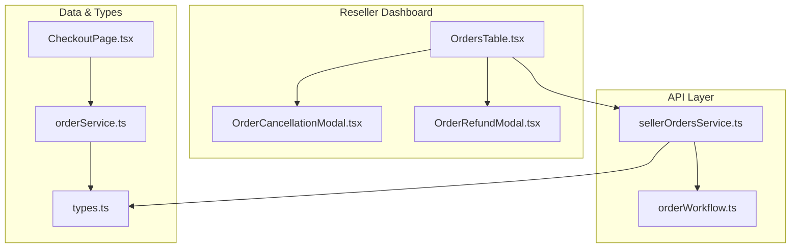
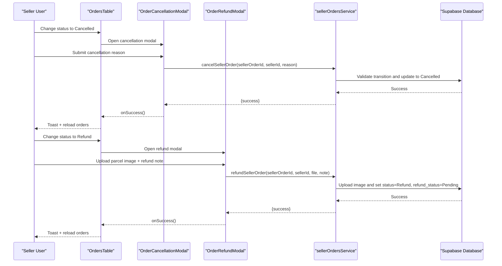
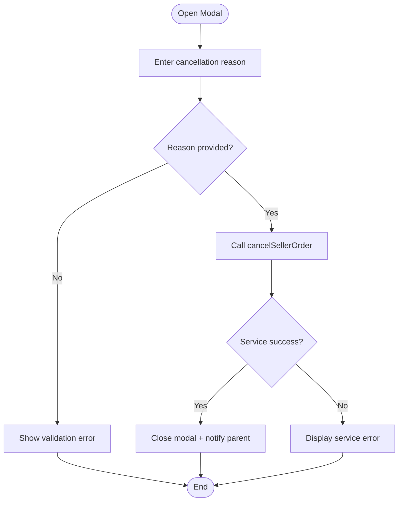
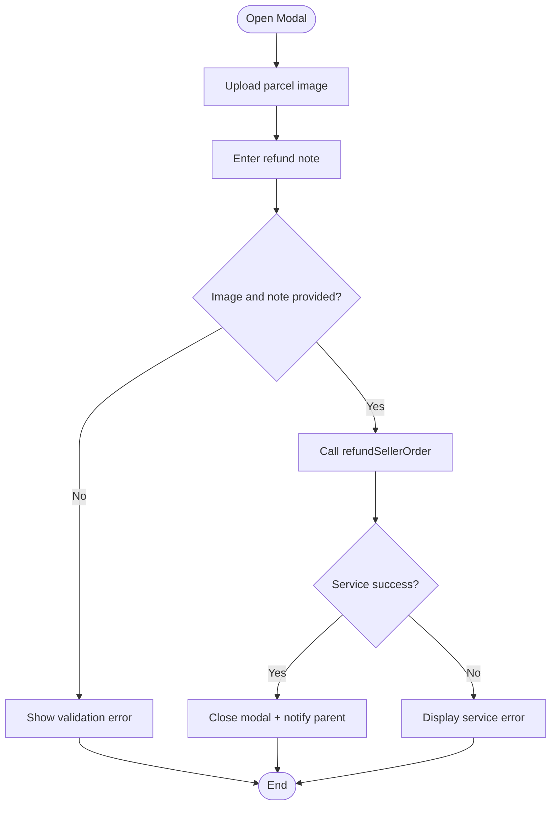
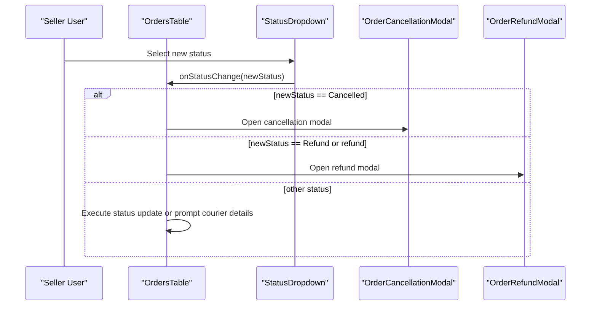
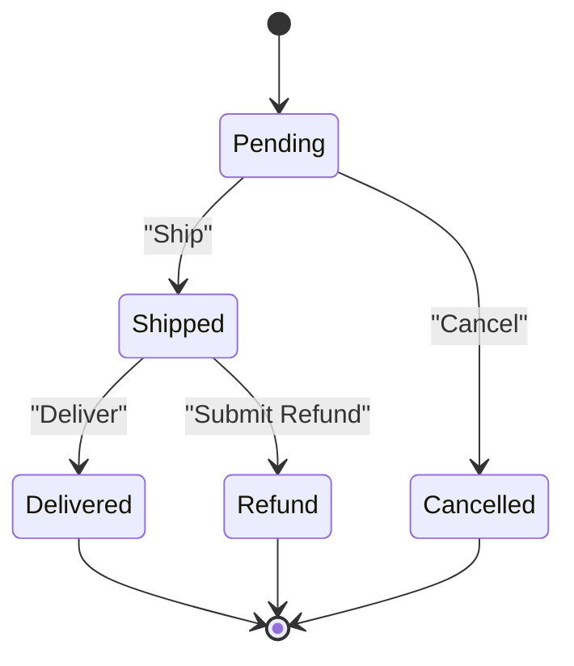
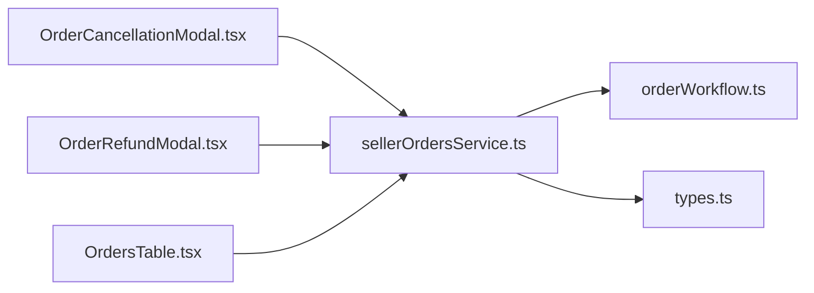

# Order Cancellation & Refund Processing

<cite>
**Referenced Files in This Document**
- [OrderCancellationModal.tsx](file://components/reseller/components/OrderCancellationModal.tsx)
- [OrderRefundModal.tsx](file://components/reseller/components/OrderRefundModal.tsx)
- [OrdersTable.tsx](file://components/reseller/components/OrdersTable.tsx)
- [sellerOrdersService.ts](file://src/api/sellerOrdersService.ts)
- [orderWorkflow.ts](file://src/constants/orderWorkflow.ts)
- [types.ts](file://types.ts)
- [orderService.ts](file://src/api/orderService.ts)
- [CheckoutPage.tsx](file://components/CheckoutPage.tsx)
</cite>

## Table of Contents
1. [Introduction](#introduction)
2. [Project Structure](#project-structure)
3. [Core Components](#core-components)
4. [Architecture Overview](#architecture-overview)
5. [Detailed Component Analysis](#detailed-component-analysis)
6. [Dependency Analysis](#dependency-analysis)
7. [Performance Considerations](#performance-considerations)
8. [Troubleshooting Guide](#troubleshooting-guide)
9. [Conclusion](#conclusion)
10. [Appendices](#appendices)

## Introduction
This document explains the order cancellation and refund processing workflows implemented in the reseller dashboard. It focuses on:
- The user interfaces for cancelling orders and submitting refunds
- Business rules that govern when cancellations and refunds are allowed
- Data persistence, audit fields, and status transitions
- Integration points with payment methods and storage
- Guidance for customizing policies and integrating external financial systems

The implementation is primarily client-side UI plus a service layer that updates database records through Supabase. There is no built-in multi-step approval workflow or direct payment processor refund API call in the current codebase; instead, refunds are recorded as a pending review state.

## Project Structure
The relevant parts of the project for this documentation are:
- Reseller UI components for cancellation and refund flows
- A shared orders table that orchestrates modal interception and success handling
- An API service layer that enforces business rules and persists changes
- Constants defining allowed status transitions
- Types and order creation logic that define payment method context

**Diagram sources**
- [OrdersTable.tsx:105-128](file://components/reseller/components/OrdersTable.tsx#L105-L128)
- [OrderCancellationModal.tsx:1-21](file://components/reseller/components/OrderCancellationModal.tsx#L1-L21)
- [OrderRefundModal.tsx:1-21](file://components/reseller/components/OrderRefundModal.tsx#L1-L21)
- [sellerOrdersService.ts:455-511](file://src/api/sellerOrdersService.ts#L455-L511)
- [sellerOrdersService.ts:518-642](file://src/api/sellerOrdersService.ts#L518-L642)
- [orderWorkflow.ts:3-12](file://src/constants/orderWorkflow.ts#L3-L12)
- [types.ts:169-173](file://types.ts#L169-L173)
- [orderService.ts:632-664](file://src/api/orderService.ts#L632-L664)
- [CheckoutPage.tsx:541-579](file://components/CheckoutPage.tsx#L541-L579)

**Section sources**
- [OrdersTable.tsx:1-128](file://components/reseller/components/OrdersTable.tsx#L1-L128)
- [OrderCancellationModal.tsx:1-53](file://components/reseller/components/OrderCancellationModal.tsx#L1-L53)
- [OrderRefundModal.tsx:1-70](file://components/reseller/components/OrderRefundModal.tsx#L1-L70)
- [sellerOrdersService.ts:455-642](file://src/api/sellerOrdersService.ts#L455-L642)
- [orderWorkflow.ts:1-37](file://src/constants/orderWorkflow.ts#L1-L37)
- [types.ts:169-173](file://types.ts#L169-L173)
- [orderService.ts:632-664](file://src/api/orderService.ts#L632-L664)
- [CheckoutPage.tsx:541-579](file://components/CheckoutPage.tsx#L541-L579)

## Core Components
- OrderCancellationModal: Collects a cancellation reason and calls the cancellation service.
- OrderRefundModal: Collects a parcel image and refund note, then submits a refund request.
- OrdersTable: Intercepts status changes to open the correct modal, handles success callbacks, and refreshes data.
- sellerOrdersService: Enforces transition rules, persists cancellation/refund data, uploads refund images, and sets refund status to Pending.
- orderWorkflow: Defines allowed status transitions and normalization helpers.
- types: Declares cancellation and refund-related fields used across the application.
- orderService and CheckoutPage: Define payment method context (COD, Advance Full, Advance DC) which influences shipping payment verification but not cancellation/refund directly.

**Section sources**
- [OrderCancellationModal.tsx:1-53](file://components/reseller/components/OrderCancellationModal.tsx#L1-L53)
- [OrderRefundModal.tsx:1-70](file://components/reseller/components/OrderRefundModal.tsx#L1-L70)
- [OrdersTable.tsx:158-244](file://components/reseller/components/OrdersTable.tsx#L158-L244)
- [sellerOrdersService.ts:455-642](file://src/api/sellerOrdersService.ts#L455-L642)
- [orderWorkflow.ts:1-37](file://src/constants/orderWorkflow.ts#L1-L37)
- [types.ts:169-173](file://types.ts#L169-L173)
- [orderService.ts:632-664](file://src/api/orderService.ts#L632-L664)
- [CheckoutPage.tsx:541-579](file://components/CheckoutPage.tsx#L541-L579)

## Architecture Overview
The cancellation and refund flows follow a consistent pattern:
1. User selects a new status from the orders interface.
2. OrdersTable intercepts special statuses:
   - Cancelled opens OrderCancellationModal.
   - Refund opens OrderRefundModal.
3. The modal collects required inputs and calls the corresponding service function.
4. The service validates parameters, checks allowed transitions, and persists changes:
   - Cancellation sets status to Cancelled and stores cancellation_reason and cancelled_at.
   - Refund uploads an image, sets status to Refund, stores refund_note, refund_image, and sets refund_status to Pending.
5. On success, the table shows a toast and reloads orders.

**Diagram sources**
- [OrdersTable.tsx:177-244](file://components/reseller/components/OrdersTable.tsx#L177-L244)
- [OrderCancellationModal.tsx:28-47](file://components/reseller/components/OrderCancellationModal.tsx#L28-L47)
- [OrderRefundModal.tsx:45-64](file://components/reseller/components/OrderRefundModal.tsx#L45-L64)
- [sellerOrdersService.ts:455-511](file://src/api/sellerOrdersService.ts#L455-L511)
- [sellerOrdersService.ts:518-642](file://src/api/sellerOrdersService.ts#L518-L642)

## Detailed Component Analysis

### OrderCancellationModal
Purpose:
- Capture a cancellation reason for an order.
- Call the cancellation service and handle success/error states.

Key behaviors:
- Requires a non-empty reason before submission.
- Disables controls while submitting.
- Calls cancelSellerOrder with sellerOrderId, sellerId, and trimmed reason.
- On success, clears form, closes modal, and triggers parent success callback.
- Displays error messages returned by the service.

Business rule enforcement:
- Actual permission and transition validation occurs in the service layer using ALLOWED_TRANSITIONS.

Audit impact:
- Cancellation reason is persisted in the database along with timestamps.

**Diagram sources**
- [OrderCancellationModal.tsx:28-47](file://components/reseller/components/OrderCancellationModal.tsx#L28-L47)
- [sellerOrdersService.ts:455-511](file://src/api/sellerOrdersService.ts#L455-L511)

**Section sources**
- [OrderCancellationModal.tsx:1-137](file://components/reseller/components/OrderCancellationModal.tsx#L1-L137)
- [sellerOrdersService.ts:455-511](file://src/api/sellerOrdersService.ts#L455-L511)

### OrderRefundModal
Purpose:
- Collect a parcel image and refund note.
- Submit a refund request that records evidence and marks the order as pending refund.

Key behaviors:
- Requires both a parcel image and a non-empty refund note.
- Supports previewing the selected image and clearing it.
- Calls refundSellerOrder with sellerOrderId, sellerId, file, and note.
- On success, clears form, closes modal, and triggers parent success callback.
- Displays error messages returned by the service.

Business rule enforcement:
- Transition to Refund is validated in the service layer.

Audit impact:
- Stores refund_image, refund_note, refund_at, and sets refund_status to Pending.

**Diagram sources**
- [OrderRefundModal.tsx:45-64](file://components/reseller/components/OrderRefundModal.tsx#L45-L64)
- [sellerOrdersService.ts:518-642](file://src/api/sellerOrdersService.ts#L518-L642)

**Section sources**
- [OrderRefundModal.tsx:1-200](file://components/reseller/components/OrderRefundModal.tsx#L1-L200)
- [sellerOrdersService.ts:518-642](file://src/api/sellerOrdersService.ts#L518-L642)

### OrdersTable Orchestration
Purpose:
- Provide the main orders view and coordinate modals for cancellation and refund.
- Intercept status changes to ensure required steps are completed.

Key behaviors:
- When status change is Cancelled, open OrderCancellationModal.
- When status change is Refund or lowercase refund, open OrderRefundModal.
- For other transitions, optionally require courier details for Shipped/Delivered.
- On success, show a toast and reload orders.

Integration points:
- Uses fetchSellerOrders and updateSellerOrderStatus from the service layer.
- Renders OrderDetailModal, CourierDetailsModal, PaymentReceiptModal alongside cancellation/refund modals.

**Diagram sources**
- [OrdersTable.tsx:177-244](file://components/reseller/components/OrdersTable.tsx#L177-L244)

**Section sources**
- [OrdersTable.tsx:158-244](file://components/reseller/components/OrdersTable.tsx#L158-L244)
- [OrdersTable.tsx:589-638](file://components/reseller/components/OrdersTable.tsx#L589-L638)

### Business Rules and Approval Workflows
Allowed transitions:
- Pending, Confirmed, Processing can move to Shipped or Cancelled.
- Shipped can move to Delivered or Refund.
- Delivered, Refund, refund, and Cancelled are terminal states.

Normalization:
- Confirmed and Processing are normalized to Pending for display and transition checks.
- Lowercase refund is normalized to Refund.

Approval workflow:
- There is no explicit multi-step approval UI in the current codebase.
- Refunds are marked with refund_status = Pending after submission, indicating they await review.
- Acceptance/rejection of related financial receipts is handled separately via PaymentReceiptModal and its own update flow.

Cancellation rules:
- Only allowed if the current order status permits transition to Cancelled.
- Requires a valid cancellation reason.

Refund rules:
- Only allowed if the current order status permits transition to Refund.
- Requires a parcel image and refund note.
- Sets refund_status to Pending after successful submission.

**Diagram sources**
- [orderWorkflow.ts:3-12](file://src/constants/orderWorkflow.ts#L3-L12)
- [orderWorkflow.ts:23-36](file://src/constants/orderWorkflow.ts#L23-L36)

**Section sources**
- [orderWorkflow.ts:1-37](file://src/constants/orderWorkflow.ts#L1-L37)
- [sellerOrdersService.ts:455-511](file://src/api/sellerOrdersService.ts#L455-L511)
- [sellerOrdersService.ts:518-642](file://src/api/sellerOrdersService.ts#L518-L642)

### Impact on Inventory and Payments
Inventory:
- The current cancellation and refund implementations do not include explicit inventory restoration logic in the referenced files.
- If inventory adjustments are required, they should be added in the service layer around the database update operations.

Payments:
- Cancellations persist cancellation metadata but do not call a payment processor refund API in the current code.
- Refunds record evidence and set refund_status to Pending; actual financial reversal would require integration with the payment system.
- Payment method context (COD, Advance Full, Advance DC) is captured during order creation and affects shipping payment verification, but does not alter cancellation/refund behavior directly.

**Section sources**
- [sellerOrdersService.ts:455-511](file://src/api/sellerOrdersService.ts#L455-L511)
- [sellerOrdersService.ts:518-642](file://src/api/sellerOrdersService.ts#L518-L642)
- [orderService.ts:632-664](file://src/api/orderService.ts#L632-L664)
- [CheckoutPage.tsx:541-579](file://components/CheckoutPage.tsx#L541-L579)

### Notification Processes
- Success notifications are shown via toasts in OrdersTable after successful cancellation or refund submission.
- Error messages from services are surfaced in modals and/or toasts depending on the flow.
- No email or push notification logic is present in the referenced files.

**Section sources**
- [OrdersTable.tsx:236-244](file://components/reseller/components/OrdersTable.tsx#L236-L244)
- [OrderCancellationModal.tsx:28-47](file://components/reseller/components/OrderCancellationModal.tsx#L28-L47)
- [OrderRefundModal.tsx:45-64](file://components/reseller/components/OrderRefundModal.tsx#L45-L64)

## Dependency Analysis
High-level dependencies:
- OrderCancellationModal depends on cancelSellerOrder from sellerOrdersService.
- OrderRefundModal depends on refundSellerOrder from sellerOrdersService.
- OrdersTable depends on fetchSellerOrders, updateSellerOrderStatus, and renders multiple modals.
- sellerOrdersService depends on orderWorkflow for transition validation and uses Supabase for data access.
- Types define cancellation_reason, refund_note, refund_status fields used throughout.

**Diagram sources**
- [OrderCancellationModal.tsx:1-21](file://components/reseller/components/OrderCancellationModal.tsx#L1-L21)
- [OrderRefundModal.tsx:1-21](file://components/reseller/components/OrderRefundModal.tsx#L1-L21)
- [OrdersTable.tsx:1-14](file://components/reseller/components/OrdersTable.tsx#L1-L14)
- [sellerOrdersService.ts:1-8](file://src/api/sellerOrdersService.ts#L1-L8)
- [orderWorkflow.ts:1-12](file://src/constants/orderWorkflow.ts#L1-L12)
- [types.ts:169-173](file://types.ts#L169-L173)

**Section sources**
- [OrderCancellationModal.tsx:1-21](file://components/reseller/components/OrderCancellationModal.tsx#L1-L21)
- [OrderRefundModal.tsx:1-21](file://components/reseller/components/OrderRefundModal.tsx#L1-L21)
- [OrdersTable.tsx:1-14](file://components/reseller/components/OrdersTable.tsx#L1-L14)
- [sellerOrdersService.ts:1-8](file://src/api/sellerOrdersService.ts#L1-L8)
- [orderWorkflow.ts:1-12](file://src/constants/orderWorkflow.ts#L1-L12)
- [types.ts:169-173](file://types.ts#L169-L173)

## Performance Considerations
- Modals avoid unnecessary re-renders by returning null when closed.
- OrdersTable uses TanStack Query caching and invalidation to minimize redundant network requests.
- Image upload in refund flow includes fallbacks to object URLs if storage fails, preventing blocking errors.
- Status updates use RPC where available, falling back to direct table updates.

[No sources needed since this section provides general guidance]

## Troubleshooting Guide
Common issues and resolutions:
- Cancellation rejected due to invalid status:
  - Ensure the order’s current status allows transition to Cancelled.
  - Check ALLOWED_TRANSITIONS and normalizeOrderStatus behavior.
- Refund submission fails:
  - Verify parcel image and refund note are provided.
  - Confirm the order’s current status allows transition to Refund.
  - Check storage bucket permissions if image upload fails.
- Permission denied errors:
  - Ensure the seller_id matches the authenticated seller and the order belongs to them.
- Partial vs full cancellation/refund:
  - Current implementation treats cancellation as full and refund as a single request without partial amounts. Extend service functions to support partial quantities/amounts if needed.

**Section sources**
- [orderWorkflow.ts:3-12](file://src/constants/orderWorkflow.ts#L3-L12)
- [orderWorkflow.ts:23-36](file://src/constants/orderWorkflow.ts#L23-L36)
- [sellerOrdersService.ts:455-511](file://src/api/sellerOrdersService.ts#L455-L511)
- [sellerOrdersService.ts:518-642](file://src/api/sellerOrdersService.ts#L518-L642)

## Conclusion
The current order cancellation and refund workflows provide a clear, auditable process:
- Cancellations require a reason and enforce allowed transitions.
- Refunds require evidence and set a pending review state.
- The UI guides sellers through required steps and surfaces errors clearly.
To extend functionality:
- Add partial cancellation/refund support in the service layer.
- Integrate with payment processors for automatic reversals.
- Implement inventory restoration logic tied to cancellations/refunds.
- Add notification channels for approvals, rejections, and status changes.

[No sources needed since this section summarizes without analyzing specific files]

## Appendices

### Customizing Cancellation and Refund Policies
- To restrict cancellation reasons, add server-side validation in cancelSellerOrder and return descriptive errors.
- To require manager approval for refunds, introduce an approval field and additional status transitions (e.g., Refund -> Approved/Rejected).
- To support partial refunds, extend refundSellerOrder to accept quantities or amounts and adjust refund_status accordingly.

**Section sources**
- [sellerOrdersService.ts:455-511](file://src/api/sellerOrdersService.ts#L455-L511)
- [sellerOrdersService.ts:518-642](file://src/api/sellerOrdersService.ts#L518-L642)

### Integrating External Financial Systems
- Replace or augment refundSellerOrder with calls to your payment provider’s refund API after successful image upload and database update.
- Handle provider-specific statuses and reconcile them with internal refund_status.
- Add idempotency keys and retry logic for robustness.
- Log provider responses and errors for auditing.

**Section sources**
- [sellerOrdersService.ts:518-642](file://src/api/sellerOrdersService.ts#L518-L642)