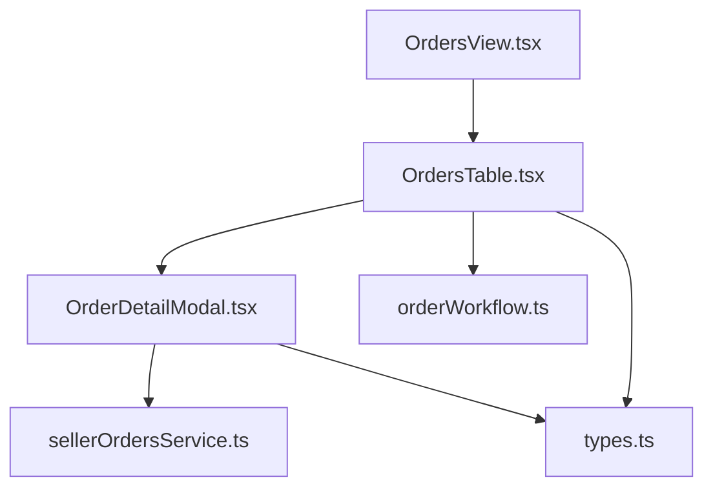
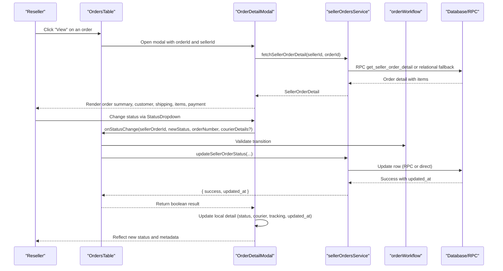
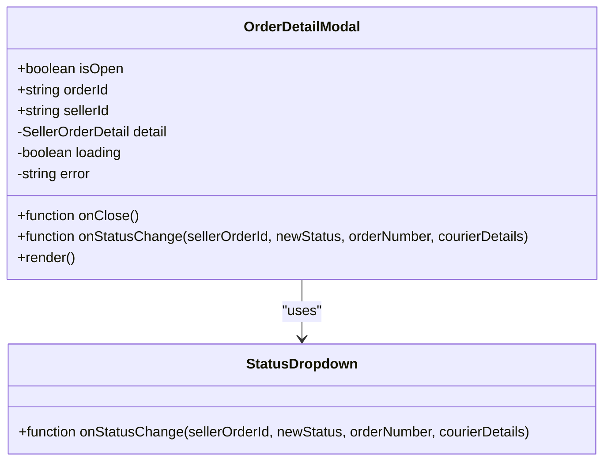
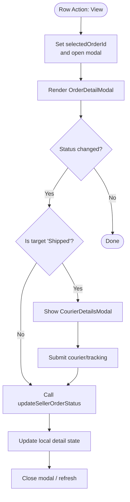
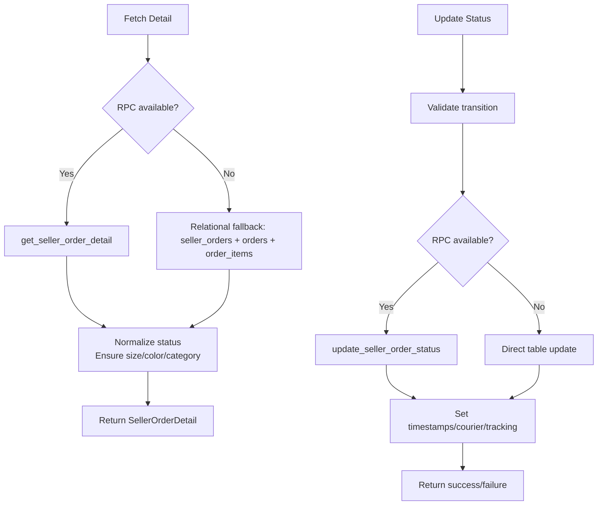
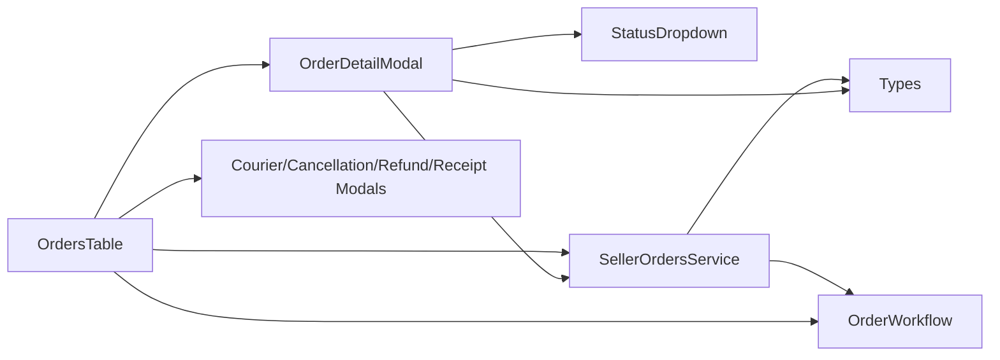
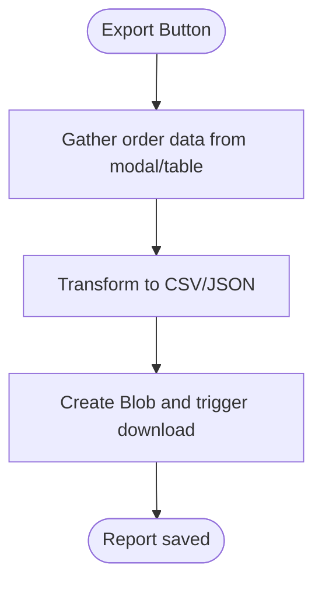

# Order Detail Inspection

<cite>
**Referenced Files in This Document**
- [OrderDetailModal.tsx](file://components/reseller/components/OrderDetailModal.tsx)
- [OrdersTable.tsx](file://components/reseller/components/OrdersTable.tsx)
- [OrdersView.tsx](file://components/reseller/components/OrdersView.tsx)
- [sellerOrdersService.ts](file://src/api/sellerOrdersService.ts)
- [orderWorkflow.ts](file://src/constants/orderWorkflow.ts)
- [types.ts](file://types.ts)
</cite>

## Table of Contents
1. [Introduction](#introduction)
2. [Project Structure](#project-structure)
3. [Core Components](#core-components)
4. [Architecture Overview](#architecture-overview)
5. [Detailed Component Analysis](#detailed-component-analysis)
6. [Dependency Analysis](#dependency-analysis)
7. [Performance Considerations](#performance-considerations)
8. [Troubleshooting Guide](#troubleshooting-guide)
9. [Conclusion](#conclusion)
10. [Appendices](#appendices)

## Introduction
This document explains the order detail inspection system centered on the `OrderDetailModal` component. It provides an in-depth view of individual reseller orders, including customer details, shipping address, product specifications, pricing breakdown, and order history context. The modal integrates with the reseller orders workflow to update statuses, handle courier and tracking information, and display payment status. It also shows how variant fields such as size and color are rendered, and how unstitched products are handled.

The documentation includes:
- How the modal loads and displays order data
- How it handles different order types and variants
- How it integrates with other reseller tools like status updates, courier interception, cancellation, refund, and receipt viewing
- Guidance for customizing the layout, adding custom fields, and implementing export functionality for order reports

## Project Structure
The order detail inspection feature is implemented across a small set of focused components and services:
- `OrderDetailModal`: UI for inspecting a single order
- `OrdersTable`: Parent table that opens the modal and orchestrates status changes
- `OrdersView`: Entry point that resolves the current seller ID and renders the table
- `sellerOrdersService`: Data access layer for fetching and mutating order data
- `orderWorkflow`: Status normalization and transition validation
- `types`: Shared TypeScript interfaces for orders and items

**Diagram sources**
- [OrdersView.tsx:9-15](file://components/reseller/components/OrdersView.tsx#L9-L15)
- [OrdersTable.tsx:538-638](file://components/reseller/components/OrdersTable.tsx#L538-L638)
- [OrderDetailModal.tsx:20-346](file://components/reseller/components/OrderDetailModal.tsx#L20-L346)
- [sellerOrdersService.ts:203-349](file://src/api/sellerOrdersService.ts#L203-L349)
- [orderWorkflow.ts:23-36](file://src/constants/orderWorkflow.ts#L23-L36)
- [types.ts:148-223](file://types.ts#L148-L223)

**Section sources**
- [OrdersView.tsx:9-15](file://components/reseller/components/OrdersView.tsx#L9-L15)
- [OrdersTable.tsx:538-638](file://components/reseller/components/OrdersTable.tsx#L538-L638)
- [OrderDetailModal.tsx:20-346](file://components/reseller/components/OrderDetailModal.tsx#L20-L346)
- [sellerOrdersService.ts:203-349](file://src/api/sellerOrdersService.ts#L203-L349)
- [orderWorkflow.ts:23-36](file://src/constants/orderWorkflow.ts#L23-L36)
- [types.ts:148-223](file://types.ts#L148-L223)

## Core Components
- `OrderDetailModal`
  - Displays order summary, customer details, shipping address, items purchased, and payment information
  - Integrates with `StatusDropdown` to change order status from within the modal
  - Handles loading, error, and empty states
  - Formats dates and currency values for readability
  - Shows courier and tracking details when available
  - Renders item rows with brand, size, color, quantity, unit price, and subtotal; highlights unstitched items by hiding size
- `OrdersTable`
  - Renders paginated orders and triggers opening the modal via a “View” action
  - Coordinates status transitions, courier interception, cancellation, refund, and receipt flows
  - Passes `onStatusChange` to the modal so local state updates after successful mutations
- `OrdersView`
  - Resolves the current seller ID from authentication context and renders `OrdersTable`
- `sellerOrdersService`
  - Provides functions to fetch order lists, fetch detailed order data, update order status, cancel orders, and process refunds
  - Uses RPC calls with relational fallbacks for robustness
- `orderWorkflow`
  - Normalizes order statuses and validates allowed transitions
- `types`
  - Defines shared interfaces for seller orders, order items, and order details

**Section sources**
- [OrderDetailModal.tsx:20-346](file://components/reseller/components/OrderDetailModal.tsx#L20-L346)
- [OrdersTable.tsx:538-638](file://components/reseller/components/OrdersTable.tsx#L538-L638)
- [OrdersView.tsx:9-15](file://components/reseller/components/OrdersView.tsx#L9-L15)
- [sellerOrdersService.ts:203-349](file://src/api/sellerOrdersService.ts#L203-L349)
- [orderWorkflow.ts:23-36](file://src/constants/orderWorkflow.ts#L23-L36)
- [types.ts:148-223](file://types.ts#L148-L223)

## Architecture Overview
The order detail inspection follows a clear separation between UI, orchestration, and data layers:
- UI Layer: `OrderDetailModal` renders the detailed view and delegates status changes to parent handlers
- Orchestration Layer: `OrdersTable` manages user interactions (open modal, status changes, courier interception, cancellation, refund, receipts)
- Data Layer: `sellerOrdersService` encapsulates API calls and business rules (status normalization, transition validation, RPC vs relational fallbacks)
- Domain Rules: `orderWorkflow` defines allowed transitions and normalizes statuses
- Contracts: `types` define the shape of order data consumed by UI and services

**Diagram sources**
- [OrdersTable.tsx:538-638](file://components/reseller/components/OrdersTable.tsx#L538-L638)
- [OrderDetailModal.tsx:80-97](file://components/reseller/components/OrderDetailModal.tsx#L80-L97)
- [sellerOrdersService.ts:203-349](file://src/api/sellerOrdersService.ts#L203-L349)
- [sellerOrdersService.ts:355-449](file://src/api/sellerOrdersService.ts#L355-L449)
- [orderWorkflow.ts:23-36](file://src/constants/orderWorkflow.ts#L23-L36)

## Detailed Component Analysis

### OrderDetailModal
Responsibilities:
- Fetch and render order details using `fetchSellerOrderDetail`
- Display sections:
  - Order summary with order number, timestamps, and status dropdown
  - Customer details with registered/guest indicator
  - Shipping address with optional courier and tracking info
  - Items purchased table with brand, size, color, quantity, unit price, subtotal
  - Payment information with method and status badge
- Handle loading skeleton, error, and empty states
- Integrate with `StatusDropdown` to update order status and reflect changes locally

Key behaviors:
- Date formatting uses localized strings
- Unstitched items hide size display
- Courier/tracking shown conditionally when present
- Local state updates after successful status change include courier/tracking and updated timestamp

**Diagram sources**
- [OrderDetailModal.tsx:7-18](file://components/reseller/components/OrderDetailModal.tsx#L7-L18)
- [OrderDetailModal.tsx:166-173](file://components/reseller/components/OrderDetailModal.tsx#L166-L173)

**Section sources**
- [OrderDetailModal.tsx:20-346](file://components/reseller/components/OrderDetailModal.tsx#L20-L346)

### OrdersTable Integration
Responsibilities:
- Provide “View” button per order to open `OrderDetailModal`
- Manage modal lifecycle (`isModalOpen`, `selectedOrderId`)
- Coordinate status changes through `handleStatusChange`
- Interact with related modals:
  - `CourierDetailsModal` for capturing courier/tracking before shipping
  - `OrderCancellationModal` for cancellations
  - `OrderRefundModal` for refund processing
  - `PaymentReceiptModal` for receipt viewing

Integration points:
- Opens modal with selected order ID and seller ID
- Passes `onStatusChange` callback to modal
- Uses `handleCourierModalSubmit` to intercept courier details for shipping transitions
- Uses cancellation/refund success handlers to refresh data and close modals

**Diagram sources**
- [OrdersTable.tsx:538-638](file://components/reseller/components/OrdersTable.tsx#L538-L638)

**Section sources**
- [OrdersTable.tsx:538-638](file://components/reseller/components/OrdersTable.tsx#L538-L638)

### Data Access and Business Rules
- `fetchSellerOrderDetail`
  - Attempts RPC call first; if unavailable, falls back to relational queries
  - Ensures missing fields like size, color, and category are populated
  - Normalizes status using `normalizeOrderStatus`
- `updateSellerOrderStatus`
  - Validates allowed transitions using `isTransitionAllowed`
  - Supports RPC or direct table update
  - Sets timestamps and courier/tracking fields based on status
- `orderWorkflow`
  - Normalizes statuses (e.g., Confirmed/Processing treated as Pending)
  - Defines allowed transitions (Pending -> Shipped/Cancelled, Shipped -> Delivered/Refund, etc.)

**Diagram sources**
- [sellerOrdersService.ts:203-349](file://src/api/sellerOrdersService.ts#L203-L349)
- [sellerOrdersService.ts:355-449](file://src/api/sellerOrdersService.ts#L355-L449)
- [orderWorkflow.ts:23-36](file://src/constants/orderWorkflow.ts#L23-L36)

**Section sources**
- [sellerOrdersService.ts:203-349](file://src/api/sellerOrdersService.ts#L203-L349)
- [sellerOrdersService.ts:355-449](file://src/api/sellerOrdersService.ts#L355-L449)
- [orderWorkflow.ts:23-36](file://src/constants/orderWorkflow.ts#L23-L36)

### Variant Handling and Order Types
- Variants:
  - Size and color are displayed per item row
  - If size/color missing from RPC response, service fills them from `order_items`
  - Category is fetched from `products` to support special rendering logic
- Order types:
  - Unstitched items: size column is hidden and replaced with a placeholder
  - Registered vs guest customers: badge indicates registration status
  - Payment method and status are shown with badges for clarity

**Section sources**
- [OrderDetailModal.tsx:267-284](file://components/reseller/components/OrderDetailModal.tsx#L267-L284)
- [sellerOrdersService.ts:218-263](file://src/api/sellerOrdersService.ts#L218-L263)
- [types.ts:178-223](file://types.ts#L178-L223)

### Tracking Details and Courier Integration
- When order status changes to “Shipped”, the modal can capture courier name and tracking number via `CourierDetailsModal`
- These fields are then reflected in the shipping section of the modal
- The service sets appropriate timestamps and fields during status updates

**Section sources**
- [OrderDetailModal.tsx:223-235](file://components/reseller/components/OrderDetailModal.tsx#L223-L235)
- [OrdersTable.tsx:601-608](file://components/reseller/components/OrdersTable.tsx#L601-L608)
- [sellerOrdersService.ts:415-427](file://src/api/sellerOrdersService.ts#L415-L427)

### Integration With Other Reseller Tools
- Status management:
  - `StatusDropdown` inside the modal delegates to parent handler
  - Transition validation ensures only allowed moves occur
- Cancellation:
  - Dedicated modal collects reason and updates order to “Cancelled”
- Refund:
  - Dedicated modal uploads parcel image and updates order to “Refund”
- Receipts:
  - Receipt modal allows viewing payment receipts linked to orders

**Section sources**
- [OrderDetailModal.tsx:166-173](file://components/reseller/components/OrderDetailModal.tsx#L166-L173)
- [OrdersTable.tsx:610-638](file://components/reseller/components/OrdersTable.tsx#L610-L638)
- [sellerOrdersService.ts:455-511](file://src/api/sellerOrdersService.ts#L455-L511)
- [sellerOrdersService.ts:518-642](file://src/api/sellerOrdersService.ts#L518-L642)

## Dependency Analysis
Coupling and cohesion:
- `OrderDetailModal` depends on:
  - `StatusDropdown` for status changes
  - `sellerOrdersService` for data fetching
  - `types` for data contracts
- `OrdersTable` depends on:
  - `OrderDetailModal` for detail view
  - `sellerOrdersService` for mutations
  - `orderWorkflow` for validation
  - Related modals for courier, cancellation, refund, receipts
- `sellerOrdersService` depends on:
  - Supabase client for RPC and relational queries
  - `orderWorkflow` for normalization and validation
  - `types` for data shapes

Potential circular dependencies:
- None detected; relationships are unidirectional from UI to service and domain rules

External integration points:
- Supabase RPC and storage for order operations and refund images
- Authentication context for seller identity resolution

**Diagram sources**
- [OrderDetailModal.tsx:20-346](file://components/reseller/components/OrderDetailModal.tsx#L20-L346)
- [OrdersTable.tsx:538-638](file://components/reseller/components/OrdersTable.tsx#L538-L638)
- [sellerOrdersService.ts:203-349](file://src/api/sellerOrdersService.ts#L203-L349)
- [orderWorkflow.ts:23-36](file://src/constants/orderWorkflow.ts#L23-L36)
- [types.ts:148-223](file://types.ts#L148-L223)

**Section sources**
- [OrderDetailModal.tsx:20-346](file://components/reseller/components/OrderDetailModal.tsx#L20-L346)
- [OrdersTable.tsx:538-638](file://components/reseller/components/OrdersTable.tsx#L538-L638)
- [sellerOrdersService.ts:203-349](file://src/api/sellerOrdersService.ts#L203-L349)
- [orderWorkflow.ts:23-36](file://src/constants/orderWorkflow.ts#L23-L36)
- [types.ts:148-223](file://types.ts#L148-L223)

## Performance Considerations
- Loading states:
  - Skeleton placeholders improve perceived performance while fetching details
- Data normalization:
  - RPC-first approach reduces payload size; relational fallback ensures resilience
- Field population:
  - Missing size/color/category are filled lazily to avoid extra queries when not needed
- Rendering efficiency:
  - Conditional rendering of courier/tracking avoids unnecessary DOM nodes
- Pagination:
  - Orders list pagination prevents large datasets from impacting UI responsiveness

[No sources needed since this section provides general guidance]

## Troubleshooting Guide
Common issues and resolutions:
- Failed to load order details
  - Cause: Network error or RPC unavailable
  - Resolution: Check console errors; ensure sellerId and orderId are valid; verify RPC availability or rely on relational fallback
- Invalid status transition
  - Cause: Attempting disallowed move (e.g., Delivered -> Shipped)
  - Resolution: Use allowed transitions defined in workflow; validate before calling update function
- Missing variant fields
  - Cause: RPC response omits size/color/category
  - Resolution: Service auto-fills from relational tables; ensure product and order_item records exist
- Courier/tracking not showing
  - Cause: Not captured during shipping transition
  - Resolution: Use courier interception modal before marking order as shipped

**Section sources**
- [OrderDetailModal.tsx:43-56](file://components/reseller/components/OrderDetailModal.tsx#L43-L56)
- [sellerOrdersService.ts:355-449](file://src/api/sellerOrdersService.ts#L355-L449)
- [orderWorkflow.ts:23-36](file://src/constants/orderWorkflow.ts#L23-L36)

## Conclusion
The order detail inspection system provides a robust, user-friendly interface for resellers to inspect and manage individual orders. It combines clear UI presentation with resilient data access and strict workflow validation. By integrating with related reseller tools, it supports end-to-end order handling from status changes to shipping, cancellation, refunds, and receipts. The architecture encourages extensibility for custom layouts, additional fields, and reporting exports.

[No sources needed since this section summarizes without analyzing specific files]

## Appendices

### Customizing the Detail View Layout
- Reorder sections:
  - Move customer/shipping blocks above order summary if preferred
- Add custom fields:
  - Extend `SellerOrderDetail` type with new properties
  - Render new fields in the modal body alongside existing sections
- Styling:
  - Adjust Tailwind classes for spacing, typography, and responsive behavior
- Conditional sections:
  - Show/hide sections based on order attributes (e.g., gift wrapping, special instructions)

**Section sources**
- [OrderDetailModal.tsx:151-329](file://components/reseller/components/OrderDetailModal.tsx#L151-L329)
- [types.ts:192-223](file://types.ts#L192-L223)

### Adding Custom Fields
- Define new fields in `SellerOrderDetail` and `SellerOrderItemDetail`
- Populate fields in `sellerOrdersService` from RPC or relational queries
- Render fields in `OrderDetailModal` under relevant sections (customer, shipping, items, payment)

**Section sources**
- [types.ts:178-223](file://types.ts#L178-L223)
- [sellerOrdersService.ts:203-349](file://src/api/sellerOrdersService.ts#L203-L349)
- [OrderDetailModal.tsx:177-329](file://components/reseller/components/OrderDetailModal.tsx#L177-L329)

### Implementing Export Functionality for Order Reports
- Collect visible data:
  - Extract order numbers, customer names, items, totals, statuses, and timestamps from `detail` and `orders`
- Format data:
  - Convert to CSV or JSON structure suitable for downstream systems
- Trigger download:
  - Create a Blob and trigger browser download with filename including date range
- Optional enhancements:
  - Filter by status/date range
  - Include courier/tracking and payment method columns
  - Support multiple sheets for orders and line items

[No sources needed since this diagram shows conceptual workflow, not actual code structure]