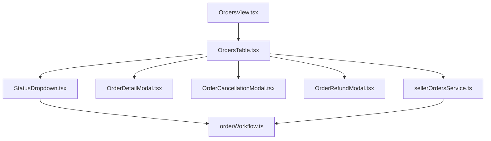
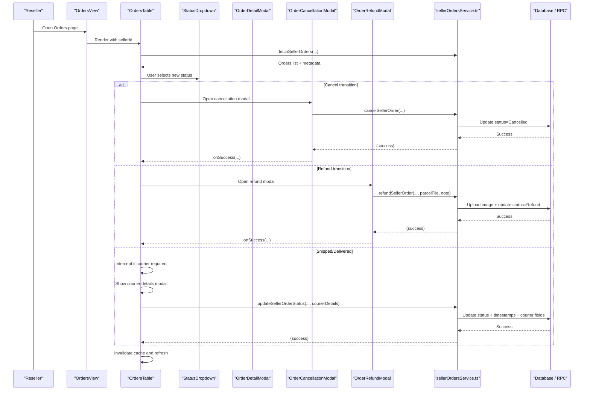
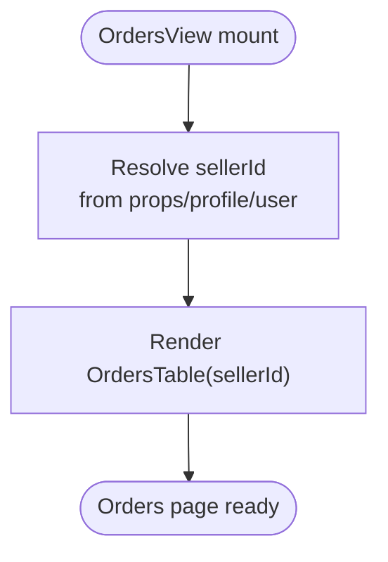
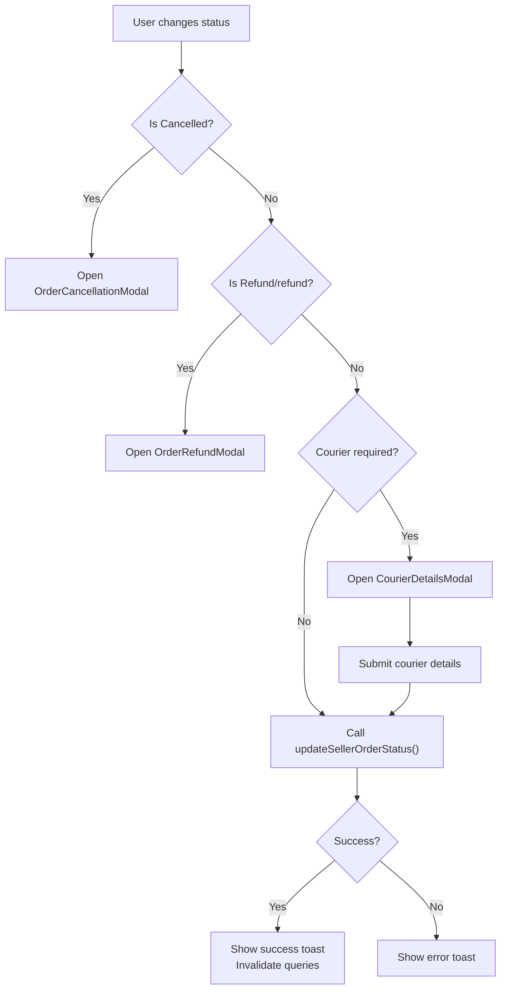
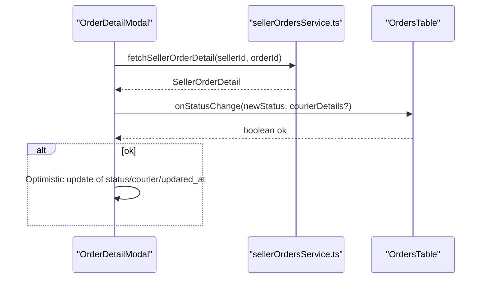
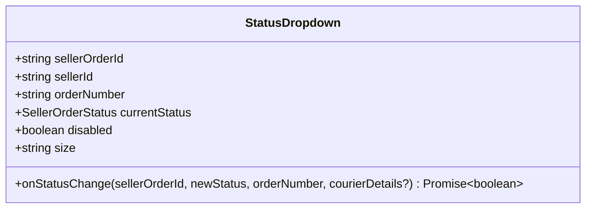
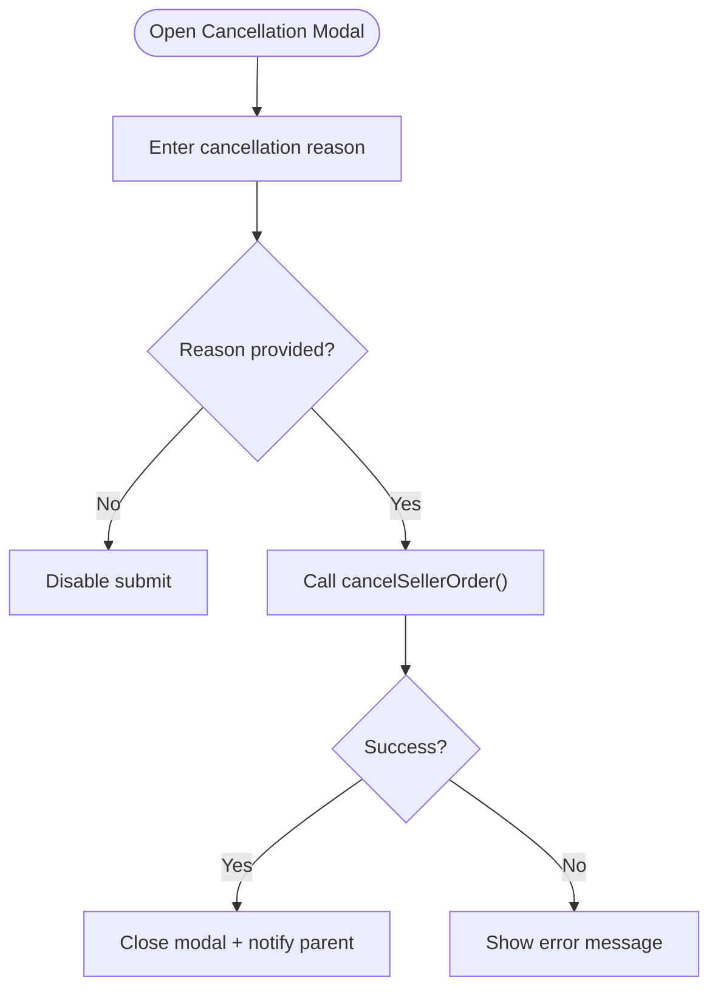
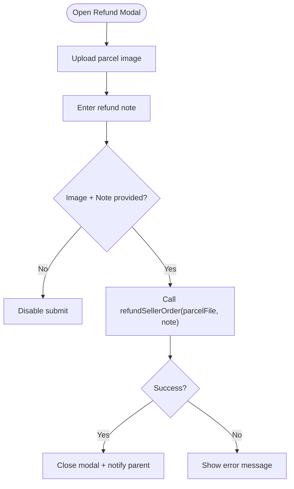
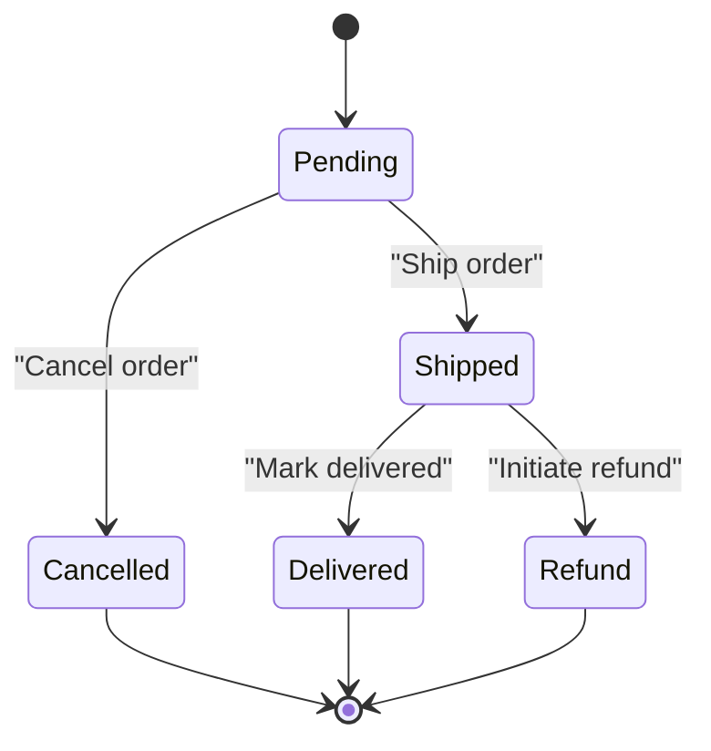
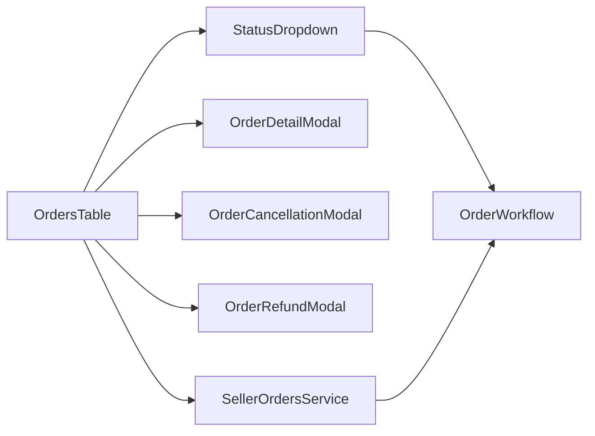

# Order Management

<cite>
**Referenced Files in This Document**
- [OrdersView.tsx](file://components/reseller/components/OrdersView.tsx)
- [OrdersTable.tsx](file://components/reseller/components/OrdersTable.tsx)
- [OrderDetailModal.tsx](file://components/reseller/components/OrderDetailModal.tsx)
- [StatusDropdown.tsx](file://components/reseller/components/StatusDropdown.tsx)
- [OrderCancellationModal.tsx](file://components/reseller/components/OrderCancellationModal.tsx)
- [OrderRefundModal.tsx](file://components/reseller/components/OrderRefundModal.tsx)
- [orderWorkflow.ts](file://src/constants/orderWorkflow.ts)
- [sellerOrdersService.ts](file://src/api/sellerOrdersService.ts)
</cite>

## Table of Contents
1. [Introduction](#introduction)
2. [Project Structure](#project-structure)
3. [Core Components](#core-components)
4. [Architecture Overview](#architecture-overview)
5. [Detailed Component Analysis](#detailed-component-analysis)
6. [Dependency Analysis](#dependency-analysis)
7. [Performance Considerations](#performance-considerations)
8. [Troubleshooting Guide](#troubleshooting-guide)
9. [Conclusion](#conclusion)

## Introduction
This document explains the order management system used by resellers to view, inspect, and manage orders. It covers:
- The OrdersView entry point for displaying all orders.
- The OrdersTable component for tabular presentation, filtering, sorting, pagination, and status changes.
- The OrderDetailModal for detailed inspection of a single order.
- The StatusDropdown for constrained status transitions.
- Cancellation through OrderCancellationModal.
- Refund handling via OrderRefundModal.
- Shipping integration using courier details and tracking numbers.
- The complete order lifecycle from placement to fulfillment, including status transitions, customer notifications, and shipping provider integration points.

## Project Structure
The order management UI is implemented under the reseller components folder, with business logic and data access centralized in the API service layer and workflow constants.

**Diagram sources**
- [OrdersView.tsx:1-19](file://components/reseller/components/OrdersView.tsx#L1-L19)
- [OrdersTable.tsx:1-643](file://components/reseller/components/OrdersTable.tsx#L1-L643)
- [OrderDetailModal.tsx:1-347](file://components/reseller/components/OrderDetailModal.tsx#L1-L347)
- [StatusDropdown.tsx:1-136](file://components/reseller/components/StatusDropdown.tsx#L1-L136)
- [OrderCancellationModal.tsx:1-137](file://components/reseller/components/OrderCancellationModal.tsx#L1-L137)
- [OrderRefundModal.tsx:1-200](file://components/reseller/components/OrderRefundModal.tsx#L1-L200)
- [orderWorkflow.ts:1-37](file://src/constants/orderWorkflow.ts#L1-L37)
- [sellerOrdersService.ts:1-644](file://src/api/sellerOrdersService.ts#L1-L644)

**Section sources**
- [OrdersView.tsx:1-19](file://components/reseller/components/OrdersView.tsx#L1-L19)
- [OrdersTable.tsx:1-643](file://components/reseller/components/OrdersTable.tsx#L1-L643)

## Core Components
- OrdersView: Entry component that resolves the current seller ID and renders OrdersTable.
- OrdersTable: Main table view with search, filter, sort, pagination, status updates, and modal orchestration.
- OrderDetailModal: Detailed order inspector showing customer, shipping, items, payment, and inline status control.
- StatusDropdown: Constrained status selector based on allowed transitions.
- OrderCancellationModal: Captures cancellation reason and calls the cancellation API.
- OrderRefundModal: Captures parcel image and refund note, uploads image, and submits refund request.

Key responsibilities:
- Data fetching and caching are handled by TanStack Query within OrdersTable.
- Business rules for status transitions are defined in orderWorkflow.ts.
- All server interactions (list, detail, update, cancel, refund) are centralized in sellerOrdersService.ts.

**Section sources**
- [OrdersView.tsx:1-19](file://components/reseller/components/OrdersView.tsx#L1-L19)
- [OrdersTable.tsx:59-643](file://components/reseller/components/OrdersTable.tsx#L59-L643)
- [OrderDetailModal.tsx:20-347](file://components/reseller/components/OrderDetailModal.tsx#L20-L347)
- [StatusDropdown.tsx:65-136](file://components/reseller/components/StatusDropdown.tsx#L65-L136)
- [OrderCancellationModal.tsx:14-137](file://components/reseller/components/OrderCancellationModal.tsx#L14-L137)
- [OrderRefundModal.tsx:14-200](file://components/reseller/components/OrderRefundModal.tsx#L14-L200)
- [orderWorkflow.ts:1-37](file://src/constants/orderWorkflow.ts#L1-L37)
- [sellerOrdersService.ts:35-644](file://src/api/sellerOrdersService.ts#L35-L644)

## Architecture Overview
The order management architecture follows a layered approach:
- Presentation Layer: OrdersView, OrdersTable, OrderDetailModal, StatusDropdown, OrderCancellationModal, OrderRefundModal.
- Workflow Rules: orderWorkflow.ts defines allowed transitions and display filters.
- Service Layer: sellerOrdersService.ts encapsulates data operations and validation.

**Diagram sources**
- [OrdersTable.tsx:158-234](file://components/reseller/components/OrdersTable.tsx#L158-L234)
- [OrderCancellationModal.tsx:28-47](file://components/reseller/components/OrderCancellationModal.tsx#L28-L47)
- [OrderRefundModal.tsx:45-64](file://components/reseller/components/OrderRefundModal.tsx#L45-L64)
- [sellerOrdersService.ts:355-449](file://src/api/sellerOrdersService.ts#L355-L449)
- [sellerOrdersService.ts:455-511](file://src/api/sellerOrdersService.ts#L455-L511)
- [sellerOrdersService.ts:518-642](file://src/api/sellerOrdersService.ts#L518-L642)

## Detailed Component Analysis

### OrdersView
- Purpose: Resolve the active seller context and render the OrdersTable.
- Behavior: Derives sellerId from props, reseller profile, or logged-in user; defaults to a placeholder when none available.

**Diagram sources**
- [OrdersView.tsx:9-16](file://components/reseller/components/OrdersView.tsx#L9-L16)

**Section sources**
- [OrdersView.tsx:1-19](file://components/reseller/components/OrdersView.tsx#L1-L19)

### OrdersTable
- Responsibilities:
  - Fetch orders using TanStack Query with filters, search, sort, and pagination.
  - Local client-side search and sorting enhancements.
  - Orchestrate modals for courier details, cancellation, refund, and payment receipt.
  - Handle status change interception to enforce workflows and require courier details when needed.
  - Provide toast notifications and cache invalidation after mutations.

Key behaviors:
- Display filters use DISPLAY_FILTER_STATUSES.
- Sorting supports created_at, seller_total, and customer_name.
- Search matches order number, customer name, aggregated items, and city.
- Status changes go through handleStatusChange, which intercepts special flows:
  - Cancelled: opens OrderCancellationModal.
  - Refund/refund: opens OrderRefundModal.
  - Shipped/Delivered requiring courier: opens CourierDetailsModal before calling updateSellerOrderStatus.

**Diagram sources**
- [OrdersTable.tsx:158-234](file://components/reseller/components/OrdersTable.tsx#L158-L234)
- [orderWorkflow.ts:14-21](file://src/constants/orderWorkflow.ts#L14-L21)

**Section sources**
- [OrdersTable.tsx:59-643](file://components/reseller/components/OrdersTable.tsx#L59-L643)

### OrderDetailModal
- Purpose: Inspect a single order’s full details, including customer, shipping address, items, payment info, and inline status control.
- Data flow:
  - On open, fetches detail via fetchSellerOrderDetail.
  - Normalizes status for display.
  - Delegates status changes to parent via onStatusChange.
  - Updates local state optimistically upon successful status change.

**Diagram sources**
- [OrderDetailModal.tsx:31-61](file://components/reseller/components/OrderDetailModal.tsx#L31-L61)
- [OrderDetailModal.tsx:80-97](file://components/reseller/components/OrderDetailModal.tsx#L80-L97)
- [sellerOrdersService.ts:203-349](file://src/api/sellerOrdersService.ts#L203-L349)

**Section sources**
- [OrderDetailModal.tsx:1-347](file://components/reseller/components/OrderDetailModal.tsx#L1-L347)

### StatusDropdown
- Purpose: Present allowed next statuses based on current status and trigger onStatusChange.
- Logic:
  - Normalizes current status.
  - Renders static badge for terminal states.
  - Provides select options for non-terminal states.
  - Disables interaction while updating.

**Diagram sources**
- [StatusDropdown.tsx:5-18](file://components/reseller/components/StatusDropdown.tsx#L5-L18)
- [StatusDropdown.tsx:65-136](file://components/reseller/components/StatusDropdown.tsx#L65-L136)

**Section sources**
- [StatusDropdown.tsx:1-136](file://components/reseller/components/StatusDropdown.tsx#L1-L136)

### OrderCancellationModal
- Purpose: Capture cancellation reason and call cancelSellerOrder.
- Validation: Requires non-empty reason; prevents double submission.
- Outcome: On success, triggers parent callback to refresh orders and show toast.

**Diagram sources**
- [OrderCancellationModal.tsx:28-47](file://components/reseller/components/OrderCancellationModal.tsx#L28-L47)
- [sellerOrdersService.ts:455-511](file://src/api/sellerOrdersService.ts#L455-L511)

**Section sources**
- [OrderCancellationModal.tsx:1-137](file://components/reseller/components/OrderCancellationModal.tsx#L1-L137)

### OrderRefundModal
- Purpose: Collect parcel image and refund note, upload image, then mark order as Refund.
- Validation: Requires parcel image and note; prevents double submission.
- Outcome: On success, triggers parent callback to refresh orders and show toast.

**Diagram sources**
- [OrderRefundModal.tsx:45-64](file://components/reseller/components/OrderRefundModal.tsx#L45-L64)
- [sellerOrdersService.ts:518-642](file://src/api/sellerOrdersService.ts#L518-L642)

**Section sources**
- [OrderRefundModal.tsx:1-200](file://components/reseller/components/OrderRefundModal.tsx#L1-L200)

### Order Lifecycle and Status Transitions
Allowed transitions are defined centrally:
- Pending, Confirmed, Processing can move to Shipped or Cancelled.
- Shipped can move to Delivered or Refund.
- Delivered, Refund, Cancelled are terminal.

Normalization treats Confirmed and Processing as Pending for display and transition purposes.

**Diagram sources**
- [orderWorkflow.ts:3-12](file://src/constants/orderWorkflow.ts#L3-L12)
- [orderWorkflow.ts:23-29](file://src/constants/orderWorkflow.ts#L23-L29)

**Section sources**
- [orderWorkflow.ts:1-37](file://src/constants/orderWorkflow.ts#L1-L37)

## Dependency Analysis
- OrdersTable depends on:
  - StatusDropdown for status selection.
  - OrderDetailModal for detailed inspection.
  - OrderCancellationModal and OrderRefundModal for specialized workflows.
  - sellerOrdersService for all data operations.
- StatusDropdown depends on orderWorkflow for allowed transitions and normalization.
- sellerOrdersService uses orderWorkflow for transition validation and normalizes statuses across responses.

**Diagram sources**
- [OrdersTable.tsx:1-13](file://components/reseller/components/OrdersTable.tsx#L1-L13)
- [StatusDropdown.tsx:1-4](file://components/reseller/components/StatusDropdown.tsx#L1-L4)
- [sellerOrdersService.ts:1-8](file://src/api/sellerOrdersService.ts#L1-L8)

**Section sources**
- [OrdersTable.tsx:1-643](file://components/reseller/components/OrdersTable.tsx#L1-L643)
- [StatusDropdown.tsx:1-136](file://components/reseller/components/StatusDropdown.tsx#L1-L136)
- [sellerOrdersService.ts:1-644](file://src/api/sellerOrdersService.ts#L1-L644)

## Performance Considerations
- Data fetching:
  - OrdersTable uses TanStack Query with query keys including filters, search, pagination, sort, and sellerId. This enables efficient caching and automatic refetching.
  - Stale time is set to reduce unnecessary network requests.
- Client-side optimizations:
  - useMemo for sorted/searched results avoids recomputation on unrelated re-renders.
  - Pagination reduces payload size.
- Mutation handling:
  - After successful status updates, query invalidation ensures consistent UI without full reloads.
- Image handling:
  - Refund modal creates object URLs for preview and handles cleanup to avoid memory leaks.

[No sources needed since this section provides general guidance]

## Troubleshooting Guide
Common issues and resolutions:
- Status update fails due to invalid transition:
  - Ensure the new status is allowed from the current status per ALLOWED_TRANSITIONS.
  - Check normalizeOrderStatus behavior for Confirmed/Processing mapping to Pending.
- Missing courier details for Shipped/Delivered:
  - Use the courier details modal when required; ensure both courier name and tracking number are provided.
- Cancellation requires a reason:
  - Ensure the cancellation reason field is non-empty before submitting.
- Refund submission requires an image and note:
  - Upload a parcel image and provide a descriptive note before submitting.
- Payment receipt actions:
  - Accepting or rejecting receipts triggers appropriate toasts and refreshes the orders list.

Operational tips:
- Use the search bar to quickly locate orders by order number, customer name, item names, or city.
- Use the status filter dropdown to focus on actionable queues like Pending, Shipped, Delivered, Refund, or Cancelled.
- Monitor toasts for success/error feedback after mutations.

**Section sources**
- [OrdersTable.tsx:126-175](file://components/reseller/components/OrdersTable.tsx#L126-L175)
- [OrderCancellationModal.tsx:28-47](file://components/reseller/components/OrderCancellationModal.tsx#L28-L47)
- [OrderRefundModal.tsx:45-64](file://components/reseller/components/OrderRefundModal.tsx#L45-L64)
- [sellerOrdersService.ts:355-449](file://src/api/sellerOrdersService.ts#L355-L449)
- [sellerOrdersService.ts:455-511](file://src/api/sellerOrdersService.ts#L455-L511)
- [sellerOrdersService.ts:518-642](file://src/api/sellerOrdersService.ts#L518-L642)

## Conclusion
The order management system provides a robust, user-friendly interface for resellers to manage orders end-to-end. It enforces strict status transitions, integrates shipping via courier details and tracking numbers, and supports cancellations and refunds with proper validation and audit trails. The separation of concerns between UI components, workflow rules, and service layer functions ensures maintainability and clarity.

[No sources needed since this section summarizes without analyzing specific files]