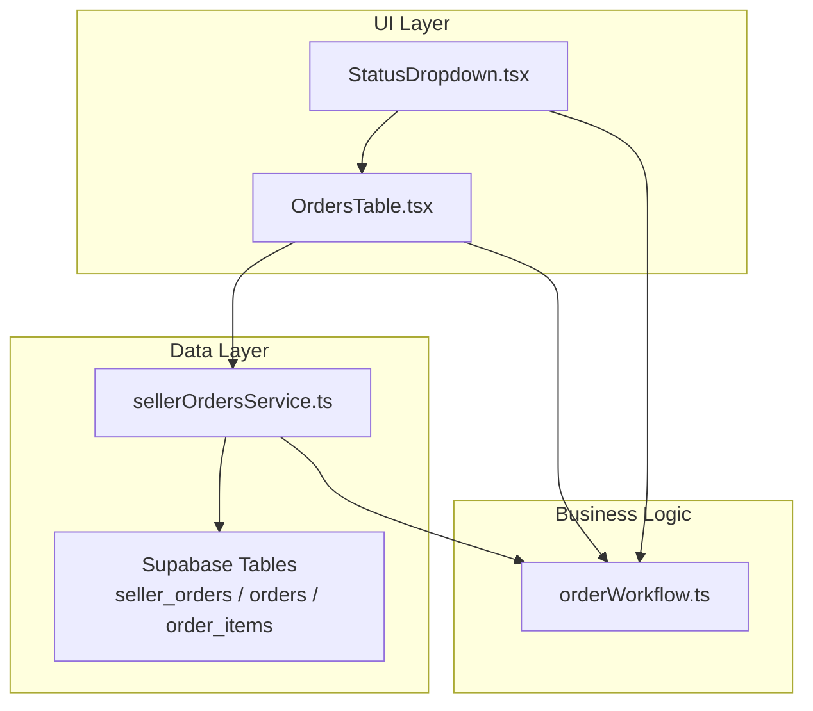
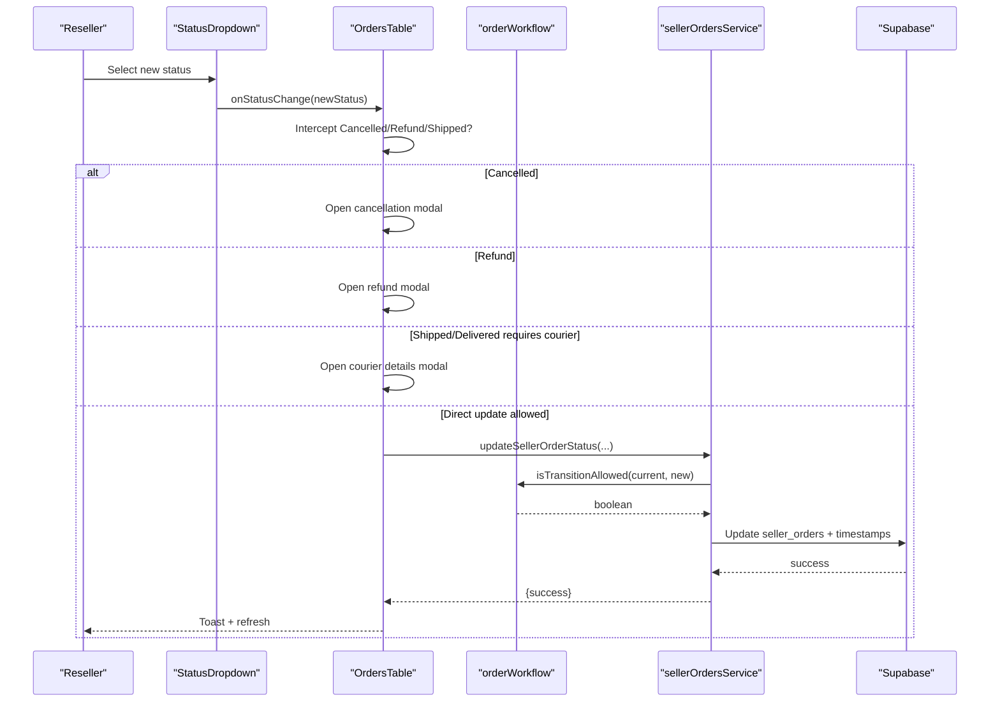
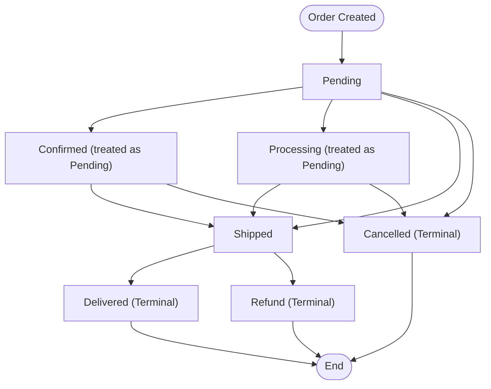
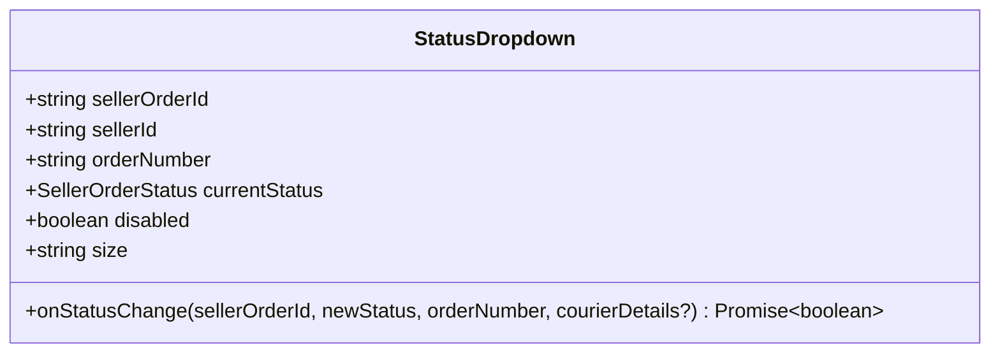
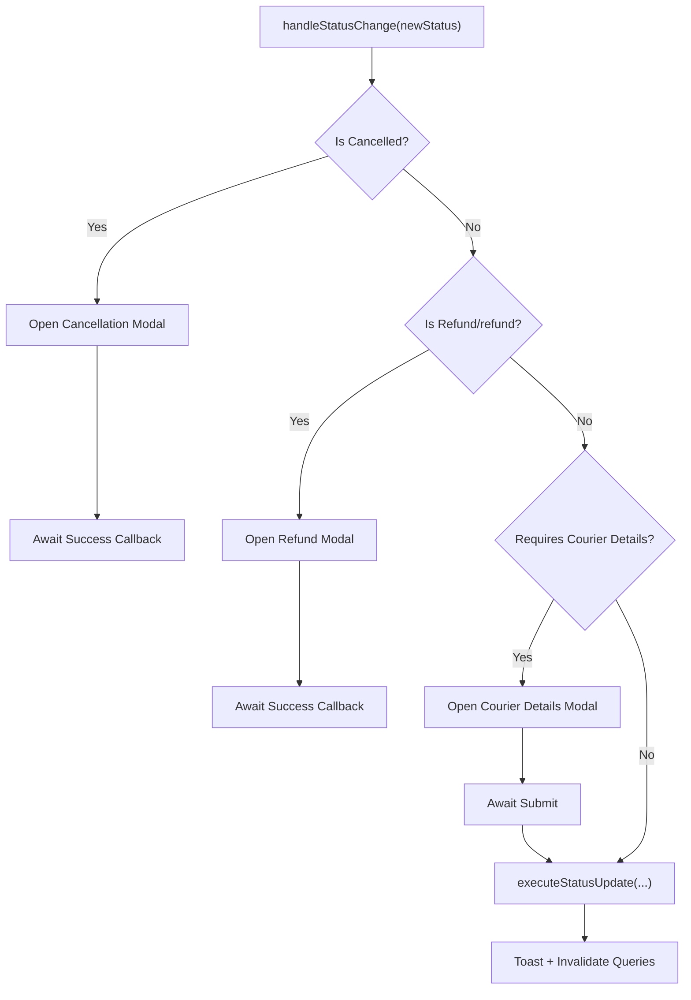
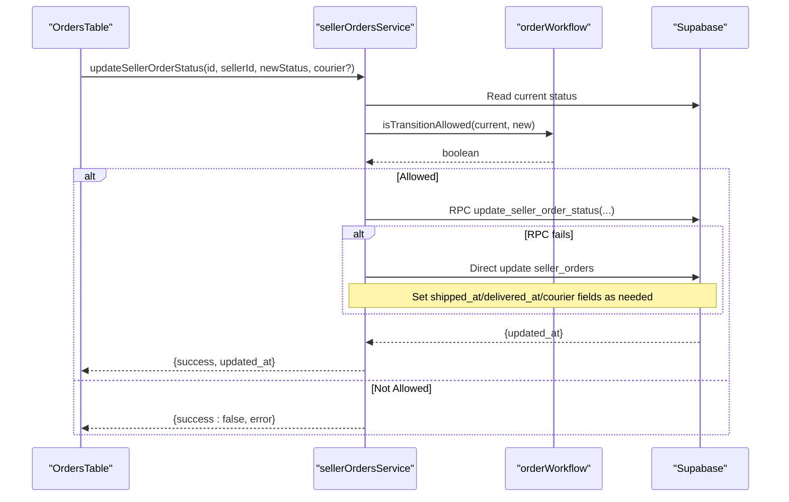
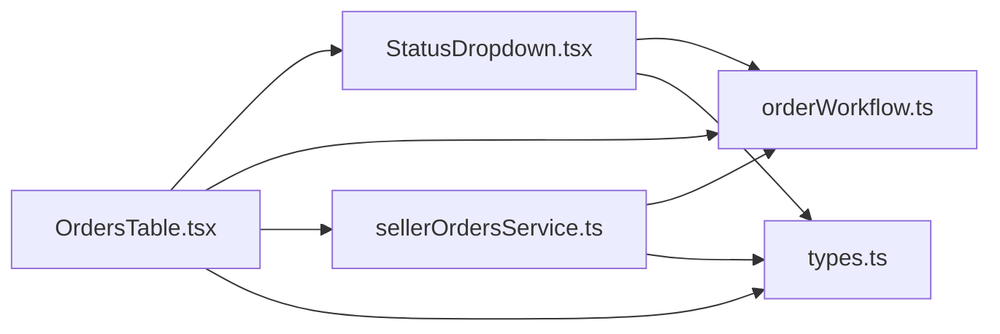

# Order Status Workflow

<cite>
**Referenced Files in This Document**
- [orderWorkflow.ts](file://src/constants/orderWorkflow.ts)
- [StatusDropdown.tsx](file://components/reseller/components/StatusDropdown.tsx)
- [OrdersTable.tsx](file://components/reseller/components/OrdersTable.tsx)
- [sellerOrdersService.ts](file://src/api/sellerOrdersService.ts)
- [types.ts](file://types.ts)
</cite>

## Table of Contents
1. [Introduction](#introduction)
2. [Project Structure](#project-structure)
3. [Core Components](#core-components)
4. [Architecture Overview](#architecture-overview)
5. [Detailed Component Analysis](#detailed-component-analysis)
6. [Dependency Analysis](#dependency-analysis)
7. [Performance Considerations](#performance-considerations)
8. [Troubleshooting Guide](#troubleshooting-guide)
9. [Conclusion](#conclusion)
10. [Appendices](#appendices)

## Introduction
This document explains the order status workflow system used by resellers to manage orders through an interactive dropdown interface. It covers:
- The StatusDropdown component and how it presents allowed transitions.
- The complete order lifecycle states defined in the workflow configuration.
- Transition rules, validation constraints, and downstream processing such as courier details capture, cancellation, and refund workflows.
- How to extend the workflow with custom statuses and integrate with external systems like notifications or inventory services.

## Project Structure
The order status workflow spans UI components, business logic constants, and API service functions:
- UI layer: StatusDropdown renders a compact status selector per order row. OrdersTable orchestrates modals for cancellations, refunds, and courier details.
- Business logic: orderWorkflow defines allowed transitions, display filters, normalization helpers, and transition validators.
- Data layer: sellerOrdersService performs server-side validation, updates, and specialized flows for cancellation and refund.
- Types: types.ts defines SellerOrderStatus and related data models.

**Diagram sources**
- [StatusDropdown.tsx:1-136](file://components/reseller/components/StatusDropdown.tsx#L1-L136)
- [OrdersTable.tsx:1-643](file://components/reseller/components/OrdersTable.tsx#L1-L643)
- [orderWorkflow.ts:1-37](file://src/constants/orderWorkflow.ts#L1-L37)
- [sellerOrdersService.ts:1-644](file://src/api/sellerOrdersService.ts#L1-L644)

**Section sources**
- [StatusDropdown.tsx:1-136](file://components/reseller/components/StatusDropdown.tsx#L1-L136)
- [OrdersTable.tsx:1-643](file://components/reseller/components/OrdersTable.tsx#L1-L643)
- [orderWorkflow.ts:1-37](file://src/constants/orderWorkflow.ts#L1-L37)
- [sellerOrdersService.ts:1-644](file://src/api/sellerOrdersService.ts#L1-L644)
- [types.ts:148-176](file://types.ts#L148-L176)

## Core Components
- StatusDropdown: A small, accessible select control that shows the current normalized status and only allows transitions defined by ALLOWED_TRANSITIONS. Terminal states render as static badges without options.
- OrdersTable: The main reseller orders view. It intercepts specific status changes (Cancelled, Refund, Shipped/Delivered requiring courier details), opens appropriate modals, and calls the service to persist changes.
- orderWorkflow: Centralizes state machine rules, normalization, and transition validation.
- sellerOrdersService: Performs server-side checks, RPC or direct table updates, timestamping, and specialized flows for cancellation and refund.

Key responsibilities:
- StatusDropdown focuses on presentation and local update gating.
- OrdersTable coordinates user interactions and modal flows.
- orderWorkflow provides the single source of truth for allowed transitions and normalization.
- sellerOrdersService enforces business rules at the data layer and persists changes.

**Section sources**
- [StatusDropdown.tsx:5-18](file://components/reseller/components/StatusDropdown.tsx#L5-L18)
- [OrdersTable.tsx:158-215](file://components/reseller/components/OrdersTable.tsx#L158-L215)
- [orderWorkflow.ts:3-36](file://src/constants/orderWorkflow.ts#L3-L36)
- [sellerOrdersService.ts:355-449](file://src/api/sellerOrdersService.ts#L355-L449)

## Architecture Overview
The order status workflow follows a layered architecture:
- Presentation: StatusDropdown displays allowed transitions based on current status.
- Orchestration: OrdersTable handles interception for special statuses and triggers modals.
- Validation: Both client and server validate transitions using orderWorkflow.
- Persistence: sellerOrdersService updates records and timestamps relevant fields.

**Diagram sources**
- [StatusDropdown.tsx:95-105](file://components/reseller/components/StatusDropdown.tsx#L95-L105)
- [OrdersTable.tsx:177-215](file://components/reseller/components/OrdersTable.tsx#L177-L215)
- [sellerOrdersService.ts:355-449](file://src/api/sellerOrdersService.ts#L355-L449)
- [orderWorkflow.ts:31-36](file://src/constants/orderWorkflow.ts#L31-L36)

## Detailed Component Analysis

### StatusLifecycle States and Rules
The order lifecycle includes:
- Pending: Initial state; can move to Shipped or Cancelled.
- Confirmed: Treated as Pending for transitions.
- Processing: Treated as Pending for transitions.
- Shipped: Can move to Delivered or Refund.
- Delivered: Terminal state.
- Cancelled: Terminal state.
- Refund/refund: Terminal state variants.

Normalization:
- Unknown or null values normalize to Pending.
- Confirmed and Processing normalize to Pending.
- Refund variants are normalized consistently.

Validation:
- isTransitionAllowed uses normalized current and target statuses against ALLOWED_TRANSITIONS.

**Diagram sources**
- [orderWorkflow.ts:3-12](file://src/constants/orderWorkflow.ts#L3-L12)
- [orderWorkflow.ts:23-29](file://src/constants/orderWorkflow.ts#L23-L29)

**Section sources**
- [orderWorkflow.ts:3-36](file://src/constants/orderWorkflow.ts#L3-L36)
- [types.ts:148-148](file://types.ts#L148-L148)

### StatusDropdown Component
Responsibilities:
- Renders a compact select with the current normalized status and allowed next states.
- Disables selection when the order is in a terminal state.
- Prevents duplicate selections and shows an updating state while the change is in flight.
- Uses getStatusBadgeStyle to apply consistent visual styling per normalized status.

Behavior highlights:
- Normalization ensures consistent rendering and option generation.
- Terminal states render as non-editable badges.
- onStatusChange is called with identifiers and the selected new status.

**Diagram sources**
- [StatusDropdown.tsx:5-18](file://components/reseller/components/StatusDropdown.tsx#L5-L18)

**Section sources**
- [StatusDropdown.tsx:20-63](file://components/reseller/components/StatusDropdown.tsx#L20-L63)
- [StatusDropdown.tsx:65-135](file://components/reseller/components/StatusDropdown.tsx#L65-L135)

### OrdersTable Orchestration
Responsibilities:
- Fetches and displays orders with filtering, sorting, and pagination.
- Intercepts specific status changes:
  - Cancelled: Opens cancellation modal to collect reason.
  - Refund/refund: Opens refund modal to collect parcel image and note.
  - Shipped/Delivered: Opens courier details modal if required.
- Executes status updates via sellerOrdersService and refreshes data on success.

Interception flow:
- If a status requires additional input, the handler returns false and opens a modal.
- Once the modal submits, OrdersTable calls executeStatusUpdate with collected details.

**Diagram sources**
- [OrdersTable.tsx:177-215](file://components/reseller/components/OrdersTable.tsx#L177-L215)
- [OrdersTable.tsx:217-234](file://components/reseller/components/OrdersTable.tsx#L217-L234)
- [OrdersTable.tsx:158-175](file://components/reseller/components/OrdersTable.tsx#L158-L175)

**Section sources**
- [OrdersTable.tsx:158-215](file://components/reseller/components/OrdersTable.tsx#L158-L215)
- [OrdersTable.tsx:217-234](file://components/reseller/components/OrdersTable.tsx#L217-L234)

### sellerOrdersService Transitions and Downstream Updates
Responsibilities:
- Validates transitions server-side using isTransitionAllowed.
- Attempts RPC update_seller_order_status first; falls back to direct table update.
- Sets timestamps and optional courier fields depending on the target status.
- Provides dedicated functions for cancel and refund flows with additional validations and storage handling.

Key behaviors:
- updateSellerOrderStatus:
  - Reads current status and validates transition.
  - On success, returns updated_at.
  - For Shipped/Delivered, sets shipped_at/delivered_at and optional courier info.
- cancelSellerOrder:
  - Requires a non-empty reason.
  - Validates transition to Cancelled.
  - Persists cancellation_reason and cancelled_at.
- refundSellerOrder:
  - Requires parcel image and note.
  - Validates transition to Refund/refund.
  - Uploads image to storage and persists refund metadata.

**Diagram sources**
- [sellerOrdersService.ts:355-449](file://src/api/sellerOrdersService.ts#L355-L449)
- [orderWorkflow.ts:31-36](file://src/constants/orderWorkflow.ts#L31-L36)

**Section sources**
- [sellerOrdersService.ts:355-449](file://src/api/sellerOrdersService.ts#L355-L449)
- [sellerOrdersService.ts:455-511](file://src/api/sellerOrdersService.ts#L455-L511)
- [sellerOrdersService.ts:518-642](file://src/api/sellerOrdersService.ts#L518-L642)

## Dependency Analysis
- StatusDropdown depends on orderWorkflow for normalization and allowed transitions.
- OrdersTable depends on StatusDropdown, orderWorkflow for display filters, and sellerOrdersService for persistence.
- sellerOrdersService depends on orderWorkflow for transition validation and Supabase for data operations.
- All components share SellerOrderStatus from types.ts.

**Diagram sources**
- [StatusDropdown.tsx:1-3](file://components/reseller/components/StatusDropdown.tsx#L1-L3)
- [OrdersTable.tsx:1-13](file://components/reseller/components/OrdersTable.tsx#L1-L13)
- [sellerOrdersService.ts:1-7](file://src/api/sellerOrdersService.ts#L1-L7)
- [types.ts:148-176](file://types.ts#L148-L176)

**Section sources**
- [StatusDropdown.tsx:1-3](file://components/reseller/components/StatusDropdown.tsx#L1-L3)
- [OrdersTable.tsx:1-13](file://components/reseller/components/OrdersTable.tsx#L1-L13)
- [sellerOrdersService.ts:1-7](file://src/api/sellerOrdersService.ts#L1-L7)
- [types.ts:148-176](file://types.ts#L148-L176)

## Performance Considerations
- Client-side normalization reduces branching complexity in UI components.
- OrdersTable uses TanStack Query caching and invalidation to minimize redundant network requests after status updates.
- Pagination and server-side filtering reduce payload sizes for large order lists.
- Prefer RPC updates where available to centralize business logic and reduce round-trips.

[No sources needed since this section provides general guidance]

## Troubleshooting Guide
Common issues and resolutions:
- Invalid transition errors:
  - Cause: Attempting to move to a status not allowed from the current state.
  - Resolution: Verify ALLOWED_TRANSITIONS and ensure the order’s current status is correct.
- Missing courier details for Shipped/Delivered:
  - Cause: Target status requires courier information but none was provided.
  - Resolution: Use the courier details modal to enter courier name and tracking number before proceeding.
- Cancellation without reason:
  - Cause: cancelSellerOrder requires a non-empty reason.
  - Resolution: Ensure the cancellation modal captures and submits a valid reason.
- Refund failures after image upload:
  - Cause: Storage upload succeeded but database update failed.
  - Resolution: Check storage permissions and database constraints; the function preserves original status on failure.

Operational tips:
- Inspect toast messages from OrdersTable for immediate feedback.
- Validate server responses from sellerOrdersService for detailed error messages.
- Confirm that normalization aligns with expected display labels in StatusDropdown.

**Section sources**
- [OrdersTable.tsx:126-132](file://components/reseller/components/OrdersTable.tsx#L126-L132)
- [sellerOrdersService.ts:364-385](file://src/api/sellerOrdersService.ts#L364-L385)
- [sellerOrdersService.ts:455-511](file://src/api/sellerOrdersService.ts#L455-L511)
- [sellerOrdersService.ts:518-642](file://src/api/sellerOrdersService.ts#L518-L642)

## Conclusion
The order status workflow provides a robust, validated state machine for resellers to manage orders safely and consistently. StatusDropdown offers a focused UI for selecting allowed transitions, while OrdersTable orchestrates complex flows like cancellations, refunds, and courier details capture. The server-side service enforces transition rules and persists changes with appropriate timestamps and metadata. Extensibility points include adding new statuses in orderWorkflow and integrating downstream processes within sellerOrdersService.

[No sources needed since this section summarizes without analyzing specific files]

## Appendices

### Extending the Workflow with Custom Statuses
To add a new status:
- Define the new status in SellerOrderStatus type.
- Add the new status to ALLOWED_TRANSITIONS with its permitted next states.
- Update DISPLAY_FILTER_STATUSES if you want it visible in filters.
- Implement any special handling in sellerOrdersService (e.g., timestamps, side effects).
- Optionally add UI-specific styling in StatusDropdown’s getStatusBadgeStyle.

Example integration points:
- Extend orderWorkflow.ts with new transitions and normalization rules.
- Extend sellerOrdersService.ts to handle new status-specific fields or side effects.
- Extend OrdersTable.tsx to intercept new statuses requiring modals or additional inputs.

**Section sources**
- [orderWorkflow.ts:3-21](file://src/constants/orderWorkflow.ts#L3-L21)
- [types.ts:148-148](file://types.ts#L148-L148)
- [StatusDropdown.tsx:20-63](file://components/reseller/components/StatusDropdown.tsx#L20-L63)
- [sellerOrdersService.ts:355-449](file://src/api/sellerOrdersService.ts#L355-L449)

### Integrating with External Systems
Recommended approach:
- Notifications:
  - Trigger customer emails or SMS upon key transitions (e.g., Shipped, Delivered, Cancelled, Refund).
  - Integrate within sellerOrdersService after successful persistence to keep UI and side effects decoupled.
- Inventory updates:
  - Adjust reserved stock or release allocations based on transitions (e.g., reserve on Confirmed/Processing, release on Cancelled).
  - Call inventory APIs inside sellerOrdersService after successful status update.
- Accounting and payouts:
  - Record financial events for refunds or completed deliveries.
  - Emit events or call accounting endpoints from sellerOrdersService.

Implementation pattern:
- Keep external integrations idempotent and resilient to partial failures.
- Log all side-effect attempts and outcomes for auditability.
- Use retries and dead-letter queues for unreliable external systems.

[No sources needed since this section provides general guidance]