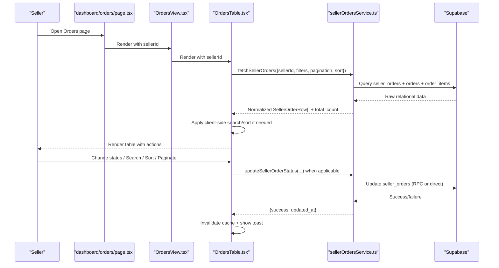
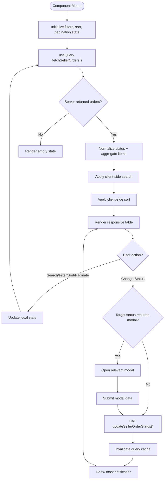
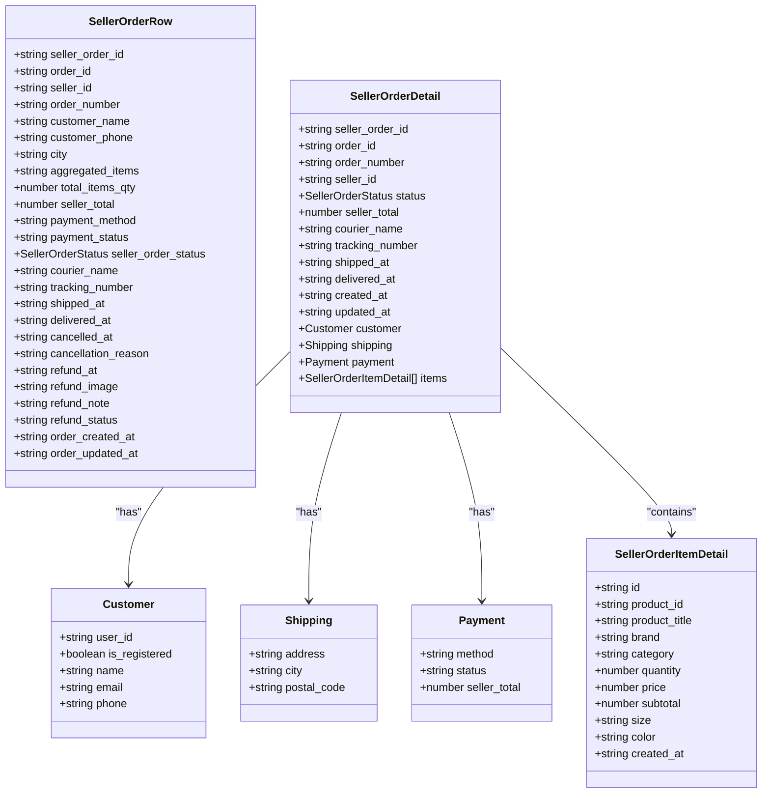
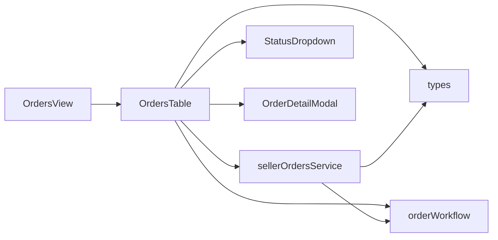

# Order Viewing & Display

<cite>
**Referenced Files in This Document**
- [OrdersView.tsx](file://components/reseller/components/OrdersView.tsx)
- [OrdersTable.tsx](file://components/reseller/components/OrdersTable.tsx)
- [page.tsx](file://app/dashboard/orders/page.tsx)
- [sellerOrdersService.ts](file://src/api/sellerOrdersService.ts)
- [orderWorkflow.ts](file://src/constants/orderWorkflow.ts)
- [StatusDropdown.tsx](file://components/reseller/components/StatusDropdown.tsx)
- [OrderDetailModal.tsx](file://components/reseller/components/OrderDetailModal.tsx)
- [types.ts](file://types.ts)
</cite>

## Table of Contents
1. [Introduction](#introduction)
2. [Project Structure](#project-structure)
3. [Core Components](#core-components)
4. [Architecture Overview](#architecture-overview)
5. [Detailed Component Analysis](#detailed-component-analysis)
6. [Dependency Analysis](#dependency-analysis)
7. [Performance Considerations](#performance-considerations)
8. [Troubleshooting Guide](#troubleshooting-guide)
9. [Conclusion](#conclusion)
10. [Appendices](#appendices)

## Introduction
This document explains the order viewing and display system used by sellers to browse, filter, sort, paginate, and manage orders. The main entry point is the OrdersView component, which resolves the seller context and delegates rendering to OrdersTable. OrdersTable fetches orders from the backend API, presents them in a responsive table with sorting, filtering, pagination, and status management, and integrates modals for detailed views, courier details, cancellations, refunds, and payment receipts.

The system emphasizes:
- Seller-scoped data access
- Clean separation between UI state and server state
- Robust error handling and user feedback via toast notifications
- Flexible status transitions validated against workflow rules
- Responsive design suitable for desktop and mobile workflows

## Project Structure
The order viewing feature spans several layers:
- Page routing layer: dashboard orders page renders OrdersView
- Presentation layer: OrdersView manages seller context and renders OrdersTable
- Data layer: sellerOrdersService performs Supabase queries and RPC calls
- Shared constants: orderWorkflow defines allowed transitions and display options
- Supporting UI components: StatusDropdown, OrderDetailModal, and related modals

```mermaid
graph TB
subgraph "Routing"
OrdersPage["dashboard/orders/page.tsx"]
end
subgraph "Presentation"
OrdersView["reseller/components/OrdersView.tsx"]
OrdersTable["reseller/components/OrdersTable.tsx"]
StatusDropdown["reseller/components/StatusDropdown.tsx"]
OrderDetailModal["reseller/components/OrderDetailModal.tsx"]
end
subgraph "Data"
SellerOrdersService["src/api/sellerOrdersService.ts"]
OrderWorkflow["src/constants/orderWorkflow.ts"]
end
subgraph "Types"
Types["types.ts"]
end
OrdersPage --> OrdersView
OrdersView --> OrdersTable
OrdersTable --> SellerOrdersService
OrdersTable --> StatusDropdown
OrdersTable --> OrderDetailModal
StatusDropdown --> OrderWorkflow
OrdersTable --> OrderWorkflow
OrdersTable --> Types
SellerOrdersService --> Types
```

**Diagram sources**
- [page.tsx:1-11](file://app/dashboard/orders/page.tsx#L1-L11)
- [OrdersView.tsx:1-19](file://components/reseller/components/OrdersView.tsx#L1-L19)
- [OrdersTable.tsx:1-643](file://components/reseller/components/OrdersTable.tsx#L1-L643)
- [sellerOrdersService.ts:1-644](file://src/api/sellerOrdersService.ts#L1-L644)
- [orderWorkflow.ts:1-37](file://src/constants/orderWorkflow.ts#L1-L37)
- [StatusDropdown.tsx:1-136](file://components/reseller/components/StatusDropdown.tsx#L1-L136)
- [OrderDetailModal.tsx:1-347](file://components/reseller/components/OrderDetailModal.tsx#L1-L347)
- [types.ts:148-223](file://types.ts#L148-L223)

**Section sources**
- [page.tsx:1-11](file://app/dashboard/orders/page.tsx#L1-L11)
- [OrdersView.tsx:1-19](file://components/reseller/components/OrdersView.tsx#L1-L19)

## Core Components
- OrdersView: Resolves the current seller ID from authentication context and passes it to OrdersTable. It acts as a thin orchestrator for seller context.
- OrdersTable: Implements the full order list experience including:
  - Fetching orders using TanStack Query
  - Filtering by status and search query
  - Sorting by date, amount, or customer name
  - Pagination controls
  - Status updates through StatusDropdown with interceptors for courier details, cancellation, and refund flows
  - Opening OrderDetailModal for detailed inspection
  - Toast notifications for success/error feedback
- StatusDropdown: Renders a status badge or dropdown based on allowed transitions and applies visual styles per normalized status.
- OrderDetailModal: Displays comprehensive order information, including customer, shipping, items, payment, and allows status changes within the modal.

**Section sources**
- [OrdersView.tsx:5-16](file://components/reseller/components/OrdersView.tsx#L5-L16)
- [OrdersTable.tsx:47-124](file://components/reseller/components/OrdersTable.tsx#L47-L124)
- [StatusDropdown.tsx:5-18](file://components/reseller/components/StatusDropdown.tsx#L5-L18)
- [OrderDetailModal.tsx:7-18](file://components/reseller/components/OrderDetailModal.tsx#L7-L18)

## Architecture Overview
The order viewing flow begins at the dashboard orders page, which renders OrdersView with the authenticated reseller’s ID. OrdersView determines the effective seller ID and renders OrdersTable. OrdersTable uses TanStack Query to fetch orders from sellerOrdersService, which queries Supabase tables and RPCs, normalizes statuses, aggregates item data, and returns structured rows.

User interactions (search, filter, sort, pagination, status change) update local state and trigger refetches or mutations. Status changes may open additional modals (CourierDetailsModal, OrderCancellationModal, OrderRefundModal, PaymentReceiptModal) depending on the target status. Successful operations invalidate cached queries and show toast notifications.



**Diagram sources**
- [page.tsx:7-10](file://app/dashboard/orders/page.tsx#L7-L10)
- [OrdersView.tsx:9-15](file://components/reseller/components/OrdersView.tsx#L9-L15)
- [OrdersTable.tsx:74-89](file://components/reseller/components/OrdersTable.tsx#L74-L89)
- [sellerOrdersService.ts:35-198](file://src/api/sellerOrdersService.ts#L35-L198)
- [sellerOrdersService.ts:355-449](file://src/api/sellerOrdersService.ts#L355-L449)

## Detailed Component Analysis

### OrdersView
Responsibilities:
- Resolve seller context from authentication hooks
- Pass sellerId to OrdersTable

Key behaviors:
- Uses useAuth to obtain resellerProfile and user
- Derives currentSellerId from props, profile, or fallback
- Delegates rendering to OrdersTable

Customization points:
- If you need to override seller resolution logic, extend the derived currentSellerId computation before passing to OrdersTable.

**Section sources**
- [OrdersView.tsx:5-16](file://components/reseller/components/OrdersView.tsx#L5-L16)

### OrdersTable
Responsibilities:
- Manage UI state for filters, sorting, pagination
- Fetch orders via TanStack Query
- Present orders in a responsive table
- Handle status changes with interceptors for courier details, cancellation, and refund
- Provide detail view via OrderDetailModal
- Show toast notifications for user feedback

Key implementation details:
- State variables include specificStatus, searchQuery, page, pageSize, sortBy, sortOrder
- TanStack Query key includes sellerId, statusFilter, search, page, pageSize, sortBy, sortOrder
- Client-side search and sort are applied after fetching; sorting by customer_name is handled locally
- Pagination calculates totalPages from totalCount and pageSize
- Status change interception:
  - Cancelled triggers OrderCancellationModal
  - Refund triggers OrderRefundModal
  - Shipped/Delivered may require CourierDetailsModal
- Date formatting utilities provide human-readable dates and relative time strings
- Payment method mapping normalizes raw values into readable labels

Responsive design:
- Table wraps horizontally on small screens
- Controls collapse gracefully with overflow-x-auto
- Typography scales across breakpoints

Accessibility:
- Buttons have aria-labels where appropriate
- Sort toggle has an accessible title and label

Error handling:
- Loading skeleton rows while fetching
- Empty state message when no records match filters
- Toast messages for success and error outcomes

Extensibility:
- Adding new columns requires updating the header row and corresponding cell renderers
- Advanced filtering can be implemented by extending the search filter logic and/or adding additional filter controls that reset page to 1

**Section sources**
- [OrdersTable.tsx:47-124](file://components/reseller/components/OrdersTable.tsx#L47-L124)
- [OrdersTable.tsx:134-156](file://components/reseller/components/OrdersTable.tsx#L134-L156)
- [OrdersTable.tsx:158-215](file://components/reseller/components/OrdersTable.tsx#L158-L215)
- [OrdersTable.tsx:260-288](file://components/reseller/components/OrdersTable.tsx#L260-L288)
- [OrdersTable.tsx:292-587](file://components/reseller/components/OrdersTable.tsx#L292-L587)

#### Data Flow and Processing Logic


**Diagram sources**
- [OrdersTable.tsx:74-89](file://components/reseller/components/OrdersTable.tsx#L74-L89)
- [OrdersTable.tsx:134-156](file://components/reseller/components/OrdersTable.tsx#L134-L156)
- [OrdersTable.tsx:158-215](file://components/reseller/components/OrdersTable.tsx#L158-L215)
- [OrdersTable.tsx:292-587](file://components/reseller/components/OrdersTable.tsx#L292-L587)

### StatusDropdown
Responsibilities:
- Render a status badge or dropdown based on allowed transitions
- Normalize status for consistent display
- Disable terminal states from editing
- Call parent onStatusChange callback with new status

Visual behavior:
- Applies color-coded badges per normalized status
- Terminal states render as static badges without dropdown options

Integration:
- Used both in OrdersTable rows and OrderDetailModal

**Section sources**
- [StatusDropdown.tsx:5-18](file://components/reseller/components/StatusDropdown.tsx#L5-L18)
- [StatusDropdown.tsx:20-63](file://components/reseller/components/StatusDropdown.tsx#L20-L63)
- [StatusDropdown.tsx:65-136](file://components/reseller/components/StatusDropdown.tsx#L65-L136)

### OrderDetailModal
Responsibilities:
- Load detailed order data via fetchSellerOrderDetail
- Display customer, shipping, items, payment sections
- Allow status changes within the modal
- Reconcile missing fields (size, color, category) during detail loading

Behavior:
- Shows skeleton loading while fetching
- Handles errors and empty states
- Updates local detail state after successful status change

**Section sources**
- [OrderDetailModal.tsx:7-18](file://components/reseller/components/OrderDetailModal.tsx#L7-L18)
- [OrderDetailModal.tsx:31-61](file://components/reseller/components/OrderDetailModal.tsx#L31-L61)
- [OrderDetailModal.tsx:80-97](file://components/reseller/components/OrderDetailModal.tsx#L80-L97)
- [OrderDetailModal.tsx:100-347](file://components/reseller/components/OrderDetailModal.tsx#L100-L347)

### Data Model and Workflow
- SellerOrderRow defines the normalized row structure displayed in the table, including identifiers, customer info, aggregated items, totals, payment method/status, courier/tracking, timestamps, and normalized status.
- SellerOrderDetail provides a richer structure for the detail modal, including nested customer, shipping, payment, and items arrays.
- orderWorkflow defines allowed transitions, display filter statuses, normalization helpers, and transition validation.



**Diagram sources**
- [types.ts:148-223](file://types.ts#L148-L223)

**Section sources**
- [types.ts:148-223](file://types.ts#L148-L223)
- [orderWorkflow.ts:1-37](file://src/constants/orderWorkflow.ts#L1-L37)

## Dependency Analysis
Coupling and cohesion:
- OrdersView depends only on authentication context and OrdersTable, keeping it cohesive and minimal.
- OrdersTable depends on:
  - TanStack Query for caching and refetching
  - sellerOrdersService for data operations
  - StatusDropdown for inline status control
  - OrderDetailModal for detailed inspection
  - orderWorkflow for display statuses and transition validation
  - types.ts for shared interfaces
- sellerOrdersService depends on Supabase client and orderWorkflow for normalization and validation.

External dependencies:
- Supabase client for database queries and RPC calls
- Lucide icons for UI elements
- Tailwind CSS classes for styling

Potential circular dependencies:
- None detected; components import services and constants but not each other in cycles.

Interface contracts:
- OrdersTable expects SellerOrderRow[] and total_count from fetchSellerOrders
- StatusDropdown expects normalized SellerOrderStatus and allowed transitions
- OrderDetailModal expects SellerOrderDetail and exposes onStatusChange callback



**Diagram sources**
- [OrdersView.tsx:1-19](file://components/reseller/components/OrdersView.tsx#L1-L19)
- [OrdersTable.tsx:1-13](file://components/reseller/components/OrdersTable.tsx#L1-L13)
- [sellerOrdersService.ts:1-8](file://src/api/sellerOrdersService.ts#L1-L8)
- [orderWorkflow.ts:1-37](file://src/constants/orderWorkflow.ts#L1-L37)
- [types.ts:148-223](file://types.ts#L148-L223)

**Section sources**
- [OrdersTable.tsx:1-13](file://components/reseller/components/OrdersTable.tsx#L1-L13)
- [sellerOrdersService.ts:1-8](file://src/api/sellerOrdersService.ts#L1-L8)
- [orderWorkflow.ts:1-37](file://src/constants/orderWorkflow.ts#L1-L37)

## Performance Considerations
- Server-side pagination: pageSize defaults to 10; adjust based on expected dataset size and network latency.
- Query caching: staleTime set to 60 seconds reduces redundant requests; consider tuning based on update frequency.
- Client-side filtering and sorting: applied after fetching; for large datasets, consider moving more filters to the server side.
- Avoid unnecessary re-renders: memoized sortedOrders and stable keys reduce DOM churn.
- Modal performance: Detail modal loads only when opened; ensure heavy computations are deferred until necessary.

[No sources needed since this section provides general guidance]

## Troubleshooting Guide
Common issues and resolutions:
- No orders displayed:
  - Verify sellerId is correctly resolved in OrdersView and passed to OrdersTable.
  - Check statusFilter and searchQuery combinations; reset filters to All and clear search.
- Status change fails:
  - Ensure the transition is allowed according to orderWorkflow.
  - Confirm required courier details are provided for Shipped/Delivered transitions.
  - Inspect toast messages for error details returned by updateSellerOrderStatus.
- Missing item details in OrderDetailModal:
  - The service attempts to backfill missing size/color/category fields; verify Supabase permissions and RPC availability.
- Pagination not updating:
  - Ensure page resets to 1 when filters or search change.
  - Validate totalCount calculation and totalPages bounds.

Operational tips:
- Use browser dev tools to inspect TanStack Query cache keys and refetch triggers.
- Log toast messages to identify success vs. error paths.
- Temporarily disable client-side search/sort to isolate server-side behavior.

**Section sources**
- [OrdersTable.tsx:158-215](file://components/reseller/components/OrdersTable.tsx#L158-L215)
- [OrdersTable.tsx:292-587](file://components/reseller/components/OrdersTable.tsx#L292-L587)
- [sellerOrdersService.ts:355-449](file://src/api/sellerOrdersService.ts#L355-L449)
- [orderWorkflow.ts:1-37](file://src/constants/orderWorkflow.ts#L1-L37)

## Conclusion
The order viewing and display system provides a robust, scalable foundation for sellers to manage their orders. OrdersView centralizes seller context, while OrdersTable delivers a rich interactive experience with filtering, sorting, pagination, and status management. The data layer abstracts Supabase interactions and enforces workflow constraints, ensuring consistency and reliability. With modular components and clear extension points, the system supports customization for appearance, columns, and advanced filtering capabilities.

[No sources needed since this section summarizes without analyzing specific files]

## Appendices

### Customizing Table Appearance
- Adjust Tailwind classes in OrdersTable for colors, spacing, typography, and borders.
- Modify StatusDropdown getStatusBadgeStyle to change badge colors per status.
- Update OrderDetailModal layout and styling to match your design system.

Adding New Columns
- Extend the table header and add corresponding cell renderers in OrdersTable.
- Ensure the column data exists in SellerOrderRow or derive it from existing fields.
- Consider adding server-side support if the new column requires aggregation or joins.

Implementing Advanced Filtering
- Add new filter controls in OrdersTable and integrate them into the TanStack Query key to trigger refetches.
- Optionally move filtering logic to sellerOrdersService for server-side efficiency.
- Reset page to 1 whenever filters change to maintain predictable UX.

**Section sources**
- [OrdersTable.tsx:292-587](file://components/reseller/components/OrdersTable.tsx#L292-L587)
- [StatusDropdown.tsx:20-63](file://components/reseller/components/StatusDropdown.tsx#L20-L63)
- [OrderDetailModal.tsx:100-347](file://components/reseller/components/OrderDetailModal.tsx#L100-L347)