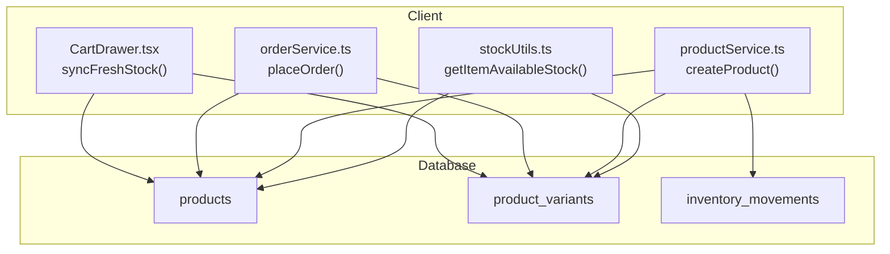
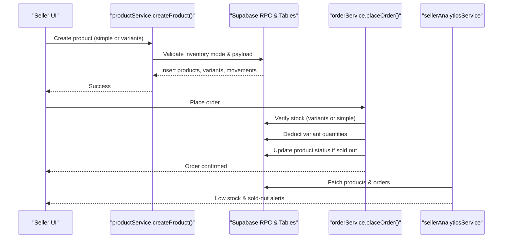
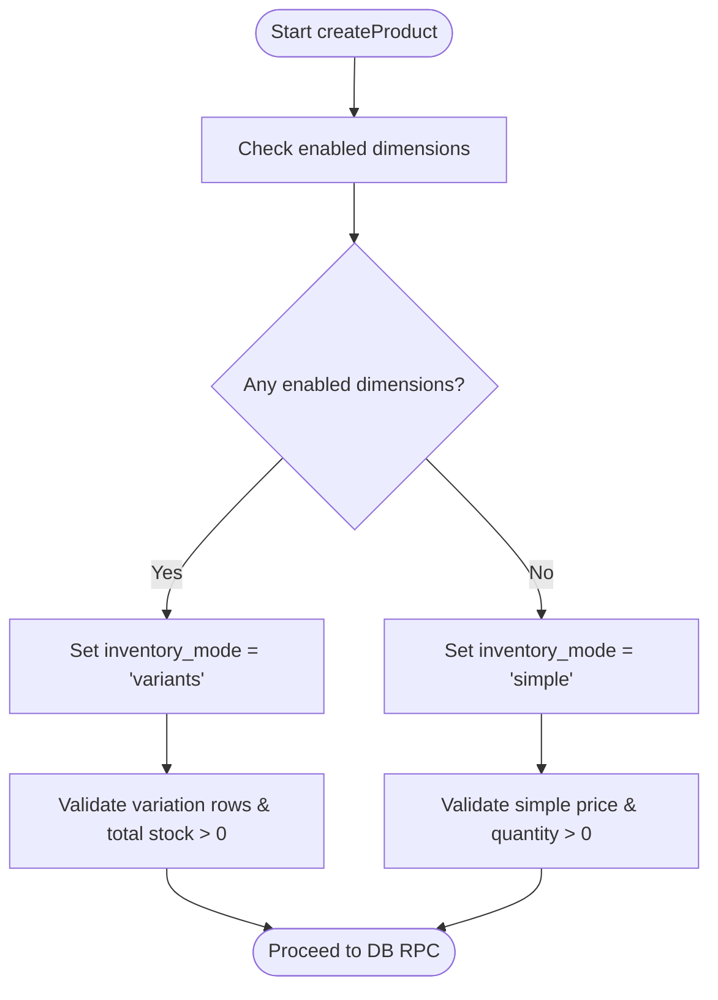
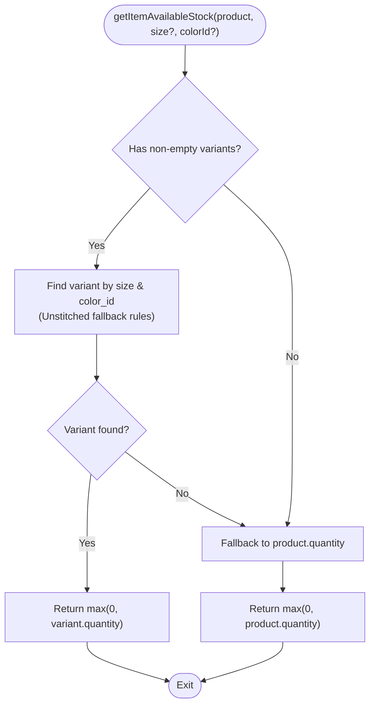
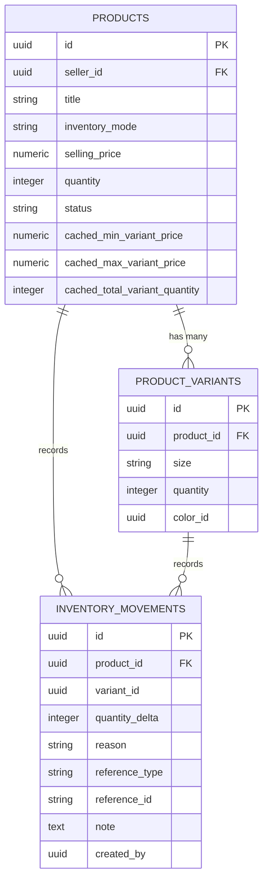
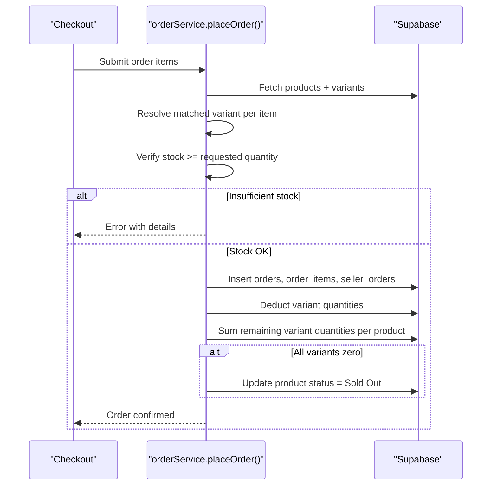
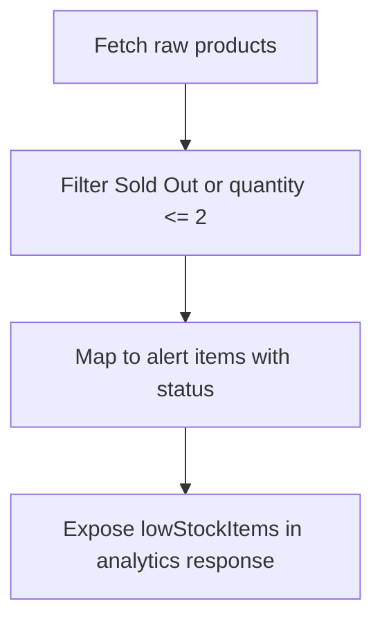
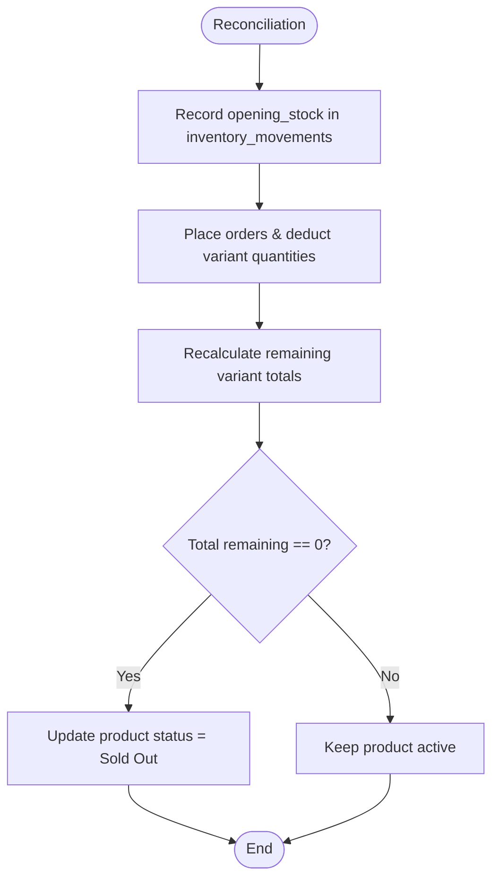
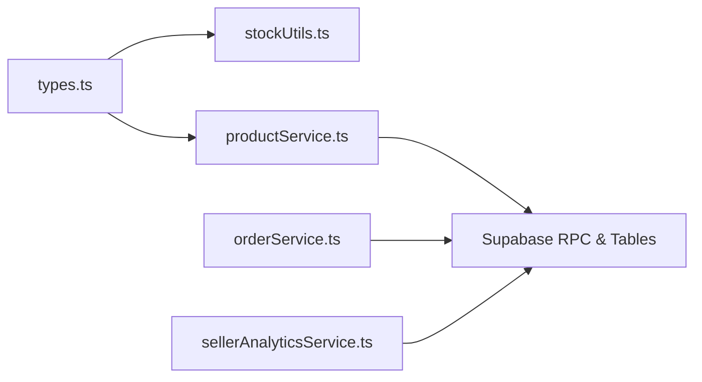

# Inventory Tracking

<cite>
**Referenced Files in This Document**
- [stockUtils.ts](file://src/utils/stockUtils.ts)
- [orderService.ts](file://src/api/orderService.ts)
- [productService.ts](file://src/api/productService.ts)
- [20261105_all_in_one_product_creation.sql](file://supabase/migrations/20261105_all_in_one_product_creation.sql)
- [types.ts](file://types.ts)
- [sellerAnalyticsService.ts](file://src/api/sellerAnalyticsService.ts)
- [CartDrawer.tsx](file://components/CartDrawer.tsx)
</cite>

## Table of Contents
1. [Introduction](#introduction)
2. [Project Structure](#project-structure)
3. [Core Components](#core-components)
4. [Architecture Overview](#architecture-overview)
5. [Detailed Component Analysis](#detailed-component-analysis)
6. [Dependency Analysis](#dependency-analysis)
7. [Performance Considerations](#performance-considerations)
8. [Troubleshooting Guide](#troubleshooting-guide)
9. [Conclusion](#conclusion)
10. [Appendices](#appendices)

## Introduction
This document explains the inventory tracking system that manages stock levels for simple products and product variants. It covers how inventory mode is selected, how stock quantities are calculated and updated, low stock alerts, and how order fulfillment synchronizes with inventory. It also includes examples of inventory calculations, reconciliation processes, and reporting capabilities for inventory analytics.

## Project Structure
The inventory system spans client-side utilities, API services, database migrations, and UI components:
- Client utility for available stock calculation across simple and variant modes
- Order service for stock verification and deduction during checkout
- Product creation service for inventory mode selection and validation
- Database migration defining inventory mode, variants, and movement tracking
- Types defining product and variant structures
- Analytics service exposing low stock and sold-out alerts
- Cart drawer refreshing stock before checkout

**Diagram sources**
- [stockUtils.ts:7-33](file://src/utils/stockUtils.ts#L7-L33)
- [productService.ts:338-392](file://src/api/productService.ts#L338-L392)
- [orderService.ts:467-712](file://src/api/orderService.ts#L467-L712)
- [20261105_all_in_one_product_creation.sql:377-413](file://supabase/migrations/20261105_all_in_one_product_creation.sql#L377-L413)

**Section sources**
- [stockUtils.ts:1-34](file://src/utils/stockUtils.ts#L1-L34)
- [productService.ts:338-392](file://src/api/productService.ts#L338-L392)
- [orderService.ts:450-750](file://src/api/orderService.ts#L450-L750)
- [20261105_all_in_one_product_creation.sql:377-413](file://supabase/migrations/20261105_all_in_one_product_creation.sql#L377-L413)

## Core Components
- Inventory mode selection: Determines whether a product uses simple inventory or variant-based inventory.
- Available stock calculation: Computes effective stock by choosing variant-level quantity when applicable, otherwise falls back to product-level quantity.
- Order stock verification and deduction: Validates availability at order time and updates variant quantities; marks products as sold out when all variants reach zero.
- Low stock alerts and analytics: Exposes low stock and sold-out items for seller dashboards.
- Inventory movements: Records opening stock entries for both simple and variant inventories.

**Section sources**
- [productService.ts:338-392](file://src/api/productService.ts#L338-L392)
- [stockUtils.ts:7-33](file://src/utils/stockUtils.ts#L7-L33)
- [orderService.ts:467-712](file://src/api/orderService.ts#L467-L712)
- [sellerAnalyticsService.ts:492-500](file://src/api/sellerAnalyticsService.ts#L492-L500)
- [20261105_all_in_one_product_creation.sql:943-1011](file://supabase/migrations/20261105_all_in_one_product_creation.sql#L943-L1011)

## Architecture Overview
The inventory architecture integrates client logic with database operations:
- Product creation validates inventory mode and ensures required fields (simple price/quantity or variant rows).
- Variant option values and inventory movements are created atomically via an RPC.
- Checkout verifies stock against current variant or product quantities and deducts inventory upon success.
- Analytics surfaces low stock and sold-out items based on product status and quantity thresholds.

**Diagram sources**
- [productService.ts:338-392](file://src/api/productService.ts#L338-L392)
- [20261105_all_in_one_product_creation.sql:377-413](file://supabase/migrations/20261105_all_in_one_product_creation.sql#L377-L413)
- [orderService.ts:467-712](file://src/api/orderService.ts#L467-L712)
- [sellerAnalyticsService.ts:492-500](file://src/api/sellerAnalyticsService.ts#L492-L500)

## Detailed Component Analysis

### Inventory Mode Selection (Simple vs Variants)
Inventory mode is derived from whether variation dimensions are enabled:
- If any dimension has enabled values, the product enters variant mode.
- In variant mode, each row defines a combination with its own selling price and quantity.
- In simple mode, the product carries a single selling price and quantity.

Validation rules ensure:
- At least one variation row exists in variant mode.
- Total stock across variants must be greater than zero.
- Simple products require a valid positive integer quantity.

**Diagram sources**
- [productService.ts:338-392](file://src/api/productService.ts#L338-L392)
- [20261105_all_in_one_product_creation.sql:377-413](file://supabase/migrations/20261105_all_in_one_product_creation.sql#L377-L413)

**Section sources**
- [productService.ts:338-392](file://src/api/productService.ts#L338-L392)
- [20261105_all_in_one_product_creation.sql:377-413](file://supabase/migrations/20261105_all_in_one_product_creation.sql#L377-L413)

### Stock Quantity Management
Available stock is computed using a single source of truth helper:
- For variant-enabled products, it selects the matching variant by size and color (with special handling for Unstitched category), returning the variant’s quantity clamped to zero minimum.
- If no matching variant is found, it falls back to the product-level quantity.

**Diagram sources**
- [stockUtils.ts:7-33](file://src/utils/stockUtils.ts#L7-L33)

**Section sources**
- [stockUtils.ts:7-33](file://src/utils/stockUtils.ts#L7-L33)
- [types.ts:1-65](file://types.ts#L1-L65)

### Relationship Between Product Quantities and Variant-Level Inventory
- When a product uses variants, the product-level quantity may be null; effective stock is determined by summing or selecting specific variant quantities depending on context.
- The product table stores cached aggregates such as total variant quantity to support quick reads and reporting.
- Opening stock entries are recorded in inventory_movements for both simple and variant modes.

**Diagram sources**
- [20261105_all_in_one_product_creation.sql:469-503](file://supabase/migrations/20261105_all_in_one_product_creation.sql#L469-L503)
- [20261105_all_in_one_product_creation.sql:943-1011](file://supabase/migrations/20261105_all_in_one_product_creation.sql#L943-L1011)

**Section sources**
- [20261105_all_in_one_product_creation.sql:469-503](file://supabase/migrations/20261105_all_in_one_product_creation.sql#L469-L503)
- [20261105_all_in_one_product_creation.sql:943-1011](file://supabase/migrations/20261105_all_in_one_product_creation.sql#L943-L1011)

### Order Fulfillment Synchronization
During order placement:
- The system fetches current product data including variants.
- It verifies stock per item:
  - For variant-enabled products, it resolves the matched variant by size and color and checks available stock.
  - If insufficient stock, it returns an error message.
- On success, it inserts order records and then deducts variant quantities.
- After deductions, it recalculates remaining stock across variants; if total remaining is zero, it sets the product status to Sold Out.

**Diagram sources**
- [orderService.ts:467-712](file://src/api/orderService.ts#L467-L712)

**Section sources**
- [orderService.ts:467-712](file://src/api/orderService.ts#L467-L712)

### Low Stock Alerts and Reporting
Low stock and sold-out alerts are surfaced in analytics:
- Products marked as Sold Out or with product-level quantity less than or equal to a threshold are flagged.
- These alerts feed into dashboard views for sellers to monitor inventory health.

**Diagram sources**
- [sellerAnalyticsService.ts:492-500](file://src/api/sellerAnalyticsService.ts#L492-L500)

**Section sources**
- [sellerAnalyticsService.ts:492-500](file://src/api/sellerAnalyticsService.ts#L492-L500)

### Inventory Calculations Examples
- Simple product:
  - If product.quantity = 10, getItemAvailableStock returns 10.
- Variant product:
  - Matching variant.quantity = 3 → returns 3.
  - No matching variant → fallback to product.quantity (if present).
- Sold-out detection:
  - After order deductions, if sum(variant.quantity) == 0 → product.status becomes Sold Out.

These examples follow the logic implemented in the stock utility and order service.

**Section sources**
- [stockUtils.ts:7-33](file://src/utils/stockUtils.ts#L7-L33)
- [orderService.ts:675-712](file://src/api/orderService.ts#L675-L712)

### Stock Reconciliation Processes
- Opening stock reconciliation:
  - During product creation, inventory_movements records opening_stock entries for both simple and variant inventories.
- Post-order reconciliation:
  - After placing orders, variant quantities are updated and product status is adjusted based on remaining stock totals.

**Diagram sources**
- [20261105_all_in_one_product_creation.sql:943-1011](file://supabase/migrations/20261105_all_in_one_product_creation.sql#L943-L1011)
- [orderService.ts:675-712](file://src/api/orderService.ts#L675-L712)

**Section sources**
- [20261105_all_in_one_product_creation.sql:943-1011](file://supabase/migrations/20261105_all_in_one_product_creation.sql#L943-L1011)
- [orderService.ts:675-712](file://src/api/orderService.ts#L675-L712)

### Cart Freshness and Pre-checkout Validation
Before finalizing checkout, the cart refreshes fresh product stock from the database to ensure accurate availability and display notices for customers.

**Section sources**
- [CartDrawer.tsx:33-63](file://components/CartDrawer.tsx#L33-L63)

## Dependency Analysis
Key dependencies and relationships:
- stockUtils.ts depends on Product type definitions.
- productService.ts orchestrates inventory mode selection and calls the database RPC.
- orderService.ts depends on product and variant data to verify and update stock.
- Migrations define schema constraints and atomic creation logic for products, variants, and movements.
- sellerAnalyticsService.ts consumes product data to generate low stock alerts.

**Diagram sources**
- [types.ts:1-65](file://types.ts#L1-L65)
- [productService.ts:338-392](file://src/api/productService.ts#L338-L392)
- [orderService.ts:467-712](file://src/api/orderService.ts#L467-L712)
- [sellerAnalyticsService.ts:492-500](file://src/api/sellerAnalyticsService.ts#L492-L500)

**Section sources**
- [types.ts:1-65](file://types.ts#L1-L65)
- [productService.ts:338-392](file://src/api/productService.ts#L338-L392)
- [orderService.ts:467-712](file://src/api/orderService.ts#L467-L712)
- [sellerAnalyticsService.ts:492-500](file://src/api/sellerAnalyticsService.ts#L492-L500)

## Performance Considerations
- Use cached aggregate columns (e.g., cached_total_variant_quantity) for faster reads where possible.
- Avoid redundant queries by batching product and variant fetches during checkout.
- Limit image uploads and use content-addressed storage paths to reduce overhead during product creation.
- Prefer server-side validations and atomic RPCs to minimize round-trips and ensure consistency.

[No sources needed since this section provides general guidance]

## Troubleshooting Guide
Common issues and resolutions:
- Invalid inventory mode payload:
  - Ensure simple products include required pricing and quantity, and variant products include at least one variation row.
- Insufficient stock errors:
  - Verify matched variant selection logic and ensure requested quantity does not exceed available stock.
- Storage path validation failures:
  - Confirm image storage paths begin with the correct user/product prefix and URLs match expected patterns.
- Low stock alerts not appearing:
  - Check product status and quantity thresholds used in analytics filtering.

**Section sources**
- [productService.ts:338-392](file://src/api/productService.ts#L338-L392)
- [orderService.ts:467-521](file://src/api/orderService.ts#L467-L521)
- [20261105_all_in_one_product_creation.sql:445-463](file://supabase/migrations/20261105_all_in_one_product_creation.sql#L445-L463)
- [sellerAnalyticsService.ts:492-500](file://src/api/sellerAnalyticsService.ts#L492-L500)

## Conclusion
The inventory tracking system robustly supports both simple and variant-based stock management. It enforces inventory mode selection, calculates available stock accurately, tracks inventory movements, and synchronizes stock changes with order fulfillment. Low stock alerts and analytics provide visibility into inventory health, enabling sellers to manage stock proactively.

[No sources needed since this section summarizes without analyzing specific files]

## Appendices
- Data model references:
  - Product and ProductVariant interfaces define core inventory attributes.
  - Database tables and RPCs enforce constraints and record movements.

**Section sources**
- [types.ts:1-65](file://types.ts#L1-L65)
- [20261105_all_in_one_product_creation.sql:469-503](file://supabase/migrations/20261105_all_in_one_product_creation.sql#L469-L503)