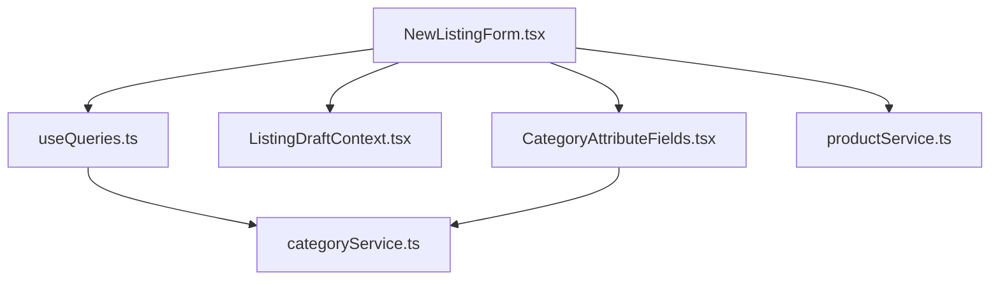
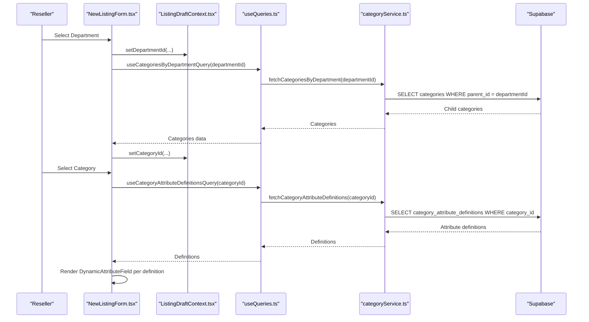
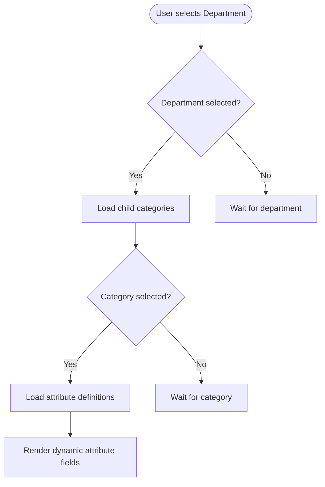
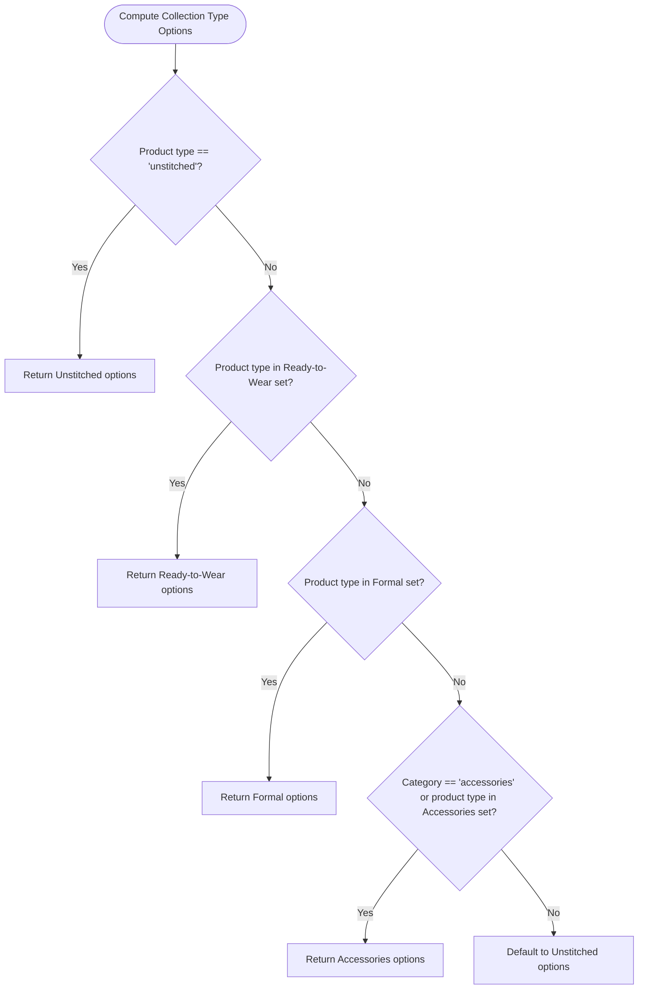
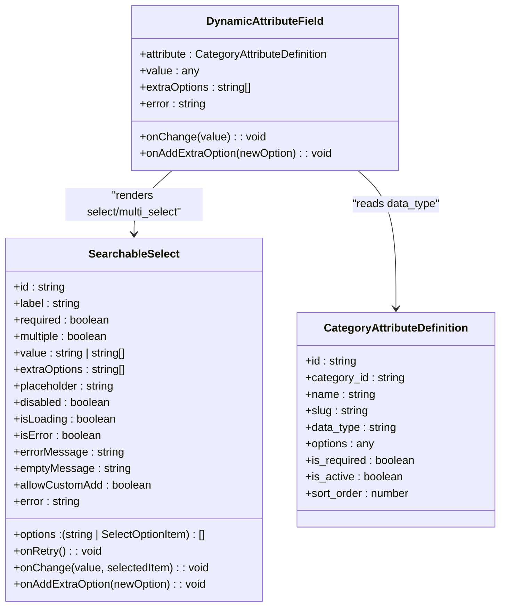
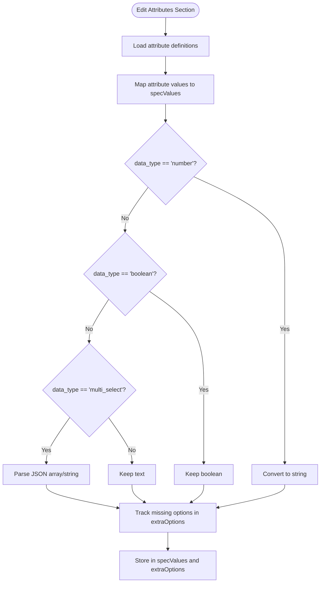
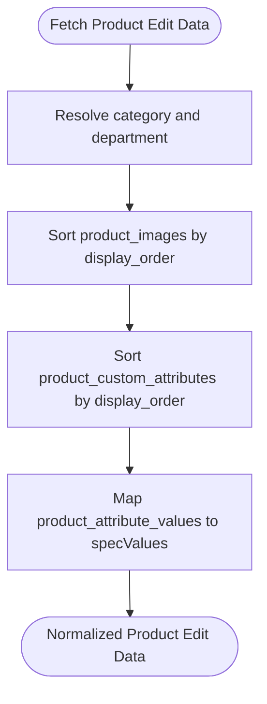
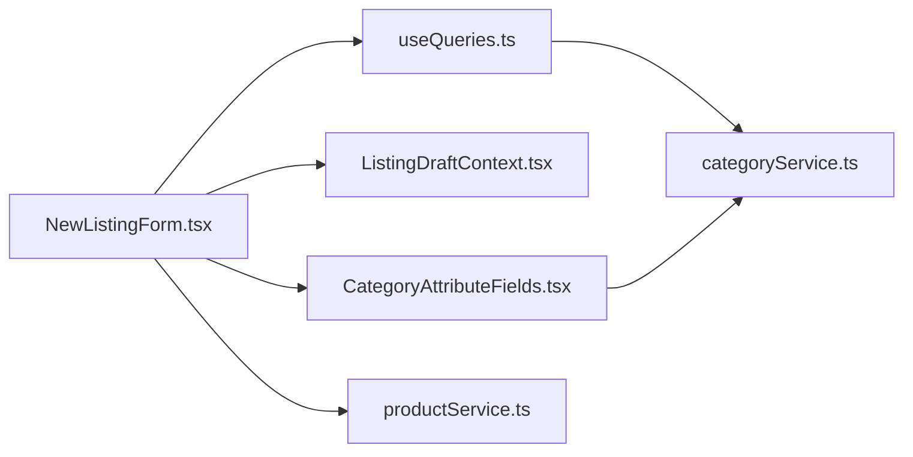

# Category & Attribute Management

<cite>
**Referenced Files in This Document**
- [NewListingForm.tsx](file://components/reseller/components/NewListingForm.tsx)
- [CategoryAttributeFields.tsx](file://components/reseller/components/CategoryAttributeFields.tsx)
- [categoryService.ts](file://src/api/categoryService.ts)
- [useQueries.ts](file://src/hooks/useQueries.ts)
- [ListingDraftContext.tsx](file://components/reseller/context/ListingDraftContext.tsx)
- [productService.ts](file://src/api/productService.ts)
</cite>

## Table of Contents
1. [Introduction](#introduction)
2. [Project Structure](#project-structure)
3. [Core Components](#core-components)
4. [Architecture Overview](#architecture-overview)
5. [Detailed Component Analysis](#detailed-component-analysis)
6. [Dependency Analysis](#dependency-analysis)
7. [Performance Considerations](#performance-considerations)
8. [Troubleshooting Guide](#troubleshooting-guide)
9. [Conclusion](#conclusion)

## Introduction
This document explains the category and attribute management system used during product creation and editing. It focuses on how the form dynamically loads departments, categories, and category-specific attributes using TanStack Query hooks, how collection type options are filtered by product type and category, and how dynamic attribute fields render different data types such as text, number, boolean, select, and multi-select. It also documents how category attributes are validated, stored, and displayed in the reseller listing interface.

## Project Structure
The category and attribute workflow spans a small set of focused files:
- The reseller listing form orchestrates UI state, user interactions, and data loading.
- A reusable dynamic attribute field renderer renders inputs based on attribute definitions.
- A category service provides typed fetchers for departments, child categories, and attribute definitions.
- A query hook layer wraps those fetchers with TanStack Query.
- A draft context holds shared form state including department, category, product type, collection type, and attribute values.
- Product edit services normalize existing product data, including category hierarchy and attribute values.

**Diagram sources**
- [NewListingForm.tsx:26-53](file://components/reseller/components/NewListingForm.tsx#L26-L53)
- [useQueries.ts:15-27](file://src/hooks/useQueries.ts#L15-L27)
- [categoryService.ts:1-22](file://src/api/categoryService.ts#L1-L22)
- [ListingDraftContext.tsx:116-173](file://components/reseller/context/ListingDraftContext.tsx#L116-L173)
- [CategoryAttributeFields.tsx:617-624](file://components/reseller/components/CategoryAttributeFields.tsx#L617-L624)
- [productService.ts:904-946](file://src/api/productService.ts#L904-L946)

**Section sources**
- [NewListingForm.tsx:26-53](file://components/reseller/components/NewListingForm.tsx#L26-L53)
- [useQueries.ts:312-357](file://src/hooks/useQueries.ts#L312-L357)
- [categoryService.ts:74-158](file://src/api/categoryService.ts#L74-L158)
- [ListingDraftContext.tsx:116-173](file://components/reseller/context/ListingDraftContext.tsx#L116-L173)
- [CategoryAttributeFields.tsx:617-800](file://components/reseller/components/CategoryAttributeFields.tsx#L617-L800)
- [productService.ts:904-946](file://src/api/productService.ts#L904-L946)

## Core Components
- NewListingForm: Main product creation/editing form. It composes department, category, product type, collection type, and dynamic attribute fields. It initializes draft state from existing products and manages validation and submission.
- CategoryAttributeFields: Provides a universal searchable select component and a dynamic attribute field dispatcher that renders inputs based on attribute data types.
- categoryService: Typed API functions to fetch top-level departments, child categories, and category attribute definitions.
- useQueries: TanStack Query hooks wrapping category service functions and product edit queries.
- ListingDraftContext: Shared state container for form fields, attribute values, extra options, custom specs, and progressive edit section states.
- productService: Normalizes product edit payloads, including category hierarchy and attribute value mapping.

**Section sources**
- [NewListingForm.tsx:462-517](file://components/reseller/components/NewListingForm.tsx#L462-L517)
- [CategoryAttributeFields.tsx:39-611](file://components/reseller/components/CategoryAttributeFields.tsx#L39-L611)
- [categoryService.ts:74-158](file://src/api/categoryService.ts#L74-L158)
- [useQueries.ts:312-357](file://src/hooks/useQueries.ts#L312-L357)
- [ListingDraftContext.tsx:116-173](file://components/reseller/context/ListingDraftContext.tsx#L116-L173)
- [productService.ts:1104-1138](file://src/api/productService.ts#L1104-L1138)

## Architecture Overview
The category and attribute system follows a layered architecture:
- UI Layer: NewListingForm renders the form and delegates rendering of attribute fields to CategoryAttributeFields.
- State Layer: ListingDraftContext stores selected department, category, product type, collection type, and attribute values.
- Data Layer: useQueries wraps categoryService functions with TanStack Query for caching and lifecycle control.
- Persistence Layer: Supabase tables for categories, category_attribute_definitions, and product-related entities.

**Diagram sources**
- [NewListingForm.tsx:535-543](file://components/reseller/components/NewListingForm.tsx#L535-L543)
- [useQueries.ts:333-357](file://src/hooks/useQueries.ts#L333-L357)
- [categoryService.ts:104-158](file://src/api/categoryService.ts#L104-L158)

## Detailed Component Analysis

### Departments, Categories, and Product Types Relationship
- Departments are top-level active categories with no parent.
- Categories are children of a selected department.
- Product type is a user-selected classification that influences available collection type options.
- Collection type options are filtered based on product type and category name.

Key behaviors:
- Departments are fetched once and cached for 10 minutes.
- Child categories are fetched only when a department ID exists.
- Attribute definitions are fetched only when a category ID exists.
- Collection type options are computed locally using product type and category name.

**Diagram sources**
- [useQueries.ts:320-357](file://src/hooks/useQueries.ts#L320-L357)
- [categoryService.ts:74-158](file://src/api/categoryService.ts#L74-L158)

**Section sources**
- [useQueries.ts:320-357](file://src/hooks/useQueries.ts#L320-L357)
- [categoryService.ts:74-158](file://src/api/categoryService.ts#L74-L158)
- [NewListingForm.tsx:217-233](file://components/reseller/components/NewListingForm.tsx#L217-L233)

### Collection Type Filtering Logic
Collection type options are determined by product type and category:
- If product type is Unstitched, return unstitched subcategories.
- If product type matches ready-to-wear or related terms, return ready-to-wear subcategories.
- If product type matches formal or party wear, return formal subcategories.
- If category is accessories or product type matches accessory terms, return accessories subcategories.
- Otherwise, default to unstitched subcategories.

**Diagram sources**
- [NewListingForm.tsx:217-233](file://components/reseller/components/NewListingForm.tsx#L217-L233)

**Section sources**
- [NewListingForm.tsx:217-233](file://components/reseller/components/NewListingForm.tsx#L217-L233)

### Dynamic Attribute Field Rendering System
Dynamic attribute fields are rendered based on attribute.data_type:
- text: Standard text input with max length and required indicator.
- number: Decimal input mode with numeric validation.
- boolean: Yes/No toggle buttons with clear option.
- select: Single searchable select with optional custom option addition.
- multi_select: Multi-select searchable select with optional custom option addition.

The SearchableSelect component supports:
- Single and multiple selection modes.
- Sticky search header and sticky bottom custom add flow.
- Portal-based dropdown to avoid clipping.
- Keyboard accessibility and focus management.
- Error display and retry behavior for query errors.

**Diagram sources**
- [CategoryAttributeFields.tsx:617-800](file://components/reseller/components/CategoryAttributeFields.tsx#L617-L800)
- [CategoryAttributeFields.tsx:39-611](file://components/reseller/components/CategoryAttributeFields.tsx#L39-L611)
- [categoryService.ts:12-22](file://src/api/categoryService.ts#L12-L22)

**Section sources**
- [CategoryAttributeFields.tsx:617-800](file://components/reseller/components/CategoryAttributeFields.tsx#L617-L800)
- [CategoryAttributeFields.tsx:39-611](file://components/reseller/components/CategoryAttributeFields.tsx#L39-L611)
- [categoryService.ts:12-22](file://src/api/categoryService.ts#L12-L22)

### Attribute Value Loading, Validation, and Storage
When editing an existing product:
- The attributes section initializes specValues and extraOptions from database rows.
- For each attribute definition:
  - Number values are normalized to strings.
  - Boolean values are preserved as booleans.
  - Multi-select values are parsed from JSON arrays or strings.
  - Text values are preserved as strings.
  - Extra options are tracked if stored values are not present in current definition options.

Validation and storage:
- Required indicators are derived from attribute.is_required.
- Custom options can be added via SearchableSelect and tracked in extraOptions.
- Attribute values are mapped back to database columns:
  - value_text for text/select.
  - value_number for number.
  - value_boolean for boolean.
  - value_jsonb for multi_select.

**Diagram sources**
- [NewListingForm.tsx:683-769](file://components/reseller/components/NewListingForm.tsx#L683-L769)
- [productService.ts:933-946](file://src/api/productService.ts#L933-L946)

**Section sources**
- [NewListingForm.tsx:683-769](file://components/reseller/components/NewListingForm.tsx#L683-L769)
- [productService.ts:933-946](file://src/api/productService.ts#L933-L946)

### Category Hierarchy and Product Edit Data Normalization
Existing product data includes:
- category_id and optional embedded category object.
- Parent category resolved to department.
- Product images sorted by display order.
- Custom attributes and attribute values normalized into form-friendly structures.

Normalization steps:
- Resolve category and department names and IDs.
- Sort images and custom specs by display order.
- Map attribute values to specValues and extraOptions.

**Diagram sources**
- [productService.ts:1104-1138](file://src/api/productService.ts#L1104-L1138)
- [productService.ts:904-946](file://src/api/productService.ts#L904-L946)

**Section sources**
- [productService.ts:1104-1138](file://src/api/productService.ts#L1104-L1138)
- [productService.ts:904-946](file://src/api/productService.ts#L904-L946)

## Dependency Analysis
The following diagram shows key dependencies between components involved in category and attribute management:

**Diagram sources**
- [NewListingForm.tsx:26-53](file://components/reseller/components/NewListingForm.tsx#L26-L53)
- [useQueries.ts:15-27](file://src/hooks/useQueries.ts#L15-L27)
- [categoryService.ts:1-22](file://src/api/categoryService.ts#L1-L22)
- [CategoryAttributeFields.tsx:617-624](file://components/reseller/components/CategoryAttributeFields.tsx#L617-L624)
- [productService.ts:904-946](file://src/api/productService.ts#L904-L946)

**Section sources**
- [NewListingForm.tsx:26-53](file://components/reseller/components/NewListingForm.tsx#L26-L53)
- [useQueries.ts:15-27](file://src/hooks/useQueries.ts#L15-L27)
- [categoryService.ts:1-22](file://src/api/categoryService.ts#L1-L22)
- [CategoryAttributeFields.tsx:617-624](file://components/reseller/components/CategoryAttributeFields.tsx#L617-L624)
- [productService.ts:904-946](file://src/api/productService.ts#L904-L946)

## Performance Considerations
- Cache strategy:
  - Departments, categories, and attribute definitions use 10-minute staleTime to reduce network calls.
  - Product edit queries use fresh fetches with refetchOnMount to ensure accurate editing state.
- Conditional fetching:
  - Child categories and attribute definitions are enabled only when their respective IDs exist.
- Local computation:
  - Collection type filtering is performed locally to avoid unnecessary server requests.
- Efficient normalization:
  - Attribute options are normalized defensively to handle various backend formats, reducing downstream parsing overhead.

[No sources needed since this section provides general guidance]

## Troubleshooting Guide
Common issues and resolutions:
- Empty department or category lists:
  - Verify that categories are marked active and have correct parent relationships.
  - Ensure fetchTopLevelDepartments and fetchCategoriesByDepartment are called with valid IDs.
- Missing attribute definitions:
  - Confirm category_attribute_definitions entries exist for the selected category and are active.
  - Check normalizeAttributeOptions handles unexpected backend formats.
- Incorrect attribute values:
  - Validate that specValues mapping respects data_type conversions.
  - Ensure extraOptions tracks values not present in current definition options.
- UI rendering problems:
  - Inspect DynamicAttributeField dispatch logic for unknown data_type values.
  - Verify SearchableSelect props match expected types and allowCustomAdd behavior.

**Section sources**
- [categoryService.ts:74-158](file://src/api/categoryService.ts#L74-L158)
- [NewListingForm.tsx:683-769](file://components/reseller/components/NewListingForm.tsx#L683-L769)
- [CategoryAttributeFields.tsx:617-800](file://components/reseller/components/CategoryAttributeFields.tsx#L617-L800)

## Conclusion
The category and attribute management system integrates a clean separation of concerns:
- The form orchestrates user interactions and state.
- Query hooks provide efficient data loading and caching.
- The category service encapsulates data access and normalization.
- Dynamic attribute fields render flexible inputs based on definitions.
- Draft context centralizes form state for consistent behavior across create and edit flows.

This design enables scalable extension of attribute types, robust validation, and a responsive user experience while maintaining clear boundaries between UI, state, and data layers.

[No sources needed since this section summarizes without analyzing specific files]