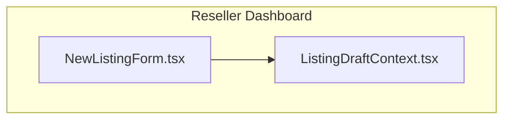
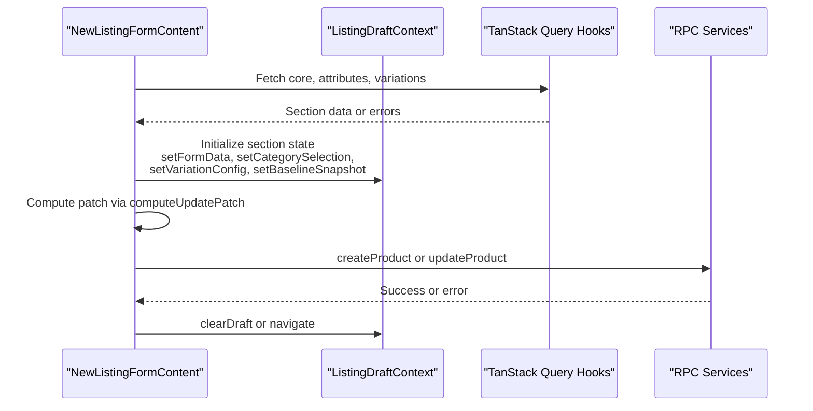
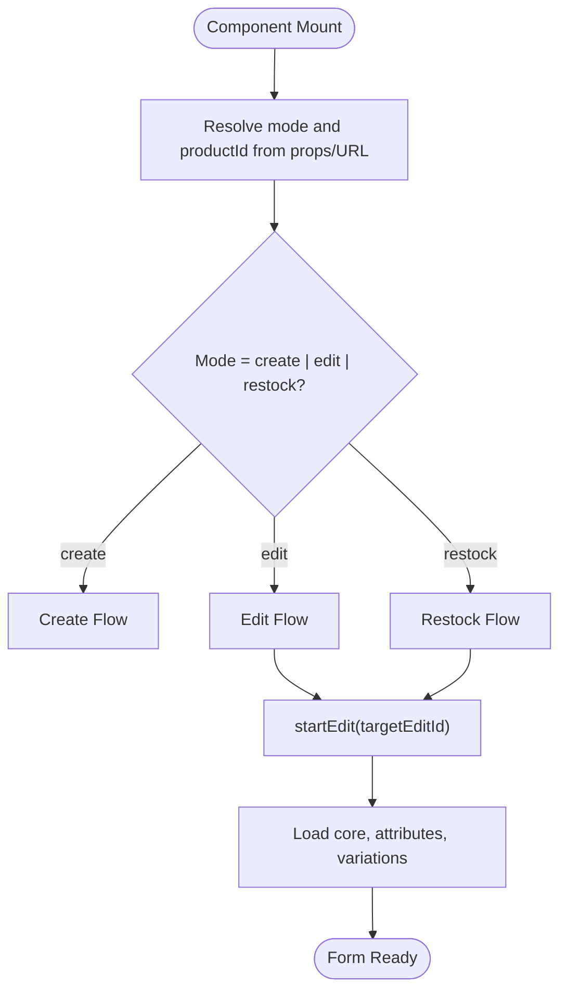
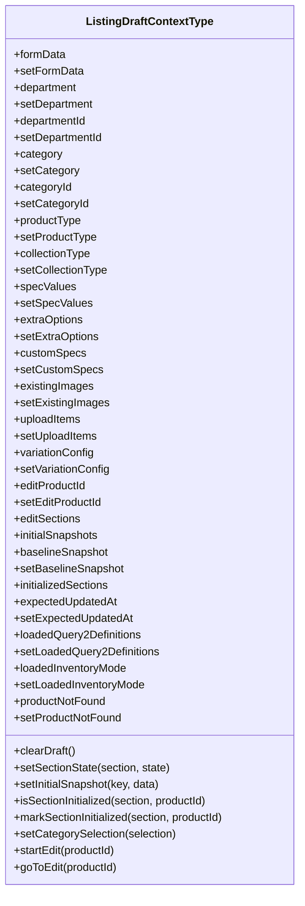
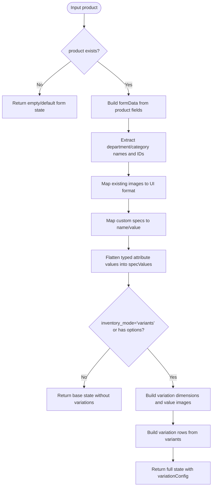
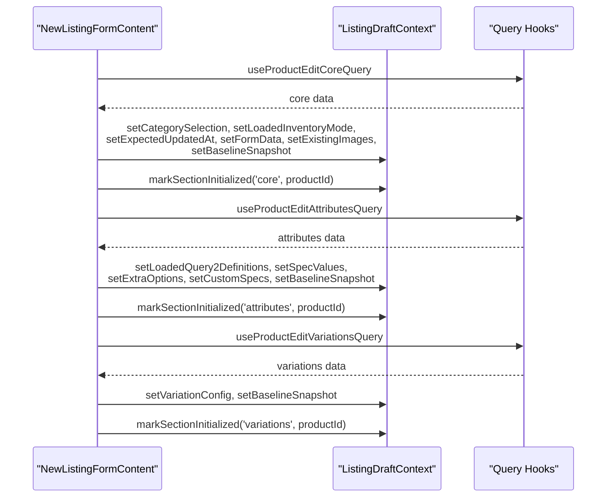
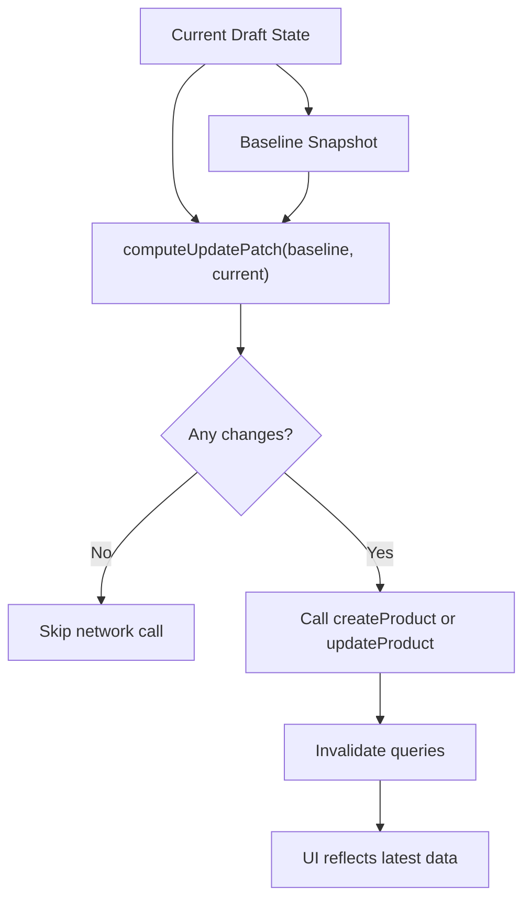
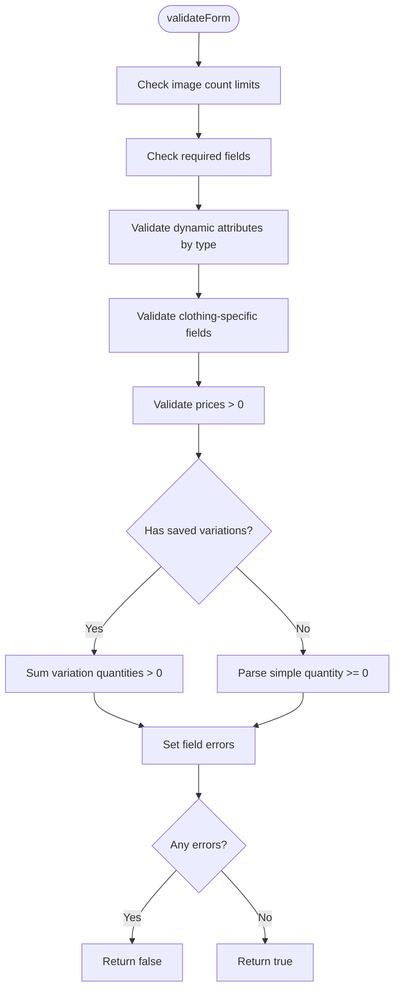
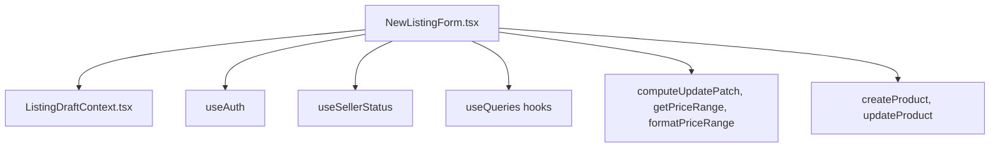

# Form Initialization & State Management

<cite>
**Referenced Files in This Document**
- [NewListingForm.tsx](file://components/reseller/components/NewListingForm.tsx)
- [ListingDraftContext.tsx](file://components/reseller/context/ListingDraftContext.tsx)
</cite>

## Table of Contents
1. [Introduction](#introduction)
2. [Project Structure](#project-structure)
3. [Core Components](#core-components)
4. [Architecture Overview](#architecture-overview)
5. [Detailed Component Analysis](#detailed-component-analysis)
6. [Dependency Analysis](#dependency-analysis)
7. [Performance Considerations](#performance-considerations)
8. [Troubleshooting Guide](#troubleshooting-guide)
9. [Conclusion](#conclusion)

## Introduction
This document explains the form initialization and state management system used by the product creation workflow. It focuses on how the `NewListingForm` component initializes different modes, manages complex form state through `ListingDraftContext`, and synchronizes UI state with database data. It also documents the `buildInitialProductStateFromNewSchema` function that transforms existing product data into a form-friendly structure, including category selection, image handling, custom specifications, and variation configuration. Finally, it details the state patterns for form fields, validation states, loading indicators, and error handling.

## Project Structure
The product listing form is implemented as a React component tree under the reseller dashboard:

- `components/reseller/components/NewListingForm.tsx`: Main form component, mode handling, data transformation, validation, submission, and UI rendering.
- `components/reseller/context/ListingDraftContext.tsx`: Shared context provider for draft form state, edit-mode section tracking, variation configuration, and helper utilities.

**Diagram sources**
- [NewListingForm.tsx:462-517](file://components/reseller/components/NewListingForm.tsx#L462-L517)
- [ListingDraftContext.tsx:177-369](file://components/reseller/context/ListingDraftContext.tsx#L177-L369)

**Section sources**
- [NewListingForm.tsx:1-54](file://components/reseller/components/NewListingForm.tsx#L1-L54)
- [ListingDraftContext.tsx:1-100](file://components/reseller/context/ListingDraftContext.tsx#L1-L100)

## Core Components
- `NewListingForm` (wrapper): Accepts props like `mode`, `productId`, and callbacks; resolves URL-based product IDs and delegates to internal content logic.
- `NewListingFormContent` (main form engine): Owns all editing logic, fetches core product data, attributes, and variations via TanStack Query hooks, initializes sections progressively, computes change patches, validates inputs, and submits create/update requests.
- `ListingDraftContext`: Provides shared state for form fields, department/category selection, dynamic attribute values, custom specs, images, upload items, variation configuration, edit-mode snapshots, and section initialization markers.

Key responsibilities:
- Mode resolution: create, edit, restock.
- Progressive section initialization: core, attributes, variations.
- Data transformation: mapping DB product schema to form-friendly structures.
- Validation: required fields, dynamic attribute rules, price/stock constraints.
- Submission: transactional RPC calls for create and update, with optimistic invalidation.

**Section sources**
- [NewListingForm.tsx:97-106](file://components/reseller/components/NewListingForm.tsx#L97-L106)
- [NewListingForm.tsx:452-467](file://components/reseller/components/NewListingForm.tsx#L452-L467)
- [ListingDraftContext.tsx:116-173](file://components/reseller/context/ListingDraftContext.tsx#L116-L173)

## Architecture Overview
The form uses a layered architecture:

- Presentation layer: `NewListingForm` renders UI sections for images, product specification, stock, and actions.
- State coordination layer: `ListingDraftContext` centralizes draft state and edit-mode helpers.
- Data access layer: TanStack Query hooks fetch core product info, attribute definitions/values, and variation options/variants.
- Persistence layer: RPC services `createProduct` and `updateProduct` persist changes.

**Diagram sources**
- [NewListingForm.tsx:535-560](file://components/reseller/components/NewListingForm.tsx#L535-L560)
- [NewListingForm.tsx:877-913](file://components/reseller/components/NewListingForm.tsx#L877-L913)
- [NewListingForm.tsx:1562-1744](file://components/reseller/components/NewListingForm.tsx#L1562-L1744)
- [ListingDraftContext.tsx:177-369](file://components/reseller/context/ListingDraftContext.tsx#L177-L369)

## Detailed Component Analysis

### Mode Handling and Entry Points
The form supports three modes:
- Create: new product creation flow.
- Edit: updating an existing product with progressive section loading.
- Restock: specialized edit flow focused on inventory updates.

Mode resolution:
- The wrapper receives `mode` prop and may override based on URL parameters (`productId` or `id`).
- Content component determines `isEditMode` and `isRestockMode`.
- In edit/restock mode, the component triggers `startEdit(productId)` to reset draft state and mark the target product ID.

**Diagram sources**
- [NewListingForm.tsx:2765-2776](file://components/reseller/components/NewListingForm.tsx#L2765-L2776)
- [NewListingForm.tsx:529-531](file://components/reseller/components/NewListingForm.tsx#L529-L531)
- [NewListingForm.tsx:599-604](file://components/reseller/components/NewListingForm.tsx#L599-L604)
- [ListingDraftContext.tsx:270-302](file://components/reseller/context/ListingDraftContext.tsx#L270-L302)

**Section sources**
- [NewListingForm.tsx:2765-2776](file://components/reseller/components/NewListingForm.tsx#L2765-L2776)
- [NewListingForm.tsx:529-531](file://components/reseller/components/NewListingForm.tsx#L529-L531)
- [NewListingForm.tsx:599-604](file://components/reseller/components/NewListingForm.tsx#L599-L604)
- [ListingDraftContext.tsx:270-302](file://components/reseller/context/ListingDraftContext.tsx#L270-L302)

### ListingDraftContext State Model
The context exposes a comprehensive state model:

- Form fields: title, brand, fabric, stitching status, piece count, quantity, color, prices, defect, description.
- Category selection: department and category names and IDs, plus atomic setter `setCategorySelection`.
- Dynamic attributes: `specValues` keyed by attribute definition ID, supporting text, number, boolean, and multi-select JSONB.
- Custom specifications: user-defined key-value pairs.
- Images: existing DB images and pending uploads with preview URLs and statuses.
- Variations: dimensions, rows, value images, and derived summary helpers.
- Edit-mode tracking: per-section load states, baseline snapshots, initialized section markers, expectedUpdatedAt concurrency token, loadedQuery2Definitions, loadedInventoryMode, productNotFound flag.

**Diagram sources**
- [ListingDraftContext.tsx:116-173](file://components/reseller/context/ListingDraftContext.tsx#L116-L173)
- [ListingDraftContext.tsx:177-369](file://components/reseller/context/ListingDraftContext.tsx#L177-L369)

**Section sources**
- [ListingDraftContext.tsx:116-173](file://components/reseller/context/ListingDraftContext.tsx#L116-L173)
- [ListingDraftContext.tsx:177-369](file://components/reseller/context/ListingDraftContext.tsx#L177-L369)

### buildInitialProductStateFromNewSchema
This function transforms an existing product object into a form-friendly structure. It handles:

- Basic form data: title, brand default, fabric, stitching status, piece count, quantity, color, compare-at price, selling price, defect, description.
- Department and category: extracts names and IDs from nested product objects.
- Existing images: maps DB image records to UI image entries with thumbnail flags.
- Custom specifications: maps custom attribute records to name/value pairs.
- Attribute values: flattens multiple typed value columns into a single `specValues` map keyed by attribute ID.
- Variation configuration: detects variant mode and reconstructs dimensions, value images, and rows from options and variants.

Complexity considerations:
- Iterates over product arrays (images, custom attributes, attribute values, options, variants).
- Uses lookup maps to resolve option value IDs to dimension names and values.
- Normalizes variation row keys using sorted attribute entries for stable identity.

**Diagram sources**
- [NewListingForm.tsx:268-445](file://components/reseller/components/NewListingForm.tsx#L268-L445)

**Section sources**
- [NewListingForm.tsx:268-445](file://components/reseller/components/NewListingForm.tsx#L268-L445)

### Progressive Section Initialization
In edit/restock mode, the form loads data progressively:

- Core section: sets category selection atomically, inventory mode, expectedUpdatedAt, basic fields, existing images, and baseline snapshot.
- Attributes section: loads attribute definitions and values, normalizes typed values, merges extra options, maps custom specs, and sets baseline snapshot.
- Variations section: builds dimensions and rows from active variants, sets variation config, and records baseline snapshot.

Each section is marked initialized once per product ID to avoid redundant re-initialization.

**Diagram sources**
- [NewListingForm.tsx:606-681](file://components/reseller/components/NewListingForm.tsx#L606-L681)
- [NewListingForm.tsx:683-769](file://components/reseller/components/NewListingForm.tsx#L683-L769)
- [NewListingForm.tsx:771-872](file://components/reseller/components/NewListingForm.tsx#L771-L872)
- [ListingDraftContext.tsx:204-213](file://components/reseller/context/ListingDraftContext.tsx#L204-L213)

**Section sources**
- [NewListingForm.tsx:606-681](file://components/reseller/components/NewListingForm.tsx#L606-L681)
- [NewListingForm.tsx:683-769](file://components/reseller/components/NewListingForm.tsx#L683-L769)
- [NewListingForm.tsx:771-872](file://components/reseller/components/NewListingForm.tsx#L771-L872)
- [ListingDraftContext.tsx:204-213](file://components/reseller/context/ListingDraftContext.tsx#L204-L213)

### Data Synchronization Between UI and Database
Synchronization occurs through:

- Baseline snapshots: capture initial state per section for change detection.
- Patch computation: `computeUpdatePatch` compares current state against baseline to produce minimal diffs.
- Submit handlers: call RPC services with computed patches and payload transformations.
- Cache invalidation: after successful mutations, invalidate relevant query keys to refresh listings and storefront data.

**Diagram sources**
- [NewListingForm.tsx:877-913](file://components/reseller/components/NewListingForm.tsx#L877-L913)
- [NewListingForm.tsx:1562-1744](file://components/reseller/components/NewListingForm.tsx#L1562-L1744)

**Section sources**
- [NewListingForm.tsx:877-913](file://components/reseller/components/NewListingForm.tsx#L877-L913)
- [NewListingForm.tsx:1562-1744](file://components/reseller/components/NewListingForm.tsx#L1562-L1744)

### Validation States and Error Handling
Validation covers:

- Image requirements: at least one image, maximum limit enforcement.
- Required fields: title, department, category, brand.
- Dynamic attribute rules: required attributes validated by backend definition types.
- Clothing-specific fields: collection type and fabric type when applicable.
- Price and stock: positive numeric prices; total variation quantity must be greater than zero if variations exist.

Error handling includes:

- Field-level errors displayed inline.
- Global submit errors surfaced at the top of the form.
- Network/storage permission errors parsed into user-friendly messages.
- Conflict errors guiding users to reload latest data.

**Diagram sources**
- [NewListingForm.tsx:1418-1531](file://components/reseller/components/NewListingForm.tsx#L1418-L1531)

**Section sources**
- [NewListingForm.tsx:1418-1531](file://components/reseller/components/NewListingForm.tsx#L1418-L1531)

### Examples of Product Types, Inventory Modes, and Nested Structures
- Product types: The form derives collection type options based on product type and category, enabling tailored dropdowns for unstitched, ready-to-wear, formal, and accessories categories.
- Inventory modes: Simple inventory uses a single quantity field; variant inventory uses a variation grid with dimensions, rows, and per-row pricing/stock.
- Nested structures:
  - Category hierarchy: department -> category with atomic selection setters.
  - Attribute values: flattened across multiple typed columns into a unified map.
  - Variations: option values mapped to rows with normalized keys and optional value images.

**Section sources**
- [NewListingForm.tsx:209-233](file://components/reseller/components/NewListingForm.tsx#L209-L233)
- [NewListingForm.tsx:336-431](file://components/reseller/components/NewListingForm.tsx#L336-L431)
- [NewListingForm.tsx:1057-1074](file://components/reseller/components/NewListingForm.tsx#L1057-L1074)

## Dependency Analysis
The form depends on:

- React hooks: `useState`, `useEffect`, `useMemo`, `useCallback`, `useRef`.
- Next.js routing: `useRouter`, `useSearchParams`.
- Icons and UI primitives: Lucide icons.
- Authentication and seller status: `useAuth`, `useSellerStatus`.
- TanStack Query hooks: departments, categories, attribute definitions, product edit core/attributes/variations.
- Utilities: `computeUpdatePatch`, `getPriceRange`, `formatPriceRange`, `normalizeVariationValueKey`.
- API services: `createProduct`, `updateProduct`, storage helpers.

Coupling and cohesion:
- High cohesion within `NewListingFormContent` for form logic.
- Clear separation between presentation and state via `ListingDraftContext`.
- External dependencies are encapsulated behind hooks and services.

Potential circular dependencies:
- None observed; imports are directional from components to context and services.

External integration points:
- Supabase RPC endpoints via service functions.
- Storage bucket operations for image uploads.

**Diagram sources**
- [NewListingForm.tsx:1-54](file://components/reseller/components/NewListingForm.tsx#L1-L54)
- [NewListingForm.tsx:519-527](file://components/reseller/components/NewListingForm.tsx#L519-L527)
- [NewListingForm.tsx:535-560](file://components/reseller/components/NewListingForm.tsx#L535-L560)
- [NewListingForm.tsx:877-913](file://components/reseller/components/NewListingForm.tsx#L877-L913)
- [NewListingForm.tsx:1562-1744](file://components/reseller/components/NewListingForm.tsx#L1562-L1744)

**Section sources**
- [NewListingForm.tsx:1-54](file://components/reseller/components/NewListingForm.tsx#L1-L54)
- [NewListingForm.tsx:519-527](file://components/reseller/components/NewListingForm.tsx#L519-L527)
- [NewListingForm.tsx:535-560](file://components/reseller/components/NewListingForm.tsx#L535-L560)
- [NewListingForm.tsx:877-913](file://components/reseller/components/NewListingForm.tsx#L877-L913)
- [NewListingForm.tsx:1562-1744](file://components/reseller/components/NewListingForm.tsx#L1562-L1744)

## Performance Considerations
- Progressive loading: Sections load independently, reducing initial render time and allowing partial availability.
- Memoization: Derived lists and summaries use `useMemo` to avoid recomputation.
- Change detection: Minimal patches reduce payload size and server load.
- Query invalidation: Targeted cache invalidation prevents unnecessary refetches.
- Object URL cleanup: Prevents memory leaks by revoking blob URLs on unmount or item removal.

[No sources needed since this section provides general guidance]

## Troubleshooting Guide
Common issues and resolutions:

- Product not found: When edit mode loads no core data, the form displays a “Product Not Found” screen with a link back to listings.
- Section load failures: Each section shows an error banner with a retry button to refetch the specific section.
- Storage bucket errors: User-friendly messages indicate bucket misconfiguration or permission issues.
- Permission denied: Messages clarify that only the product owner can edit or restock.
- Network errors: Guidance to check connectivity and retry.
- Foreign key constraint violations: Indicates seller verification issues requiring re-login.
- Conflict errors: Advises reloading the product to get the latest version before saving.

Operational tips:
- Use the “Retry” buttons for failed sections.
- Confirm destructive changes when deactivating variants or setting stock to zero.
- After successful mutation, rely on automatic navigation or callback behavior.

**Section sources**
- [NewListingForm.tsx:244-266](file://components/reseller/components/NewListingForm.tsx#L244-L266)
- [NewListingForm.tsx:1763-1783](file://components/reseller/components/NewListingForm.tsx#L1763-L1783)
- [NewListingForm.tsx:1665-1679](file://components/reseller/components/NewListingForm.tsx#L1665-L1679)
- [NewListingForm.tsx:1729-1743](file://components/reseller/components/NewListingForm.tsx#L1729-L1743)

## Conclusion
The product creation workflow’s form initialization and state management system is built around a robust context-driven architecture. `NewListingForm` orchestrates mode-specific flows, while `ListingDraftContext` centralizes complex state for forms, attributes, images, and variations. The `buildInitialProductStateFromNewSchema` function ensures seamless transformation of backend product schemas into UI-friendly structures. Progressive section loading, precise change detection, and targeted cache invalidation provide a responsive and reliable editing experience. Validation and error handling protect data integrity and guide users effectively through common pitfalls.

[No sources needed since this section summarizes without analyzing specific files]