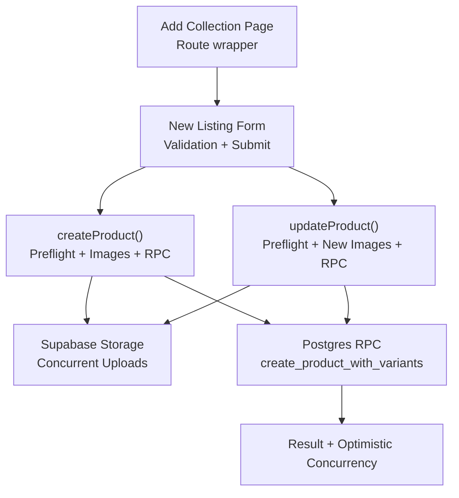
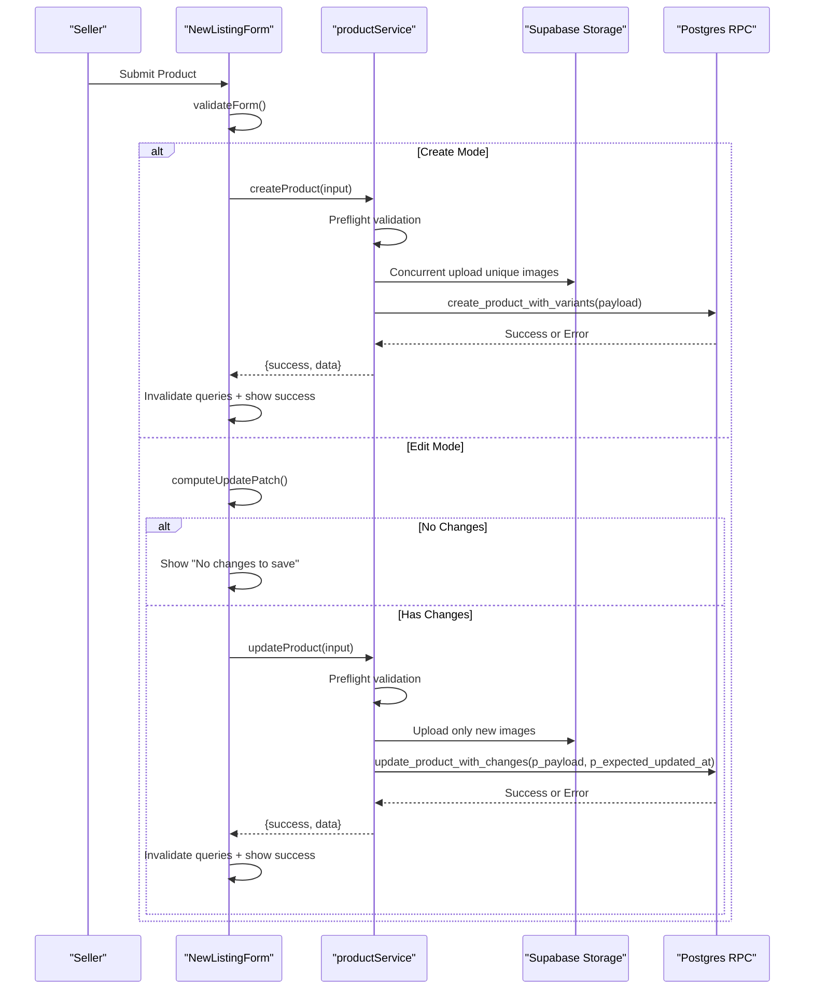
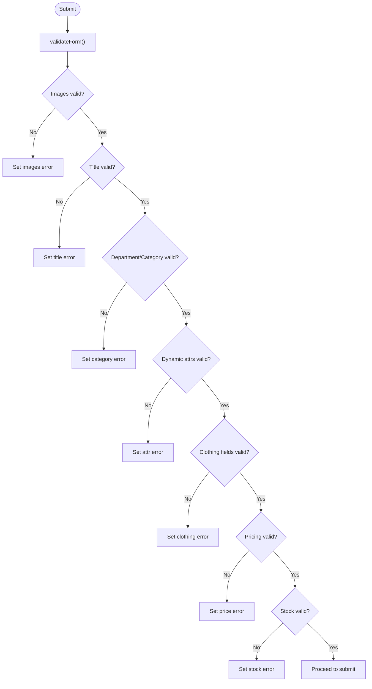
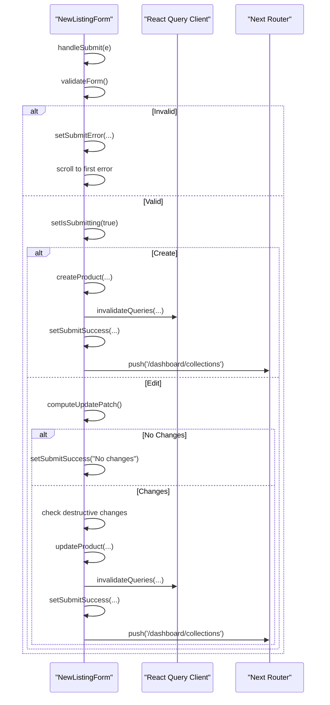
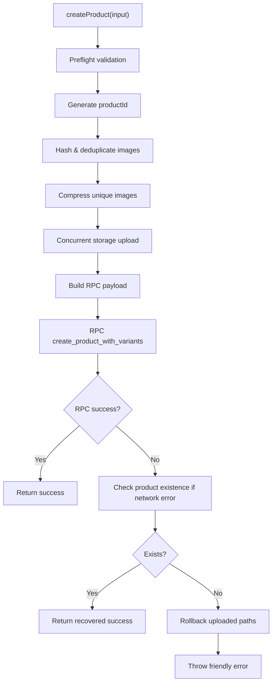
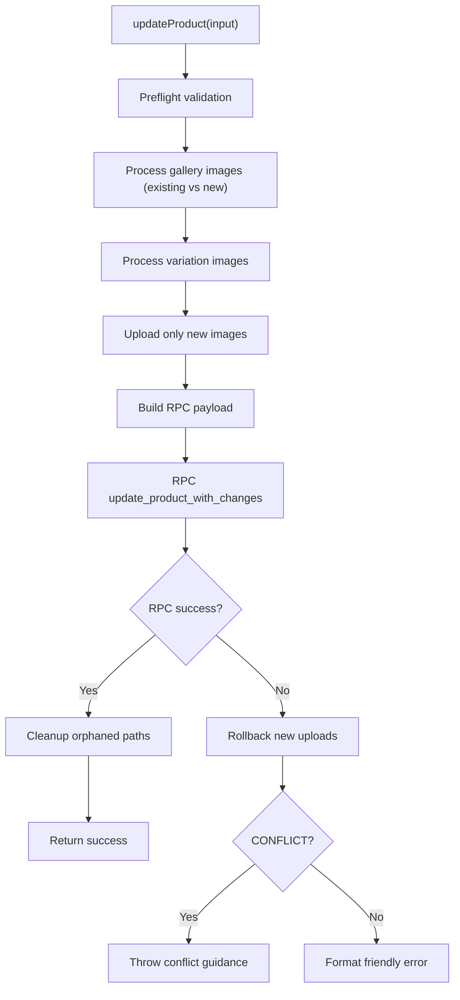
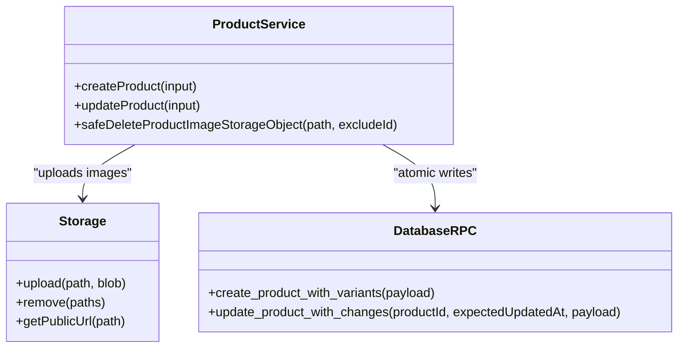
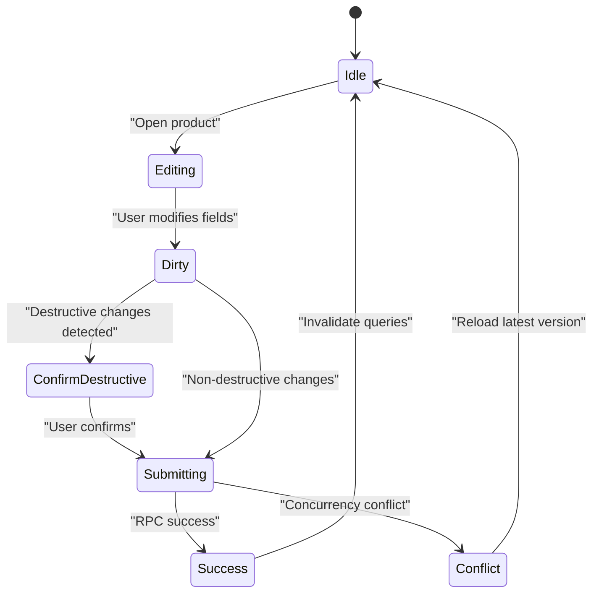
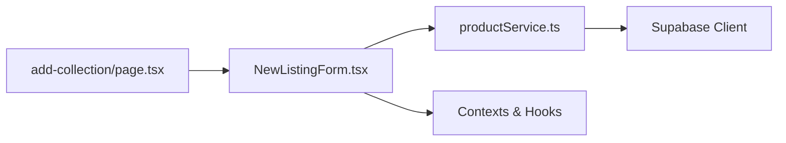

# Form Validation & Submission

<cite>
**Referenced Files in This Document**
- [NewListingForm.tsx](file://components/reseller/components/NewListingForm.tsx)
- [productService.ts](file://src/api/productService.ts)
- [add-collection/page.tsx](file://app/dashboard/add-collection/page.tsx)
- [20261106_update_product_with_changes_rpc.sql](file://supabase/migrations/20261106_update_product_with_changes_rpc.sql)
</cite>

## Table of Contents
1. [Introduction](#introduction)
2. [Project Structure](#project-structure)
3. [Core Components](#core-components)
4. [Architecture Overview](#architecture-overview)
5. [Detailed Component Analysis](#detailed-component-analysis)
6. [Dependency Analysis](#dependency-analysis)
7. [Performance Considerations](#performance-considerations)
8. [Troubleshooting Guide](#troubleshooting-guide)
9. [Conclusion](#conclusion)

## Introduction
This document explains the complete product creation and editing workflow, focusing on form validation, real-time feedback, error handling, submission flow, transactional persistence, image handling, variants, attributes, and optimistic update patterns. The implementation is split between a rich client-side form component and a service layer that orchestrates storage uploads and atomic database RPC calls.

## Project Structure
The product creation/editing UI lives under the reseller dashboard:
- The page routes to the listing form with create, edit, or restock modes.
- The form manages local state, validation, variation configuration, and submission orchestration.
- The service layer performs preflight validation, image hashing/compression/upload, payload construction, and atomic RPC calls.

**Diagram sources**
- [add-collection/page.tsx:9-31](file://app/dashboard/add-collection/page.tsx#L9-L31)
- [NewListingForm.tsx:1534-1745](file://components/reseller/components/NewListingForm.tsx#L1534-L1745)
- [productService.ts:302-707](file://src/api/productService.ts#L302-L707)
- [productService.ts:1200-1637](file://src/api/productService.ts#L1200-L1637)

**Section sources**
- [add-collection/page.tsx:1-48](file://app/dashboard/add-collection/page.tsx#L1-L48)
- [NewListingForm.tsx:1-120](file://components/reseller/components/NewListingForm.tsx#L1-L120)

## Core Components
- NewListingForm: React component responsible for user input, real-time validation, variation management, image upload UX, and calling the appropriate service function.
- productService.createProduct: Orchestrates new product creation, including preflight validation, image processing, concurrent storage upload, and an atomic RPC call.
- productService.updateProduct: Orchestrates product updates, including change detection, new image upload, payload construction, optimistic concurrency checks, and post-commit cleanup.

Key responsibilities:
- Real-time validation rules per field.
- Error message normalization and user-friendly display.
- Loading states and success/error banners.
- Transactional data persistence via RPC.
- Image deduplication, compression, and safe deletion.
- Variants and option images handling.
- Optimistic concurrency protection during edits.

**Section sources**
- [NewListingForm.tsx:1418-1531](file://components/reseller/components/NewListingForm.tsx#L1418-L1531)
- [productService.ts:302-707](file://src/api/productService.ts#L302-L707)
- [productService.ts:1200-1637](file://src/api/productService.ts#L1200-L1637)

## Architecture Overview
The submission lifecycle differs by mode:

- Create mode:
  - Client validates inputs.
  - Service hashes all gallery and variation images once using SHA-256.
  - Service compresses unique images and uploads them concurrently.
  - Service builds a payload matching the RPC contract.
  - Atomic RPC creates product, options, variants, attributes, and images.
  - On network timeout, service probes existence and returns a recovered result.
  - On failure, uploaded paths are rolled back and friendly errors are thrown.

- Edit mode:
  - Client computes a patch against baseline snapshot.
  - If no changes, submit short-circuits.
  - Destructive changes (deactivated variants or zero stock) prompt confirmation.
  - Only newly added images are hashed, compressed, and uploaded.
  - Payload includes targetMode, confirm flags, and optional patch.product.
  - Atomic RPC enforces optimistic concurrency via expectedUpdatedAt.
  - Post-commit cleanup removes orphaned storage paths returned by the RPC.

**Diagram sources**
- [NewListingForm.tsx:1534-1745](file://components/reseller/components/NewListingForm.tsx#L1534-L1745)
- [productService.ts:302-707](file://src/api/productService.ts#L302-L707)
- [productService.ts:1200-1637](file://src/api/productService.ts#L1200-L1637)

## Detailed Component Analysis

### Form Validation Rules and Real-Time Feedback
The form validates fields before submission and clears field-level errors when users correct inputs.

Validation highlights:
- Images:
  - Minimum one image required; maximum ten allowed.
  - Immediate feedback when removing images drops below minimum.
- Title:
  - Required and at least three characters.
- Department and Category:
  - Required in create mode; read-only in edit mode.
- Dynamic Attribute Specifications:
  - Enforced based on backend `is_required` flag.
  - Supports text, number, boolean, and multi-select types.
- Brand:
  - Required in create mode.
- Clothing-specific fields:
  - Collection Type and Fabric Type may be required depending on category and attribute definitions.
- Pricing:
  - Retail price and selling price must be greater than zero unless saved variations exist.
- Stock:
  - For variations: total quantity across rows must be greater than zero.
  - For simple products: integer quantity greater than or equal to zero.

Real-time behavior:
- Input handlers clear field-level errors when values change.
- Removing existing or new images updates the image error immediately.
- Changing department/category resets dependent fields and clears stale errors.
- Selecting collection type/fabric clears related errors.

**Diagram sources**
- [NewListingForm.tsx:1418-1531](file://components/reseller/components/NewListingForm.tsx#L1418-L1531)

**Section sources**
- [NewListingForm.tsx:1217-1341](file://components/reseller/components/NewListingForm.tsx#L1217-L1341)
- [NewListingForm.tsx:1343-1416](file://components/reseller/components/NewListingForm.tsx#L1343-L1416)
- [NewListingForm.tsx:1418-1531](file://components/reseller/components/NewListingForm.tsx#L1418-L1531)

### Submission Flow and Loading States
- Submit handler prevents duplicate submissions and clears previous global errors/success messages.
- If validation fails, it sets a global error and scrolls to the first invalid field.
- In create mode, it calls `createProduct`, invalidates relevant queries, shows success, and navigates after a delay.
- In edit mode:
  - If no changes detected, it shows a temporary success message and exits early.
  - If destructive changes are detected, it prompts for confirmation.
  - It calls `updateProduct`, invalidates queries, shows success, and navigates after a delay.
- Loading button text adapts to mode and section loading states.

**Diagram sources**
- [NewListingForm.tsx:1534-1745](file://components/reseller/components/NewListingForm.tsx#L1534-L1745)

**Section sources**
- [NewListingForm.tsx:1534-1745](file://components/reseller/components/NewListingForm.tsx#L1534-L1745)
- [NewListingForm.tsx:1747-1761](file://components/reseller/components/NewListingForm.tsx#L1747-L1761)

### Integration with productService.createProduct
- Preflight validation ensures authentication, category selection, title length, image count limits, inventory mode derivation, dimension/value limits, row limits, pricing constraints, and stock totals.
- A client-generated UUID is used as productId for content-addressed storage paths.
- All gallery and variation images are hashed with SHA-256 and deduplicated.
- Unique images are compressed and uploaded concurrently with a worker pool.
- Payload construction maps custom specs, category attributes, options, and variants.
- Atomic RPC `create_product_with_variants` is invoked.
- Network timeouts trigger existence checks to recover successful creations.
- Errors roll back uploaded paths and throw friendly messages.

**Diagram sources**
- [productService.ts:302-707](file://src/api/productService.ts#L302-L707)

**Section sources**
- [productService.ts:302-707](file://src/api/productService.ts#L302-L707)

### Integration with productService.updateProduct
- Preflight validation mirrors create logic but allows zero stock for simple products and supports variant quantity ranges.
- Existing images are preserved; only new files are hashed, compressed, and uploaded.
- Option value images are mapped from variationConfig, supporting both loaded and legacy formats.
- Payload includes targetMode, confirm flags, and optional patch.product.
- Atomic RPC `update_product_with_changes` is called with optimistic concurrency via expectedUpdatedAt.
- On RPC error:
  - Newly uploaded paths are rolled back.
  - CONFLICT errors are transformed into user guidance.
  - VALIDATION errors are stripped of prefixes.
  - Missing RPC function errors include migration instructions.
- Post-commit cleanup removes orphaned storage paths returned by the RPC.

**Diagram sources**
- [productService.ts:1200-1637](file://src/api/productService.ts#L1200-L1637)

**Section sources**
- [productService.ts:1200-1637](file://src/api/productService.ts#L1200-L1637)

### Transaction Handling for Related Data
- Images:
  - Deduplicated by SHA-256 to avoid redundant uploads.
  - Compressed to reduce bandwidth and improve performance.
  - Uploaded concurrently with limited workers.
  - Rollback of uploaded paths on failure.
  - Safe deletion utility checks references before removing storage objects.
- Variants and Options:
  - Enabled dimensions and active values are processed.
  - Option images are attached to option values where present.
  - Rows map to combinations with prices and quantities.
- Attributes:
  - Custom specs and category attribute values are normalized and filtered.
- RPC Contracts:
  - Create uses `create_product_with_variants`.
  - Update uses `update_product_with_changes` with optimistic concurrency.

**Diagram sources**
- [productService.ts:46-94](file://src/api/productService.ts#L46-L94)
- [productService.ts:302-707](file://src/api/productService.ts#L302-L707)
- [productService.ts:1200-1637](file://src/api/productService.ts#L1200-L1637)

**Section sources**
- [productService.ts:46-94](file://src/api/productService.ts#L46-L94)
- [productService.ts:302-707](file://src/api/productService.ts#L302-L707)
- [productService.ts:1200-1637](file://src/api/productService.ts#L1200-L1637)

### Optimistic Update Pattern
- Edit mode computes a patch against a baseline snapshot to detect dirty sections and minimize network payloads.
- No-change guard avoids unnecessary API calls.
- Destructive changes (deactivating variants or setting stock to zero) require explicit confirmation.
- Update RPC enforces optimistic concurrency using `expectedUpdatedAt`; conflicts are surfaced to the user with reload guidance.
- Post-commit cleanup removes orphaned storage paths identified by the database.

**Diagram sources**
- [NewListingForm.tsx:877-913](file://components/reseller/components/NewListingForm.tsx#L877-L913)
- [NewListingForm.tsx:1656-1745](file://components/reseller/components/NewListingForm.tsx#L1656-L1745)
- [productService.ts:1570-1637](file://src/api/productService.ts#L1570-L1637)
- [20261106_update_product_with_changes_rpc.sql:133-160](file://supabase/migrations/20261106_update_product_with_changes_rpc.sql#L133-L160)

**Section sources**
- [NewListingForm.tsx:877-913](file://components/reseller/components/NewListingForm.tsx#L877-L913)
- [NewListingForm.tsx:1656-1745](file://components/reseller/components/NewListingForm.tsx#L1656-L1745)
- [productService.ts:1570-1637](file://src/api/productService.ts#L1570-L1637)
- [20261106_update_product_with_changes_rpc.sql:133-160](file://supabase/migrations/20261106_update_product_with_changes_rpc.sql#L133-L160)

### Error Handling Strategies
- Field-level errors:
  - Clear on input change or selection.
  - Display inline beneath fields.
- Global errors:
  - Shown at top of form with alert styling.
  - Auto-scroll to first invalid field on failed validation.
- Service-layer errors:
  - Friendly messages for missing RPC functions, constraint violations, foreign key issues, and permission denials.
  - Migration instructions included for schema cache issues.
- Storage errors:
  - Per-image status with retry capability.
  - Rollback of uploaded paths on failure.
- Concurrency conflicts:
  - User-guided reload instruction.

**Section sources**
- [NewListingForm.tsx:244-266](file://components/reseller/components/NewListingForm.tsx#L244-L266)
- [productService.ts:255-292](file://src/api/productService.ts#L255-L292)
- [productService.ts:1600-1621](file://src/api/productService.ts#L1600-L1621)

## Dependency Analysis
- Page depends on NewListingForm to render the form and handle finish callbacks.
- NewListingForm depends on:
  - Authentication context for seller ID.
  - React Query hooks for departments, categories, attributes, and product data.
  - ListingDraftContext for draft state and baseline snapshots.
  - productService for create/update operations.
- productService depends on:
  - Supabase client for storage and RPC.
  - Utility functions for image resolution, compression, hashing, and error formatting.

**Diagram sources**
- [add-collection/page.tsx:9-31](file://app/dashboard/add-collection/page.tsx#L9-L31)
- [NewListingForm.tsx:1-54](file://components/reseller/components/NewListingForm.tsx#L1-L54)
- [productService.ts:1-8](file://src/api/productService.ts#L1-L8)

**Section sources**
- [add-collection/page.tsx:1-48](file://app/dashboard/add-collection/page.tsx#L1-L48)
- [NewListingForm.tsx:1-54](file://components/reseller/components/NewListingForm.tsx#L1-L54)
- [productService.ts:1-8](file://src/api/productService.ts#L1-L8)

## Performance Considerations
- Image deduplication reduces redundant uploads and storage usage.
- Compression reduces payload size and improves upload speed.
- Concurrent uploads with limited workers balance throughput and server load.
- Change detection minimizes network traffic by sending only necessary patches.
- Query invalidation keeps caches consistent without full page reloads.

[No sources needed since this section provides general guidance]

## Troubleshooting Guide
Common issues and resolutions:
- Missing RPC functions:
  - Follow migration instructions embedded in error messages.
- Schema cache issues:
  - Re-run migrations and refresh schema cache.
- Duplicate keys or constraint violations:
  - Review input uniqueness and business rules.
- Foreign key errors:
  - Verify selected category/options exist and are valid.
- Permission denied:
  - Ensure logged-in seller owns the product or listing.
- Storage bucket not found:
  - Contact support to verify storage configuration.
- Network errors:
  - Check internet connectivity and retry.

**Section sources**
- [productService.ts:255-292](file://src/api/productService.ts#L255-L292)
- [NewListingForm.tsx:244-266](file://components/reseller/components/NewListingForm.tsx#L244-L266)
- [productService.ts:1600-1621](file://src/api/productService.ts#L1600-L1621)

## Conclusion
The product creation and editing workflow combines robust client-side validation, responsive user feedback, efficient image handling, and transactional persistence through atomic RPCs. The system protects data integrity with optimistic concurrency, rollback mechanisms, and comprehensive error messaging. By leveraging change detection and query invalidation, it delivers a smooth, resilient user experience while maintaining strong guarantees around related data such as images, variants, and attributes.

[No sources needed since this section summarizes without analyzing specific files]