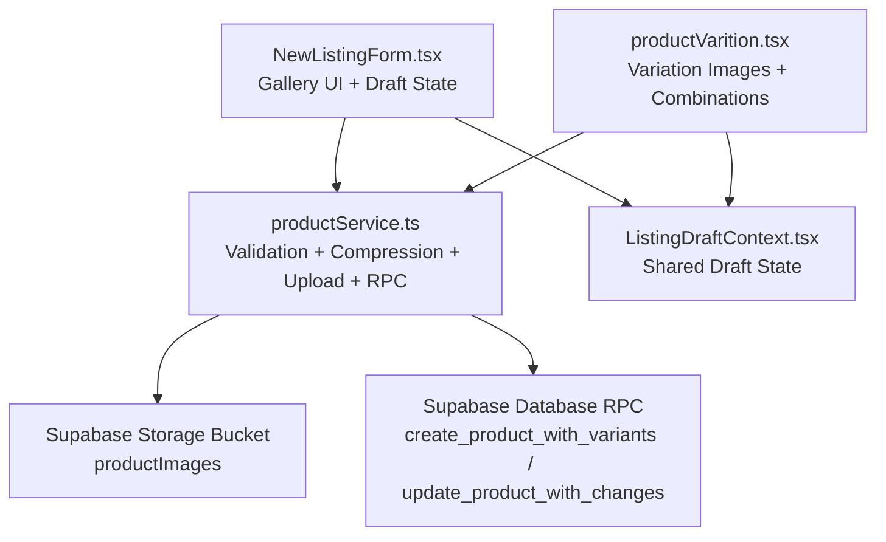
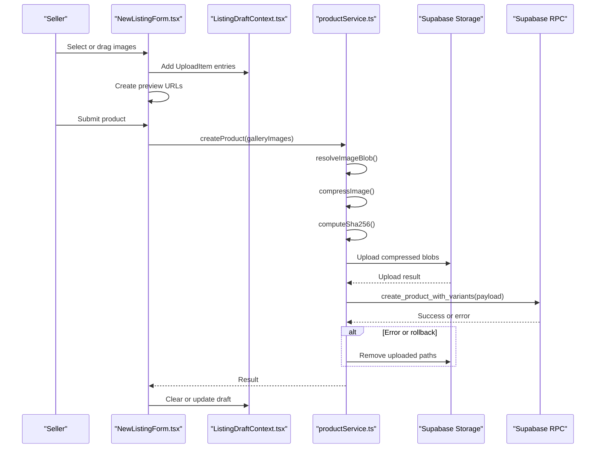
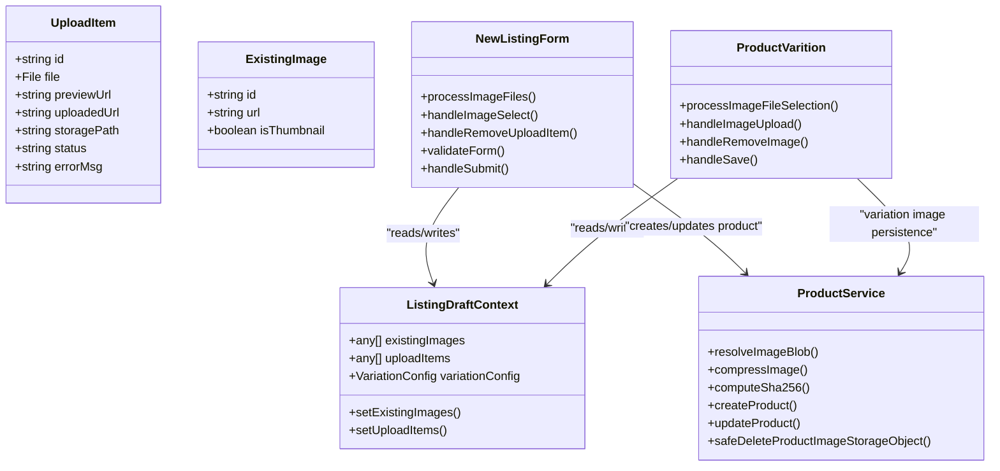

# Image Upload & Processing

<cite>
**Referenced Files in This Document**
- [NewListingForm.tsx](file://components/reseller/components/NewListingForm.tsx)
- [productService.ts](file://src/api/productService.ts)
- [ListingDraftContext.tsx](file://components/reseller/context/ListingDraftContext.tsx)
- [productVarition.tsx](file://components/reseller/components/productVarition.tsx)
</cite>

## Table of Contents
1. [Introduction](#introduction)
2. [Project Structure](#project-structure)
3. [Core Components](#core-components)
4. [Architecture Overview](#architecture-overview)
5. [Detailed Component Analysis](#detailed-component-analysis)
6. [Dependency Analysis](#dependency-analysis)
7. [Performance Considerations](#performance-considerations)
8. [Troubleshooting Guide](#troubleshooting-guide)
9. [Conclusion](#conclusion)

## Introduction
This document explains the image upload and processing system used during product creation and editing. It covers the complete pipeline from file selection to storage persistence, including preview generation, upload progress tracking, validation rules, maximum image limits, Supabase storage integration, existing image management, thumbnail assignment, variation image handling, cleanup on deletion, drag-and-drop support, image optimization, and responsive display behavior.

The implementation is split between:
- A listing form UI that manages gallery images and user interactions.
- A service layer that validates, compresses, hashes, uploads, and persists images atomically with product data.
- A variation page that assigns per-option images for product variants.
- A shared draft context that holds form state, including uploaded items and existing images.

## Project Structure
The image handling logic lives primarily in these files:

| File | Responsibility |
|---|---|
| `components/reseller/components/NewListingForm.tsx` | Gallery image selection, preview, removal, count enforcement, submission wiring, and error formatting. |
| `src/api/productService.ts` | Image resolution, compression, hashing, deduplication, concurrent upload, RPC payload construction, atomic creation/update, and safe storage cleanup. |
| `components/reseller/context/ListingDraftContext.tsx` | Shared draft state including `existingImages`, `uploadItems`, and variation configuration. |
| `components/reseller/components/productVarition.tsx` | Variation dimension/value management, per-option image assignment, drag-and-drop upload, and combination row thumbnails. |

**Diagram sources**
- [NewListingForm.tsx:85-95](file://components/reseller/components/NewListingForm.tsx#L85-L95)
- [productService.ts:4-7](file://src/api/productService.ts#L4-L7)
- [ListingDraftContext.tsx:137-140](file://components/reseller/context/ListingDraftContext.tsx#L137-L140)
- [productVarition.tsx:174-197](file://components/reseller/components/productVarition.tsx#L174-L197)

**Section sources**
- [NewListingForm.tsx:85-95](file://components/reseller/components/NewListingForm.tsx#L85-L95)
- [productService.ts:4-7](file://src/api/productService.ts#L4-L7)
- [ListingDraftContext.tsx:137-140](file://components/reseller/context/ListingDraftContext.tsx#L137-L140)
- [productVarition.tsx:174-197](file://components/reseller/components/productVarition.tsx#L174-L197)

## Core Components

### UploadItem Interface
`UploadItem` represents a single gallery image selected by the seller before final submission. It includes:
- A unique identifier.
- The original `File`.
- A browser-generated preview URL.
- Optional server-side URL and storage path after successful upload.
- Status indicating uploading, success, or error.
- Optional error message.

This interface is defined in the listing form and consumed by the draft context and UI components.

**Section sources**
- [NewListingForm.tsx:85-93](file://components/reseller/components/NewListingForm.tsx#L85-L93)

### ExistingImage Interface
`ExistingImage` represents an already persisted product image loaded from the database. It includes:
- Optional database ID.
- Public image URL.
- Optional thumbnail flag.

It is used when initializing edit mode so sellers can keep, reorder, or remove existing images.

**Section sources**
- [NewListingForm.tsx:79-83](file://components/reseller/components/NewListingForm.tsx#L79-L83)

### Listing Draft Context
The draft context holds:
- Form fields.
- Department and category selections.
- Existing product images.
- New upload items.
- Variation configuration.
- Edit-mode section states and snapshots.

For image handling, it exposes `existingImages` and `uploadItems`, which are updated as users add or remove gallery images.

**Section sources**
- [ListingDraftContext.tsx:137-140](file://components/reseller/context/ListingDraftContext.tsx#L137-L140)
- [ListingDraftContext.tsx:189-191](file://components/reseller/context/ListingDraftContext.tsx#L189-L191)

### Product Service Image Pipeline
The service layer implements the core image pipeline:
1. Resolve input to a Blob.
2. Validate format and size.
3. Compress and optionally resize using a canvas.
4. Compute SHA-256 hash for deduplication.
5. Generate content-addressed storage paths.
6. Upload concurrently with a concurrency limit.
7. Build RPC payloads for product creation or update.
8. Roll back uploaded images if the database transaction fails.

**Section sources**
- [productService.ts:96-156](file://src/api/productService.ts#L96-L156)
- [productService.ts:158-240](file://src/api/productService.ts#L158-L240)
- [productService.ts:242-250](file://src/api/productService.ts#L242-L250)
- [productService.ts:495-543](file://src/api/productService.ts#L495-L543)

## Architecture Overview
The image handling architecture separates UI concerns from backend persistence:

**Diagram sources**
- [NewListingForm.tsx:1343-1381](file://components/reseller/components/NewListingForm.tsx#L1343-L1381)
- [productService.ts:302-707](file://src/api/productService.ts#L302-L707)

## Detailed Component Analysis

### Gallery Image Selection and Preview
The listing form supports:
- File input selection.
- Adding multiple images up to a maximum limit.
- Creating local preview URLs.
- Removing newly added images.
- Removing existing images.
- Enforcing at least one image.

When files are selected:
1. The available slot count is calculated based on existing images and already queued upload items.
2. If the limit is exceeded, a user-facing error is set.
3. Only the allowed number of files are added.
4. Each new item receives a unique ID, the original file, a preview URL, and initial status.

Preview URLs are created using browser object URLs and cleaned up when items are removed or the component unmounts.

**Section sources**
- [NewListingForm.tsx:1343-1381](file://components/reseller/components/NewListingForm.tsx#L1343-L1381)
- [NewListingForm.tsx:1384-1390](file://components/reseller/components/NewListingForm.tsx#L1384-L1390)
- [NewListingForm.tsx:1392-1416](file://components/reseller/components/NewListingForm.tsx#L1392-L1416)
- [NewListingForm.tsx:1190-1197](file://components/reseller/components/NewListingForm.tsx#L1190-L1197)

### Maximum Image Limits and Validation
There are two related limits:
- UI-level limit enforced in the listing form: maximum 10 images per collection.
- Service-level limit enforced during product creation or update: also maximum 10 images.

Validation ensures:
- At least one image is present.
- Total images do not exceed the maximum.
- Errors are shown inline and prevent submission when invalid.

**Section sources**
- [NewListingForm.tsx:95](file://components/reseller/components/NewListingForm.tsx#L95)
- [NewListingForm.tsx:1346-1381](file://components/reseller/components/NewListingForm.tsx#L1346-L1381)
- [NewListingForm.tsx:1418-1433](file://components/reseller/components/NewListingForm.tsx#L1418-L1433)
- [productService.ts:4](file://src/api/productService.ts#L4)
- [productService.ts:330-336](file://src/api/productService.ts#L330-L336)
- [productService.ts:1231-1237](file://src/api/productService.ts#L1231-L1237)

### File Validation Rules
Client-side validation applies to both gallery images and variation images:
- Allowed formats: JPG, PNG, WebP.
- SVG is explicitly rejected.
- Maximum file size: 10MB.
- For variation images, only one image per option value is allowed.

If an unsupported format or oversized file is selected, a warning or error is displayed instead of proceeding.

**Section sources**
- [productService.ts:162-169](file://src/api/productService.ts#L162-L169)
- [productVarition.tsx:566-596](file://components/reseller/components/productVarition.tsx#L566-L596)

### Image Optimization and Compression
Images are optimized before upload:
- Unsupported SVG files throw an error.
- Oversized files above 10MB throw an error.
- Large images are resized to a maximum dimension of 2000 pixels while preserving aspect ratio.
- PNG files remain PNG; other formats are encoded as JPEG with a quality factor around 0.88.
- Canvas fallback returns the original blob if compression fails.

This reduces bandwidth, improves upload speed, and avoids unnecessarily large storage objects.

**Section sources**
- [productService.ts:158-240](file://src/api/productService.ts#L158-L240)

### Content Addressing and Deduplication
Each image is hashed using SHA-256 over its original bytes. The hash is used to:
- Avoid compressing identical files more than once.
- Avoid uploading duplicate files.
- Generate deterministic storage paths.

Storage paths follow a content-addressed pattern:
`{userId}/{productId}/{hash}.{ext}`

This means identical images across gallery and variation values share a single stored blob.

**Section sources**
- [productService.ts:242-250](file://src/api/productService.ts#L242-L250)
- [productService.ts:397-435](file://src/api/productService.ts#L397-L435)
- [productService.ts:495-543](file://src/api/productService.ts#L495-L543)

### Concurrent Upload and Progress Tracking
Unique images are uploaded concurrently with a worker pool limited to three workers. The service tracks:
- Successfully uploaded paths.
- Upload errors.
- Cleanup paths for rollback.

In the UI, each `UploadItem` has a status field. Although the current listing form marks new gallery items as immediately successful in the UI, the service still performs real uploads and rollbacks. A retry helper exists to reset failed items to success state for UI purposes.

For true progress tracking, the UI would need to map upload progress to each item’s status. Currently, the main progress signal is the submit button state and service-level error/success responses.

**Section sources**
- [productService.ts:495-543](file://src/api/productService.ts#L495-L543)
- [NewListingForm.tsx:85-93](file://components/reseller/components/NewListingForm.tsx#L85-L93)
- [NewListingForm.tsx:1076-1080](file://components/reseller/components/NewListingForm.tsx#L1076-L1080)

### Supabase Storage Integration
The system uses the Supabase storage client with:
- Bucket name: `productImages`.
- Direct upload of compressed blobs.
- Content type preservation.
- Cache control headers.
- Upsert disabled to avoid accidental overwrites.
- Public URL generation for preview and display.

Errors from storage are mapped into user-friendly messages, including bucket-not-found and permission-denied scenarios.

**Section sources**
- [productService.ts:4-7](file://src/api/productService.ts#L4-L7)
- [productService.ts:507-518](file://src/api/productService.ts#L507-L518)
- [productService.ts:417](file://src/api/productService.ts#L417)
- [NewListingForm.tsx:244-266](file://components/reseller/components/NewListingForm.tsx#L244-L266)

### Atomic Product Creation and Update
Product creation and update use atomic RPC calls:
- `create_product_with_variants` for new products.
- `update_product_with_changes` for edits.

Before calling the RPC:
- Client-side validation runs.
- Images are resolved, compressed, hashed, and uploaded.
- Payloads include gallery images, custom specs, attribute values, options, and variants.

After calling the RPC:
- On failure, newly uploaded paths are removed.
- On network timeout, the service checks whether the product was actually created and may return a recovered success response.

**Section sources**
- [productService.ts:302-707](file://src/api/productService.ts#L302-L707)
- [productService.ts:1191-1200](file://src/api/productService.ts#L1191-L1200)
- [productService.ts:1570-1598](file://src/api/productService.ts#L1570-L1598)

### Existing Product Images and Thumbnail Assignment
When loading an existing product:
- Product images are fetched with their storage path, public URL, display order, and thumbnail flag.
- Images are sorted by display order.
- The first image is treated as the thumbnail in update payloads.
- The UI maps existing images into `ExistingImage` entries.

Thumbnail assignment is handled by marking the first image in the gallery as the thumbnail during update processing.

**Section sources**
- [productService.ts:1130-1133](file://src/api/productService.ts#L1130-L1133)
- [productService.ts:1338-1389](file://src/api/productService.ts#L1338-L1389)
- [NewListingForm.tsx:315-320](file://components/reseller/components/NewListingForm.tsx#L315-L320)
- [NewListingForm.tsx:643-649](file://components/reseller/components/NewListingForm.tsx#L643-L649)

### Variation Images and Thumbnail Assignment
Variation images are managed separately from gallery images:
- Sellers select a dimension and value.
- One image is assigned per option value.
- Images can be uploaded directly or selected from the product gallery.
- Drag-and-drop is supported for assigning variation images.
- Existing variation images are loaded from `product_option_images` and linked to option values.

The variation page stores per-value images in `variationConfig.valueImages`, keyed by normalized dimension and value.

**Section sources**
- [productVarition.tsx:174-197](file://components/reseller/components/productVarition.tsx#L174-L197)
- [productVarition.tsx:566-627](file://components/reseller/components/productVarition.tsx#L566-L627)
- [productVarition.tsx:1170-1273](file://components/reseller/components/productVarition.tsx#L1170-L1273)
- [productVarition.tsx:287-354](file://components/reseller/components/productVarition.tsx#L287-L354)

### Safe Deletion of Orphaned Storage Objects
When removing an image, the system does not blindly delete the storage object. Instead, it checks:
- Whether the storage path is still referenced by `product_images`.
- Whether the storage path is still referenced by `product_option_images`.

Only if no references remain is the storage object deleted. An optional exclusion parameter allows deleting an image while ignoring a specific row, such as during destructive updates.

**Section sources**
- [productService.ts:42-94](file://src/api/productService.ts#L42-L94)

### Drag-and-Drop Functionality
Drag-and-drop is implemented for variation images:
- The drop zone prevents default behavior.
- Dropped files are passed through the same validation as file input selection.
- Only the first file is kept because one image per option is enforced.
- Warnings are shown if multiple files are dropped.

Gallery image drag-and-drop is not shown in the analyzed snippet, but the same validation and limit logic applies to gallery selection.

**Section sources**
- [productVarition.tsx:1232-1251](file://components/reseller/components/productVarition.tsx#L1232-L1251)
- [productVarition.tsx:566-596](file://components/reseller/components/productVarition.tsx#L566-L596)

### Responsive Image Display
Responsive display is achieved through:
- Small thumbnail previews for variation rows.
- Object-fit styling for consistent sizing.
- Browser-generated object URLs for immediate preview without server round-trips.
- Public URLs from Supabase for persisted images.

The variation page shows small thumbnails in combination rows and larger previews when an option image is attached.

**Section sources**
- [productVarition.tsx:77-96](file://components/reseller/components/productVarition.tsx#L77-L96)
- [productVarition.tsx:1182-1230](file://components/reseller/components/productVarition.tsx#L1182-L1230)
- [NewListingForm.tsx:55-65](file://components/reseller/components/NewListingForm.tsx#L55-L65)

## Dependency Analysis

**Diagram sources**
- [NewListingForm.tsx:85-93](file://components/reseller/components/NewListingForm.tsx#L85-L93)
- [NewListingForm.tsx:79-83](file://components/reseller/components/NewListingForm.tsx#L79-L83)
- [ListingDraftContext.tsx:137-140](file://components/reseller/context/ListingDraftContext.tsx#L137-L140)
- [productService.ts:96-250](file://src/api/productService.ts#L96-L250)
- [productVarition.tsx:566-627](file://components/reseller/components/productVarition.tsx#L566-L627)

**Section sources**
- [NewListingForm.tsx:85-93](file://components/reseller/components/NewListingForm.tsx#L85-L93)
- [productService.ts:96-250](file://src/api/productService.ts#L96-L250)
- [ListingDraftContext.tsx:137-140](file://components/reseller/context/ListingDraftContext.tsx#L137-L140)
- [productVarition.tsx:566-627](file://components/reseller/components/productVarition.tsx#L566-L627)

## Performance Considerations
- **Deduplication:** SHA-256 hashing prevents redundant compression and uploads.
- **Concurrent Uploads:** Three workers balance throughput and server load.
- **Compression:** JPEG encoding and resizing reduce payload size.
- **Content Addressing:** Deterministic paths avoid accidental duplicates.
- **Lazy Preview:** Object URLs provide instant previews without network cost.
- **Optimistic UI:** New gallery items are marked successful in the UI to improve perceived performance, while actual upload and rollback happen in the service layer.

[No sources needed since this section provides general guidance]

## Troubleshooting Guide

### Common Errors and Messages
| Symptom | Likely Cause | Resolution |
|---|---|---|
| Storage bucket not found | Supabase storage bucket misconfigured or missing | Verify the `productImages` bucket exists and is accessible. |
| Permission denied | Row-level security or storage policy blocks access | Check Supabase policies for authenticated sellers. |
| Network error | Internet connectivity or server timeout | Retry after reconnecting; check network logs. |
| Duplicate key constraint | Product or option already exists | Review product title, category, or variation values. |
| Foreign key constraint | Invalid category or option reference | Ensure selected category and option values exist. |
| Image exceeds 10MB | File too large | Resize or compress the image before upload. |
| SVG not allowed | Unsupported format | Convert SVG to JPG, PNG, or WebP. |

**Section sources**
- [NewListingForm.tsx:244-266](file://components/reseller/components/NewListingForm.tsx#L244-L266)
- [productService.ts:252-292](file://src/api/productService.ts#L252-L292)
- [productService.ts:162-169](file://src/api/productService.ts#L162-L169)

### Recovery After Network Timeout
If the RPC call times out but the product was actually created:
- The service queries the product by generated ID.
- If found, it returns a recovered success response.
- Uploaded images are preserved because the product now references them.

If the product was not created:
- Newly uploaded images are removed.
- A friendly error message is returned.

**Section sources**
- [productService.ts:654-700](file://src/api/productService.ts#L654-L700)

### Cleanup on Deletion
When deleting an image:
- The system checks references in `product_images` and `product_option_images`.
- If references remain, the storage object is not deleted.
- If no references remain, the storage object is safely removed.

**Section sources**
- [productService.ts:42-94](file://src/api/productService.ts#L42-L94)

## Conclusion
The image upload and processing system combines a clear UI workflow with a robust service layer. It enforces strict validation, optimizes images, deduplicates uploads, integrates with Supabase storage, and maintains consistency with atomic database operations. Existing images are loaded and managed safely, thumbnails are assigned consistently, and orphaned storage objects are cleaned up only when safe. Variation images extend the model with per-option visuals, drag-and-drop support, and careful state management.

For future improvements:
- Add real-time upload progress per `UploadItem`.
- Surface detailed upload errors to the UI.
- Provide explicit re-upload retry logic tied to service failures.
- Consider background cleanup jobs for orphaned storage objects if database references become inconsistent.

[No sources needed since this section summarizes without analyzing specific files]