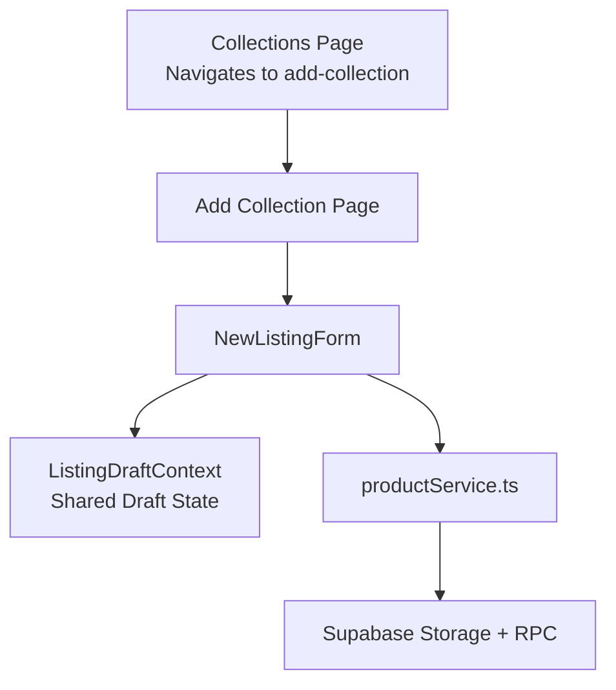
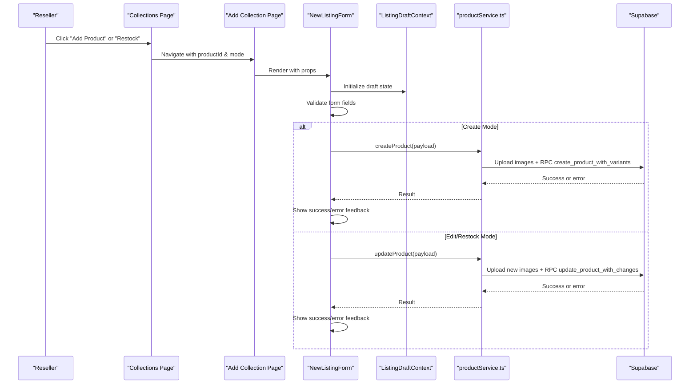
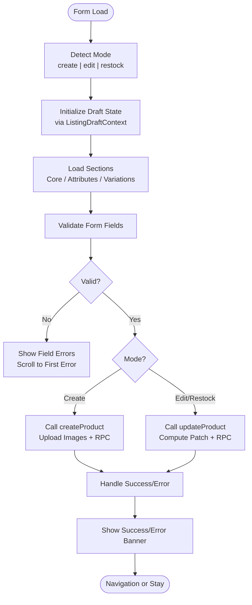
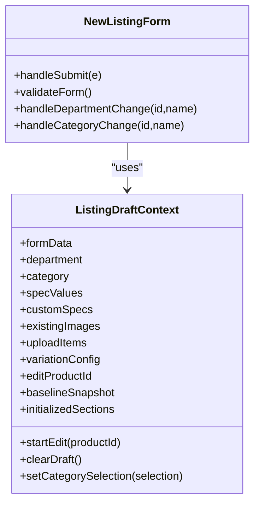
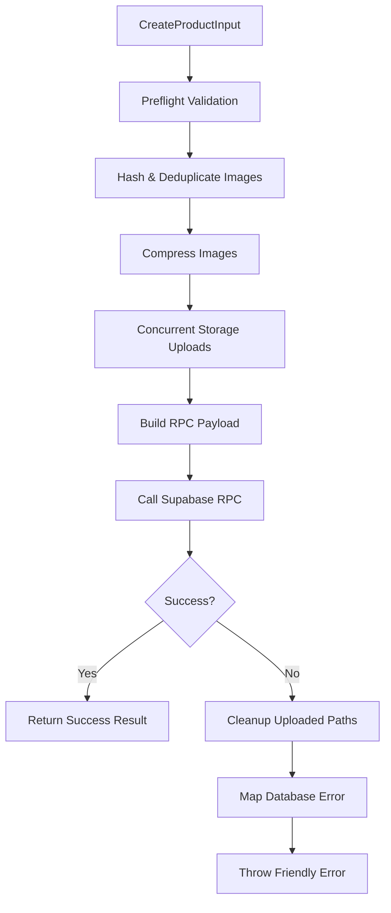
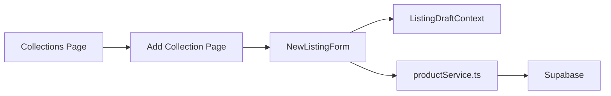

# Product Creation Workflow

<cite>
**Referenced Files in This Document**   
- [NewListingForm.tsx](file://components/reseller/components/NewListingForm.tsx)
- [ListingDraftContext.tsx](file://components/reseller/context/ListingDraftContext.tsx)
- [productService.ts](file://src/api/productService.ts)
- [page.tsx (Add Collection)](file://app/dashboard/add-collection/page.tsx)
- [page.tsx (Collections)](file://app/dashboard/collections/page.tsx)
- [ResellerContext.tsx](file://components/reseller/context/ResellerContext.tsx)
- [20261105_all_in_one_product_creation.sql](file://supabase/migrations/20261105_all_in_one_product_creation.sql)
</cite>

## Table of Contents
1. [Introduction](#introduction)
2. [Project Structure](#project-structure)
3. [Core Components](#core-components)
4. [Architecture Overview](#architecture-overview)
5. [Detailed Component Analysis](#detailed-component-analysis)
6. [Dependency Analysis](#dependency-analysis)
7. [Performance Considerations](#performance-considerations)
8. [Troubleshooting Guide](#troubleshooting-guide)
9. [Conclusion](#conclusion)

## Introduction
This document explains the complete product creation workflow in the reseller dashboard, focusing on the `NewListingForm` component. It covers form initialization, data validation, category selection, variation handling, and submission through the product service layer to Supabase. It also documents how the form supports three modes: create, edit, and restock; how it manages state through `ListingDraftContext`; and how errors, loading states, and user feedback are handled end-to-end.

## Project Structure
The product creation flow spans a small set of focused files:

- **Route entry**: The Add Collection page reads URL parameters, resolves mode, and renders `NewListingForm`.
- **Form component**: `NewListingForm` owns UI, validation, image handling, variation configuration, and submission logic.
- **Shared draft state**: `ListingDraftContext` centralizes form fields, categories, attributes, variations, and progressive edit section state.
- **Product service layer**: `productService.ts` performs client-side preflight validation, image hashing/compression, storage uploads, and atomic RPC calls to Supabase.
- **Supabase migrations**: SQL migrations define the database schema and RPC functions used by the product service.

**Diagram sources**
- [page.tsx (Add Collection):1-47](file://app/dashboard/add-collection/page.tsx#L1-L47)
- [page.tsx (Collections):1-45](file://app/dashboard/collections/page.tsx#L1-L45)
- [NewListingForm.tsx:462-527](file://components/reseller/components/NewListingForm.tsx#L462-L527)
- [productService.ts:302-707](file://src/api/productService.ts#L302-L707)

**Section sources**
- [page.tsx (Add Collection):1-47](file://app/dashboard/add-collection/page.tsx#L1-L47)
- [page.tsx (Collections):1-45](file://app/dashboard/collections/page.tsx#L1-L45)

## Core Components
- **NewListingForm**: Main form component for creating or editing listings. It handles:
  - Mode detection (`create`, `edit`, `restock`).
  - Category and department selection with dynamic attribute fields.
  - Image upload and preview.
  - Variation configuration and stock management.
  - Validation and submission to the product service layer.
- **ListingDraftContext**: Shared context providing:
  - Form data, category selection, specification values, custom specs, images, and variation config.
  - Progressive edit section state for core, attributes, and variations.
  - Edit lifecycle helpers like `startEdit`, `clearDraft`, and `setCategorySelection`.
- **productService.ts**: Service layer that:
  - Validates inputs.
  - Processes and deduplicates images using SHA-256 hashing.
  - Uploads images concurrently to Supabase storage.
  - Calls atomic RPC functions for product creation and updates.

**Section sources**
- [NewListingForm.tsx:97-112](file://components/reseller/components/NewListingForm.tsx#L97-L112)
- [NewListingForm.tsx:462-527](file://components/reseller/components/NewListingForm.tsx#L462-L527)
- [ListingDraftContext.tsx:86-173](file://components/reseller/context/ListingDraftContext.tsx#L86-L173)
- [productService.ts:9-30](file://src/api/productService.ts#L9-L30)

## Architecture Overview
The product creation workflow follows a layered architecture:

1. **UI Layer**: `NewListingForm` collects input, validates, and prepares payloads.
2. **State Layer**: `ListingDraftContext` holds shared state across sections and modes.
3. **Service Layer**: `productService.ts` orchestrates image processing, storage uploads, and RPC calls.
4. **Persistence Layer**: Supabase database and storage bucket handle persistence and media.

**Diagram sources**
- [page.tsx (Collections):27-42](file://app/dashboard/collections/page.tsx#L27-L42)
- [page.tsx (Add Collection):14-31](file://app/dashboard/add-collection/page.tsx#L14-L31)
- [NewListingForm.tsx:1534-1745](file://components/reseller/components/NewListingForm.tsx#L1534-L1745)
- [productService.ts:302-707](file://src/api/productService.ts#L302-L707)

## Detailed Component Analysis

### NewListingForm Component
`NewListingForm` is the central orchestrator for product creation and editing. It supports three modes:

- **Create**: Initializes fresh form state, validates all required fields, and calls `createProduct`.
- **Edit**: Loads existing product data via TanStack Query hooks, computes change patches, and calls `updateProduct`.
- **Restock**: Similar to edit but focuses on inventory updates and shows restock-specific feedback.

Key responsibilities:
- **Mode Detection**: Determines edit/restock vs create based on props and URL.
- **Data Initialization**: Uses `useListingDraft` to manage form state and progressive section loading.
- **Category Selection**: Fetches departments and categories dynamically; locks them in edit mode.
- **Dynamic Attributes**: Renders category-specific attribute fields based on backend definitions.
- **Image Handling**: Supports drag-and-drop, previews, removal, and concurrent uploads.
- **Variation Management**: Integrates with a dedicated variation editor route and maintains variation rows.
- **Validation**: Enforces required fields, numeric constraints, and business rules.
- **Submission**: Calls appropriate service function and handles success/error states.

**Diagram sources**
- [NewListingForm.tsx:462-527](file://components/reseller/components/NewListingForm.tsx#L462-L527)
- [NewListingForm.tsx:1418-1531](file://components/reseller/components/NewListingForm.tsx#L1418-L1531)
- [NewListingForm.tsx:1534-1745](file://components/reseller/components/NewListingForm.tsx#L1534-L1745)

**Section sources**
- [NewListingForm.tsx:462-527](file://components/reseller/components/NewListingForm.tsx#L462-L527)
- [NewListingForm.tsx:1418-1531](file://components/reseller/components/NewListingForm.tsx#L1418-L1531)
- [NewListingForm.tsx:1534-1745](file://components/reseller/components/NewListingForm.tsx#L1534-L1745)

### ListingDraftContext
`ListingDraftContext` provides centralized state for the form, including:

- **Form Data**: Title, brand, fabric, pricing, quantity, description, defect.
- **Category Selection**: Department and category IDs/names.
- **Specifications**: Dynamic attribute values and custom specs.
- **Images**: Existing images and upload queue.
- **Variations**: Dimensions, rows, and value images.
- **Progressive Edit State**: Tracks which sections have been loaded for a given product ID.

It exposes helpers such as:
- `startEdit`: Resets draft state and sets target product ID.
- `clearDraft`: Clears all form and edit state.
- `setCategorySelection`: Atomically updates department/category fields.

**Diagram sources**
- [ListingDraftContext.tsx:116-173](file://components/reseller/context/ListingDraftContext.tsx#L116-L173)
- [ListingDraftContext.tsx:177-369](file://components/reseller/context/ListingDraftContext.tsx#L177-L369)
- [NewListingForm.tsx:462-527](file://components/reseller/components/NewListingForm.tsx#L462-L527)

**Section sources**
- [ListingDraftContext.tsx:86-173](file://components/reseller/context/ListingDraftContext.tsx#L86-L173)
- [ListingDraftContext.tsx:177-369](file://components/reseller/context/ListingDraftContext.tsx#L177-L369)

### Product Service Layer
The product service layer handles:

- **Client-Side Validation**: Ensures required fields, limits, and business rules before network calls.
- **Image Processing**: Resolves file inputs, computes SHA-256 hashes, compresses images, and deduplicates uploads.
- **Concurrent Uploads**: Limits concurrency to prevent overwhelming storage.
- **Atomic RPC Calls**: Uses `create_product_with_variants` for creation and `update_product_with_changes` for edits.
- **Error Handling**: Maps database/storage errors to user-friendly messages and attempts cleanup on failure.

**Diagram sources**
- [productService.ts:302-707](file://src/api/productService.ts#L302-L707)
- [productService.ts:1200-1599](file://src/api/productService.ts#L1200-L1599)

**Section sources**
- [productService.ts:302-707](file://src/api/productService.ts#L302-L707)
- [productService.ts:1200-1599](file://src/api/productService.ts#L1200-L1599)

### Step-by-Step Product Creation Flow

#### 1. Initial Form Load
- The collections page navigates to the add collection route with optional `productId` and `mode`.
- The add collection page resolves parameters and renders `NewListingForm`.
- `NewListingForm` initializes draft state via `useListingDraft`.

**Section sources**
- [page.tsx (Collections):27-42](file://app/dashboard/collections/page.tsx#L27-L42)
- [page.tsx (Add Collection):14-31](file://app/dashboard/add-collection/page.tsx#L14-L31)
- [NewListingForm.tsx:462-527](file://components/reseller/components/NewListingForm.tsx#L462-L527)

#### 2. Data Validation
- Required fields include title, department, category, brand, and at least one image.
- For clothing categories, collection type and fabric may be required.
- Pricing and quantity validation depends on whether variations exist.

**Section sources**
- [NewListingForm.tsx:1418-1531](file://components/reseller/components/NewListingForm.tsx#L1418-L1531)

#### 3. Category Selection
- Departments and categories are fetched via TanStack Query hooks.
- In edit mode, department and category are read-only.
- Selecting a department clears dependent fields like category and specifications.

**Section sources**
- [NewListingForm.tsx:977-1074](file://components/reseller/components/NewListingForm.tsx#L977-L1074)
- [NewListingForm.tsx:1225-1279](file://components/reseller/components/NewListingForm.tsx#L1225-L1279)

#### 4. Product Submission Process
- **Create Mode**: Calls `createProduct` with gallery images, simple pricing, spec values, and variation config.
- **Edit/Restock Mode**: Computes patch, optionally prompts for destructive changes, then calls `updateProduct`.
- On success, invalidates relevant queries and shows feedback.

**Section sources**
- [NewListingForm.tsx:1534-1745](file://components/reseller/components/NewListingForm.tsx#L1534-L1745)
- [productService.ts:302-707](file://src/api/productService.ts#L302-L707)

#### 5. Error Handling and User Feedback
- Form-level errors are displayed inline.
- Submission errors are shown in a banner.
- Network/storage/database errors are mapped to friendly messages.
- Loading skeletons and retry buttons improve UX during failures.

**Section sources**
- [NewListingForm.tsx:1835-1847](file://components/reseller/components/NewListingForm.tsx#L1835-L1847)
- [productService.ts:255-292](file://src/api/productService.ts#L255-L292)

### Examples of Form Field Validation
- **Title**: Must be between 3 and 255 characters.
- **Department/Category**: Required in create mode; locked in edit mode.
- **Brand**: Required.
- **Images**: At least one image required; maximum 10 per product.
- **Pricing**: Selling price must be greater than 0; original retail price cannot be less than selling price.
- **Quantity**: Must be an integer; total variation stock must be greater than 0 if variations exist.

**Section sources**
- [NewListingForm.tsx:1418-1531](file://components/reseller/components/NewListingForm.tsx#L1418-L1531)
- [productService.ts:316-392](file://src/api/productService.ts#L316-L392)

### Integration with Supabase
- **Storage Bucket**: Images are uploaded to a dedicated bucket with content-addressed paths.
- **RPC Functions**: 
  - `create_product_with_variants` for atomic product creation.
  - `update_product_with_changes` for atomic product updates.
- **Migrations**: SQL scripts define constraints and RPC implementations.

**Section sources**
- [productService.ts:302-707](file://src/api/productService.ts#L302-L707)
- [productService.ts:1200-1599](file://src/api/productService.ts#L1200-L1599)
- [20261105_all_in_one_product_creation.sql](file://supabase/migrations/20261105_all_in_one_product_creation.sql)

## Dependency Analysis
The following diagram shows key dependencies between components and services:

**Diagram sources**
- [page.tsx (Collections):1-45](file://app/dashboard/collections/page.tsx#L1-L45)
- [page.tsx (Add Collection):1-47](file://app/dashboard/add-collection/page.tsx#L1-L47)
- [NewListingForm.tsx:462-527](file://components/reseller/components/NewListingForm.tsx#L462-L527)
- [productService.ts:302-707](file://src/api/productService.ts#L302-L707)

**Section sources**
- [page.tsx (Collections):1-45](file://app/dashboard/collections/page.tsx#L1-L45)
- [page.tsx (Add Collection):1-47](file://app/dashboard/add-collection/page.tsx#L1-L47)

## Performance Considerations
- **Image Deduplication**: SHA-256 hashing prevents redundant uploads.
- **Concurrent Uploads**: Limited to a small number of workers to balance speed and stability.
- **Query Caching**: TanStack Query caches department, category, and product data.
- **Patch-Based Updates**: Only changed fields are sent to the server during edits.

[No sources needed since this section provides general guidance]

## Troubleshooting Guide
Common issues and resolutions:

- **Storage Bucket Not Found**: Indicates misconfigured Supabase storage. Contact support.
- **Permission Denied**: Row-level security policies may block access. Verify seller account permissions.
- **Network Error**: Check internet connection and retry.
- **Database Function Not Found**: Ensure migration scripts are executed in Supabase SQL editor.
- **Duplicate Key Constraint**: Review unique fields like titles or option values.

**Section sources**
- [productService.ts:255-292](file://src/api/productService.ts#L255-L292)
- [NewListingForm.tsx:244-266](file://components/reseller/components/NewListingForm.tsx#L244-L266)

## Conclusion
The product creation workflow in the reseller dashboard is built around a robust `NewListingForm` component that integrates with `ListingDraftContext` for state management and `productService.ts` for persistence. The system supports create, edit, and restock modes, enforces comprehensive validation, and provides clear user feedback. Supabase integration ensures reliable storage and transactional database operations through RPC functions.

[No sources needed since this section summarizes without analyzing specific files]