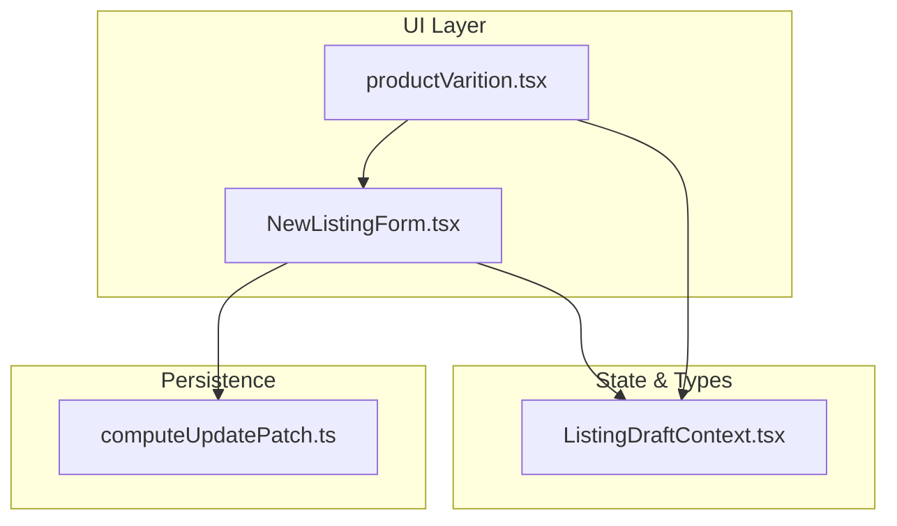
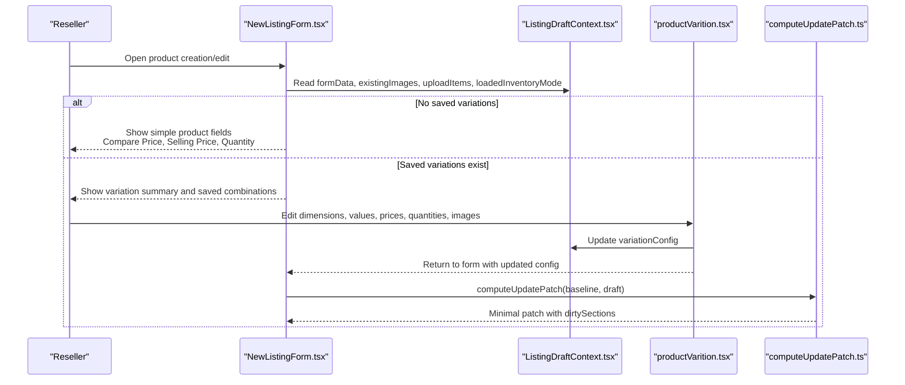
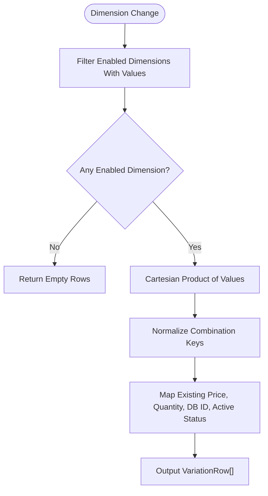
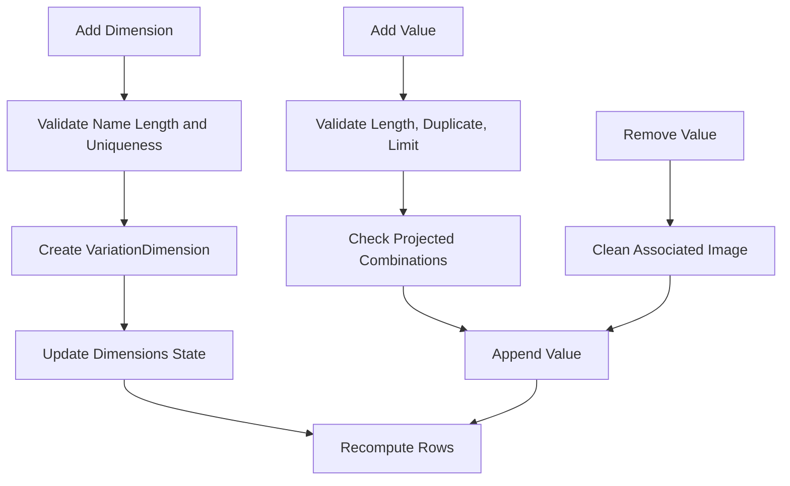
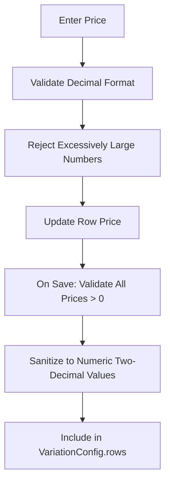
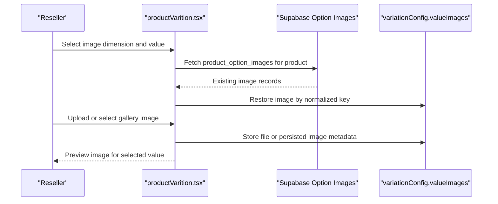
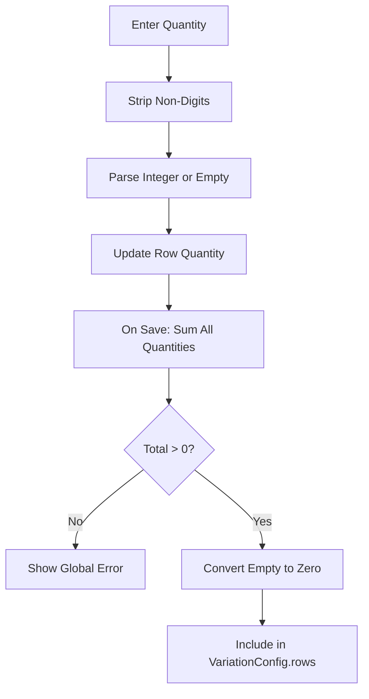
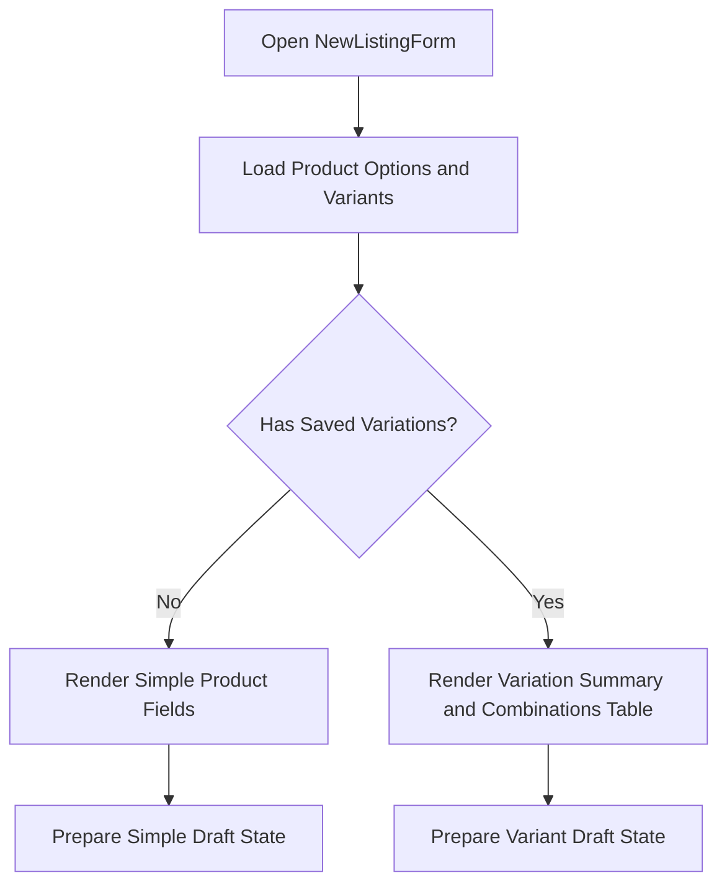
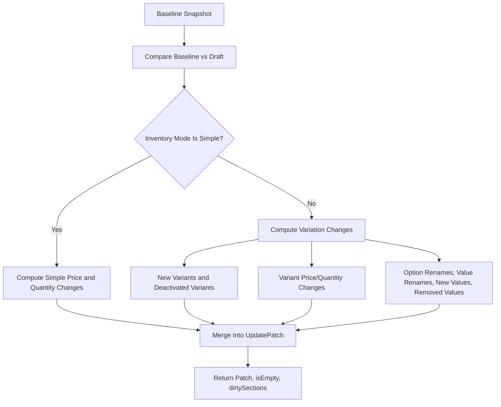
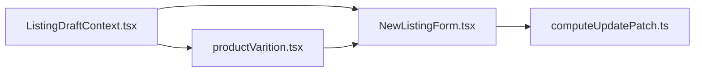

# Variant & Inventory Management

<cite>
**Referenced Files in This Document**
- [ListingDraftContext.tsx](file://components/reseller/context/ListingDraftContext.tsx)
- [productVarition.tsx](file://components/reseller/components/productVarition.tsx)
- [NewListingForm.tsx](file://components/reseller/components/NewListingForm.tsx)
- [computeUpdatePatch.ts](file://src/utils/computeUpdatePatch.ts)
</cite>

## Table of Contents
1. [Introduction](#introduction)
2. [Project Structure](#project-structure)
3. [Core Components](#core-components)
4. [Architecture Overview](#architecture-overview)
5. [Detailed Component Analysis](#detailed-component-analysis)
6. [Dependency Analysis](#dependency-analysis)
7. [Performance Considerations](#performance-considerations)
8. [Troubleshooting Guide](#troubleshooting-guide)
9. [Conclusion](#conclusion)

## Introduction
This document explains the variant and inventory management system used during product creation and editing. It covers how the form supports both simple inventory mode and variant-based inventory mode, how variation rows are dynamically generated from dimension definitions, how dimensions such as size and color are managed, how pricing and stock quantities are set per combination, and how the final draft is converted into an efficient database update patch.

The system centers around a shared `VariationConfig` data structure, a dynamic variation editor component, a listing form that integrates simple and variant modes, and a pure utility that computes minimal database patches.

## Project Structure
The variant and inventory workflow spans four main files:

- **Shared types and context**: Defines `VariationDimension`, `VariationRow`, `VariationConfig`, price helpers, and global draft state.
- **Variation editor**: Renders dimension cards, value chips, variation images, and the combinations table where prices and quantities are edited.
- **Listing form**: Integrates simple product fields with saved variations, shows a compact preview of combinations, and prepares draft state for persistence.
- **Update patch utility**: Compares baseline data against draft state and returns only changed sections, including detailed variation changes.



**Diagram sources**
- [NewListingForm.tsx:336-495](file://components/reseller/components/NewListingForm.tsx#L336-L495)
- [productVarition.tsx:98-109](file://components/reseller/components/productVarition.tsx#L98-L109)
- [ListingDraftContext.tsx:34-76](file://components/reseller/context/ListingDraftContext.tsx#L34-L76)
- [computeUpdatePatch.ts:195-564](file://src/utils/computeUpdatePatch.ts#L195-L564)

**Section sources**
- [ListingDraftContext.tsx:34-76](file://components/reseller/context/ListingDraftContext.tsx#L34-L76)
- [productVarition.tsx:98-109](file://components/reseller/components/productVarition.tsx#L98-L109)
- [NewListingForm.tsx:336-495](file://components/reseller/components/NewListingForm.tsx#L336-L495)
- [computeUpdatePatch.ts:195-564](file://src/utils/computeUpdatePatch.ts#L195-L564)

## Core Components
The variant system is built on three core concepts:

| Concept | Purpose | Key Fields / Behavior |
|---|---|---|
| `VariationDimension` | Represents a variation axis such as Color, Size, or Material. | `id`, `name`, `enabled`, `values`, optional `dbId`, `ref`, and `valueIds`. |
| `VariationRow` | Represents one SKU combination. | `key`, `color`, `size`, `attributes`, `price`, `quantity`, optional `image`, `dbId`, `isActive`. |
| `VariationConfig` | Holds the complete variation model for a product draft. | `dimensions`, `imageDimension`, `valueImages`, `rows`, legacy `useColor`/`useSize`, `colors`, `sizes`. |

Additional helpers:

- `normalizeVariationValueKey`: Normalizes dimension name and value into a stable dictionary key.
- `getPriceRange`: Computes minimum and maximum valid row prices.
- `formatPriceRange`: Formats the price range for display.

These types live in the shared listing draft context and are consumed by both the variation editor and the listing form.

**Section sources**
- [ListingDraftContext.tsx:34-76](file://components/reseller/context/ListingDraftContext.tsx#L34-L76)
- [ListingDraftContext.tsx:78-84](file://components/reseller/context/ListingDraftContext.tsx#L78-L84)
- [ListingDraftContext.tsx:371-415](file://components/reseller/context/ListingDraftContext.tsx#L371-L415)

## Architecture Overview
The product creation flow supports two inventory modes:

1. **Simple inventory mode**: A single product has one selling price, compare-at price, and quantity.
2. **Variant inventory mode**: The product has multiple combinations, each with its own price and quantity.

The listing form detects whether variations have been configured. If not, it renders simple product fields. If variations exist, it renders a read-only summary of saved combinations and delegates editing to the variation page.



**Diagram sources**
- [NewListingForm.tsx:336-495](file://components/reseller/components/NewListingForm.tsx#L336-L495)
- [NewListingForm.tsx:2409-2533](file://components/reseller/components/NewListingForm.tsx#L2409-L2533)
- [productVarition.tsx:679-777](file://components/reseller/components/productVarition.tsx#L679-L777)
- [computeUpdatePatch.ts:195-564](file://src/utils/computeUpdatePatch.ts#L195-L564)

## Detailed Component Analysis

### Variation Data Model
The data model separates dimension definitions from combination rows:

- Dimensions define the axes of variation.
- Rows represent the Cartesian product of enabled dimensions with values.
- Each row carries per-combination pricing and stock.
- Images can be attached per dimension value, not per row, and are later mapped into row previews.

```mermaid
classDiagram
class VariationDimension {
+string id
+string name
+boolean enabled
+string[] values
+string dbId
+string ref
+Record~string,string~ valueIds
}
class VariationRow {
+string key
+string color
+string size
+Record~string,string~ attributes
+number|string price
+number|string quantity
+string image
+string dbId
+boolean isActive
}
class VariationConfig {
+VariationDimension[] dimensions
+string imageDimension
+Record~string,{file,storagePath,imageUrl,previewUrl,id}~ valueImages
+VariationRow[] rows
+boolean useColor
+boolean useSize
+string[] colors
+string[] sizes
}
VariationConfig --> VariationDimension : "contains"
VariationConfig --> VariationRow : "contains"
```

**Diagram sources**
- [ListingDraftContext.tsx:34-76](file://components/reseller/context/ListingDraftContext.tsx#L34-L76)

**Section sources**
- [ListingDraftContext.tsx:34-76](file://components/reseller/context/ListingDraftContext.tsx#L34-L76)

### Dynamic Generation of Variation Rows
The variation editor generates rows using a Cartesian product of enabled dimensions with values. When dimensions change, rows are recomputed while preserving existing prices, quantities, database IDs, and active status when possible.

Key behaviors:

- `cartesianProduct` builds all combinations from enabled dimensions.
- `computeRows` maps previous rows into new combinations using normalized keys.
- Legacy `useColor`/`useSize` configuration is migrated into modern `dimensions`.
- Row keys are collision-safe by sorting dimension entries and normalizing names/values.



**Diagram sources**
- [productVarition.tsx:32-48](file://components/reseller/components/productVarition.tsx#L32-L48)
- [productVarition.tsx:225-279](file://components/reseller/components/productVarition.tsx#L225-L279)

**Section sources**
- [productVarition.tsx:32-48](file://components/reseller/components/productVarition.tsx#L32-L48)
- [productVarition.tsx:140-164](file://components/reseller/components/productVarition.tsx#L140-L164)
- [productVarition.tsx:225-279](file://components/reseller/components/productVarition.tsx#L225-L279)

### Dimension Management: Size, Color, and Custom Dimensions
The variation page provides full control over dimensions:

- Add a new dimension with validation for name length and uniqueness.
- Toggle dimension enablement; disabled dimensions do not generate combinations.
- Add values per dimension with duplicate checks, length limits, and total combination limits.
- Remove values and clean up associated variation images.
- For existing products, dimension structure is locked to preserve SKU integrity, but values, prices, quantities, and images remain editable.

Constraints:

- Maximum 20 values per dimension.
- Maximum projected total combinations enforced before adding a value.
- Existing product variants cannot add/remove dimensions or disable them.



**Diagram sources**
- [productVarition.tsx:399-433](file://components/reseller/components/productVarition.tsx#L399-L433)
- [productVarition.tsx:487-542](file://components/reseller/components/productVarition.tsx#L487-L542)
- [productVarition.tsx:544-564](file://components/reseller/components/productVarition.tsx#L544-L564)
- [productVarition.tsx:435-471](file://components/reseller/components/productVarition.tsx#L435-L471)

**Section sources**
- [productVarition.tsx:399-433](file://components/reseller/components/productVarition.tsx#L399-L433)
- [productVarition.tsx:487-542](file://components/reseller/components/productVarition.tsx#L487-L542)
- [productVarition.tsx:544-564](file://components/reseller/components/productVarition.tsx#L544-L564)
- [productVarition.tsx:435-471](file://components/reseller/components/productVarition.tsx#L435-L471)

### Pricing Strategies Per Variant
Each combination row has its own price. The variation editor enforces:

- Price must be greater than zero.
- Decimal input allows up to two decimal places.
- Very large numbers are rejected.
- On save, prices are sanitized to numeric values rounded to two decimals.
- The price range displayed at the top is derived only from valid row prices.



**Diagram sources**
- [productVarition.tsx:629-660](file://components/reseller/components/productVarition.tsx#L629-L660)
- [productVarition.tsx:702-736](file://components/reseller/components/productVarition.tsx#L702-L736)
- [productVarition.tsx:395-397](file://components/reseller/components/productVarition.tsx#L395-L397)

**Section sources**
- [productVarition.tsx:629-660](file://components/reseller/components/productVarition.tsx#L629-L660)
- [productVarition.tsx:702-736](file://components/reseller/components/productVarition.tsx#L702-L736)
- [productVarition.tsx:395-397](file://components/reseller/components/productVarition.tsx#L395-L397)

### Managing Variant-Specific Images
Images are attached per dimension value rather than per row. The variation editor:

- Lets users select a dimension for images.
- Shows tabs for each value in that dimension.
- Allows uploading one image per value via file input or drag-and-drop.
- Supports selecting an image from the product gallery.
- Loads existing option images for edit mode and maps them back to dimension values.
- Filters saved images to only include values belonging to enabled dimensions.



**Diagram sources**
- [productVarition.tsx:287-354](file://components/reseller/components/productVarition.tsx#L287-L354)
- [productVarition.tsx:566-627](file://components/reseller/components/productVarition.tsx#L566-L627)
- [productVarition.tsx:738-774](file://components/reseller/components/productVarition.tsx#L738-L774)

**Section sources**
- [productVarition.tsx:287-354](file://components/reseller/components/productVarition.tsx#L287-L354)
- [productVarition.tsx:566-627](file://components/reseller/components/productVarition.tsx#L566-L627)
- [productVarition.tsx:738-774](file://components/reseller/components/productVarition.tsx#L738-L774)

### Handling Inventory Quantities Across Multiple Variants
Quantities are tracked per combination row. The variation editor:

- Accepts integer-only input.
- Treats empty quantity as zero during validation.
- Requires total quantity across all rows to be greater than zero.
- Preserves existing quantities when dimensions change.
- Converts empty strings to zero when saving.



**Diagram sources**
- [productVarition.tsx:662-677](file://components/reseller/components/productVarition.tsx#L662-L677)
- [productVarition.tsx:720-736](file://components/reseller/components/productVarition.tsx#L720-L736)

**Section sources**
- [productVarition.tsx:662-677](file://components/reseller/components/productVarition.tsx#L662-L677)
- [productVarition.tsx:720-736](file://components/reseller/components/productVarition.tsx#L720-L736)

### Simple vs Variant Inventory Modes in the Listing Form
The listing form integrates both modes:

- In create mode without saved variations, it shows simple product fields: compare price, selling price, and quantity.
- When variations are saved, it shows a summary and a compact read-only table of combinations.
- It loads existing product options and maps them into `VariationRow` objects for edit mode.
- It preserves legacy `useColor`/`useSize` flags alongside modern `dimensions`.



**Diagram sources**
- [NewListingForm.tsx:336-495](file://components/reseller/components/NewListingForm.tsx#L336-L495)
- [NewListingForm.tsx:2409-2533](file://components/reseller/components/NewListingForm.tsx#L2409-L2533)
- [NewListingForm.tsx:2535-2600](file://components/reseller/components/NewListingForm.tsx#L2535-L2600)

**Section sources**
- [NewListingForm.tsx:336-495](file://components/reseller/components/NewListingForm.tsx#L336-L495)
- [NewListingForm.tsx:2409-2533](file://components/reseller/components/NewListingForm.tsx#L2409-L2533)
- [NewListingForm.tsx:2535-2600](file://components/reseller/components/NewListingForm.tsx#L2535-L2600)

### Integration with `computeUpdatePatch` for Efficient Database Updates
The `computeUpdatePatch` utility compares baseline data with draft state and returns only what changed. For variations, it tracks:

- Option renames.
- Value renames.
- New values.
- Removed value IDs.
- Variant price and quantity changes.
- New variant combinations.
- Deactivated variant IDs.

It also handles simple inventory updates, images, custom specifications, attribute values, and product details.



**Diagram sources**
- [computeUpdatePatch.ts:195-564](file://src/utils/computeUpdatePatch.ts#L195-L564)

**Section sources**
- [computeUpdatePatch.ts:195-564](file://src/utils/computeUpdatePatch.ts#L195-L564)

## Dependency Analysis
The variant and inventory system has clear boundaries:

- `ListingDraftContext.tsx` exports shared types and helpers.
- `productVarition.tsx` consumes those types and manages local variation state.
- `NewListingForm.tsx` consumes both context and variation configuration to render simple or variant UI.
- `computeUpdatePatch.ts` consumes draft state and baseline snapshots to produce minimal update patches.



**Diagram sources**
- [ListingDraftContext.tsx:34-76](file://components/reseller/context/ListingDraftContext.tsx#L34-L76)
- [productVarition.tsx:18-26](file://components/reseller/components/productVarition.tsx#L18-L26)
- [NewListingForm.tsx:46-495](file://components/reseller/components/NewListingForm.tsx#L46-L495)
- [computeUpdatePatch.ts:1-2](file://src/utils/computeUpdatePatch.ts#L1-L2)

**Section sources**
- [ListingDraftContext.tsx:34-76](file://components/reseller/context/ListingDraftContext.tsx#L34-L76)
- [productVarition.tsx:18-26](file://components/reseller/components/productVarition.tsx#L18-L26)
- [NewListingForm.tsx:46-495](file://components/reseller/components/NewListingForm.tsx#L46-L495)
- [computeUpdatePatch.ts:1-2](file://src/utils/computeUpdatePatch.ts#L1-L2)

## Performance Considerations
- **Combination explosion**: The Cartesian product grows multiplicatively. The variation editor enforces a maximum number of values per dimension and a maximum projected total combination count to prevent excessive UI and processing overhead.
- **Row recomputation**: Every dimension or value change recomputes rows. Existing prices, quantities, and database IDs are preserved through maps keyed by normalized row keys.
- **Image loading**: Variation images are fetched once per product in edit mode and mapped to normalized dimension-value keys to avoid repeated lookups.
- **Patch minimization**: `computeUpdatePatch` avoids unnecessary writes by tracking only changed sections and fields.

[No sources needed since this section provides general guidance]

## Troubleshooting Guide

Common issues and their likely causes:

| Symptom | Likely Cause | Resolution |
|---|---|---|
| Cannot add or remove dimensions on an existing product | Existing product variants lock dimension structure to preserve SKU integrity. | Keep dimensions unchanged; still edit values, prices, quantities, and images. |
| Adding a value fails due to combination limit | Projected combinations exceed the maximum allowed. | Reduce values or disable unused dimensions. |
| Price validation error on save | One or more rows have empty, invalid, or non-positive prices. | Enter a positive numeric price for every combination. |
| Total quantity validation error | All rows have zero or invalid quantities. | Assign at least one positive quantity across combinations. |
| Variation images not showing | No image uploaded for the selected dimension value, or wrong dimension/value selected. | Upload or select an image for the active dimension value. |
| Variation summary not visible | No saved variations exist yet. | Navigate to the variation page, configure dimensions and combinations, then save. |

**Section sources**
- [productVarition.tsx:400-433](file://components/reseller/components/productVarition.tsx#L400-L433)
- [productVarition.tsx:519-536](file://components/reseller/components/productVarition.tsx#L519-L536)
- [productVarition.tsx:702-736](file://components/reseller/components/productVarition.tsx#L702-L736)
- [productVarition.tsx:1054-1279](file://components/reseller/components/productVarition.tsx#L1054-L1279)

## Conclusion
The variant and inventory management system provides a robust way to model products with either simple or variant-based inventory. It uses a clear separation between dimension definitions and combination rows, validates user input aggressively, preserves existing data safely, and integrates with a minimal-patch update strategy. For resellers, this means accurate per-SKU pricing and stock management, safe handling of existing products, and efficient database updates.

[No sources needed since this section summarizes without analyzing specific files]