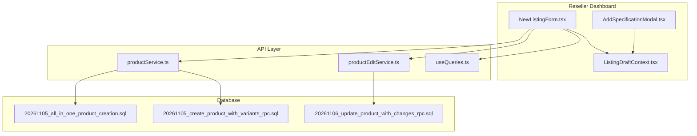
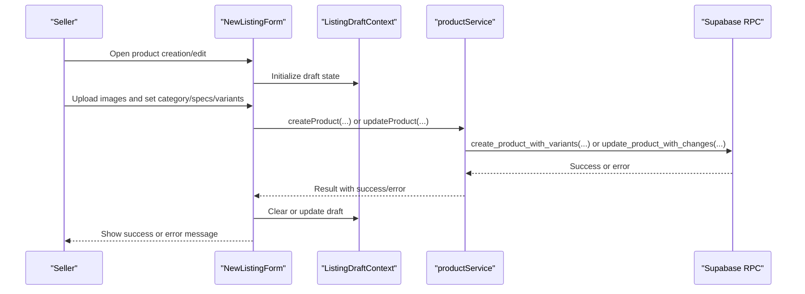
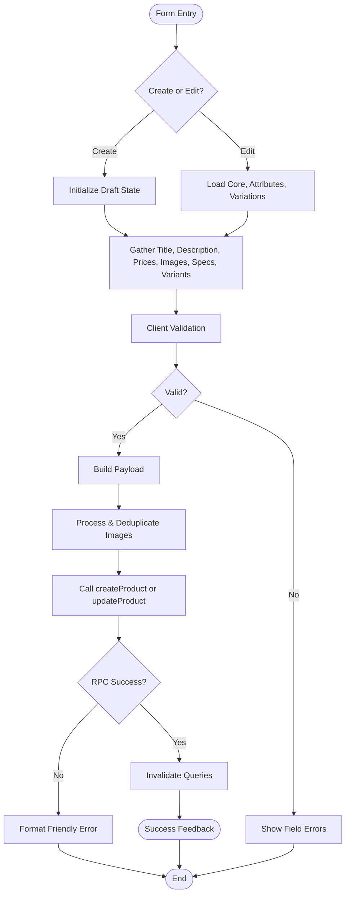
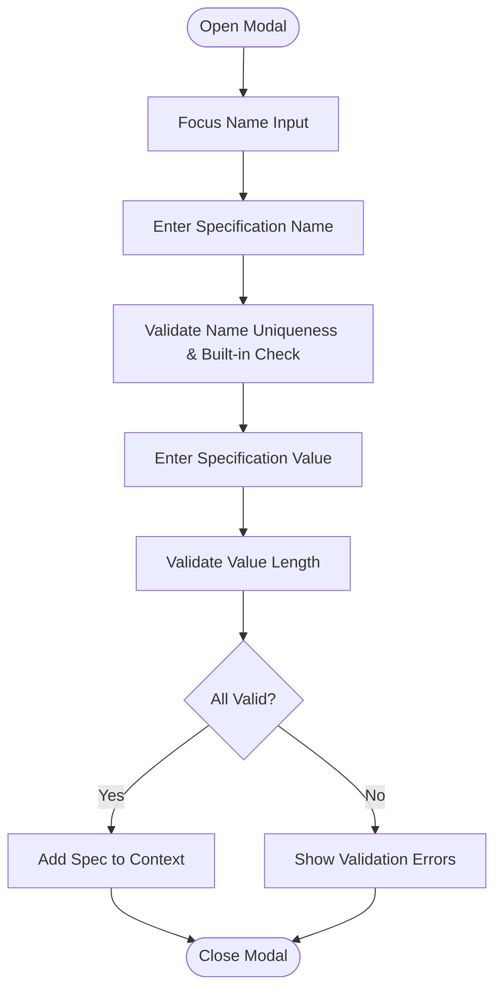
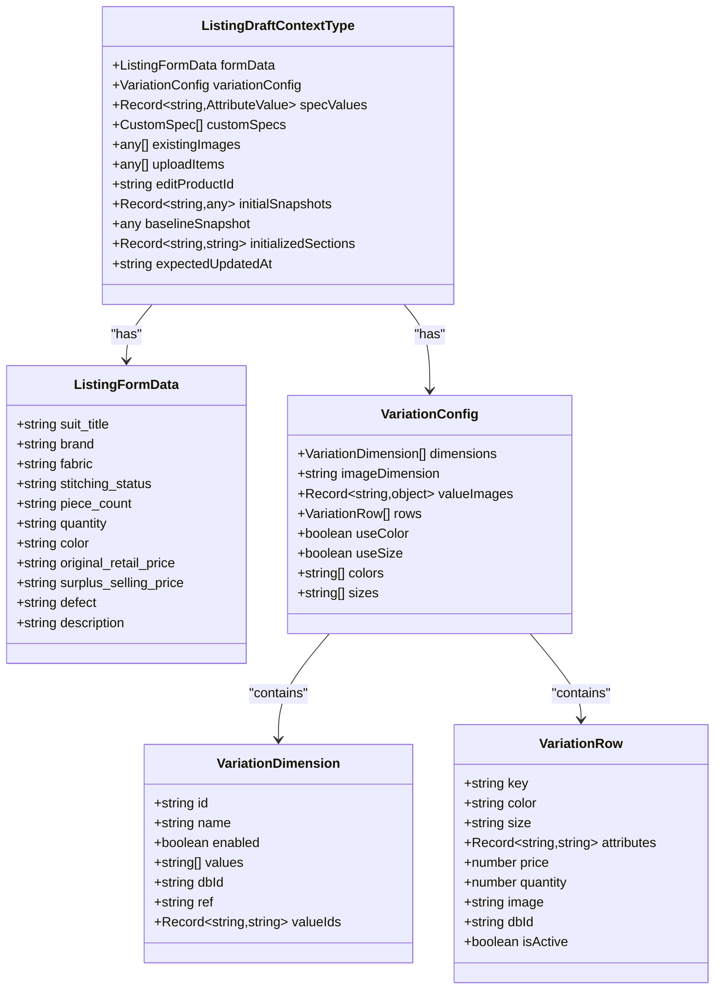
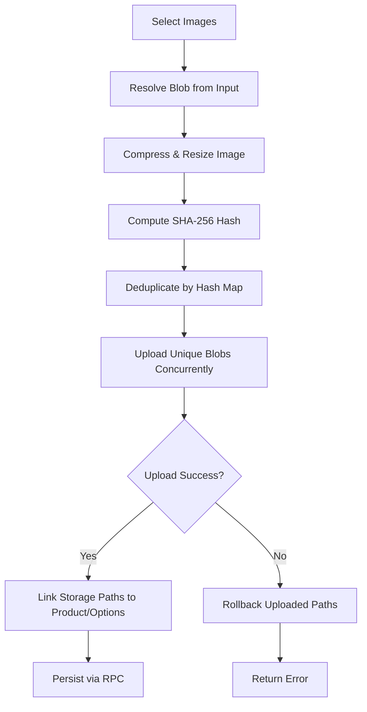
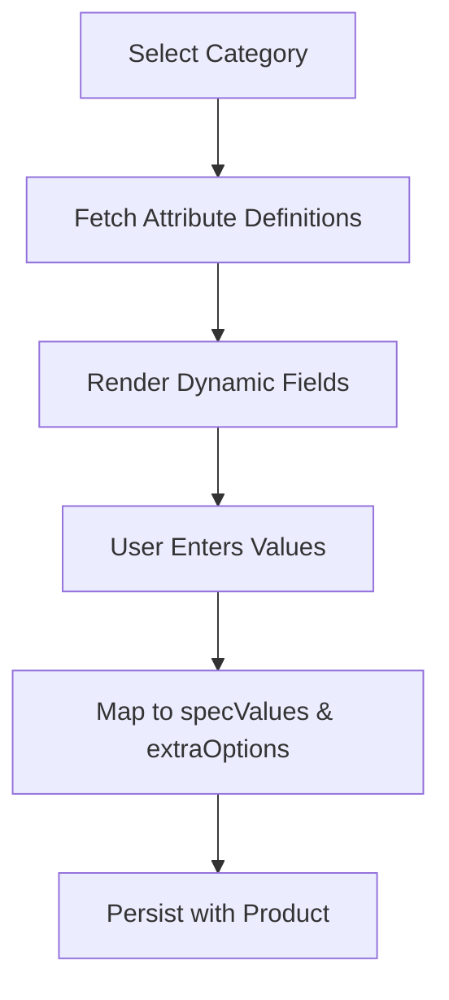
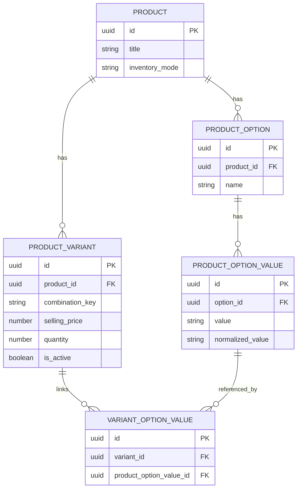
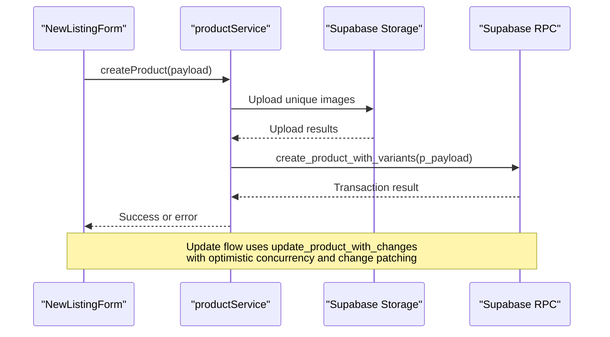
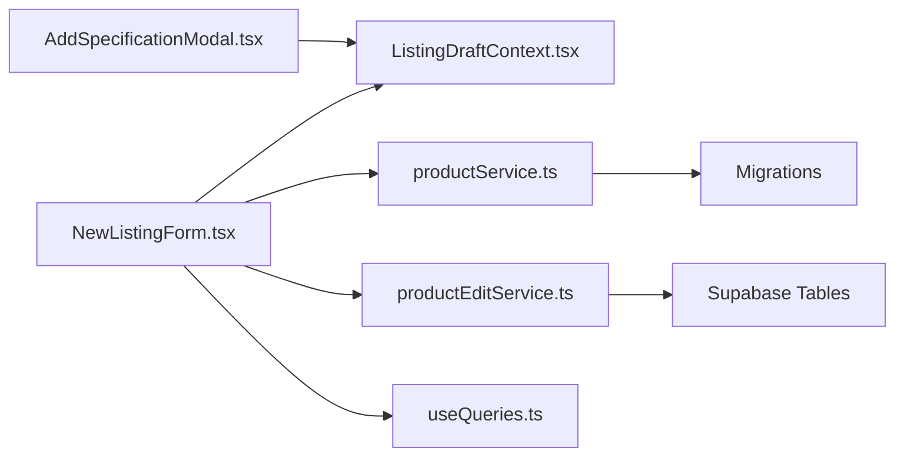

# Product Management

<cite>
**Referenced Files in This Document**
- [NewListingForm.tsx](file://components/reseller/components/NewListingForm.tsx)
- [AddSpecificationModal.tsx](file://components/reseller/components/AddSpecificationModal.tsx)
- [ListingDraftContext.tsx](file://components/reseller/context/ListingDraftContext.tsx)
- [productService.ts](file://src/api/productService.ts)
- [productEditService.ts](file://src/api/productEditService.ts)
- [useQueries.ts](file://src/hooks/useQueries.ts)
- [20261105_all_in_one_product_creation.sql](file://supabase/migrations/20261105_all_in_one_product_creation.sql)
- [20261105_create_product_with_variants_rpc.sql](file://supabase/migrations/20261105_create_product_with_variants_rpc.sql)
- [20261106_update_product_with_changes_rpc.sql](file://supabase/migrations/20261106_update_product_with_changes_rpc.sql)
</cite>

## Table of Contents
1. [Introduction](#introduction)
2. [Project Structure](#project-structure)
3. [Core Components](#core-components)
4. [Architecture Overview](#architecture-overview)
5. [Detailed Component Analysis](#detailed-component-analysis)
6. [Dependency Analysis](#dependency-analysis)
7. [Performance Considerations](#performance-considerations)
8. [Troubleshooting Guide](#troubleshooting-guide)
9. [Conclusion](#conclusion)

## Introduction
This document explains the product management system used by the reseller dashboard. It covers how a seller creates and edits products, manages variants with multi-dimensional options such as size and color, adds custom specifications, assigns category attributes, uploads images, tracks inventory, and submits data to the database through atomic RPC functions. The focus is on the NewListingForm component, the AddSpecificationModal, the listing draft context, and the API layer that orchestrates image processing, validation, and transactional persistence.

## Project Structure
The product management feature spans UI components, shared state, API services, hooks, and database migrations:

- UI and workflow orchestration live in the reseller components directory.
- Shared form and edit-state logic lives in the listing draft context.
- Data persistence and image handling are implemented in the product service layer.
- Edit-specific fetchers are separated into an edit service for progressive loading.
- React Query hooks centralize caching and query configuration.
- Database behavior is enforced through migration scripts and RPC functions.

**Diagram sources**
- [NewListingForm.tsx:1-120](file://components/reseller/components/NewListingForm.tsx#L1-L120)
- [AddSpecificationModal.tsx:1-40](file://components/reseller/components/AddSpecificationModal.tsx#L1-L40)
- [ListingDraftContext.tsx:1-120](file://components/reseller/context/ListingDraftContext.tsx#L1-L120)
- [productService.ts:1-120](file://src/api/productService.ts#L1-L120)
- [productEditService.ts:1-60](file://src/api/productEditService.ts#L1-L60)
- [useQueries.ts:1-40](file://src/hooks/useQueries.ts#L1-L40)
- [20261105_all_in_one_product_creation.sql](file://supabase/migrations/20261105_all_in_one_product_creation.sql)
- [20261105_create_product_with_variants_rpc.sql](file://supabase/migrations/20261105_create_product_with_variants_rpc.sql)
- [20261106_update_product_with_changes_rpc.sql](file://supabase/migrations/20261106_update_product_with_changes_rpc.sql)

**Section sources**
- [NewListingForm.tsx:1-120](file://components/reseller/components/NewListingForm.tsx#L1-L120)
- [productService.ts:1-120](file://src/api/productService.ts#L1-L120)
- [productEditService.ts:1-60](file://src/api/productEditService.ts#L1-L60)
- [useQueries.ts:1-40](file://src/hooks/useQueries.ts#L1-L40)

## Core Components
The product management system is centered around these core pieces:

- NewListingForm: Main form for creating or editing listings, managing images, category attributes, custom specifications, and complex variants.
- AddSpecificationModal: Accessible modal for adding custom product specifications with validation and accessibility features.
- ListingDraftContext: Shared state for form data, category selection, variation configuration, edit mode progress, and baseline snapshots.
- productService: Image processing, validation, and atomic creation/update via RPC.
- productEditService: Progressive section loaders for core product data, attributes, variations, and option images.
- useQueries: Centralized React Query hooks for categories, attributes, product information, and seller product lists.

Key responsibilities:
- Form entry points and submission orchestration are handled by NewListingForm.
- Variant configuration and row-level pricing/stock are managed through VariationConfig in ListingDraftContext.
- Category attribute assignment uses dynamic fields driven by category attribute definitions.
- Custom specifications are added through AddSpecificationModal and persisted as product_custom_attributes.
- Images are compressed, deduplicated by SHA-256 hash, uploaded to storage, and linked to products or variant values.
- Creation and updates are executed atomically using database RPCs with optimistic concurrency checks.

**Section sources**
- [NewListingForm.tsx:97-120](file://components/reseller/components/NewListingForm.tsx#L97-L120)
- [AddSpecificationModal.tsx:8-40](file://components/reseller/components/AddSpecificationModal.tsx#L8-L40)
- [ListingDraftContext.tsx:34-76](file://components/reseller/context/ListingDraftContext.tsx#L34-L76)
- [productService.ts:9-30](file://src/api/productService.ts#L9-L30)
- [productEditService.ts:3-55](file://src/api/productEditService.ts#L3-L55)
- [useQueries.ts:320-357](file://src/hooks/useQueries.ts#L320-L357)

## Architecture Overview
The product management architecture follows a layered approach:

- Presentation Layer: NewListingForm renders forms, modals, and variant tables; AddSpecificationModal provides specification input.
- State Layer: ListingDraftContext holds draft form state, variation configuration, edit mode flags, and baseline snapshots.
- Service Layer: productService handles image processing, validation, and RPC calls; productEditService loads sections progressively.
- Data Layer: Supabase RPC functions enforce business rules, constraints, and transactional integrity.

**Diagram sources**
- [NewListingForm.tsx:1560-1595](file://components/reseller/components/NewListingForm.tsx#L1560-L1595)
- [productService.ts:302-707](file://src/api/productService.ts#L302-L707)
- [productService.ts:1200-1216](file://src/api/productService.ts#L1200-L1216)
- [20261105_create_product_with_variants_rpc.sql](file://supabase/migrations/20261105_create_product_with_variants_rpc.sql)
- [20261106_update_product_with_changes_rpc.sql](file://supabase/migrations/20261106_update_product_with_changes_rpc.sql)

## Detailed Component Analysis

### NewListingForm: Product Creation and Editing Workflow
NewListingForm is the primary interface for sellers to create new listings or edit existing ones. It supports:

- Basic product details: title, description, defect condition, prices, quantity.
- Category and department selection with dynamic attribute fields.
- Custom specification addition via AddSpecificationModal.
- Image upload with preview, thumbnail selection, and storage integration.
- Simple inventory mode (single SKU with price and stock).
- Complex variant mode with multi-dimensional options (e.g., color, size), per-variant pricing and stock, and optional value images.

Data flow highlights:
- On edit, it initializes core, attributes, and variations sections progressively using TanStack Query hooks.
- On submit, it validates inputs, builds payloads, processes images, and calls createProduct or updateProduct.
- It invalidates relevant queries after successful operations to refresh listings and storefront data.

**Diagram sources**
- [NewListingForm.tsx:1560-1595](file://components/reseller/components/NewListingForm.tsx#L1560-L1595)
- [productService.ts:302-707](file://src/api/productService.ts#L302-L707)
- [productService.ts:1200-1216](file://src/api/productService.ts#L1200-L1216)

**Section sources**
- [NewListingForm.tsx:462-580](file://components/reseller/components/NewListingForm.tsx#L462-L580)
- [NewListingForm.tsx:606-681](file://components/reseller/components/NewListingForm.tsx#L606-L681)
- [NewListingForm.tsx:683-769](file://components/reseller/components/NewListingForm.tsx#L683-L769)
- [NewListingForm.tsx:771-800](file://components/reseller/components/NewListingForm.tsx#L771-L800)
- [NewListingForm.tsx:1560-1595](file://components/reseller/components/NewListingForm.tsx#L1560-L1595)

### AddSpecificationModal: Custom Specification Addition
AddSpecificationModal allows sellers to add custom product specifications with robust validation and accessibility:

- Name validation: required, unique among existing specs, not a built-in label, length limit.
- Value validation: required, length limit.
- Accessibility: portal rendering, focus trap, ESC key handling, body scroll lock, focus restoration.
- Integration: Adds entries to customSpecs in ListingDraftContext, which are later persisted as product_custom_attributes.

**Diagram sources**
- [AddSpecificationModal.tsx:124-174](file://components/reseller/components/AddSpecificationModal.tsx#L124-L174)
- [AddSpecificationModal.tsx:183-305](file://components/reseller/components/AddSpecificationModal.tsx#L183-L305)

**Section sources**
- [AddSpecificationModal.tsx:1-40](file://components/reseller/components/AddSpecificationModal.tsx#L1-L40)
- [AddSpecificationModal.tsx:124-174](file://components/reseller/components/AddSpecificationModal.tsx#L124-L174)
- [AddSpecificationModal.tsx:183-305](file://components/reseller/components/AddSpecificationModal.tsx#L183-L305)

### ListingDraftContext: Shared State and Variant Configuration
ListingDraftContext centralizes all draft state for product creation and editing:

- Form data: title, brand, fabric, stitching status, piece count, quantity, color, prices, defect, description.
- Category selection: department and category IDs/names.
- Attribute values: dynamic category attribute values keyed by attribute ID.
- Custom specs: array of name/value pairs.
- Existing images and upload items: local previews and storage references.
- Variation configuration: dimensions, enabled flags, values, per-value images, rows with per-variant price/quantity.
- Edit mode: product ID, section load states, baseline snapshots, initialization markers, expected updated timestamp.

Complex variant model:
- Dimensions represent option types like color or size.
- Values represent specific options within a dimension.
- Rows represent combinations of dimension values with independent pricing and stock.
- Value images can be attached to dimension values for visual selection.

**Diagram sources**
- [ListingDraftContext.tsx:6-12](file://components/reseller/context/ListingDraftContext.tsx#L6-L12)
- [ListingDraftContext.tsx:34-76](file://components/reseller/context/ListingDraftContext.tsx#L34-L76)
- [ListingDraftContext.tsx:86-112](file://components/reseller/context/ListingDraftContext.tsx#L86-L112)
- [ListingDraftContext.tsx:116-173](file://components/reseller/context/ListingDraftContext.tsx#L116-L173)

**Section sources**
- [ListingDraftContext.tsx:1-120](file://components/reseller/context/ListingDraftContext.tsx#L1-L120)
- [ListingDraftContext.tsx:177-369](file://components/reseller/context/ListingDraftContext.tsx#L177-L369)

### Image Upload and Storage Handling
Image handling is centralized in productService:

- Input resolution: accepts File, Blob, data URL, blob URL, or remote URL.
- Compression: canvas-based resizing up to 2000px, format conversion to JPEG unless PNG.
- Hashing: SHA-256 of original bytes for deduplication across gallery and variant values.
- Concurrency: limited concurrent uploads with rollback tracking.
- Safe deletion: removes storage objects only when no product_images or product_option_images reference them.

**Diagram sources**
- [productService.ts:96-156](file://src/api/productService.ts#L96-L156)
- [productService.ts:158-240](file://src/api/productService.ts#L158-L240)
- [productService.ts:242-250](file://src/api/productService.ts#L242-L250)
- [productService.ts:394-493](file://src/api/productService.ts#L394-L493)
- [productService.ts:495-543](file://src/api/productService.ts#L495-L543)
- [productService.ts:46-94](file://src/api/productService.ts#L46-L94)

**Section sources**
- [productService.ts:96-156](file://src/api/productService.ts#L96-L156)
- [productService.ts:158-240](file://src/api/productService.ts#L158-L240)
- [productService.ts:242-250](file://src/api/productService.ts#L242-L250)
- [productService.ts:394-493](file://src/api/productService.ts#L394-L493)
- [productService.ts:495-543](file://src/api/productService.ts#L495-L543)
- [productService.ts:46-94](file://src/api/productService.ts#L46-L94)

### Category Attribute Assignment
Category attributes are dynamically rendered based on attribute definitions fetched for the selected category:

- Definitions include data type, options, required flag, and sort order.
- Values are stored as text, number, boolean, or JSONB depending on definition.
- Extra options allow sellers to enter values not present in predefined options.
- NewListingForm maps loaded attribute values to specValues and extraOptions.

**Diagram sources**
- [useQueries.ts:320-357](file://src/hooks/useQueries.ts#L320-L357)
- [NewListingForm.tsx:683-769](file://components/reseller/components/NewListingForm.tsx#L683-L769)

**Section sources**
- [useQueries.ts:320-357](file://src/hooks/useQueries.ts#L320-L357)
- [NewListingForm.tsx:683-769](file://components/reseller/components/NewListingForm.tsx#L683-L769)

### Complex Variant System
The variant system supports multi-dimensional product options:

- Dimensions: e.g., Color, Size. Each has enabled flag and list of values.
- Values: specific options like Red, Blue, Small, Medium.
- Rows: combinations of dimension values with independent selling price and quantity.
- Value images: optional images attached to dimension values for visual selection.
- Mapping: rows map to product_variants; dimension values map to product_options and product_option_values.

**Diagram sources**
- [productEditService.ts:311-343](file://src/api/productEditService.ts#L311-L343)
- [productService.ts:570-608](file://src/api/productService.ts#L570-L608)
- [ListingDraftContext.tsx:34-76](file://components/reseller/context/ListingDraftContext.tsx#L34-L76)

**Section sources**
- [productEditService.ts:311-343](file://src/api/productEditService.ts#L311-L343)
- [productService.ts:570-608](file://src/api/productService.ts#L570-L608)
- [ListingDraftContext.tsx:34-76](file://components/reseller/context/ListingDraftContext.tsx#L34-L76)

### Data Flow from Form Submission to Database Storage
Creation flow:
1. NewListingForm collects form data, images, specs, and variation config.
2. productService performs client-side validation and derives inventory mode.
3. Images are resolved, compressed, hashed, deduplicated, and uploaded concurrently.
4. Payload is constructed matching RPC contract including simple or variant structures.
5. create_product_with_variants RPC executes atomically, persisting product, images, attributes, options, and variants.
6. On network timeout or unknown outcome, productService verifies product existence and returns recovered result if found.

Update flow:
1. NewListingForm computes changes against baseline snapshot using computeUpdatePatch.
2. Only newly added images are processed and uploaded; existing storage paths are preserved.
3. update_product_with_changes RPC executes with optimistic concurrency check using expectedUpdatedAt.
4. Newly uploaded paths are rolled back on failure; orphaned paths are cleaned up post-commit.

**Diagram sources**
- [productService.ts:302-707](file://src/api/productService.ts#L302-L707)
- [productService.ts:1200-1216](file://src/api/productService.ts#L1200-L1216)
- [20261105_create_product_with_variants_rpc.sql](file://supabase/migrations/20261105_create_product_with_variants_rpc.sql)
- [20261106_update_product_with_changes_rpc.sql](file://supabase/migrations/20261106_update_product_with_changes_rpc.sql)

**Section sources**
- [productService.ts:302-707](file://src/api/productService.ts#L302-L707)
- [productService.ts:1200-1216](file://src/api/productService.ts#L1200-L1216)

## Dependency Analysis
Component dependencies and relationships:

- NewListingForm depends on:
  - ListingDraftContext for shared state.
  - productService for creation/update.
  - productEditService for progressive edit data loading.
  - useQueries for categories, attributes, and product information.
- AddSpecificationModal depends on:
  - ListingDraftContext for custom specs.
- productService depends on:
  - Supabase client for storage and RPC.
  - Migrations defining RPC functions and constraints.
- productEditService depends on:
  - Supabase client for relational queries.

**Diagram sources**
- [NewListingForm.tsx:1-120](file://components/reseller/components/NewListingForm.tsx#L1-L120)
- [AddSpecificationModal.tsx:1-40](file://components/reseller/components/AddSpecificationModal.tsx#L1-L40)
- [productService.ts:1-120](file://src/api/productService.ts#L1-L120)
- [productEditService.ts:1-60](file://src/api/productEditService.ts#L1-L60)
- [useQueries.ts:1-40](file://src/hooks/useQueries.ts#L1-L40)

**Section sources**
- [NewListingForm.tsx:1-120](file://components/reseller/components/NewListingForm.tsx#L1-L120)
- [productService.ts:1-120](file://src/api/productService.ts#L1-L120)
- [productEditService.ts:1-60](file://src/api/productEditService.ts#L1-L60)
- [useQueries.ts:1-40](file://src/hooks/useQueries.ts#L1-L40)

## Performance Considerations
- Image compression and hashing reduce bandwidth and storage duplication.
- Concurrent uploads with limited workers prevent overwhelming storage while improving throughput.
- Progressive section loading avoids blocking the entire edit screen on large datasets.
- React Query caching reduces redundant network requests for categories, attributes, and product lists.
- Optimistic concurrency checks prevent lost updates during concurrent edits.

[No sources needed since this section provides general guidance]

## Troubleshooting Guide
Common issues and resolutions:

- Storage bucket not found: Ensure productImages bucket exists and RLS policies allow access.
- Permission denied: Verify seller identity and row-level security policies.
- Network timeout: productService checks product existence and may return recovered result.
- Duplicate key constraint: Review titles, options, or category selections for uniqueness.
- Invalid price or stock: Ensure positive selling price and non-negative integer quantities.
- Missing RPC function: Execute corresponding migration script in Supabase SQL editor.

**Section sources**
- [productService.ts:242-292](file://src/api/productService.ts#L242-L292)
- [productService.ts:654-701](file://src/api/productService.ts#L654-L701)
- [20261106_update_product_with_changes_rpc.sql:133-160](file://supabase/migrations/20261106_update_product_with_changes_rpc.sql#L133-L160)

## Conclusion
The product management system in the reseller dashboard provides a comprehensive solution for creating and editing products with rich variant support, category attributes, custom specifications, and robust image handling. The architecture separates concerns between UI, state, services, and database layers, ensuring maintainability and performance. Atomic RPC functions enforce data integrity, while progressive loading and caching improve user experience. Sellers can confidently manage complex product catalogs with clear validation, error handling, and efficient storage operations.

[No sources needed since this section summarizes without analyzing specific files]