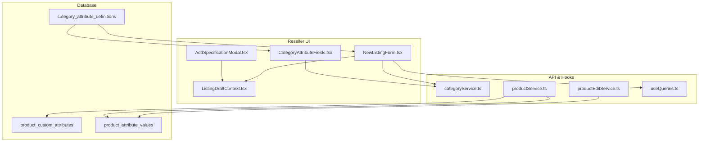
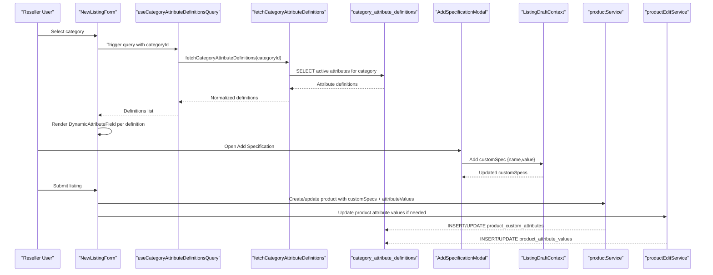
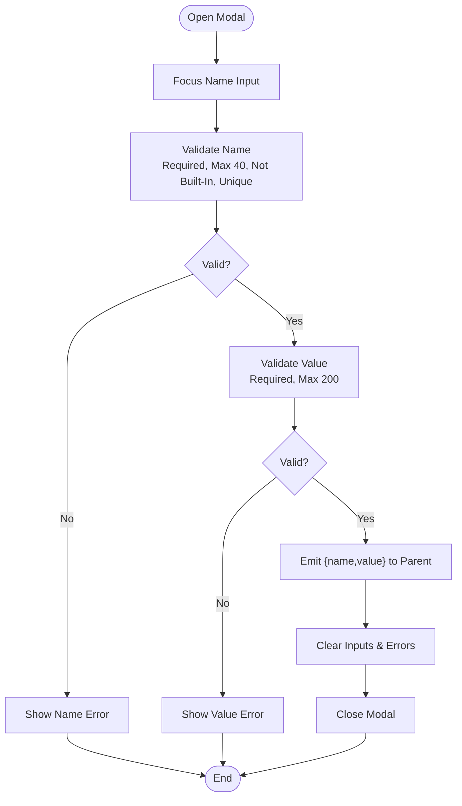
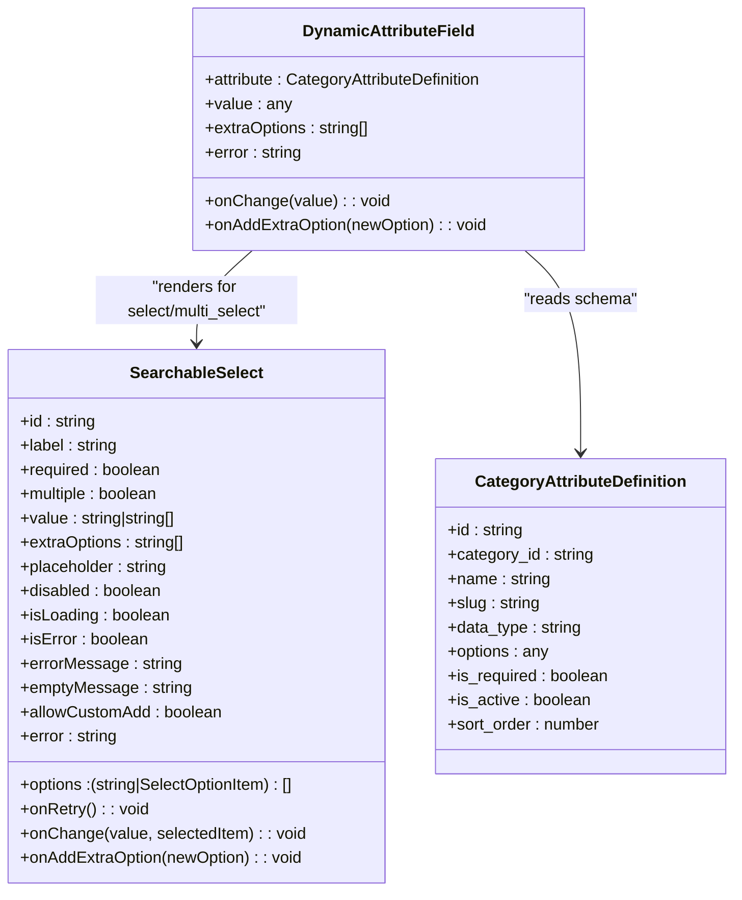
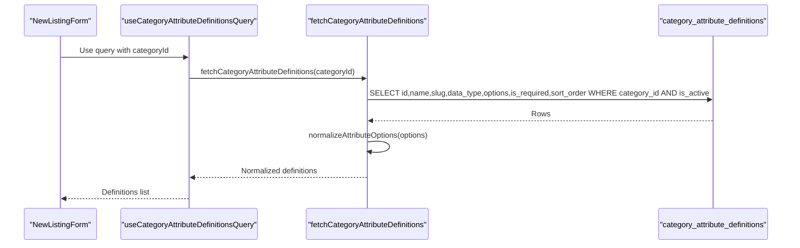
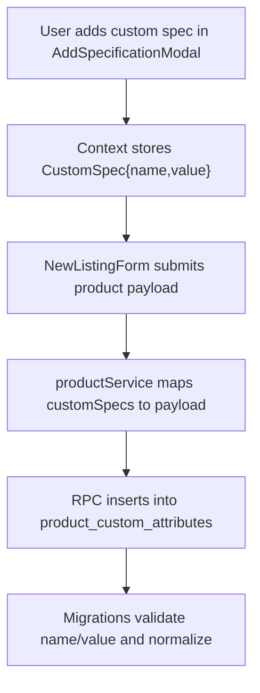
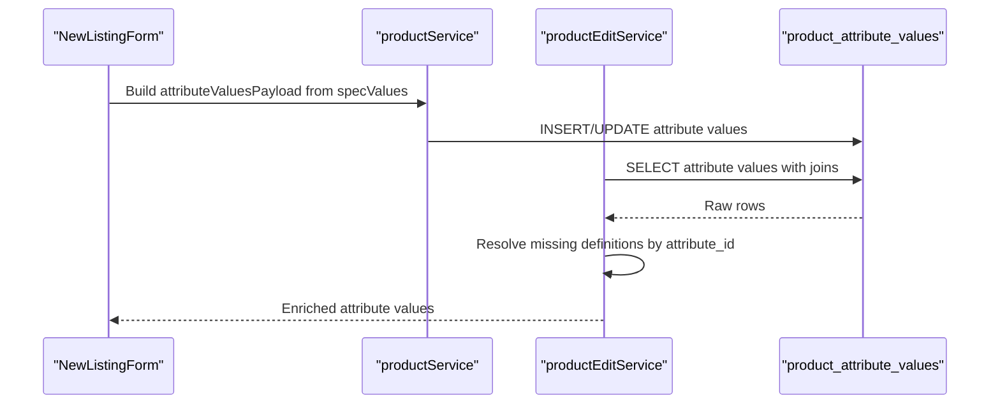
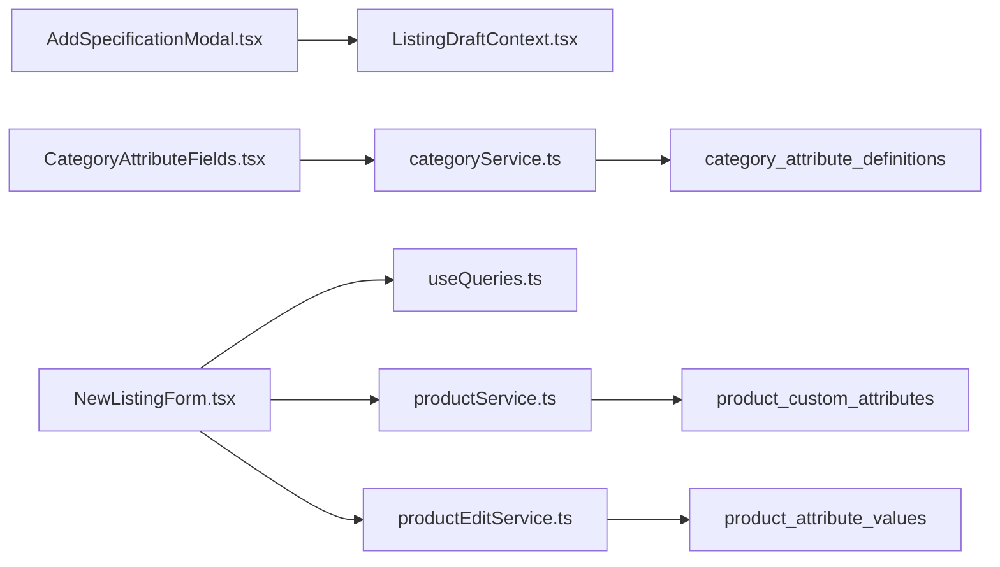

# Specifications & Attributes

<cite>
**Referenced Files in This Document**
- [AddSpecificationModal.tsx](file://components/reseller/components/AddSpecificationModal.tsx)
- [CategoryAttributeFields.tsx](file://components/reseller/components/CategoryAttributeFields.tsx)
- [NewListingForm.tsx](file://components/reseller/components/NewListingForm.tsx)
- [ListingDraftContext.tsx](file://components/reseller/context/ListingDraftContext.tsx)
- [categoryService.ts](file://src/api/categoryService.ts)
- [productService.ts](file://src/api/productService.ts)
- [productEditService.ts](file://src/api/productEditService.ts)
- [useQueries.ts](file://src/hooks/useQueries.ts)
- [20261105_all_in_one_product_creation.sql](file://supabase/migrations/20261105_all_in_one_product_creation.sql)
- [20261105_create_product_with_variants_rpc.sql](file://supabase/migrations/20261105_create_product_with_variants_rpc.sql)
- [20261106_fix_on_conflict_rpc.sql](file://supabase/migrations/20261106_fix_on_conflict_rpc.sql)
</cite>

## Table of Contents
1. [Introduction](#introduction)
2. [Project Structure](#project-structure)
3. [Core Components](#core-components)
4. [Architecture Overview](#architecture-overview)
5. [Detailed Component Analysis](#detailed-component-analysis)
6. [Dependency Analysis](#dependency-analysis)
7. [Performance Considerations](#performance-considerations)
8. [Troubleshooting Guide](#troubleshooting-guide)
9. [Conclusion](#conclusion)

## Introduction
This document explains the specifications and attributes system that enables dynamic product properties for resellers. It covers:
- Adding custom product specifications through a modal form.
- Rendering predefined category attributes dynamically based on category selection.
- Supported attribute data types: text, number, boolean, select, and multi-select.
- How attribute definitions are fetched from the database.
- How custom attributes are stored and retrieved.
- Validation rules and error handling.
- Integration points with product creation/editing and display helpers.

The system separates two kinds of product metadata:
- Custom specifications: free-form name/value pairs defined by the reseller per product.
- Category attributes: predefined fields tied to a selected category, with typed values and optional options.

## Project Structure
The relevant code is split between UI components, context/state, API services, hooks, and database migrations:
- UI components handle user interaction and rendering.
- Context holds draft state for attributes and custom specs.
- Services and hooks fetch category definitions and persist product data.
- Migrations define how custom specifications and attribute values are stored.

**Diagram sources**
- [AddSpecificationModal.tsx:1-309](file://components/reseller/components/AddSpecificationModal.tsx#L1-L309)
- [CategoryAttributeFields.tsx:1-836](file://components/reseller/components/CategoryAttributeFields.tsx#L1-L836)
- [NewListingForm.tsx:1032-2231](file://components/reseller/components/NewListingForm.tsx#L1032-L2231)
- [ListingDraftContext.tsx:1-416](file://components/reseller/context/ListingDraftContext.tsx#L1-L416)
- [categoryService.ts:1-159](file://src/api/categoryService.ts#L1-L159)
- [productService.ts:545-568](file://src/api/productService.ts#L545-L568)
- [productEditService.ts:212-253](file://src/api/productEditService.ts#L212-L253)
- [useQueries.ts:329-357](file://src/hooks/useQueries.ts#L329-L357)

**Section sources**
- [AddSpecificationModal.tsx:1-309](file://components/reseller/components/AddSpecificationModal.tsx#L1-L309)
- [CategoryAttributeFields.tsx:1-836](file://components/reseller/components/CategoryAttributeFields.tsx#L1-L836)
- [NewListingForm.tsx:1032-2231](file://components/reseller/components/NewListingForm.tsx#L1032-L2231)
- [ListingDraftContext.tsx:1-416](file://components/reseller/context/ListingDraftContext.tsx#L1-L416)
- [categoryService.ts:1-159](file://src/api/categoryService.ts#L1-L159)
- [productService.ts:545-568](file://src/api/productService.ts#L545-L568)
- [productEditService.ts:212-253](file://src/api/productEditService.ts#L212-L253)
- [useQueries.ts:329-357](file://src/hooks/useQueries.ts#L329-L357)

## Core Components
- AddSpecificationModal: Adds custom product specifications with validation and accessibility features.
- CategoryAttributeFields: Renders dynamic attribute fields based on category-defined schemas and supports multiple input types.
- NewListingForm: Orchestrates category selection, loads attribute definitions, merges built-in and extra options, and persists both custom specs and category attribute values.
- ListingDraftContext: Holds draft state for spec values, extra options, and custom specs.
- categoryService: Fetches categories and attribute definitions from the database and normalizes option lists.
- productService / productEditService: Persist and retrieve product data including custom specs and attribute values.
- useQueries: Provides React Query hooks for fetching attribute definitions by category.

Key responsibilities:
- Custom specs: name + value pair, validated client-side and normalized server-side.
- Category attributes: typed fields (text, number, boolean, select, multi_select), required flags, sort order, and options normalization.

**Section sources**
- [AddSpecificationModal.tsx:16-174](file://components/reseller/components/AddSpecificationModal.tsx#L16-L174)
- [CategoryAttributeFields.tsx:617-836](file://components/reseller/components/CategoryAttributeFields.tsx#L617-L836)
- [NewListingForm.tsx:1049-1057](file://components/reseller/components/NewListingForm.tsx#L1049-L1057)
- [ListingDraftContext.tsx:114-136](file://components/reseller/context/ListingDraftContext.tsx#L114-L136)
- [categoryService.ts:12-22](file://src/api/categoryService.ts#L12-L22)
- [productService.ts:545-568](file://src/api/productService.ts#L545-L568)
- [productEditService.ts:212-253](file://src/api/productEditService.ts#L212-L253)
- [useQueries.ts:346-357](file://src/hooks/useQueries.ts#L346-L357)

## Architecture Overview
The flow begins when a reseller selects a category. The system fetches attribute definitions for that category and renders corresponding input fields. Resellers can also add custom specifications via a modal. On submit, both custom specs and category attribute values are persisted.

**Diagram sources**
- [NewListingForm.tsx:1049-1057](file://components/reseller/components/NewListingForm.tsx#L1049-L1057)
- [useQueries.ts:346-357](file://src/hooks/useQueries.ts#L346-L357)
- [categoryService.ts:132-158](file://src/api/categoryService.ts#L132-L158)
- [AddSpecificationModal.tsx:124-174](file://components/reseller/components/AddSpecificationModal.tsx#L124-L174)
- [ListingDraftContext.tsx:131-136](file://components/reseller/context/ListingDraftContext.tsx#L131-L136)
- [productService.ts:545-568](file://src/api/productService.ts#L545-L568)
- [productEditService.ts:212-253](file://src/api/productEditService.ts#L212-L253)

## Detailed Component Analysis

### AddSpecificationModal
Purpose:
- Allows resellers to add custom product specifications with name and value.
- Validates inputs and prevents conflicts with built-in labels or duplicates.
- Provides accessible modal behavior, focus management, and keyboard navigation.

Validation rules:
- Name:
  - Required.
  - Maximum length: 40 characters.
  - Must not match built-in labels (case-insensitive).
  - Must be unique among existing custom specs (case-insensitive).
- Value:
  - Required.
  - Maximum length: 200 characters.

Behavior:
- Clears inputs and errors on close.
- Locks body scroll while open.
- Traps Tab focus within the modal.
- Returns focus to trigger element on close.

Data contract:
- Emits objects with name and value strings.
- Stored in context as CustomSpec[] and later persisted to product_custom_attributes.

**Diagram sources**
- [AddSpecificationModal.tsx:48-120](file://components/reseller/components/AddSpecificationModal.tsx#L48-L120)
- [AddSpecificationModal.tsx:124-174](file://components/reseller/components/AddSpecificationModal.tsx#L124-L174)

**Section sources**
- [AddSpecificationModal.tsx:16-174](file://components/reseller/components/AddSpecificationModal.tsx#L16-L174)
- [AddSpecificationModal.tsx:183-305](file://components/reseller/components/AddSpecificationModal.tsx#L183-L305)

### CategoryAttributeFields
Purpose:
- Renders dynamic attribute fields based on category-defined schema.
- Supports data types: text, number, boolean, select, multi_select.
- Provides searchable dropdowns with inline custom option addition.
- Normalizes backend options defensively.

Supported data types and behaviors:
- text:
  - Text input with max length 200.
  - Displays required indicator if attribute.is_required is true.
- number:
  - Decimal input mode; allows empty while typing; rejects NaN and negative values.
  - Accepts digits and at most one decimal point.
- boolean:
  - Yes/No toggle buttons with clear option.
  - Unset until touched; represented as undefined until set.
- select:
  - Single-choice searchable dropdown.
  - Options normalized from various formats; supports custom additions.
- multi_select:
  - Multi-choice searchable dropdown.
  - Stores array of strings; supports custom additions.

Options normalization:
- Handles arrays, stringified JSON, comma-separated strings, and object arrays with label/value/name fields.
- Trims whitespace, drops empties, and deduplicates case-insensitively.

Accessibility:
- SearchableSelect uses combobox/listbox roles, aria-expanded, aria-selected, and keyboard navigation (Arrow keys, Enter, Escape, Home, End).

**Diagram sources**
- [CategoryAttributeFields.tsx:617-836](file://components/reseller/components/CategoryAttributeFields.tsx#L617-L836)
- [CategoryAttributeFields.tsx:8-32](file://components/reseller/components/CategoryAttributeFields.tsx#L8-L32)
- [categoryService.ts:12-22](file://src/api/categoryService.ts#L12-L22)

**Section sources**
- [CategoryAttributeFields.tsx:34-611](file://components/reseller/components/CategoryAttributeFields.tsx#L34-L611)
- [CategoryAttributeFields.tsx:617-836](file://components/reseller/components/CategoryAttributeFields.tsx#L617-L836)
- [categoryService.ts:24-72](file://src/api/categoryService.ts#L24-L72)

### Data Flow: Fetching Attribute Definitions
- NewListingForm uses a hook to fetch attribute definitions for the selected category.
- The hook calls fetchCategoryAttributeDefinitions, which queries category_attribute_definitions filtered by category_id and is_active.
- Results are normalized (options) and sorted by sort_order then name.
- NewListingForm merges these definitions with built-in attributes and extra options added by the user.

**Diagram sources**
- [NewListingForm.tsx:1049-1057](file://components/reseller/components/NewListingForm.tsx#L1049-L1057)
- [useQueries.ts:346-357](file://src/hooks/useQueries.ts#L346-L357)
- [categoryService.ts:132-158](file://src/api/categoryService.ts#L132-L158)

**Section sources**
- [NewListingForm.tsx:1049-1057](file://components/reseller/components/NewListingForm.tsx#L1049-L1057)
- [useQueries.ts:346-357](file://src/hooks/useQueries.ts#L346-L357)
- [categoryService.ts:132-158](file://src/api/categoryService.ts#L132-L158)

### Data Flow: Storing and Retrieving Custom Specifications
- Custom specs are collected in ListingDraftContext as CustomSpec[].
- On product creation/update, productService maps customSpecs into payload entries for product_custom_attributes.
- Database migrations validate and insert custom specs, normalizing names and rejecting empty values.

**Diagram sources**
- [AddSpecificationModal.tsx:124-174](file://components/reseller/components/AddSpecificationModal.tsx#L124-L174)
- [ListingDraftContext.tsx:6-10](file://components/reseller/context/ListingDraftContext.tsx#L6-L10)
- [productService.ts:545-552](file://src/api/productService.ts#L545-L552)
- [20261105_all_in_one_product_creation.sql:544-559](file://supabase/migrations/20261105_all_in_one_product_creation.sql#L544-L559)

**Section sources**
- [productService.ts:545-552](file://src/api/productService.ts#L545-L552)
- [20261105_all_in_one_product_creation.sql:544-559](file://supabase/migrations/20261105_all_in_one_product_creation.sql#L544-L559)
- [20261105_create_product_with_variants_rpc.sql:428-443](file://supabase/migrations/20261105_create_product_with_variants_rpc.sql#L428-L443)
- [20261106_fix_on_conflict_rpc.sql:359-375](file://supabase/migrations/20261106_fix_on_conflict_rpc.sql#L359-L375)

### Data Flow: Storing and Retrieving Category Attribute Values
- Attribute values are stored keyed by attribute_id in specValues.
- For persistence, productService builds an attributeValuesPayload mapping attributeId to value, filtering out empty/undefined/null values.
- productEditService retrieves attribute values and resolves missing category_attribute_definitions when necessary.

**Diagram sources**
- [productService.ts:554-568](file://src/api/productService.ts#L554-L568)
- [productEditService.ts:212-253](file://src/api/productEditService.ts#L212-L253)

**Section sources**
- [productService.ts:554-568](file://src/api/productService.ts#L554-L568)
- [productEditService.ts:212-253](file://src/api/productEditService.ts#L212-L253)

### Example Attribute Types and Validation Rules
- Text attribute:
  - Input: plain text.
  - Validation: max 200 characters; required if marked required.
- Number attribute:
  - Input: decimal mode; accepts digits and one decimal point; rejects negatives and NaN.
  - Validation: numeric format enforced client-side.
- Boolean attribute:
  - Input: Yes/No toggle; clear option resets to unset.
  - Validation: required if marked required; unset until explicitly chosen.
- Select attribute:
  - Input: single-choice searchable dropdown.
  - Options: normalized from backend; supports adding custom values.
  - Validation: required if marked required.
- Multi-select attribute:
  - Input: multi-choice searchable dropdown.
  - Options: normalized from backend; supports adding custom values.
  - Validation: required if marked required; array of strings.

These behaviors are implemented in DynamicAttributeField and SearchableSelect.

**Section sources**
- [CategoryAttributeFields.tsx:645-836](file://components/reseller/components/CategoryAttributeFields.tsx#L645-L836)
- [CategoryAttributeFields.tsx:34-611](file://components/reseller/components/CategoryAttributeFields.tsx#L34-L611)
- [categoryService.ts:24-72](file://src/api/categoryService.ts#L24-L72)

### Integration with Product Creation/Edit and Display
- NewListingForm orchestrates:
  - Category selection.
  - Loading attribute definitions.
  - Rendering dynamic fields.
  - Collecting custom specs and attribute values.
  - Submitting to productService and productEditService.
- Display helpers map raw product data into UI-ready structures, sorting category attributes by sort_order and custom attributes by display_order.

Note: While search and filtering UI exists elsewhere, this documentation focuses on the specification/attributes subsystem and its integration with product creation/editing and display mapping.

**Section sources**
- [NewListingForm.tsx:1049-1057](file://components/reseller/components/NewListingForm.tsx#L1049-L1057)
- [NewListingForm.tsx:2218-2231](file://components/reseller/components/NewListingForm.tsx#L2218-L2231)
- [productService.ts:545-568](file://src/api/productService.ts#L545-L568)
- [productEditService.ts:212-253](file://src/api/productEditService.ts#L212-L253)

## Dependency Analysis
Component relationships:
- AddSpecificationModal depends on ListingDraftContext for storing custom specs.
- CategoryAttributeFields depends on categoryService for attribute definitions and options normalization.
- NewListingForm depends on useQueries for fetching definitions and on productService/productEditService for persistence.
- Database tables:
  - category_attribute_definitions: defines attribute schema per category.
  - product_custom_attributes: stores custom specs.
  - product_attribute_values: stores typed attribute values.

**Diagram sources**
- [AddSpecificationModal.tsx:1-309](file://components/reseller/components/AddSpecificationModal.tsx#L1-L309)
- [CategoryAttributeFields.tsx:1-836](file://components/reseller/components/CategoryAttributeFields.tsx#L1-L836)
- [NewListingForm.tsx:1032-2231](file://components/reseller/components/NewListingForm.tsx#L1032-L2231)
- [ListingDraftContext.tsx:1-416](file://components/reseller/context/ListingDraftContext.tsx#L1-L416)
- [categoryService.ts:1-159](file://src/api/categoryService.ts#L1-L159)
- [productService.ts:545-568](file://src/api/productService.ts#L545-L568)
- [productEditService.ts:212-253](file://src/api/productEditService.ts#L212-L253)

**Section sources**
- [AddSpecificationModal.tsx:1-309](file://components/reseller/components/AddSpecificationModal.tsx#L1-L309)
- [CategoryAttributeFields.tsx:1-836](file://components/reseller/components/CategoryAttributeFields.tsx#L1-L836)
- [NewListingForm.tsx:1032-2231](file://components/reseller/components/NewListingForm.tsx#L1032-L2231)
- [ListingDraftContext.tsx:1-416](file://components/reseller/context/ListingDraftContext.tsx#L1-L416)
- [categoryService.ts:1-159](file://src/api/categoryService.ts#L1-L159)
- [productService.ts:545-568](file://src/api/productService.ts#L545-L568)
- [productEditService.ts:212-253](file://src/api/productEditService.ts#L212-L253)

## Performance Considerations
- Option normalization:
  - Deduplication and trimming occur during option normalization; ensure large option lists are pre-normalized where possible.
- Dropdown performance:
  - SearchableSelect computes filtered options using useMemo; keep option lists reasonable in size.
- Query caching:
  - useCategoryAttributeDefinitionsQuery caches results for 10 minutes; reuse category selections to avoid redundant network calls.
- Portal rendering:
  - Modals and dropdowns use createPortal to avoid clipping; consider minimizing re-renders by memoizing content.

[No sources needed since this section provides general guidance]

## Troubleshooting Guide
Common issues and resolutions:
- Attribute definitions fail to load:
  - Check categoryId validity and is_active flag in category_attribute_definitions.
  - Use retry logic exposed in NewListingForm’s error state to refetch definitions.
- Options not appearing in select/multi-select:
  - Verify options normalization handles your backend format (array, stringified JSON, comma-separated, object arrays).
  - Ensure options are non-empty after trimming.
- Custom spec rejected:
  - Ensure name is not a built-in label and is unique among existing specs.
  - Respect max lengths: name ≤ 40, value ≤ 200.
- Number input rejects valid values:
  - Only digits and one decimal point are allowed; no negatives or NaN.
- Missing attribute definitions in retrieved attribute values:
  - productEditService resolves missing definitions by attribute_id; verify RLS policies and RPC contracts.

**Section sources**
- [NewListingForm.tsx:2200-2216](file://components/reseller/components/NewListingForm.tsx#L2200-L2216)
- [categoryService.ts:24-72](file://src/api/categoryService.ts#L24-L72)
- [AddSpecificationModal.tsx:124-174](file://components/reseller/components/AddSpecificationModal.tsx#L124-L174)
- [productEditService.ts:212-253](file://src/api/productEditService.ts#L212-L253)

## Conclusion
The specifications and attributes system provides a flexible way to model product metadata:
- Custom specifications allow resellers to add free-form name/value pairs with robust validation.
- Category attributes enforce typed, structured data aligned with category schemas, supporting text, number, boolean, select, and multi-select.
- Attribute definitions are fetched from the database and rendered dynamically based on category selection.
- Both custom specs and category attribute values are persisted reliably and integrated with product creation/edit flows.
- The design emphasizes accessibility, validation, and resilience against inconsistent backend option formats.

[No sources needed since this section summarizes without analyzing specific files]