# Dimension Configuration

<cite>
**Referenced Files in This Document**
- [ListingDraftContext.tsx](file://components/reseller/context/ListingDraftContext.tsx)
- [productVarition.tsx](file://components/reseller/components/productVarition.tsx)
- [NewListingForm.tsx](file://components/reseller/components/NewListingForm.tsx)
- [productService.ts](file://src/api/productService.ts)
- [20261105_create_product_with_variants_rpc.sql](file://supabase/migrations/20261105_create_product_with_variants_rpc.sql)
</cite>

## Table of Contents
1. [Introduction](#introduction)
2. [Project Structure](#project-structure)
3. [Core Components](#core-components)
4. [Architecture Overview](#architecture-overview)
5. [Detailed Component Analysis](#detailed-component-analysis)
6. [Dependency Analysis](#dependency-analysis)
7. [Performance Considerations](#performance-considerations)
8. [Troubleshooting Guide](#troubleshooting-guide)
9. [Conclusion](#conclusion)

## Introduction
This document explains the dimension configuration system used to manage product variation dimensions such as Color, Size, and custom attributes like Material. It covers how to add, remove, enable/disable, and configure dimensions with their values; how validation rules are enforced; how dimensions relate to generated combinations; and how cartesian product calculation is implemented. It also documents performance constraints for large dimension sets and provides practical examples for dynamic dimension creation and constraint handling.

## Project Structure
The dimension configuration system spans a context layer that defines shared types and state, a dedicated variation UI component that implements user interactions and validation, a listing form that consumes and persists variation data, and backend services and database migrations that enforce server-side constraints.

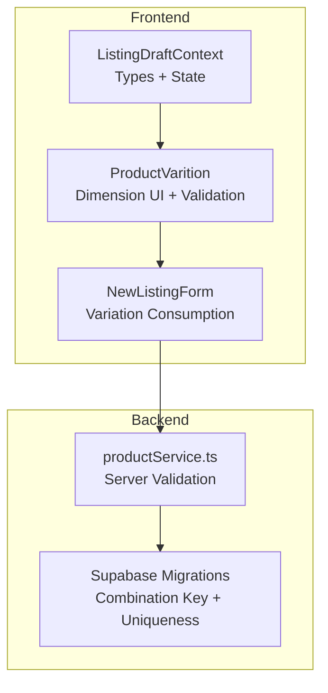

**Diagram sources**
- [ListingDraftContext.tsx:34-76](file://components/reseller/context/ListingDraftContext.tsx#L34-L76)
- [productVarition.tsx:32-48](file://components/reseller/components/productVarition.tsx#L32-L48)
- [NewListingForm.tsx:341-349](file://components/reseller/components/NewListingForm.tsx#L341-L349)
- [productService.ts:1245-1273](file://src/api/productService.ts#L1245-L1273)
- [20261105_create_product_with_variants_rpc.sql:761-804](file://supabase/migrations/20261105_create_product_with_variants_rpc.sql#L761-L804)

**Section sources**
- [ListingDraftContext.tsx:34-76](file://components/reseller/context/ListingDraftContext.tsx#L34-L76)
- [productVarition.tsx:32-48](file://components/reseller/components/productVarition.tsx#L32-L48)
- [NewListingForm.tsx:341-349](file://components/reseller/components/NewListingForm.tsx#L341-L349)
- [productService.ts:1245-1273](file://src/api/productService.ts#L1245-L1273)
- [20261105_create_product_with_variants_rpc.sql:761-804](file://supabase/migrations/20261105_create_product_with_variants_rpc.sql#L761-L804)

## Core Components
- VariationDimension interface: Defines a single variation dimension including its identifier, name, enabled state, list of values, and optional database identifiers and value-to-id mappings.
- VariationRow: Represents one combination row with normalized key, color/size shortcuts, attribute map, price, quantity, image reference, and active state.
- VariationConfig: Holds the full variation configuration including dimensions, image dimension selection, per-value images, rows, legacy flags, and color/size arrays.
- ProductVarition component: Implements adding/removing dimensions, adding/removing values, enabling/disabling dimensions, generating combinations, validating inputs, and saving configuration.
- NewListingForm: Consumes variation configuration, maps existing product options into dimensions, and integrates variations into the overall listing workflow.
- productService: Enforces server-side limits on number of dimensions, values per dimension, total combinations, prices, and quantities.
- Database migrations: Build combination keys from option names and values, validate unknown option values, prevent duplicate combinations, and persist variants.

**Section sources**
- [ListingDraftContext.tsx:34-76](file://components/reseller/context/ListingDraftContext.tsx#L34-L76)
- [productVarition.tsx:32-48](file://components/reseller/components/productVarition.tsx#L32-L48)
- [NewListingForm.tsx:341-349](file://components/reseller/components/NewListingForm.tsx#L341-L349)
- [productService.ts:1245-1273](file://src/api/productService.ts#L1245-L1273)
- [20261105_create_product_with_variants_rpc.sql:761-804](file://supabase/migrations/20261105_create_product_with_variants_rpc.sql#L761-L804)

## Architecture Overview
The system follows a layered approach:
- Data model layer: VariationDimension, VariationRow, VariationConfig define the shape of variation data.
- UI layer: ProductVarition manages user input, validation, and live combination generation.
- Integration layer: NewListingForm reads and writes variation configuration during product creation/editing.
- Service layer: productService validates business rules before persistence.
- Persistence layer: Supabase RPCs and migrations ensure consistent combination keys and uniqueness.

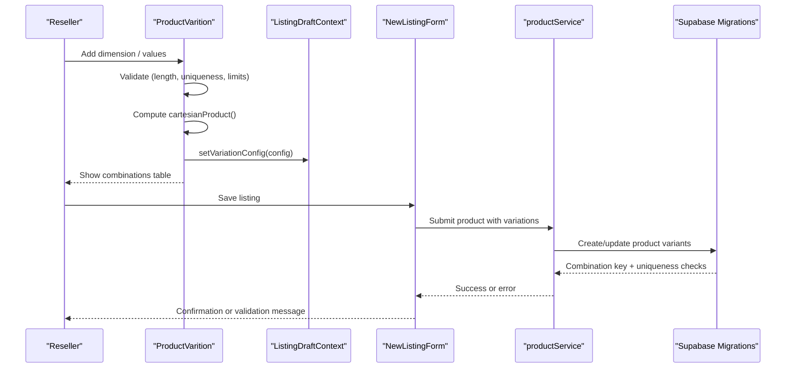

**Diagram sources**
- [productVarition.tsx:32-48](file://components/reseller/components/productVarition.tsx#L32-L48)
- [productVarition.tsx:400-541](file://components/reseller/components/productVarition.tsx#L400-L541)
- [productVarition.tsx:680-777](file://components/reseller/components/productVarition.tsx#L680-L777)
- [NewListingForm.tsx:341-349](file://components/reseller/components/NewListingForm.tsx#L341-L349)
- [productService.ts:1245-1273](file://src/api/productService.ts#L1245-L1273)
- [20261105_create_product_with_variants_rpc.sql:761-804](file://supabase/migrations/20261105_create_product_with_variants_rpc.sql#L761-L804)

## Detailed Component Analysis

### VariationDimension Interface and Related Types
The core data structures define how dimensions and combinations are represented:
- VariationDimension includes id, name, enabled, values, and optional dbId/ref/valueIds for mapping to persisted option values.
- VariationRow represents each generated combination with a normalized key, color/size shortcuts, attributes, price, quantity, image, and active flag.
- VariationConfig aggregates dimensions, image dimension selection, per-value images, rows, and legacy compatibility fields.

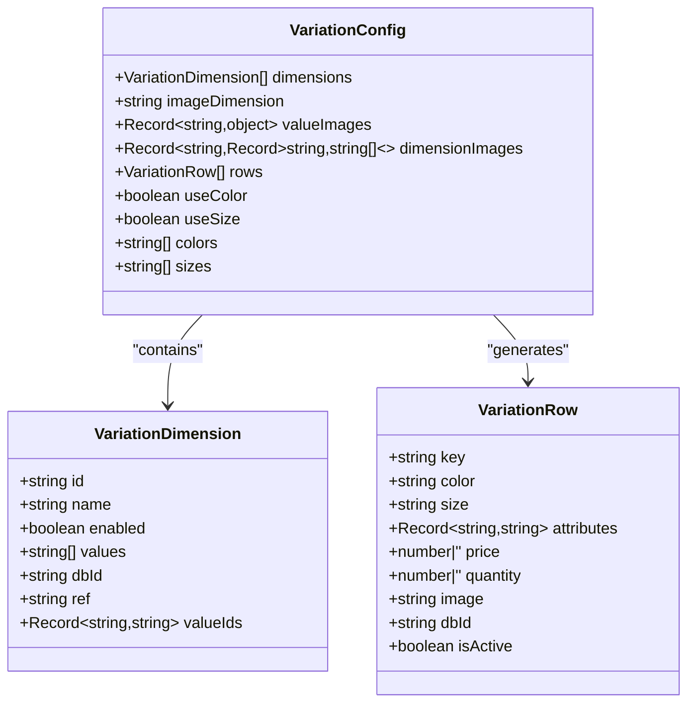

**Diagram sources**
- [ListingDraftContext.tsx:34-76](file://components/reseller/context/ListingDraftContext.tsx#L34-L76)

**Section sources**
- [ListingDraftContext.tsx:34-76](file://components/reseller/context/ListingDraftContext.tsx#L34-L76)

### Adding and Removing Dimensions
Adding a new dimension:
- Validates non-empty name, maximum length of 30 characters, and uniqueness across existing dimensions.
- Creates a new VariationDimension with a generated id, enabled by default, and empty values.
- Updates local dimensions and clears input.

Removing a dimension:
- Prevents removal on existing products to preserve SKU integrity.
- Optionally confirms deletion if the dimension has values.
- Cleans up associated value images keyed by normalized dimension name and value.
- Recomputes combinations after removal.

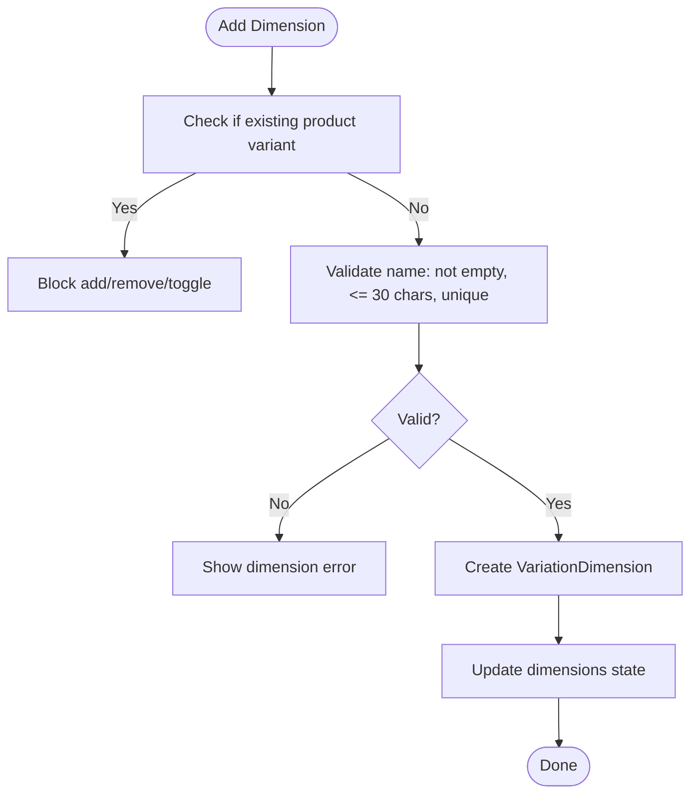

**Diagram sources**
- [productVarition.tsx:400-433](file://components/reseller/components/productVarition.tsx#L400-L433)
- [productVarition.tsx:435-471](file://components/reseller/components/productVarition.tsx#L435-L471)

**Section sources**
- [productVarition.tsx:400-433](file://components/reseller/components/productVarition.tsx#L400-L433)
- [productVarition.tsx:435-471](file://components/reseller/components/productVarition.tsx#L435-L471)

### Configuring Values and Enforcing Constraints
Value addition constraints:
- Non-empty value.
- Maximum length of 30 characters.
- Case-insensitive uniqueness within the same dimension.
- Maximum 20 values per dimension.
- Projected cartesian product limit of 100 combinations across enabled dimensions with values.

These constraints protect performance and maintain manageable inventory complexity.

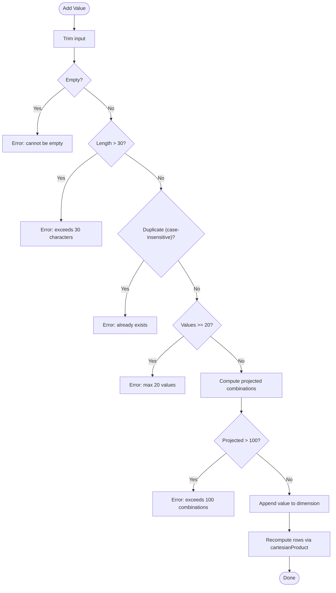

**Diagram sources**
- [productVarition.tsx:487-541](file://components/reseller/components/productVarition.tsx#L487-L541)

**Section sources**
- [productVarition.tsx:487-541](file://components/reseller/components/productVarition.tsx#L487-L541)

### Handling Enable/Disable States
Dimensions can be toggled enabled or disabled:
- On existing products, toggling is blocked to preserve historical SKU combinations.
- When enabled, the dimension participates in cartesian product computation.
- Disabling removes the dimension from combination generation and updates rows accordingly.

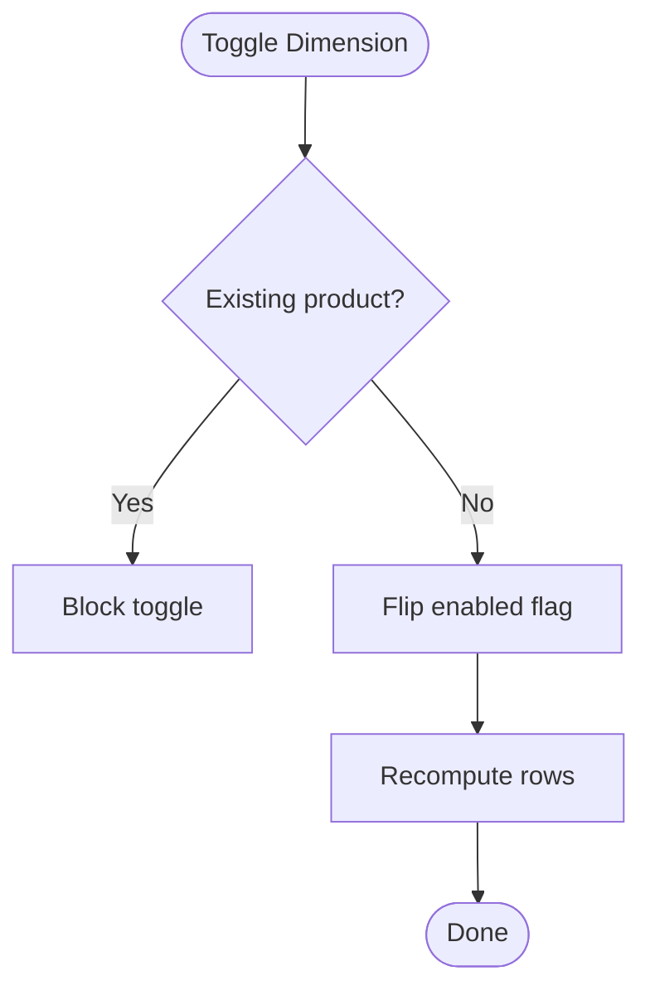

**Diagram sources**
- [productVarition.tsx:473-485](file://components/reseller/components/productVarition.tsx#L473-L485)

**Section sources**
- [productVarition.tsx:473-485](file://components/reseller/components/productVarition.tsx#L473-L485)

### Cartesian Product Calculation and Combination Generation
The cartesian product function computes all combinations across enabled dimensions with at least one value:
- Filters out disabled dimensions and those without values.
- Iteratively builds combinations by multiplying values across dimensions.
- Generates a normalized key for each combination to preserve stable row identity.
- Preserves existing price, quantity, dbId, and active state when recomputing rows.

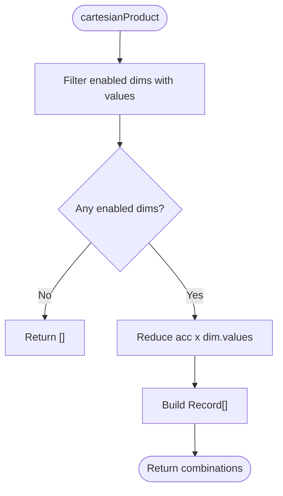

**Diagram sources**
- [productVarition.tsx:32-48](file://components/reseller/components/productVarition.tsx#L32-L48)
- [productVarition.tsx:226-267](file://components/reseller/components/productVarition.tsx#L226-L267)

**Section sources**
- [productVarition.tsx:32-48](file://components/reseller/components/productVarition.tsx#L32-L48)
- [productVarition.tsx:226-267](file://components/reseller/components/productVarition.tsx#L226-L267)

### Relationship Between Dimensions and Values
Each dimension contains an array of string values. The relationship is:
- One dimension maps to many values.
- Each value contributes to the cartesian product when the dimension is enabled.
- Per-value images are stored using a normalized key combining dimension name and value.
- Database mappings may include valueIds to link to persisted option values.

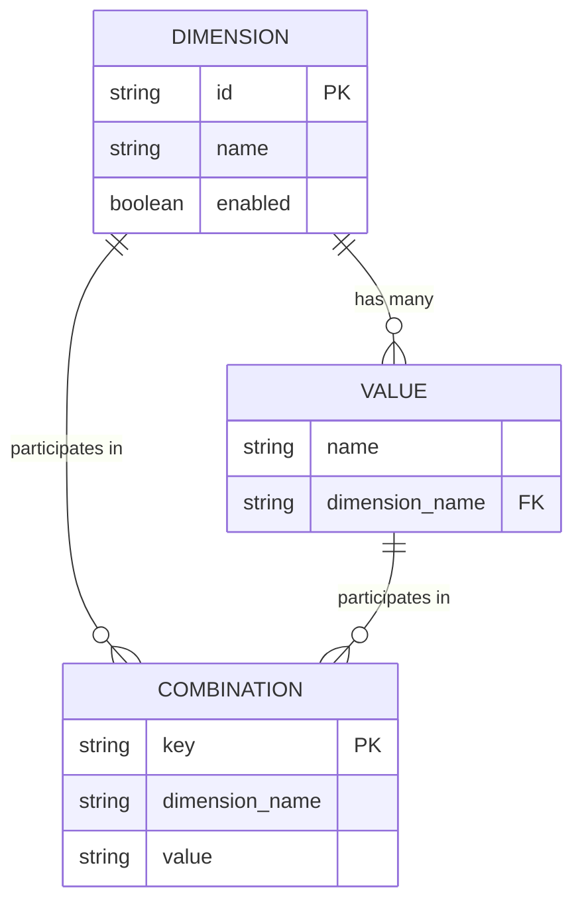

**Diagram sources**
- [ListingDraftContext.tsx:34-76](file://components/reseller/context/ListingDraftContext.tsx#L34-L76)
- [productVarition.tsx:32-48](file://components/reseller/components/productVarition.tsx#L32-L48)

**Section sources**
- [ListingDraftContext.tsx:34-76](file://components/reseller/context/ListingDraftContext.tsx#L34-L76)
- [productVarition.tsx:32-48](file://components/reseller/components/productVarition.tsx#L32-L48)

### Creating Dynamic Dimensions
Dynamic dimension creation is supported through the UI:
- Users can type a dimension name and press Enter or click Add.
- Suggested dimensions like Color, Size, and Material are provided.
- For existing products, dimension structure is locked to safeguard historical SKUs.

Example usage patterns:
- Add a new custom dimension named Material.
- Add multiple values under Material (e.g., Cotton, Silk).
- Ensure the dimension is enabled to participate in combinations.

**Section sources**
- [productVarition.tsx:851-914](file://components/reseller/components/productVarition.tsx#L851-L914)
- [productVarition.tsx:400-433](file://components/reseller/components/productVarition.tsx#L400-L433)

### Managing Dimension-Specific Constraints
Constraints are enforced both in the UI and backend:
- UI constraints:
  - 30-character limit for dimension names and values.
  - Case-insensitive uniqueness within a dimension.
  - Maximum 20 values per dimension.
  - Projected combinations capped at 100.
- Backend constraints:
  - Maximum 5 enabled dimensions.
  - Maximum 20 values per dimension.
  - Maximum 100 variation combinations.
  - Every variation must have a valid selling price greater than 0.
  - Every variation quantity must be an integer greater than or equal to 0.

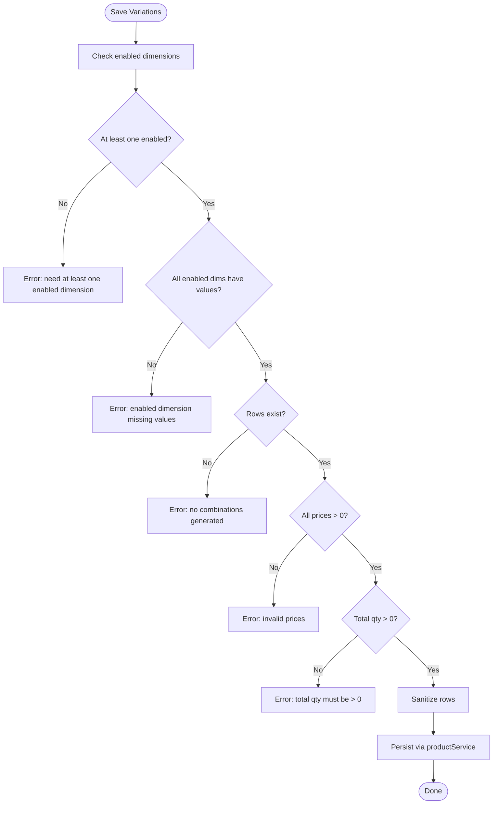

**Diagram sources**
- [productVarition.tsx:680-777](file://components/reseller/components/productVarition.tsx#L680-L777)
- [productService.ts:1245-1273](file://src/api/productService.ts#L1245-L1273)

**Section sources**
- [productVarition.tsx:680-777](file://components/reseller/components/productVarition.tsx#L680-L777)
- [productService.ts:1245-1273](file://src/api/productService.ts#L1245-L1273)

### Handling Existing Products and Locked Structures
For existing products with variations:
- Adding, removing, or toggling dimensions is blocked to preserve SKU integrity.
- Users can still add/edit values, update prices and quantities, and assign variation images.
- The UI displays a locked notification explaining restrictions.

**Section sources**
- [productVarition.tsx:851-861](file://components/reseller/components/productVarition.tsx#L851-L861)
- [productVarition.tsx:400-404](file://components/reseller/components/productVarition.tsx#L400-L404)
- [productVarition.tsx:435-440](file://components/reseller/components/productVarition.tsx#L435-L440)
- [productVarition.tsx:473-478](file://components/reseller/components/productVarition.tsx#L473-L478)

### Mapping Existing Product Options to Dimensions
When editing an existing product, the listing form maps product options into VariationDimension objects:
- Maps option id, name, enabled state, values, and valueIds.
- Builds a lookup from option value ids to option names and values.
- Reconstructs variation rows from variant data, preserving attributes and special columns like color and size.

**Section sources**
- [NewListingForm.tsx:341-349](file://components/reseller/components/NewListingForm.tsx#L341-L349)
- [NewListingForm.tsx:378-408](file://components/reseller/components/NewListingForm.tsx#L378-L408)
- [NewListingForm.tsx:807-836](file://components/reseller/components/NewListingForm.tsx#L807-L836)

### Database Combination Keys and Uniqueness
Database migrations build combination keys from normalized option names and values:
- Normalize option names and values.
- Validate that option values exist for given dimensions.
- Construct combination keys as ordered parts joined by pipe separators.
- Reject duplicate combination rows.
- Insert product variants with SKU, combination key, price, and quantity.

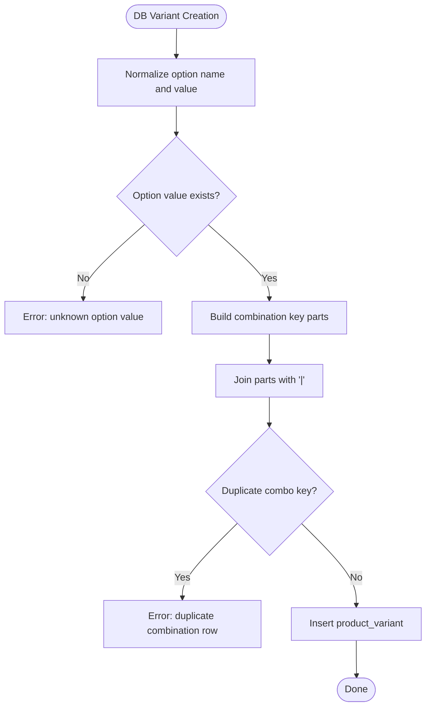

**Diagram sources**
- [20261105_create_product_with_variants_rpc.sql:761-804](file://supabase/migrations/20261105_create_product_with_variants_rpc.sql#L761-L804)

**Section sources**
- [20261105_create_product_with_variants_rpc.sql:761-804](file://supabase/migrations/20261105_create_product_with_variants_rpc.sql#L761-L804)

## Dependency Analysis
The dimension configuration system depends on:
- Shared types and utilities from ListingDraftContext.
- UI logic and validation in ProductVarition.
- Listing form integration in NewListingForm.
- Server-side validation in productService.
- Database constraints and combination key generation in Supabase migrations.

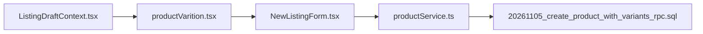

**Diagram sources**
- [ListingDraftContext.tsx:34-76](file://components/reseller/context/ListingDraftContext.tsx#L34-L76)
- [productVarition.tsx:32-48](file://components/reseller/components/productVarition.tsx#L32-L48)
- [NewListingForm.tsx:341-349](file://components/reseller/components/NewListingForm.tsx#L341-L349)
- [productService.ts:1245-1273](file://src/api/productService.ts#L1245-L1273)
- [20261105_create_product_with_variants_rpc.sql:761-804](file://supabase/migrations/20261105_create_product_with_variants_rpc.sql#L761-L804)

**Section sources**
- [ListingDraftContext.tsx:34-76](file://components/reseller/context/ListingDraftContext.tsx#L34-L76)
- [productVarition.tsx:32-48](file://components/reseller/components/productVarition.tsx#L32-L48)
- [NewListingForm.tsx:341-349](file://components/reseller/components/NewListingForm.tsx#L341-L349)
- [productService.ts:1245-1273](file://src/api/productService.ts#L1245-L1273)
- [20261105_create_product_with_variants_rpc.sql:761-804](file://supabase/migrations/20261105_create_product_with_variants_rpc.sql#L761-L804)

## Performance Considerations
- Cartesian product growth: With n dimensions having v_i values each, the number of combinations grows multiplicatively. The system caps projected combinations at 100 to avoid excessive memory and rendering costs.
- Values per dimension cap: Limiting to 20 values per dimension reduces combinatorial explosion and keeps UI tables manageable.
- Row recomputation: Recomputing rows after every dimension/value change triggers cartesianProduct; keeping dimensions and values small improves responsiveness.
- Image management: Per-value images are keyed by normalized dimension+value; limiting values reduces image association overhead.
- Backend validation: Enforcing server-side limits ensures consistency even if client constraints are bypassed.

Recommendations:
- Prefer fewer dimensions with moderate values over many dimensions with many values.
- Use Color and Size as primary dimensions; add custom dimensions only when necessary.
- Monitor projected combinations before adding values to stay under the 100-combination limit.
- Avoid unnecessary toggling of dimensions; changes trigger recomputation.

[No sources needed since this section provides general guidance]

## Troubleshooting Guide
Common issues and resolutions:
- Cannot add dimension on existing product:
  - Cause: Existing product variation structure is locked.
  - Resolution: Edit values, prices, quantities, and images instead of changing dimension structure.
- Dimension name too long:
  - Cause: Exceeds 30-character limit.
  - Resolution: Shorten the dimension name.
- Duplicate dimension name:
  - Cause: Case-insensitive uniqueness check failed.
  - Resolution: Use a different dimension name.
- Value too long or duplicate:
  - Cause: Exceeds 30-character limit or duplicates an existing value.
  - Resolution: Shorten or rename the value.
- Too many values per dimension:
  - Cause: Exceeds 20 values.
  - Resolution: Remove some values or consolidate them.
- Projected combinations exceed limit:
  - Cause: Adding a value would exceed 100 combinations.
  - Resolution: Reduce values or disable some dimensions.
- No combinations generated:
  - Cause: No enabled dimensions with values.
  - Resolution: Enable at least one dimension and add values.
- Invalid prices or quantities:
  - Cause: Prices must be > 0; quantities must be integers >= 0; total quantity must be > 0.
  - Resolution: Correct row values before saving.

**Section sources**
- [productVarition.tsx:400-433](file://components/reseller/components/productVarition.tsx#L400-L433)
- [productVarition.tsx:487-541](file://components/reseller/components/productVarition.tsx#L487-L541)
- [productVarition.tsx:680-777](file://components/reseller/components/productVarition.tsx#L680-L777)
- [productService.ts:1245-1273](file://src/api/productService.ts#L1245-L1273)

## Conclusion
The dimension configuration system provides a robust framework for managing product variations through clear interfaces, strict validation, and safe defaults. It supports dynamic dimension creation, value management, enable/disable states, and cartesian product-based combination generation while enforcing performance and data integrity constraints at both frontend and backend layers. By following the documented constraints and best practices, resellers can efficiently configure complex product variations without compromising system stability or user experience.

[No sources needed since this section summarizes without analyzing specific files]