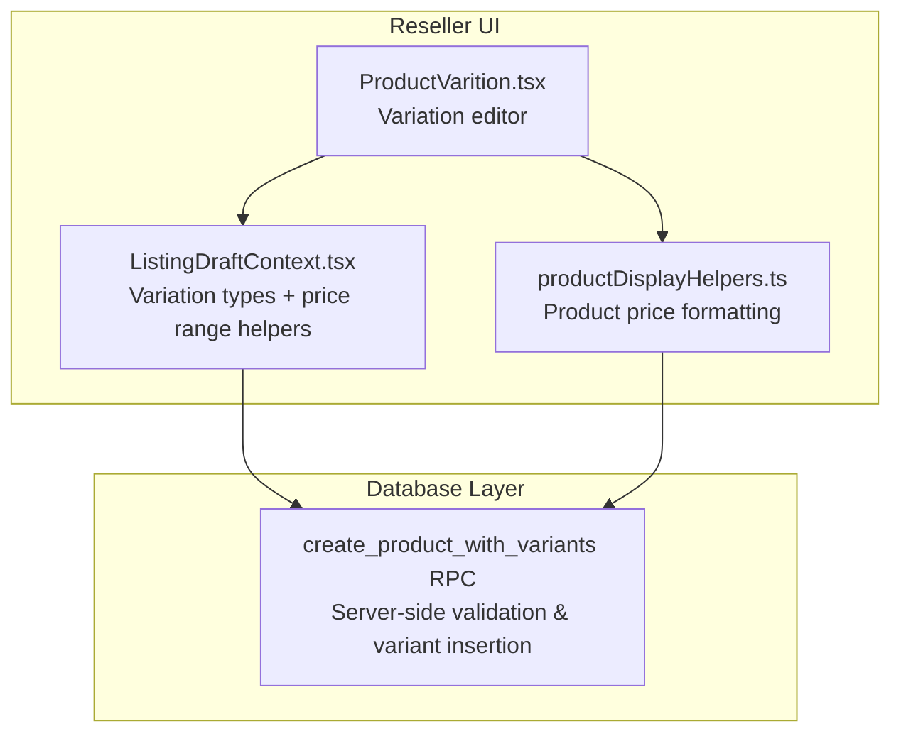
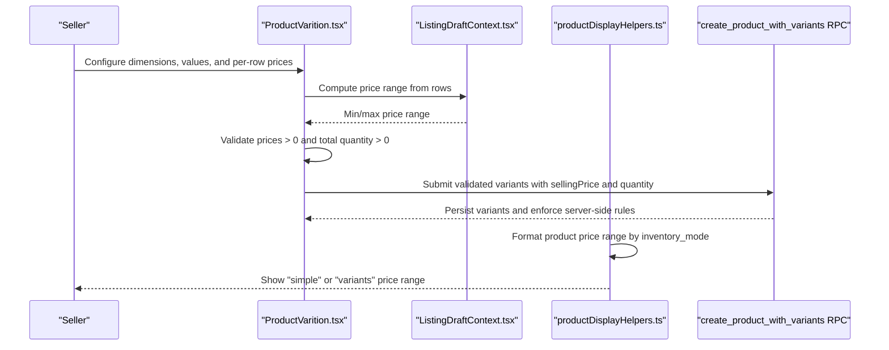
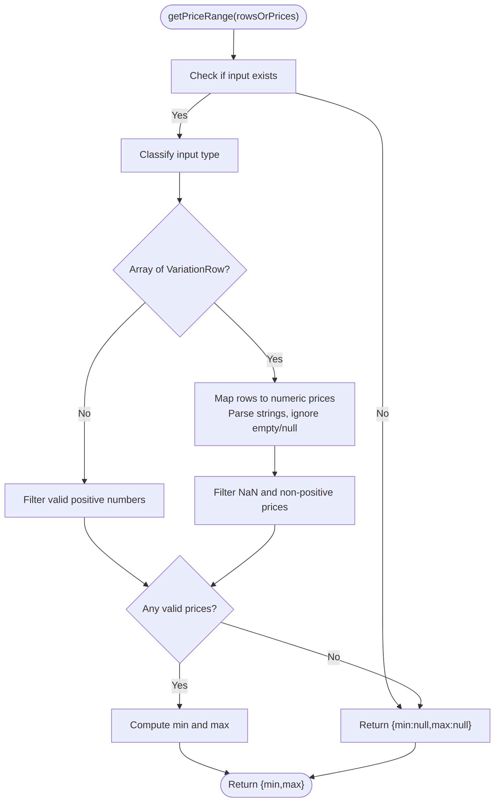
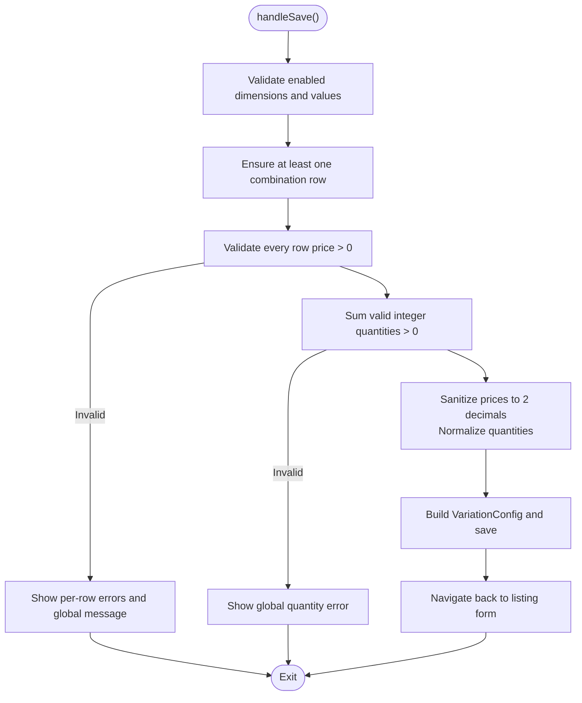
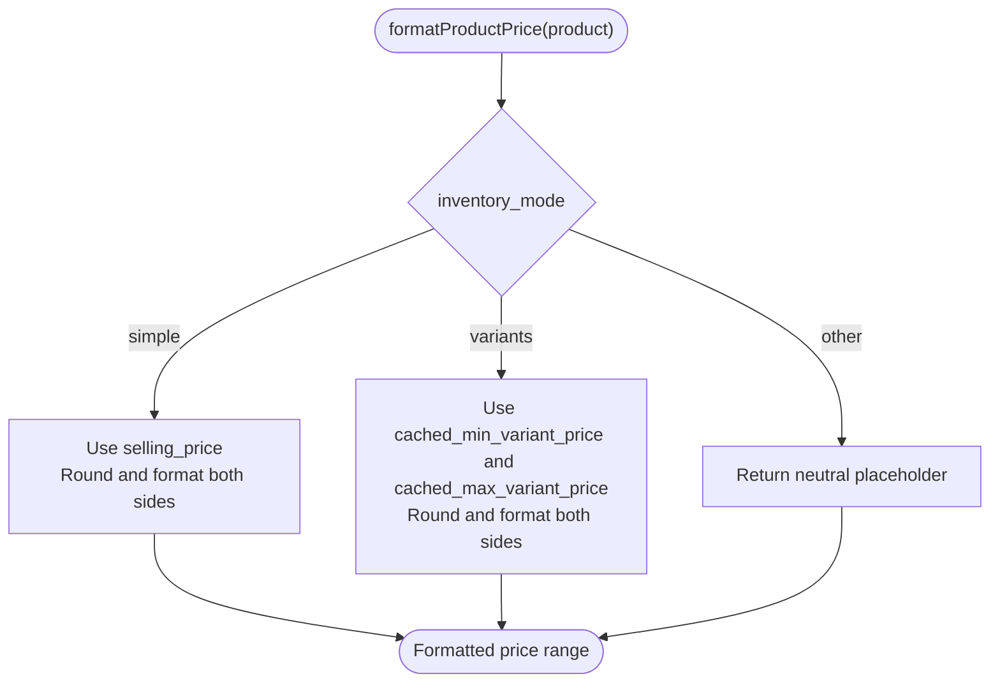
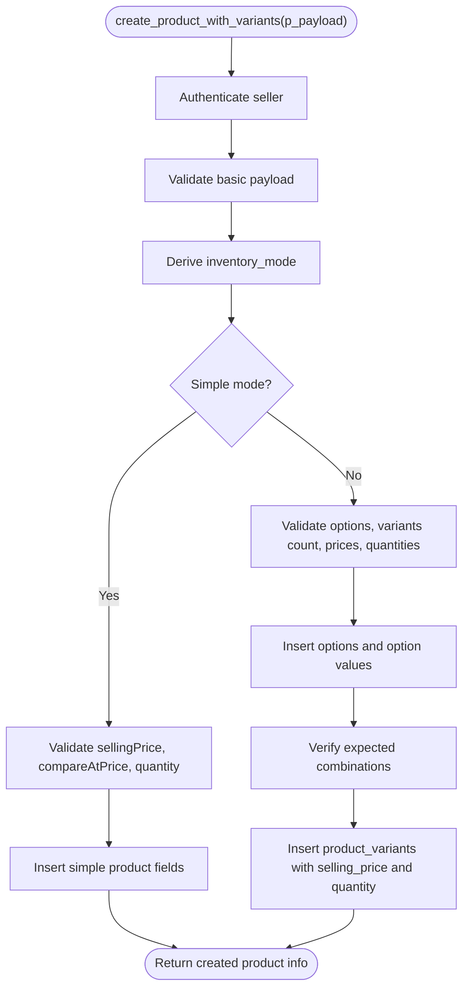
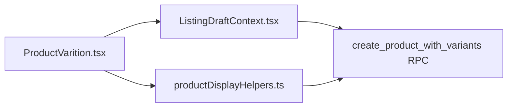

# Pricing Strategies

<cite>
**Referenced Files in This Document**
- [ListingDraftContext.tsx](file://components/reseller/context/ListingDraftContext.tsx)
- [productVarition.tsx](file://components/reseller/components/productVarition.tsx)
- [productDisplayHelpers.ts](file://components/reseller/components/common/productDisplayHelpers.ts)
- [20261105_create_product_with_variants_rpc.sql](file://supabase/migrations/20261105_create_product_with_variants_rpc.sql)
</cite>

## Table of Contents
1. [Introduction](#introduction)
2. [Project Structure](#project-structure)
3. [Core Components](#core-components)
4. [Architecture Overview](#architecture-overview)
5. [Detailed Component Analysis](#detailed-component-analysis)
6. [Dependency Analysis](#dependency-analysis)
7. [Performance Considerations](#performance-considerations)
8. [Troubleshooting Guide](#troubleshooting-guide)
9. [Conclusion](#conclusion)

## Introduction
This document explains the pricing strategy system for products with variant-specific pricing and price range calculations. It covers:
- How base product pricing differs from variant pricing
- Validation rules for prices, quantities, and combinations
- Decimal precision handling during editing and persistence
- Price range calculation algorithms for variation rows
- Bulk operations when creating or updating variants
- Integration between the reseller UI, listing draft context, display helpers, and database RPCs

The goal is to help sellers configure size/color combinations, implement consistent pricing rules, and understand how edge cases are handled across the frontend and backend.

## Project Structure
Pricing-related logic spans three main areas:
- Reseller listing draft context: defines variation data structures and price range utilities
- Variation editor component: validates per-row prices, computes ranges, and saves sanitized configuration
- Display helpers: format product-level price ranges based on inventory mode
- Database RPC migration: enforces server-side validation, variant creation, and catalog consistency

**Diagram sources**
- [productVarition.tsx:23-26](file://components/reseller/components/productVarition.tsx#L23-L26)
- [ListingDraftContext.tsx:34-76](file://components/reseller/context/ListingDraftContext.tsx#L34-L76)
- [productDisplayHelpers.ts:3-10](file://components/reseller/components/common/productDisplayHelpers.ts#L3-L10)
- [20261105_create_product_with_variants_rpc.sql:104-109](file://supabase/migrations/20261105_create_product_with_variants_rpc.sql#L104-L109)

**Section sources**
- [productVarition.tsx:1-120](file://components/reseller/components/productVarition.tsx#L1-L120)
- [ListingDraftContext.tsx:1-112](file://components/reseller/context/ListingDraftContext.tsx#L1-L112)
- [productDisplayHelpers.ts:1-42](file://components/reseller/components/common/productDisplayHelpers.ts#L1-L42)
- [20261105_create_product_with_variants_rpc.sql:100-110](file://supabase/migrations/20261105_create_product_with_variants_rpc.sql#L100-L110)

## Core Components
- Variation row model: represents each combination (for example, color and size) with a unique key, optional attributes, price, quantity, and image metadata.
- Variation dimension model: represents option dimensions such as Color or Size, including enabled state and allowed values.
- Price range utilities: compute minimum and maximum valid prices from variation rows and format them for display.
- Product display helpers: render product-level price ranges depending on whether the product is simple or has variants.
- Database RPC: validates payload, ensures correct inventory mode, enforces variant constraints, and persists variants with selling price and quantity.

Key responsibilities:
- Frontend validation and user feedback for per-row prices and quantities
- Safe decimal input handling with two-decimal precision
- Deriving price ranges from active variation rows
- Server-side enforcement of positive prices, valid combinations, and stock requirements

**Section sources**
- [ListingDraftContext.tsx:34-76](file://components/reseller/context/ListingDraftContext.tsx#L34-L76)
- [ListingDraftContext.tsx:371-415](file://components/reseller/context/ListingDraftContext.tsx#L371-L415)
- [productDisplayHelpers.ts:3-42](file://components/reseller/components/common/productDisplayHelpers.ts#L3-L42)
- [20261105_create_product_with_variants_rpc.sql:261-316](file://supabase/migrations/20261105_create_product_with_variants_rpc.sql#L261-L316)

## Architecture Overview
The pricing strategy follows a layered approach:
- The variation editor collects per-combination prices and quantities
- Price range utilities compute min/max from valid row prices
- Display helpers present product-level price ranges according to inventory mode
- The database RPC enforces business rules and persists variants

**Diagram sources**
- [productVarition.tsx:629-777](file://components/reseller/components/productVarition.tsx#L629-L777)
- [ListingDraftContext.tsx:371-415](file://components/reseller/context/ListingDraftContext.tsx#L371-L415)
- [productDisplayHelpers.ts:18-42](file://components/reseller/components/common/productDisplayHelpers.ts#L18-L42)
- [20261105_create_product_with_variants_rpc.sql:740-804](file://supabase/migrations/20261105_create_product_with_variants_rpc.sql#L740-L804)

## Detailed Component Analysis

### Variation Data Model and Price Range Utilities
The variation model supports flexible option dimensions and per-combination pricing. The price range utilities:
- Accept either raw variation rows or plain number arrays
- Parse string prices safely and filter invalid or non-positive values
- Return min and max of valid prices
- Format the range with two decimals for display

Complexity:
- Parsing and filtering: O(n) over rows or numbers
- Min/max computation: O(n) using Math.min/Math.max
- Formatting: constant time per range

**Diagram sources**
- [ListingDraftContext.tsx:371-403](file://components/reseller/context/ListingDraftContext.tsx#L371-L403)

**Section sources**
- [ListingDraftContext.tsx:34-76](file://components/reseller/context/ListingDraftContext.tsx#L34-L76)
- [ListingDraftContext.tsx:371-415](file://components/reseller/context/ListingDraftContext.tsx#L371-L415)

### Variation Editor Pricing Rules and Decimal Precision
The variation editor enforces:
- At least one enabled dimension with values
- No duplicate dimension names or values
- Maximum limits for values per dimension and total combinations
- Per-row price must be greater than zero
- Total quantity across all rows must be greater than zero
- Decimal precision: only digits with up to two decimal places are accepted in price inputs
- Sanitization before saving: prices are converted to numbers rounded to two decimals

**Diagram sources**
- [productVarition.tsx:679-777](file://components/reseller/components/productVarition.tsx#L679-L777)
- [productVarition.tsx:629-660](file://components/reseller/components/productVarition.tsx#L629-L660)

**Section sources**
- [productVarition.tsx:487-542](file://components/reseller/components/productVarition.tsx#L487-L542)
- [productVarition.tsx:629-677](file://components/reseller/components/productVarition.tsx#L629-L677)
- [productVarition.tsx:679-777](file://components/reseller/components/productVarition.tsx#L679-L777)

### Product-Level Price Range Display
The display helpers format product prices differently based on inventory mode:
- Simple products: show the same selling price twice (for example, “250 - 250”)
- Variant products: show cached_min_variant_price to cached_max_variant_price
- Invalid or missing values: show a neutral placeholder

This ensures consistent presentation across listings and tables.

**Diagram sources**
- [productDisplayHelpers.ts:18-42](file://components/reseller/components/common/productDisplayHelpers.ts#L18-L42)

**Section sources**
- [productDisplayHelpers.ts:3-42](file://components/reseller/components/common/productDisplayHelpers.ts#L3-L42)

### Database RPC Validation and Variant Persistence
The database RPC enforces:
- Authentication and seller verification
- Inventory mode selection: simple vs variants
- For simple products:
  - Selling price must be greater than zero
  - Compare-at price cannot be less than selling price
  - Quantity must be an integer greater than or equal to zero
  - Total stock must be greater than zero
- For variant products:
  - Must not include simple pricing details
  - Between 1 and 5 option dimensions
  - At least one and no more than 100 variation combinations
  - Each variant row must have a positive selling price and non-negative quantity
  - Combination keys must match defined options and be unique
  - Expected Cartesian product count must match provided combinations

Variant insertion includes:
- SKU generation
- Combination key construction
- Storing selling_price and quantity in product_variants

**Diagram sources**
- [20261105_create_product_with_variants_rpc.sql:202-316](file://supabase/migrations/20261105_create_product_with_variants_rpc.sql#L202-L316)
- [20261105_create_product_with_variants_rpc.sql:603-738](file://supabase/migrations/20261105_create_product_with_variants_rpc.sql#L603-L738)
- [20261105_create_product_with_variants_rpc.sql:740-804](file://supabase/migrations/20261105_create_product_with_variants_rpc.sql#L740-L804)

**Section sources**
- [20261105_create_product_with_variants_rpc.sql:261-316](file://supabase/migrations/20261105_create_product_with_variants_rpc.sql#L261-L316)
- [20261105_create_product_with_variants_rpc.sql:603-738](file://supabase/migrations/20261105_create_product_with_variants_rpc.sql#L603-L738)
- [20261105_create_product_with_variants_rpc.sql:740-804](file://supabase/migrations/20261105_create_product_with_variants_rpc.sql#L740-L804)

## Dependency Analysis
The pricing strategy depends on clear contracts between components:
- Variation editor depends on context types and price range utilities
- Display helpers depend on product fields reflecting inventory mode and cached variant aggregates
- Database RPC depends on normalized option names and strict combination validation

**Diagram sources**
- [productVarition.tsx:23-26](file://components/reseller/components/productVarition.tsx#L23-L26)
- [ListingDraftContext.tsx:371-415](file://components/reseller/context/ListingDraftContext.tsx#L371-L415)
- [productDisplayHelpers.ts:18-42](file://components/reseller/components/common/productDisplayHelpers.ts#L18-L42)
- [20261105_create_product_with_variants_rpc.sql:104-109](file://supabase/migrations/20261105_create_product_with_variants_rpc.sql#L104-L109)

**Section sources**
- [productVarition.tsx:1-120](file://components/reseller/components/productVarition.tsx#L1-L120)
- [ListingDraftContext.tsx:1-112](file://components/reseller/context/ListingDraftContext.tsx#L1-L112)
- [productDisplayHelpers.ts:1-42](file://components/reseller/components/common/productDisplayHelpers.ts#L1-L42)
- [20261105_create_product_with_variants_rpc.sql:100-110](file://supabase/migrations/20261105_create_product_with_variants_rpc.sql#L100-L110)

## Performance Considerations
- Price range computation is linear in the number of variation rows; it remains efficient for typical product catalogs.
- Input validation uses regex and numeric parsing; keep price inputs constrained to avoid unnecessary re-renders.
- Display formatting rounds values for readability; this avoids heavy floating-point formatting overhead.
- Database RPC performs batch validations and inserts; ensure client-side payloads respect limits to reduce retries.

[No sources needed since this section provides general guidance]

## Troubleshooting Guide
Common issues and resolutions:
- Empty or invalid price in a variation row:
  - Ensure every row has a positive numeric price
  - Use only digits and up to two decimal places
- Zero or negative total quantity:
  - Ensure at least one row has a positive integer quantity
- Duplicate dimension or value:
  - Normalize names and values; avoid duplicates within a dimension
- Incomplete combination set:
  - The number of variant rows must match the Cartesian product of enabled dimensions
- Compare-at price less than selling price:
  - Adjust compare-at price to be greater than or equal to selling price
- Security violation on images:
  - Ensure storage paths and URLs follow required patterns tied to seller and product IDs

**Section sources**
- [productVarition.tsx:629-777](file://components/reseller/components/productVarition.tsx#L629-L777)
- [20261105_create_product_with_variants_rpc.sql:277-316](file://supabase/migrations/20261105_create_product_with_variants_rpc.sql#L277-L316)
- [20261105_create_product_with_variants_rpc.sql:740-804](file://supabase/migrations/20261105_create_product_with_variants_rpc.sql#L740-L804)

## Conclusion
The pricing strategy system combines robust frontend validation, clear price range calculations, and strong server-side enforcement. Sellers can confidently set different prices for size/color combinations, rely on consistent decimal precision, and understand how base product pricing relates to variant adjustments. The architecture ensures that price ranges are computed accurately, persisted securely, and displayed consistently across the reseller interface.

[No sources needed since this section summarizes without analyzing specific files]