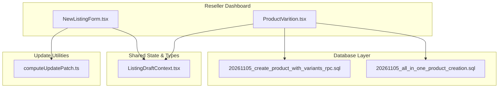
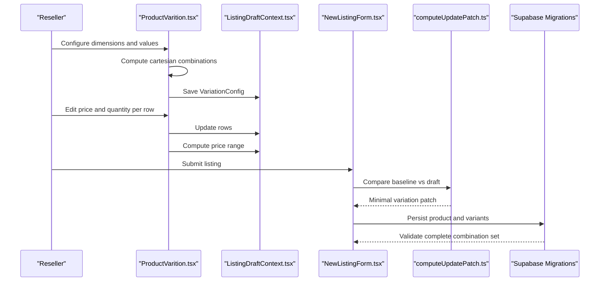
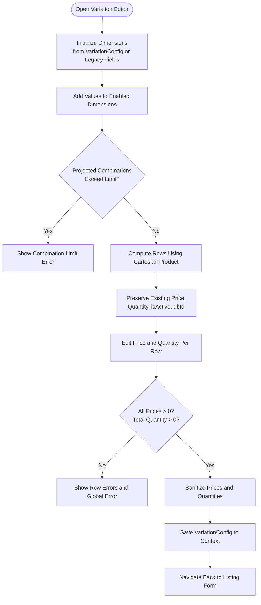
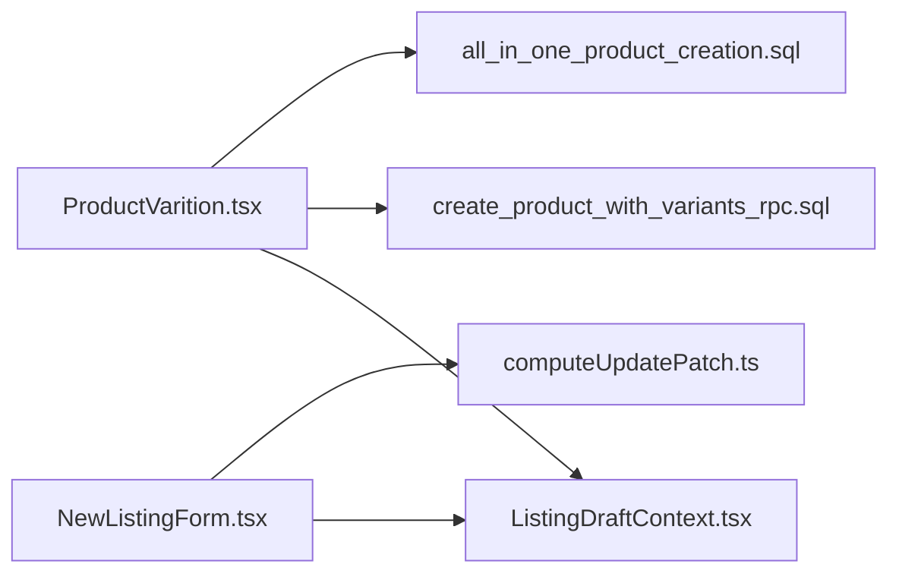

# Variant Grid Management

<cite>
**Referenced Files in This Document**
- [ListingDraftContext.tsx](file://components/reseller/context/ListingDraftContext.tsx)
- [productVarition.tsx](file://components/reseller/components/productVarition.tsx)
- [NewListingForm.tsx](file://components/reseller/components/NewListingForm.tsx)
- [computeUpdatePatch.ts](file://src/utils/computeUpdatePatch.ts)
- [20261105_create_product_with_variants_rpc.sql](file://supabase/migrations/20261105_create_product_with_variants_rpc.sql)
- [20261105_all_in_one_product_creation.sql](file://supabase/migrations/20261105_all_in_one_product_creation.sql)
</cite>

## Table of Contents
1. [Introduction](#introduction)
2. [Project Structure](#project-structure)
3. [Core Components](#core-components)
4. [Architecture Overview](#architecture-overview)
5. [Detailed Component Analysis](#detailed-component-analysis)
6. [Dependency Analysis](#dependency-analysis)
7. [Performance Considerations](#performance-considerations)
8. [Troubleshooting Guide](#troubleshooting-guide)
9. [Conclusion](#conclusion)

## Introduction
This document explains the variant grid management system used to display and edit all possible product combinations. It focuses on:
- The `VariationRow` structure and how it represents a single combination row.
- Row computation using cartesian products across enabled dimensions.
- Preservation of existing prices, quantities, active states, and database identifiers when dimensions change.
- The grid interface for editing per-variant price and quantity.
- Bulk operations such as saving validated variation configurations.
- Real-time price range calculation from combination rows.
- Handling complex variant matrices, large combination sets, and validation rules for pricing and inventory.

The implementation spans React components, a shared draft context, a patch computation utility, and server-side validation migrations that enforce complete and valid variant sets.

## Project Structure
The variant grid is primarily implemented in the reseller dashboard area:
- Shared types and utilities live in the listing draft context.
- The dedicated variation editor component manages dimension configuration, value management, image assignment, and row-level edits.
- The main listing form initializes existing product data into the same variation model.
- A patch utility computes minimal updates between baseline and draft state.
- Database migrations validate and persist complete cartesian combinations with strict constraints.

**Diagram sources**
- [NewListingForm.tsx:336-430](file://components/reseller/components/NewListingForm.tsx#L336-L430)
- [productVarition.tsx:98-116](file://components/reseller/components/productVarition.tsx#L98-L116)
- [ListingDraftContext.tsx:34-76](file://components/reseller/context/ListingDraftContext.tsx#L34-L76)
- [computeUpdatePatch.ts:195-564](file://src/utils/computeUpdatePatch.ts#L195-L564)
- [20261105_create_product_with_variants_rpc.sql:727-804](file://supabase/migrations/20261105_create_product_with_variants_rpc.sql#L727-L804)
- [20261105_all_in_one_product_creation.sql:840-917](file://supabase/migrations/20261105_all_in_one_product_creation.sql#L840-L917)

**Section sources**
- [ListingDraftContext.tsx:34-76](file://components/reseller/context/ListingDraftContext.tsx#L34-L76)
- [productVarition.tsx:98-116](file://components/reseller/components/productVarition.tsx#L98-L116)
- [NewListingForm.tsx:336-430](file://components/reseller/components/NewListingForm.tsx#L336-L430)
- [computeUpdatePatch.ts:195-564](file://src/utils/computeUpdatePatch.ts#L195-L564)

## Core Components
This section documents the primary data structures and core logic driving the variant grid.

### VariationDimension
Represents one variation axis, such as Color or Size. It includes:
- A stable identifier.
- A human-readable name.
- An enabled flag controlling whether the dimension participates in the cartesian product.
- A list of allowed values.
- Optional database identifiers and reference mappings for existing products.

Complexity considerations:
- Dimension enumeration is linear in the number of dimensions.
- Value iteration is linear in the total number of values across enabled dimensions.

**Section sources**
- [ListingDraftContext.tsx:34-42](file://components/reseller/context/ListingDraftContext.tsx#L34-L42)

### VariationRow
Represents one combination row in the grid. It includes:
- A normalized key derived from sorted attribute entries.
- Specialized color and size fields for convenience.
- A full attributes map describing the combination.
- Price and quantity fields that accept either numbers or empty strings during editing.
- Optional image, database identifier, and active-state flags.

Key behaviors:
- The normalized key ensures consistent matching even if attribute order changes.
- Empty string values allow users to clear inputs without losing row identity.
- Database identifiers enable update tracking for existing variants.

Complexity considerations:
- Key normalization sorts attribute keys; cost is O(k log k) where k is the number of attributes.
- Row mapping is O(n) over all generated combinations.

**Section sources**
- [ListingDraftContext.tsx:44-54](file://components/reseller/context/ListingDraftContext.tsx#L44-L54)
- [productVarition.tsx:243-266](file://components/reseller/components/productVarition.tsx#L243-L266)

### VariationConfig
Holds the complete variation definition, including:
- Dimensions.
- Image dimension selection.
- Per-value images.
- Rows representing all combinations.
- Legacy compatibility flags for color and size.

Usage:
- Saved by the variation editor after validation.
- Consumed by the listing form and patch computation.

Complexity considerations:
- Configuration serialization is proportional to the number of dimensions, values, and rows.

**Section sources**
- [ListingDraftContext.tsx:56-76](file://components/reseller/context/ListingDraftContext.tsx#L56-L76)
- [productVarition.tsx:765-777](file://components/reseller/components/productVarition.tsx#L765-L777)

### Cartesian Product Computation
The cartesian product function generates all combinations from enabled dimensions with non-empty value lists. It:
- Filters disabled dimensions.
- Returns an empty array if no enabled dimensions exist.
- Iteratively builds combinations by multiplying previous results with each new dimension’s values.

Complexity:
- Time complexity is O(c), where c is the total number of combinations.
- Space complexity is O(c) to store the resulting combination objects.

**Section sources**
- [productVarition.tsx:32-48](file://components/reseller/components/productVarition.tsx#L32-L48)

### Row Computation and Existing Data Preservation
The `computeRows` function rebuilds the grid whenever dimensions change. It:
- Builds lookup maps for existing quantity, price, database identifier, and active state keyed by normalized row key.
- Generates new combinations via cartesian product.
- Preserves existing values when the normalized key matches.
- Defaults missing values to zero quantity, empty price, and active state true.

This approach ensures that adding or removing dimensions does not discard user-entered data for unchanged combinations.

Complexity:
- Lookup construction is O(r) over previous rows.
- Combination generation is O(c).
- Final mapping is O(c).

**Section sources**
- [productVarition.tsx:225-267](file://components/reseller/components/productVarition.tsx#L225-L267)

### Real-Time Price Range Calculation
The context provides a helper that computes minimum and maximum prices from variation rows or raw price arrays. It:
- Accepts either `VariationRow[]` or `number[]`.
- Ignores empty, null, undefined, NaN, and non-positive prices.
- Returns null min/max when no valid prices are present.

Formatting helpers convert the computed range into a user-friendly label.

Complexity:
- Linear scan over provided rows or prices.
- Min/max computation is O(p) where p is the number of valid prices.

**Section sources**
- [ListingDraftContext.tsx:375-415](file://components/reseller/context/ListingDraftContext.tsx#L375-L415)
- [productVarition.tsx:395-397](file://components/reseller/components/productVarition.tsx#L395-L397)

## Architecture Overview
The variant grid follows a layered architecture:
- Presentation layer: React components render dimensions, values, and combination rows.
- State layer: Draft context holds shared configuration and computed ranges.
- Update layer: Patch utility compares baseline snapshots with current drafts.
- Persistence layer: Server-side RPCs and migrations validate and insert/update variants.

**Diagram sources**
- [productVarition.tsx:395-397](file://components/reseller/components/productVarition.tsx#L395-L397)
- [productVarition.tsx:765-777](file://components/reseller/components/productVarition.tsx#L765-L777)
- [NewListingForm.tsx:336-430](file://components/reseller/components/NewListingForm.tsx#L336-L430)
- [computeUpdatePatch.ts:417-554](file://src/utils/computeUpdatePatch.ts#L417-L554)
- [20261105_create_product_with_variants_rpc.sql:734-738](file://supabase/migrations/20261105_create_product_with_variants_rpc.sql#L734-L738)

## Detailed Component Analysis

### ProductVarition Component
The variation editor component is responsible for:
- Initializing dynamic dimensions from saved configuration or legacy color/size fields.
- Adding, removing, enabling, and disabling dimensions.
- Adding and removing dimension values with validation.
- Managing per-value images.
- Computing and preserving rows through dimension changes.
- Validating and saving variation configurations.

Key responsibilities:
- Dimension lifecycle management with error feedback.
- Combination limit enforcement to prevent excessively large grids.
- Row-level price and quantity editing with input sanitization.
- Saving sanitized rows and value images back to the draft context.

**Diagram sources**
- [productVarition.tsx:140-164](file://components/reseller/components/productVarition.tsx#L140-L164)
- [productVarition.tsx:400-485](file://components/reseller/components/productVarition.tsx#L400-L485)
- [productVarition.tsx:519-542](file://components/reseller/components/productVarition.tsx#L519-L542)
- [productVarition.tsx:630-677](file://components/reseller/components/productVarition.tsx#L630-L677)
- [productVarition.tsx:680-777](file://components/reseller/components/productVarition.tsx#L680-L777)

**Section sources**
- [productVarition.tsx:98-116](file://components/reseller/components/productVarition.tsx#L98-L116)
- [productVarition.tsx:140-164](file://components/reseller/components/productVarition.tsx#L140-L164)
- [productVarition.tsx:225-279](file://components/reseller/components/productVarition.tsx#L225-L279)
- [productVarition.tsx:400-542](file://components/reseller/components/productVarition.tsx#L400-L542)
- [productVarition.tsx:630-777](file://components/reseller/components/productVarition.tsx#L630-L777)

### NewListingForm Integration
The listing form initializes existing product data into the variation model:
- Detects variant inventory mode.
- Maps product options to dimensions.
- Maps option values to dimension values.
- Reconstructs rows from existing variants, falling back to combination keys when needed.
- Stores value images and image dimension metadata.

This ensures that editing an existing product loads the same grid shape and preserves existing variant data.

**Section sources**
- [NewListingForm.tsx:336-430](file://components/reseller/components/NewListingForm.tsx#L336-L430)
- [NewListingForm.tsx:771-800](file://components/reseller/components/NewListingForm.tsx#L771-L800)

### Patch Computation for Variations
The patch utility compares baseline snapshots with draft state and produces minimal updates:
- Tracks option renames, value renames, new values, and removed values.
- Compares variant prices and quantities by database identifier or normalized key.
- Identifies newly created combinations and deactivated variants.
- Marks the variations section dirty only when actual changes exist.

This enables efficient server updates without rewriting unchanged data.

**Section sources**
- [computeUpdatePatch.ts:417-554](file://src/utils/computeUpdatePatch.ts#L417-L554)

### Database Validation and Persistence
Server-side migrations enforce robust variant creation:
- Verify that the number of submitted combinations equals the expected cartesian product count.
- Validate selling price greater than zero.
- Validate quantity as a non-negative integer.
- Ensure each row specifies exactly the required number of option values.
- Normalize option names and values, reject unknown option values, and detect duplicate combinations.
- Insert product variants with SKU, combination key, price, and quantity.

These checks protect data integrity and ensure every product has a complete and valid variant matrix.

**Section sources**
- [20261105_create_product_with_variants_rpc.sql:734-804](file://supabase/migrations/20261105_create_product_with_variants_rpc.sql#L734-L804)
- [20261105_all_in_one_product_creation.sql:847-917](file://supabase/migrations/20261105_all_in_one_product_creation.sql#L847-L917)

## Dependency Analysis
The variant grid depends on several layers:

Coupling and cohesion:
- `ProductVarition` is tightly coupled to `ListingDraftContext` for shared state and utilities.
- `NewListingForm` coordinates initialization and delegates patch computation to `computeUpdatePatch`.
- Database migrations are independent but define the contract for valid variant payloads.

Potential circular dependencies:
- No direct circular imports are evident among these files; dependencies flow from UI to context to utilities to database schema.

External integration points:
- Supabase client is used for fetching option images and interacting with storage.
- Next.js router is used for navigation between the variation editor and listing form.

**Diagram sources**
- [productVarition.tsx:1-27](file://components/reseller/components/productVarition.tsx#L1-L27)
- [NewListingForm.tsx:27-50](file://components/reseller/components/NewListingForm.tsx#L27-L50)
- [computeUpdatePatch.ts:1-2](file://src/utils/computeUpdatePatch.ts#L1-L2)

**Section sources**
- [productVarition.tsx:1-27](file://components/reseller/components/productVarition.tsx#L1-L27)
- [NewListingForm.tsx:27-50](file://components/reseller/components/NewListingForm.tsx#L27-L50)
- [computeUpdatePatch.ts:1-2](file://src/utils/computeUpdatePatch.ts#L1-L2)

## Performance Considerations
- Combination explosion: The cartesian product grows multiplicatively with enabled dimensions and their value counts. The component enforces a maximum total combinations limit to avoid rendering extremely large grids.
- Row key normalization: Sorting attribute keys adds overhead; keep the number of attributes per variant reasonable.
- Price range computation: Scans all rows; consider memoizing or limiting recomputation when rows change frequently.
- Image handling: Per-value images are stored in memory; large galleries should be paginated or lazy-loaded to reduce memory pressure.
- Patch computation: Only changed sections are marked dirty; this minimizes network payload and server work.

Recommendations:
- Keep the number of enabled dimensions small.
- Limit values per dimension to practical sizes.
- Use bulk operations for price and quantity updates where possible.
- Debounce heavy computations if real-time previews become expensive.

[No sources needed since this section provides general guidance]

## Troubleshooting Guide
Common issues and resolutions:

- Missing dimensions or values:
  - Ensure at least one enabled dimension has values before saving.
  - The component shows a global error when dimensions are incomplete.

- Invalid prices:
  - Every row must have a price greater than zero.
  - Input validation rejects malformed decimal strings and excessively large values.

- Zero total quantity:
  - At least one combination must have a positive quantity.
  - The save handler validates the sum across all rows.

- Combination limit exceeded:
  - Adding a value may exceed the maximum allowed combinations.
  - The component prevents adding values that would breach the limit.

- Existing product structure locked:
  - For existing products with variations, dimension structure is locked to preserve SKU integrity.
  - Removing or disabling dimensions is restricted.

- Option images not loading:
  - The component fetches option images once per product in edit mode.
  - Errors are captured and reported via section state.

**Section sources**
- [productVarition.tsx:400-485](file://components/reseller/components/productVarition.tsx#L400-L485)
- [productVarition.tsx:519-542](file://components/reseller/components/productVarition.tsx#L519-L542)
- [productVarition.tsx:630-777](file://components/reseller/components/productVarition.tsx#L630-L777)
- [productVarition.tsx:287-354](file://components/reseller/components/productVarition.tsx#L287-L354)

## Conclusion
The variant grid management system provides a robust, user-friendly interface for managing complex product combinations. It uses cartesian product computation to generate all possible variants, preserves existing data during dimension changes, and enforces strict validation both on the client and server. The design separates concerns across presentation, shared state, patch computation, and database persistence, making it maintainable and scalable within the limits of practical combination sizes.

For complex variant matrices:
- Prefer fewer, well-chosen dimensions.
- Keep value lists concise.
- Use bulk editing patterns for price and quantity.
- Rely on the built-in validation and server-side safeguards to maintain data integrity.

[No sources needed since this section summarizes without analyzing specific files]