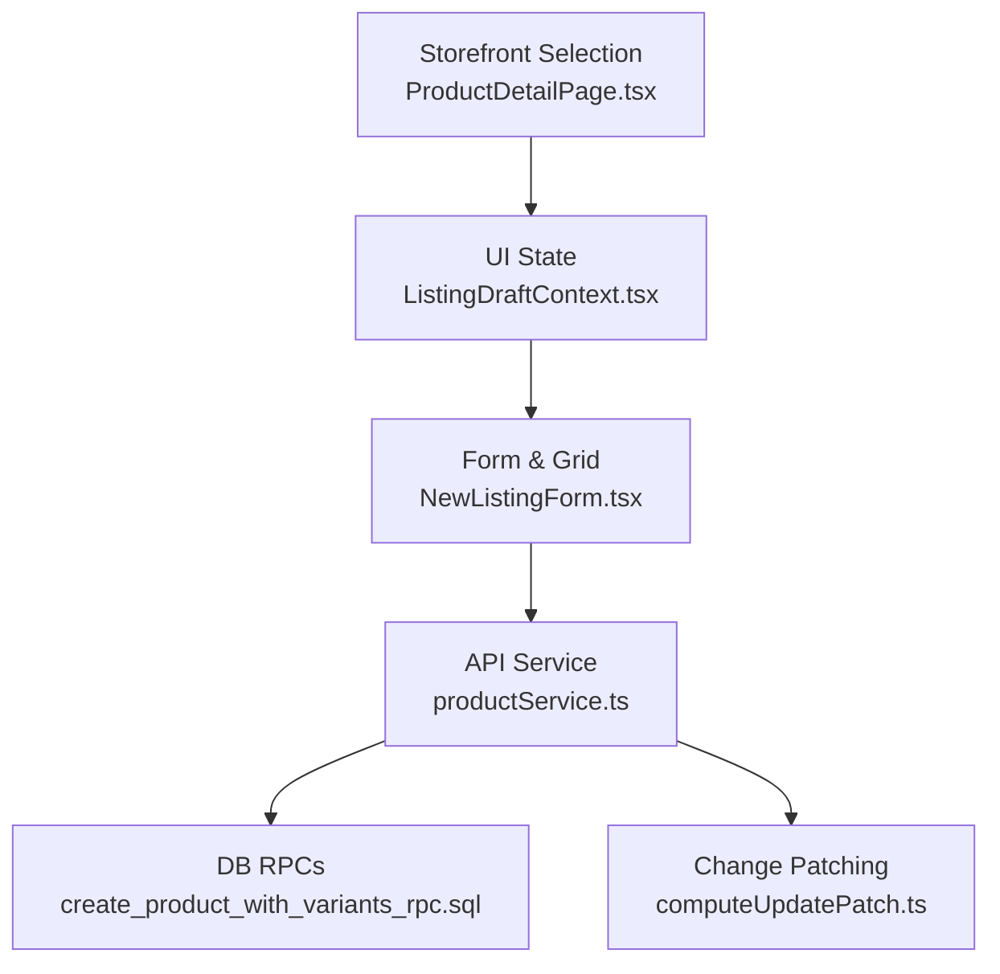
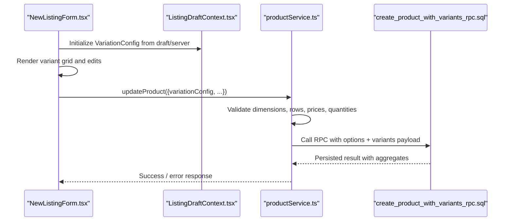
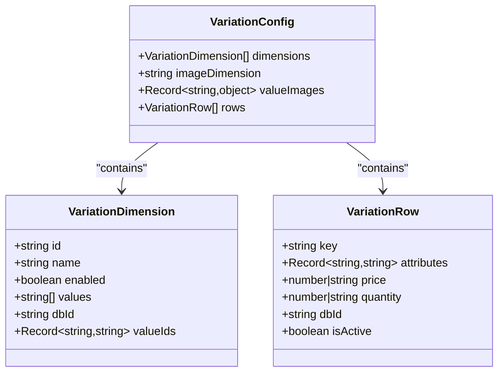
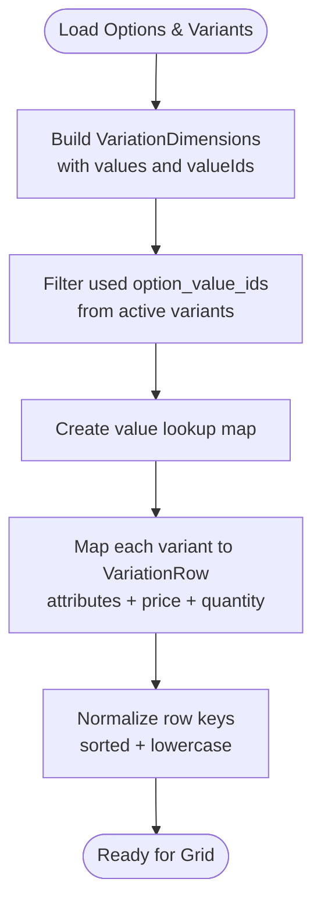
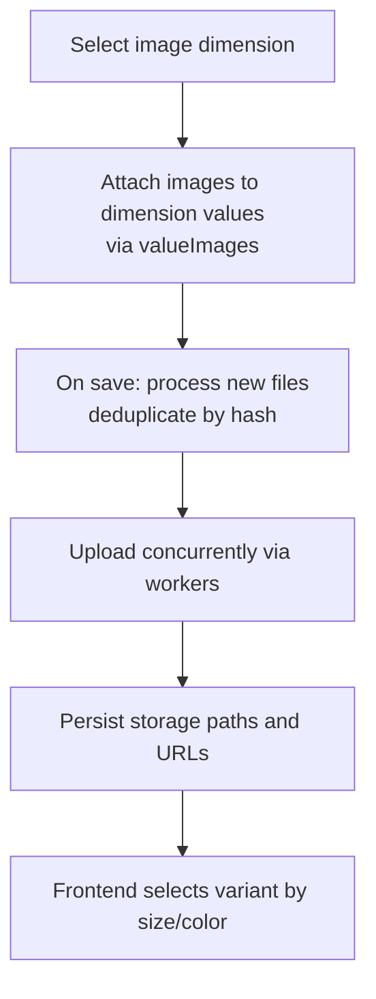
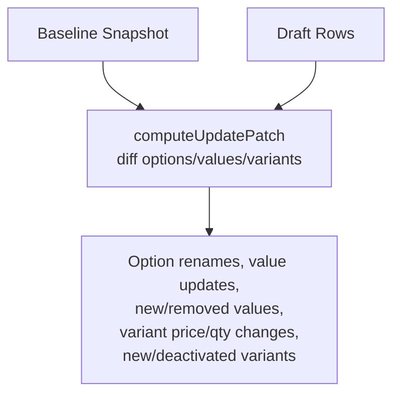
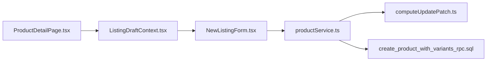

# Variant Management System

<cite>
**Referenced Files in This Document**
- [ListingDraftContext.tsx](file://components/reseller/context/ListingDraftContext.tsx)
- [NewListingForm.tsx](file://components/reseller/components/NewListingForm.tsx)
- [productService.ts](file://src/api/productService.ts)
- [computeUpdatePatch.ts](file://src/utils/computeUpdatePatch.ts)
- [20261105_create_product_with_variants_rpc.sql](file://supabase/migrations/20261105_create_product_with_variants_rpc.sql)
- [20261105_all_in_one_product_creation.sql](file://supabase/migrations/20261105_all_in_one_product_creation.sql)
- [ProductDetailPage.tsx](file://components/ProductDetailPage.tsx)
</cite>

## Table of Contents
1. [Introduction](#introduction)
2. [Project Structure](#project-structure)
3. [Core Components](#core-components)
4. [Architecture Overview](#architecture-overview)
5. [Detailed Component Analysis](#detailed-component-analysis)
6. [Dependency Analysis](#dependency-analysis)
7. [Performance Considerations](#performance-considerations)
8. [Troubleshooting Guide](#troubleshooting-guide)
9. [Conclusion](#conclusion)

## Introduction
This document explains the variant management system that enables multi-dimensional product options such as size and color, with per-variant pricing, inventory tracking, and option images. It covers the data model (VariationConfig), dimension and value mapping, variant rows, persistence and validation rules, and how the UI composes a grid for managing combinations. It also includes guidance for creating size/color combinations, managing variant-specific images, handling variant pricing strategies, bulk operations, and performance considerations for large variant sets.

## Project Structure
The variant system spans client-side state, form orchestration, API validation and persistence, and database RPCs:
- Client state and types: ListingDraftContext.tsx
- Form orchestration and grid: NewListingForm.tsx
- API service and payload building: productService.ts
- Change detection and patching: computeUpdatePatch.ts
- Database RPCs and constraints: 20261105_create_product_with_variants_rpc.sql, 20261105_all_in_one_product_creation.sql
- Storefront selection logic: ProductDetailPage.tsx

**Diagram sources**
- [ListingDraftContext.tsx:34-76](file://components/reseller/context/ListingDraftContext.tsx#L34-L76)
- [NewListingForm.tsx:336-445](file://components/reseller/components/NewListingForm.tsx#L336-L445)
- [productService.ts:1200-1500](file://src/api/productService.ts#L1200-L1500)
- [20261105_create_product_with_variants_rpc.sql:104-200](file://supabase/migrations/20261105_create_product_with_variants_rpc.sql#L104-L200)
- [computeUpdatePatch.ts:460-541](file://src/utils/computeUpdatePatch.ts#L460-L541)
- [ProductDetailPage.tsx:527-548](file://components/ProductDetailPage.tsx#L527-L548)

**Section sources**
- [ListingDraftContext.tsx:34-76](file://components/reseller/context/ListingDraftContext.tsx#L34-L76)
- [NewListingForm.tsx:336-445](file://components/reseller/components/NewListingForm.tsx#L336-L445)
- [productService.ts:1200-1500](file://src/api/productService.ts#L1200-L1500)
- [20261105_create_product_with_variants_rpc.sql:104-200](file://supabase/migrations/20261105_create_product_with_variants_rpc.sql#L104-L200)
- [computeUpdatePatch.ts:460-541](file://src/utils/computeUpdatePatch.ts#L460-L541)
- [ProductDetailPage.tsx:527-548](file://components/ProductDetailPage.tsx#L527-L548)

## Core Components
- VariationDimension: Represents a variation axis (e.g., Size, Color). Includes enabled flag, values list, and optional DB identifiers and value-to-ID mappings.
- VariationRow: Represents one combination of dimension values with price, quantity, and optional image reference.
- VariationConfig: Holds dimensions, an optional image-dimension selector, value-level images, and the grid of rows. Also supports legacy fields for backward compatibility.

Key responsibilities:
- Dimensions define the axes and allowed values.
- Rows define concrete combinations and their per-variant attributes (price, stock).
- ValueImages maps normalized dimension+value keys to uploaded or existing images.

**Section sources**
- [ListingDraftContext.tsx:34-76](file://components/reseller/context/ListingDraftContext.tsx#L34-L76)

## Architecture Overview
The system follows a layered flow:
1. Data loading and normalization populate VariationConfig from server data.
2. The form renders a grid where sellers edit prices and quantities per row.
3. On save, productService validates constraints and builds RPC payloads for options and variants.
4. Database RPCs enforce business rules, persist changes, and update aggregated product metrics.

**Diagram sources**
- [NewListingForm.tsx:771-839](file://components/reseller/components/NewListingForm.tsx#L771-L839)
- [productService.ts:1200-1500](file://src/api/productService.ts#L1200-L1500)
- [20261105_create_product_with_variants_rpc.sql:104-200](file://supabase/migrations/20261105_create_product_with_variants_rpc.sql#L104-L200)

## Detailed Component Analysis

### VariationConfig and Data Model
- VariationDimension:
  - id/dbId: UI and DB identifiers
  - name: Dimension label
  - enabled: Whether this dimension participates in variants
  - values: List of allowed values
  - valueIds: Mapping from value string to DB ID
- VariationRow:
  - key: Normalized stable key for matching across saves
  - attributes: Map of dimension names to selected values
  - price/quantity: Per-variant selling price and stock
  - dbId/isActive: Persistence and lifecycle flags
- VariationConfig:
  - dimensions: Array of VariationDimension
  - imageDimension: Which dimension’s values carry images
  - valueImages: Map of normalized keys to image metadata
  - rows: Array of VariationRow

Complexity notes:
- Row key normalization ensures stable matching across edits and saves.
- valueImages uses a normalized key combining dimension name and value for consistent lookup.

**Section sources**
- [ListingDraftContext.tsx:34-76](file://components/reseller/context/ListingDraftContext.tsx#L34-L76)
- [NewListingForm.tsx:336-445](file://components/reseller/components/NewListingForm.tsx#L336-L445)

**Diagram sources**
- [ListingDraftContext.tsx:34-76](file://components/reseller/context/ListingDraftContext.tsx#L34-L76)

### Dimension Management and Value Mapping
- Loading:
  - Options are mapped into VariationDimension entries with values and valueIds.
  - Used value IDs are filtered based on active variants to keep only relevant values.
- Mapping:
  - A value lookup map connects DB option_value_ids to human-readable dimension/value pairs.
  - For legacy data, combination_key is parsed to reconstruct attributes when needed.
- Normalization:
  - Keys are built by sorting attribute entries and lowercasing to ensure deterministic matching.

**Diagram sources**
- [NewListingForm.tsx:771-839](file://components/reseller/components/NewListingForm.tsx#L771-L839)
- [NewListingForm.tsx:336-445](file://components/reseller/components/NewListingForm.tsx#L336-L445)

**Section sources**
- [NewListingForm.tsx:771-839](file://components/reseller/components/NewListingForm.tsx#L771-L839)
- [NewListingForm.tsx:336-445](file://components/reseller/components/NewListingForm.tsx#L336-L445)

### Variant Pricing and Inventory Strategies
- Validation:
  - Each row must have a valid positive selling price.
  - Each row must have a non-negative integer quantity.
  - Total stock across all variants must be greater than zero.
- Aggregation:
  - After persistence, the database computes min/max selling price and total variant quantity, updating cached columns on the product.

Practical implications:
- Sellers can set different prices per combination (e.g., larger sizes cost more).
- Stock can be tracked at the variant level; total stock must remain positive.

**Section sources**
- [productService.ts:1245-1277](file://src/api/productService.ts#L1245-L1277)
- [20261105_create_product_with_variants_rpc.sql:857-874](file://supabase/migrations/20261105_create_product_with_variants_rpc.sql#L857-L874)

### Managing Variant-Specific Images
- Image dimension:
  - One dimension can be designated to carry images (e.g., Color).
- Value images:
  - valueImages maps normalized keys (dimension::value) to image metadata.
  - During save, new files are deduplicated by SHA-256 and uploaded concurrently; existing references are reused.
- Display:
  - The storefront selects variants based on selected size and color, using variant attributes and color_id.

**Diagram sources**
- [productService.ts:1392-1468](file://src/api/productService.ts#L1392-L1468)
- [ProductDetailPage.tsx:527-548](file://components/ProductDetailPage.tsx#L527-L548)

**Section sources**
- [productService.ts:1392-1468](file://src/api/productService.ts#L1392-L1468)
- [ProductDetailPage.tsx:527-548](file://components/ProductDetailPage.tsx#L527-L548)

### Variant Grid Interface and Bulk Operations
- Grid rendering:
  - Rows are derived from saved variants, enriched with attributes and special shortcuts for color/size.
  - Price and quantity are editable per row.
- Bulk operations:
  - The change detection layer compares base snapshots with draft rows to compute minimal patches for options, values, and variants.
  - It tracks renames, new/removed values, updated prices/quantities, new combinations, and deactivated variants.

**Diagram sources**
- [computeUpdatePatch.ts:460-541](file://src/utils/computeUpdatePatch.ts#L460-L541)

**Section sources**
- [NewListingForm.tsx:771-839](file://components/reseller/components/NewListingForm.tsx#L771-L839)
- [computeUpdatePatch.ts:460-541](file://src/utils/computeUpdatePatch.ts#L460-L541)

### Creating Size/Color Combinations
- Define dimensions:
  - Add Size and Color dimensions with allowed values.
- Create rows:
  - For each desired combination (e.g., S/Red, M/Blue), add a row and set price and quantity.
- Attach images:
  - If Color is the image dimension, attach images to specific colors.
- Save:
  - The system validates and persists options and variants, then updates product aggregates.

Operational tips:
- Use consistent naming for values to simplify mapping and avoid duplicates.
- Ensure at least one row has positive stock to satisfy validation.

**Section sources**
- [NewListingForm.tsx:336-445](file://components/reseller/components/NewListingForm.tsx#L336-L445)
- [productService.ts:1245-1277](file://src/api/productService.ts#L1245-L1277)

## Dependency Analysis
- UI components depend on context for VariationConfig and helpers like getPriceRange/formatPriceRange.
- NewListingForm orchestrates loading, editing, and saving variations.
- productService enforces constraints and constructs RPC payloads for options and variants.
- Database RPCs validate counts, ensure totals, and update cached aggregates.
- computeUpdatePatch provides efficient diffing between baseline and draft states.

**Diagram sources**
- [ListingDraftContext.tsx:34-76](file://components/reseller/context/ListingDraftContext.tsx#L34-L76)
- [NewListingForm.tsx:771-839](file://components/reseller/components/NewListingForm.tsx#L771-L839)
- [productService.ts:1200-1500](file://src/api/productService.ts#L1200-L1500)
- [computeUpdatePatch.ts:460-541](file://src/utils/computeUpdatePatch.ts#L460-L541)
- [20261105_create_product_with_variants_rpc.sql:104-200](file://supabase/migrations/20261105_create_product_with_variants_rpc.sql#L104-L200)
- [ProductDetailPage.tsx:527-548](file://components/ProductDetailPage.tsx#L527-L548)

**Section sources**
- [productService.ts:1200-1500](file://src/api/productService.ts#L1200-L1500)
- [20261105_all_in_one_product_creation.sql:393-423](file://supabase/migrations/20261105_all_in_one_product_creation.sql#L393-L423)

## Performance Considerations
- Limits:
  - Maximum 5 enabled dimensions.
  - Maximum 20 values per dimension.
  - Maximum 100 variation combinations.
- Concurrency:
  - Image uploads use concurrent workers limited by UPLOAD_CONCURRENCY to balance throughput and resource usage.
- Deduplication:
  - New images are hashed and deduplicated before upload to reduce redundant storage writes.
- Aggregates:
  - Database computes min/max price and total quantity once per product to avoid repeated calculations.

Recommendations:
- Keep dimension values concise and normalized.
- Avoid excessive combinations; consider splitting products if necessary.
- Batch image uploads and rely on built-in concurrency controls.

**Section sources**
- [productService.ts:1245-1277](file://src/api/productService.ts#L1245-L1277)
- [productService.ts:1421-1468](file://src/api/productService.ts#L1421-L1468)
- [20261105_create_product_with_variants_rpc.sql:857-874](file://supabase/migrations/20261105_create_product_with_variants_rpc.sql#L857-L874)

## Troubleshooting Guide
Common errors and resolutions:
- Too many dimensions: Reduce enabled dimensions to 5 or fewer.
- Too many values per dimension: Limit each dimension to 20 values.
- Missing or invalid row data: Ensure every variant row has a positive price and non-negative integer quantity.
- Zero total stock: At least one variant must have stock > 0.
- Image upload failures: Check storage configuration and permissions; the service cleans up partial uploads on failure.

Where to look:
- Frontend validation and error messages in productService.ts.
- Database validations in RPC migrations.

**Section sources**
- [productService.ts:1245-1277](file://src/api/productService.ts#L1245-L1277)
- [20261105_create_product_with_variants_rpc.sql:304-307](file://supabase/migrations/20261105_create_product_with_variants_rpc.sql#L304-L307)
- [20261105_all_in_one_product_creation.sql:420-423](file://supabase/migrations/20261105_all_in_one_product_creation.sql#L420-L423)

## Conclusion
The variant management system provides a robust framework for modeling multi-dimensional product options with per-variant pricing and inventory. It balances flexibility with strict validation and performance safeguards. By leveraging VariationConfig, normalized keys, and efficient change detection, it supports complex configurations while maintaining a responsive user experience. Properly sizing dimensions and combinations, and using the provided image and pricing features, will help sellers manage catalogs effectively at scale.