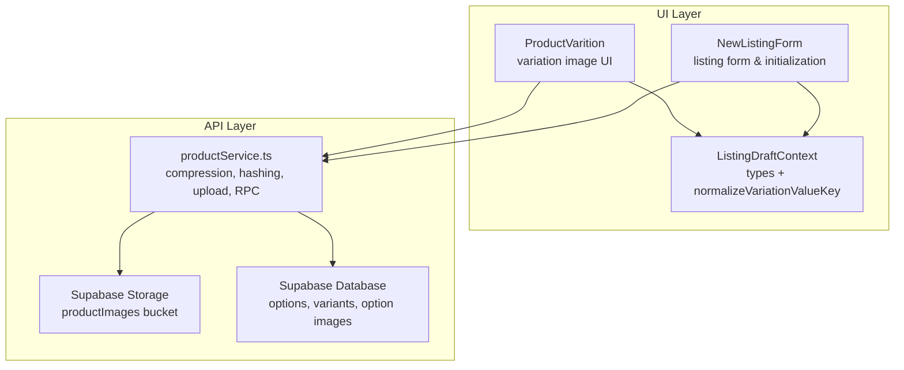
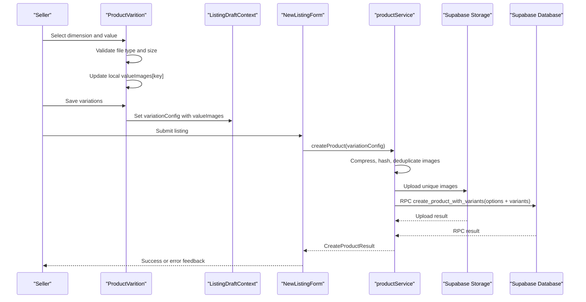
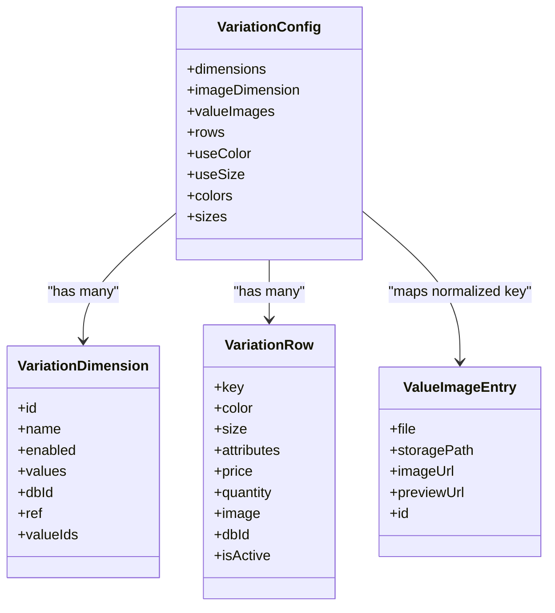
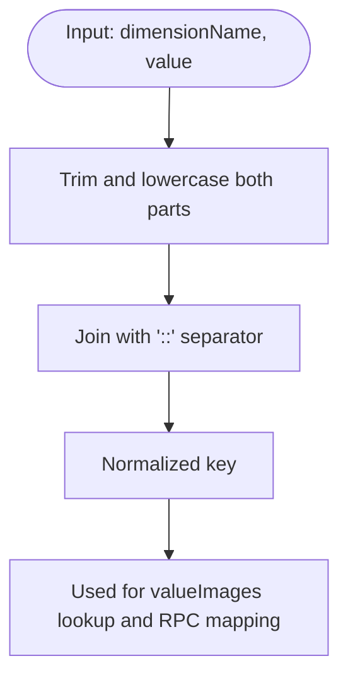
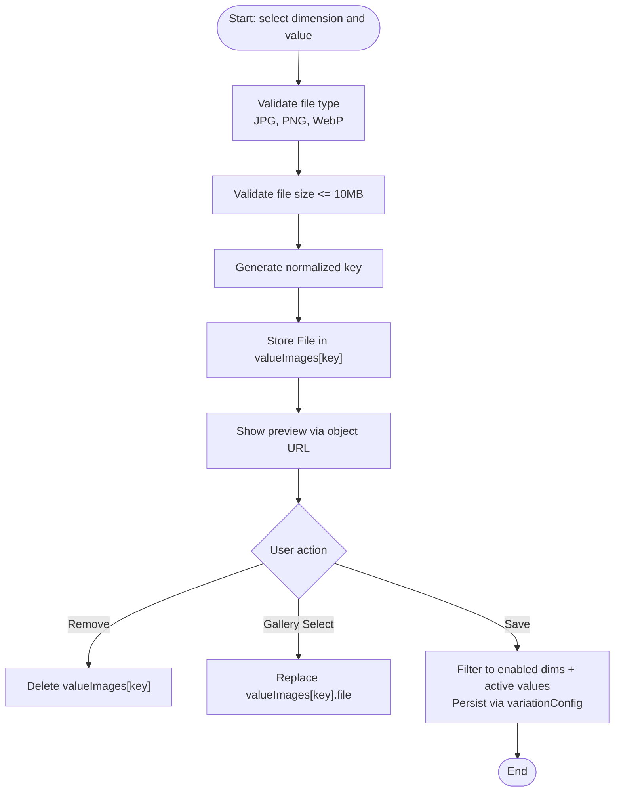
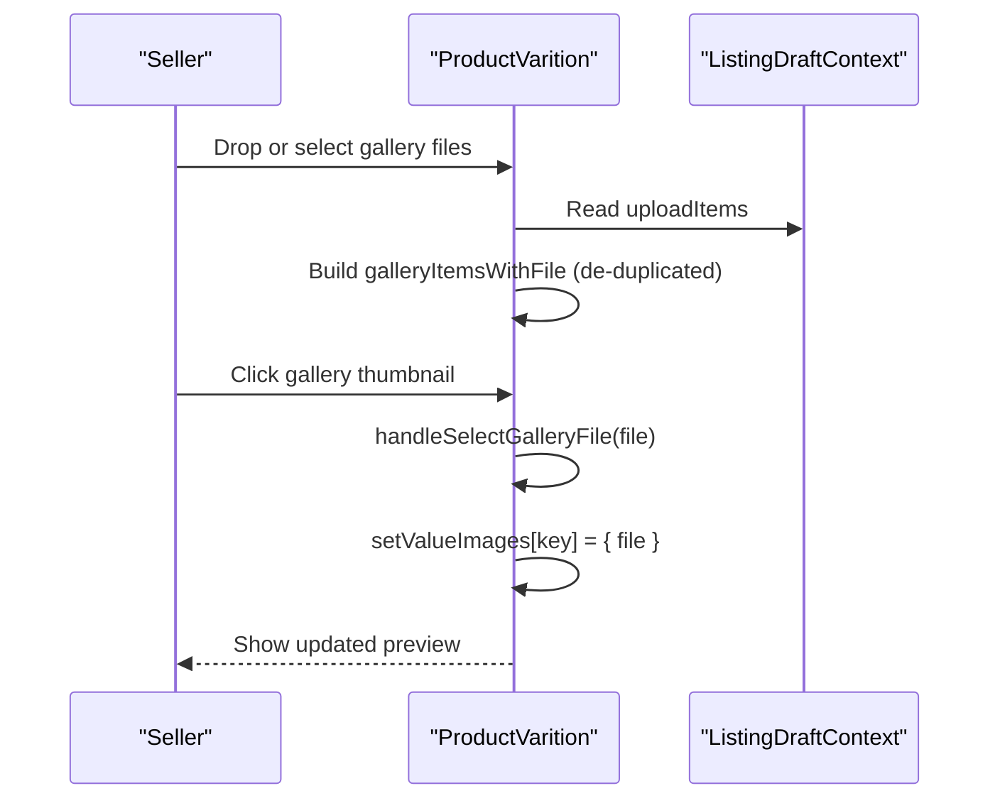
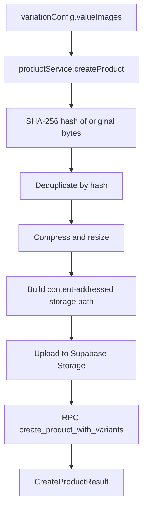
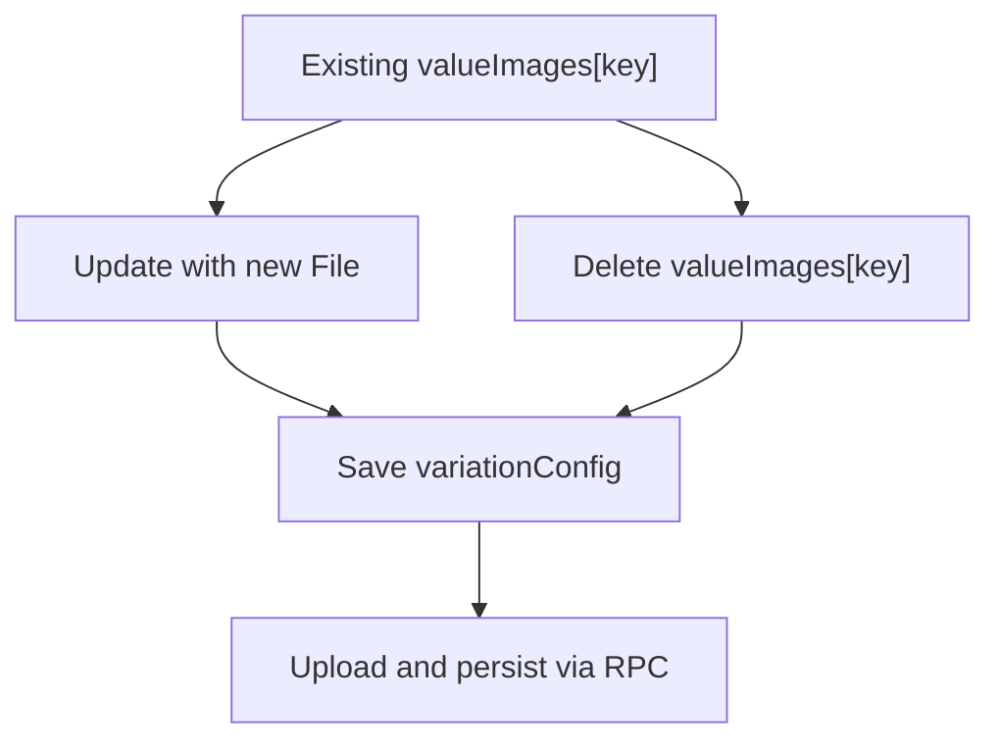
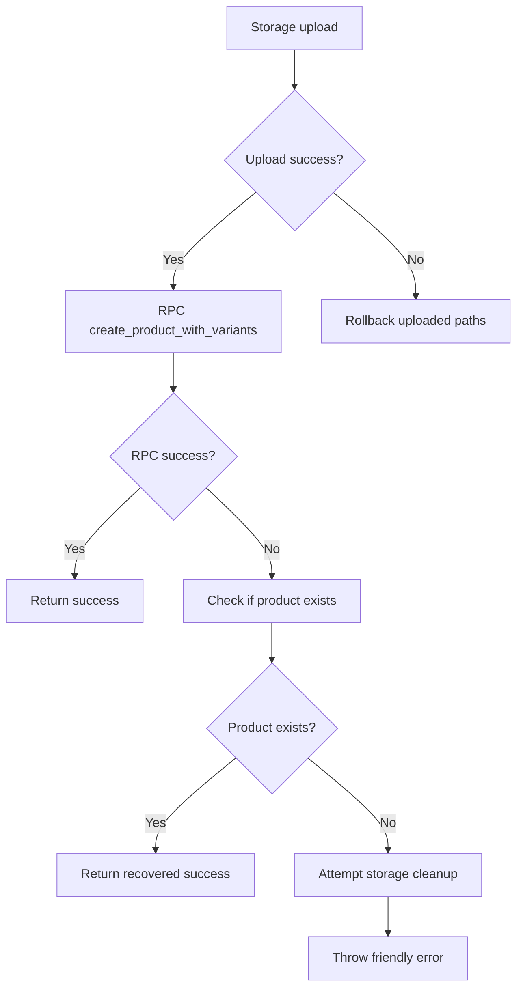
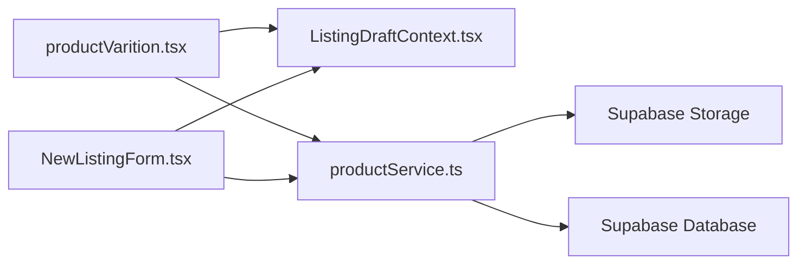

# Variation Image Management

<cite>
**Referenced Files in This Document**
- [productVarition.tsx](file://components/reseller/components/productVarition.tsx)
- [ListingDraftContext.tsx](file://components/reseller/context/ListingDraftContext.tsx)
- [NewListingForm.tsx](file://components/reseller/components/NewListingForm.tsx)
- [productService.ts](file://src/api/productService.ts)
- [useObjectUrl.ts](file://src/hooks/useObjectUrl.ts)
</cite>

## Table of Contents
1. [Introduction](#introduction)
2. [Project Structure](#project-structure)
3. [Core Components](#core-components)
4. [Architecture Overview](#architecture-overview)
5. [Detailed Component Analysis](#detailed-component-analysis)
6. [Dependency Analysis](#dependency-analysis)
7. [Performance Considerations](#performance-considerations)
8. [Troubleshooting Guide](#troubleshooting-guide)
9. [Conclusion](#conclusion)

## Introduction
This document explains the variation image management system that associates images with specific dimension values such as color and size. It covers:
- The `valueImages` structure used to map normalized variation keys to image data.
- The image upload workflow, including gallery selection, file validation, preview handling, and persistence.
- The relationship between images and normalized variation keys.
- Storage paths, optimization, caching, and error handling for failed uploads.

The system is implemented across a dedicated variation UI component, a shared listing draft context, a main listing form, and an API service responsible for compression, hashing, storage uploads, and database persistence.

## Project Structure
The variation image feature spans four primary areas:
- Variation UI: manages per-dimension value image selection, previews, and saving.
- Listing Draft Context: defines shared types, normalization logic, and global draft state.
- Main Listing Form: initializes variation configuration from existing products and displays value thumbnails.
- Product Service: handles image processing, deduplication, storage upload, RPC payload construction, and cleanup.

**Diagram sources**
- [productVarition.tsx:179-220](file://components/reseller/components/productVarition.tsx#L179-L220)
- [ListingDraftContext.tsx:56-84](file://components/reseller/context/ListingDraftContext.tsx#L56-L84)
- [NewListingForm.tsx:351-430](file://components/reseller/components/NewListingForm.tsx#L351-L430)
- [productService.ts:302-493](file://src/api/productService.ts#L302-L493)

**Section sources**
- [productVarition.tsx:179-220](file://components/reseller/components/productVarition.tsx#L179-L220)
- [ListingDraftContext.tsx:56-84](file://components/reseller/context/ListingDraftContext.tsx#L56-L84)
- [NewListingForm.tsx:351-430](file://components/reseller/components/NewListingForm.tsx#L351-L430)
- [productService.ts:302-493](file://src/api/productService.ts#L302-L493)

## Core Components
- **Variation Image UI (`productVarition.tsx`)**
  - Manages local `valueImages` state keyed by normalized variation keys.
  - Provides dimension selector, active value tabs, single-image upload, gallery selection, remove actions, and save behavior.
  - Loads existing variation images from the database during edit mode.

- **Listing Draft Context (`ListingDraftContext.tsx`)**
  - Defines `VariationConfig`, including `dimensions`, `imageDimension`, `rows`, and `valueImages`.
  - Exposes `normalizeVariationValueKey`, which produces stable dictionary keys like `color::red` or `size::xl`.

- **Main Listing Form (`NewListingForm.tsx`)**
  - Builds initial `variationConfig` when editing existing products.
  - Reads `valueImages` from product options and maps them into the draft.
  - Displays small thumbnails for color and size values using `valueImages`.

- **Product Service (`productService.ts`)**
  - Validates, compresses, resizes, hashes, deduplicates, and uploads images.
  - Maps variation images to enabled dimensions and active values.
  - Uploads unique images concurrently and constructs RPC payloads for options and variants.
  - Handles errors and performs storage cleanup on failure.

**Section sources**
- [productVarition.tsx:179-220](file://components/reseller/components/productVarition.tsx#L179-L220)
- [productVarition.tsx:567-627](file://components/reseller/components/productVarition.tsx#L567-L627)
- [productVarition.tsx:738-777](file://components/reseller/components/productVarition.tsx#L738-L777)
- [ListingDraftContext.tsx:56-84](file://components/reseller/context/ListingDraftContext.tsx#L56-L84)
- [NewListingForm.tsx:351-430](file://components/reseller/components/NewListingForm.tsx#L351-L430)
- [NewListingForm.tsx:2471-2511](file://components/reseller/components/NewListingForm.tsx#L2471-L2511)
- [productService.ts:162-250](file://src/api/productService.ts#L162-L250)
- [productService.ts:437-493](file://src/api/productService.ts#L437-L493)

## Architecture Overview
The variation image flow connects user interactions in the variation UI to persistent storage and database records through a layered architecture.

**Diagram sources**
- [productVarition.tsx:567-627](file://components/reseller/components/productVarition.tsx#L567-L627)
- [productVarition.tsx:738-777](file://components/reseller/components/productVarition.tsx#L738-L777)
- [NewListingForm.tsx:351-430](file://components/reseller/components/NewListingForm.tsx#L351-L430)
- [productService.ts:302-493](file://src/api/productService.ts#L302-L493)
- [productService.ts:495-543](file://src/api/productService.ts#L495-L543)
- [productService.ts:545-631](file://src/api/productService.ts#L545-L631)

## Detailed Component Analysis

### Value Images Data Model
The `valueImages` structure maps normalized variation keys to image metadata. A key is generated by combining the dimension name and value in lowercase, separated by `::`.

**Diagram sources**
- [ListingDraftContext.tsx:34-76](file://components/reseller/context/ListingDraftContext.tsx#L34-L76)

**Section sources**
- [ListingDraftContext.tsx:56-84](file://components/reseller/context/ListingDraftContext.tsx#L56-L84)

### Normalized Variation Keys
The normalization function ensures consistent keys regardless of casing or whitespace. For example:
- Color red becomes `color::red`.
- Size XL becomes `size::xl`.

This key is used everywhere:
- Local `valueImages` mapping.
- Gallery tab rendering.
- Saving variation configuration.
- Building RPC options and variants.

**Diagram sources**
- [ListingDraftContext.tsx:82-84](file://components/reseller/context/ListingDraftContext.tsx#L82-L84)

**Section sources**
- [ListingDraftContext.tsx:82-84](file://components/reseller/context/ListingDraftContext.tsx#L82-L84)

### Variation Image Upload Workflow
The variation image workflow supports:
- Selecting a dimension.
- Selecting a value within that dimension.
- Uploading one image per value.
- Validating format and size.
- Previewing the selected image.
- Removing or replacing the image.
- Selecting an image from the gallery.
- Saving only images belonging to enabled dimensions and active values.

**Diagram sources**
- [productVarition.tsx:567-627](file://components/reseller/components/productVarition.tsx#L567-L627)
- [productVarition.tsx:738-777](file://components/reseller/components/productVarition.tsx#L738-L777)

**Section sources**
- [productVarition.tsx:567-627](file://components/reseller/components/productVarition.tsx#L567-L627)
- [productVarition.tsx:738-777](file://components/reseller/components/productVarition.tsx#L738-L777)

### Gallery Selection Interface
The gallery interface shows available uploaded files from the listing draft’s `uploadItems`. Users can pick one of these files to assign it to the currently selected dimension value.

Key behaviors:
- Only files are considered; URLs or blobs without a `File` are ignored.
- Duplicate files are de-duplicated by reference.
- Selected gallery file replaces the current `valueImages[key].file`.
- Warning messages appear if multiple files are dropped.

**Diagram sources**
- [productVarition.tsx:125-138](file://components/reseller/components/productVarition.tsx#L125-L138)
- [productVarition.tsx:618-627](file://components/reseller/components/productVarition.tsx#L618-L627)

**Section sources**
- [productVarition.tsx:125-138](file://components/reseller/components/productVarition.tsx#L125-L138)
- [productVarition.tsx:618-627](file://components/reseller/components/productVarition.tsx#L618-L627)

### File Validation Rules
Validation occurs before storing the image locally:
- Allowed MIME types: `image/jpeg`, `image/png`, `image/webp`.
- Maximum file size: 10MB.
- If multiple files are dropped, only the first is kept and a warning is shown.
- Invalid files do not update `valueImages`.

These rules prevent invalid or oversized images from entering the draft state.

**Section sources**
- [productVarition.tsx:567-596](file://components/reseller/components/productVarition.tsx#L567-L596)

### Relationship Between Images and Normalized Variation Keys
Each image is associated with a normalized key derived from:
- Dimension name: e.g., `Color`, `Size`.
- Dimension value: e.g., `Red`, `XL`.

Examples:
- Assigning an image to color red uses key `color::red`.
- Assigning an image to size xl uses key `size::xl`.

When saving:
- Only images for enabled dimensions and their active values are included.
- Existing persisted images are merged with new files.
- Legacy fallback fields are supported but the primary path uses `valueImages`.

**Section sources**
- [productVarition.tsx:738-777](file://components/reseller/components/productVarition.tsx#L738-L777)
- [productService.ts:453-493](file://src/api/productService.ts#L453-L493)

### Image Persistence Strategies
There are two layers of persistence:

1. **Browser Storage via Supabase Storage**
   - Images are compressed and resized.
   - Content-addressed paths use `{userId}/{productId}/{hash}.{ext}`.
   - Unique SHA-256 hashes avoid duplicate uploads.
   - Concurrency limit controls simultaneous uploads.
   - Failed uploads trigger cleanup of partially uploaded paths.

2. **Database Records via RPC**
   - Options include values with optional image references.
   - Variants include combination values, prices, and quantities.
   - The RPC call creates or updates products atomically.
   - Error handling includes network timeout recovery and storage cleanup.

**Diagram sources**
- [productService.ts:162-250](file://src/api/productService.ts#L162-L250)
- [productService.ts:397-435](file://src/api/productService.ts#L397-L435)
- [productService.ts:495-543](file://src/api/productService.ts#L495-L543)
- [productService.ts:545-631](file://src/api/productService.ts#L545-L631)

**Section sources**
- [productService.ts:162-250](file://src/api/productService.ts#L162-L250)
- [productService.ts:397-435](file://src/api/productService.ts#L397-L435)
- [productService.ts:495-543](file://src/api/productService.ts#L495-L543)
- [productService.ts:545-631](file://src/api/productService.ts#L545-L631)

### Examples: Assigning Images to Color and Size Combinations
Although images are attached to individual dimension values rather than full combinations, they are displayed alongside rows that represent combinations.

- Assigning an image to color red:
  - Select dimension `Color`.
  - Select value `Red`.
  - Upload or select a gallery image.
  - The key becomes `color::red`.

- Assigning an image to size xl:
  - Select dimension `Size`.
  - Select value `XL`.
  - Upload or select a gallery image.
  - The key becomes `size::xl`.

In the listing table, each row may show thumbnails for its color and size values by looking up `valueImages` using normalized keys.

**Section sources**
- [productVarition.tsx:1067-1151](file://components/reseller/components/productVarition.tsx#L1067-L1151)
- [NewListingForm.tsx:2471-2511](file://components/reseller/components/NewListingForm.tsx#L2471-L2511)

### Handling Image Updates
Updates follow a replace-and-save pattern:
- Replacing an image updates the same normalized key.
- Removing an image deletes the key from `valueImages`.
- On save, only entries for enabled dimensions and active values are preserved.
- Existing persisted images are retained unless explicitly removed.

**Diagram sources**
- [productVarition.tsx:598-627](file://components/reseller/components/productVarition.tsx#L598-L627)
- [productVarition.tsx:738-777](file://components/reseller/components/productVarition.tsx#L738-L777)

**Section sources**
- [productVarition.tsx:598-627](file://components/reseller/components/productVarition.tsx#L598-L627)
- [productVarition.tsx:738-777](file://components/reseller/components/productVarition.tsx#L738-L777)

### Managing Image Storage Paths
Storage paths are constructed using:
- User ID.
- Product ID.
- SHA-256 hash of the original file.
- Extension derived from compression output.

This approach ensures:
- Content addressing.
- Deduplication.
- Predictable public URLs.
- Safe deletion when no database rows reference the path.

**Section sources**
- [productService.ts:397-435](file://src/api/productService.ts#L397-L435)
- [productService.ts:46-94](file://src/api/productService.ts#L46-L94)

### Image Optimization and Caching Strategies
Optimization steps:
- Disallow SVG.
- Enforce 10MB maximum.
- Resize large images to a maximum dimension of 2000px.
- Convert to JPEG unless the original is PNG.
- Encode at high quality while reducing size.

Caching strategies:
- Browser object URLs for immediate previews.
- Supabase storage cache control headers for public URLs.
- Client-side de-duplication prevents redundant processing.

**Section sources**
- [productService.ts:162-250](file://src/api/productService.ts#L162-L250)
- [productService.ts:495-543](file://src/api/productService.ts#L495-L543)

### Error Handling for Failed Uploads
Error handling covers:
- Client-side validation warnings for invalid formats and oversized files.
- Storage upload failures with rollback of uploaded paths.
- RPC failures with friendly database error messages.
- Network timeout recovery checking whether the product was already created.
- Cleanup warnings logged when storage removal fails.

**Diagram sources**
- [productService.ts:495-543](file://src/api/productService.ts#L495-L543)
- [productService.ts:633-701](file://src/api/productService.ts#L633-L701)

**Section sources**
- [productService.ts:495-543](file://src/api/productService.ts#L495-L543)
- [productService.ts:633-701](file://src/api/productService.ts#L633-L701)

## Dependency Analysis
The variation image system has clear layering and dependencies:

Coupling and cohesion:
- `productVarition.tsx` depends on `ListingDraftContext.tsx` for types and normalization.
- `NewListingForm.tsx` depends on `ListingDraftContext.tsx` for initialization and display.
- Both UI components depend on `productService.ts` for persistence.
- `productService.ts` is the central coordination point for image processing and database operations.

Potential circular dependencies:
- None observed; dependencies flow from UI to context to API.

External integration points:
- Supabase storage bucket `productImages`.
- Supabase RPC functions for product creation and updates.

**Diagram sources**
- [productVarition.tsx:179-220](file://components/reseller/components/productVarition.tsx#L179-L220)
- [NewListingForm.tsx:351-430](file://components/reseller/components/NewListingForm.tsx#L351-L430)
- [productService.ts:302-493](file://src/api/productService.ts#L302-L493)

**Section sources**
- [productVarition.tsx:179-220](file://components/reseller/components/productVarition.tsx#L179-L220)
- [NewListingForm.tsx:351-430](file://components/reseller/components/NewListingForm.tsx#L351-L430)
- [productService.ts:302-493](file://src/api/productService.ts#L302-L493)

## Performance Considerations
- **Client-side preview**: Uses browser object URLs for fast previews without server round-trips.
- **Compression and resizing**: Reduces bandwidth and improves load times.
- **Content-addressed storage**: Prevents duplicate uploads and reduces storage waste.
- **Concurrent uploads**: Limits parallel uploads to balance throughput and stability.
- **De-duplication**: Avoids repeated compression and hashing for identical files.
- **Caching headers**: Improves CDN/browser caching for public image URLs.

[No sources needed since this section provides general guidance]

## Troubleshooting Guide
Common issues and resolutions:

- **Invalid image format**
  - Symptom: Warning message asking to select JPG, PNG, or WebP.
  - Cause: File MIME type not allowed.
  - Resolution: Convert the image to an allowed format.

- **Image too large**
  - Symptom: Warning message about exceeding 10MB.
  - Cause: File size exceeds client-side limit.
  - Resolution: Reduce file size before uploading.

- **Multiple files dropped**
  - Symptom: Warning that only the first file was kept.
  - Cause: Single-image-per-value rule.
  - Resolution: Upload one image at a time.

- **Missing variation image after reload**
  - Symptom: Image not visible when reopening the variation page.
  - Cause: Image not saved for enabled dimension and active value.
  - Resolution: Ensure the dimension is enabled and the value is present, then save variations.

- **Storage upload failure**
  - Symptom: Error indicating storage upload failed.
  - Cause: Network issue, permission denied, or bucket misconfiguration.
  - Resolution: Check internet connection, permissions, and storage bucket configuration.

- **RPC failure or missing function**
  - Symptom: Friendly error mentioning database function not found.
  - Cause: Migration script not executed.
  - Resolution: Run the required migration script in the Supabase SQL editor.

**Section sources**
- [productVarition.tsx:567-596](file://components/reseller/components/productVarition.tsx#L567-L596)
- [productService.ts:255-292](file://src/api/productService.ts#L255-L292)
- [productService.ts:633-701](file://src/api/productService.ts#L633-L701)

## Conclusion
The variation image management system provides a robust way to associate images with specific dimension values. It combines a clear UI workflow, strict validation, normalized key mapping, optimized storage, and resilient persistence. By separating concerns across the variation UI, listing draft context, main listing form, and product service, the system remains maintainable and scalable. Proper error handling, cleanup, and caching ensure a reliable experience for sellers managing product variations.

[No sources needed since this section summarizes without analyzing specific files]