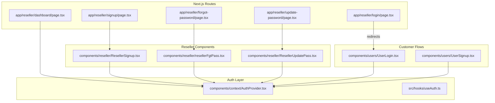
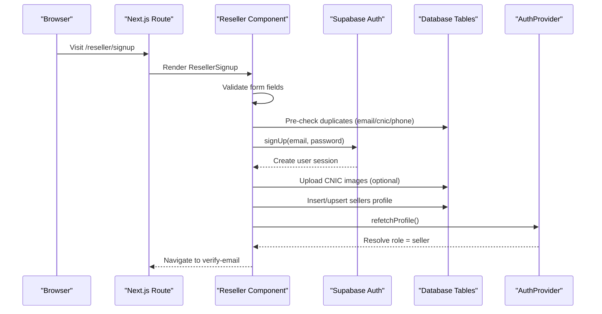
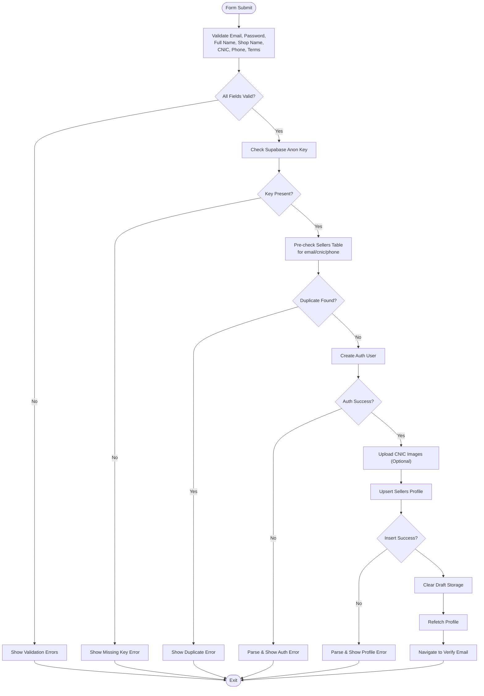
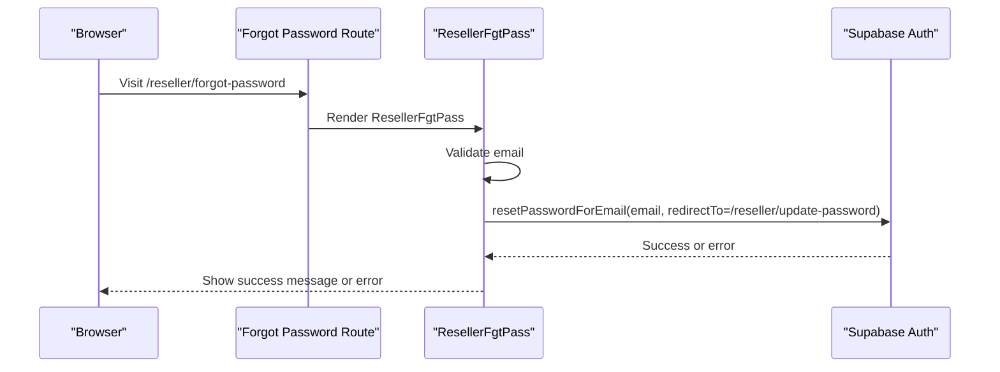
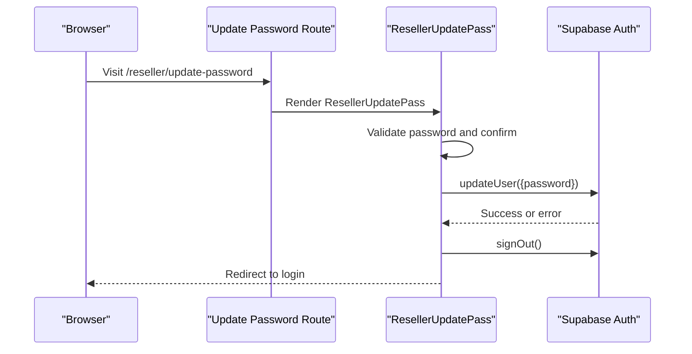
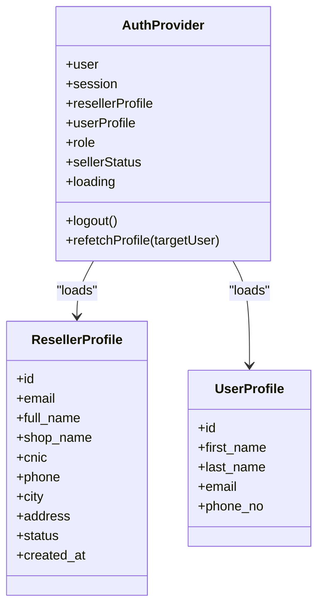
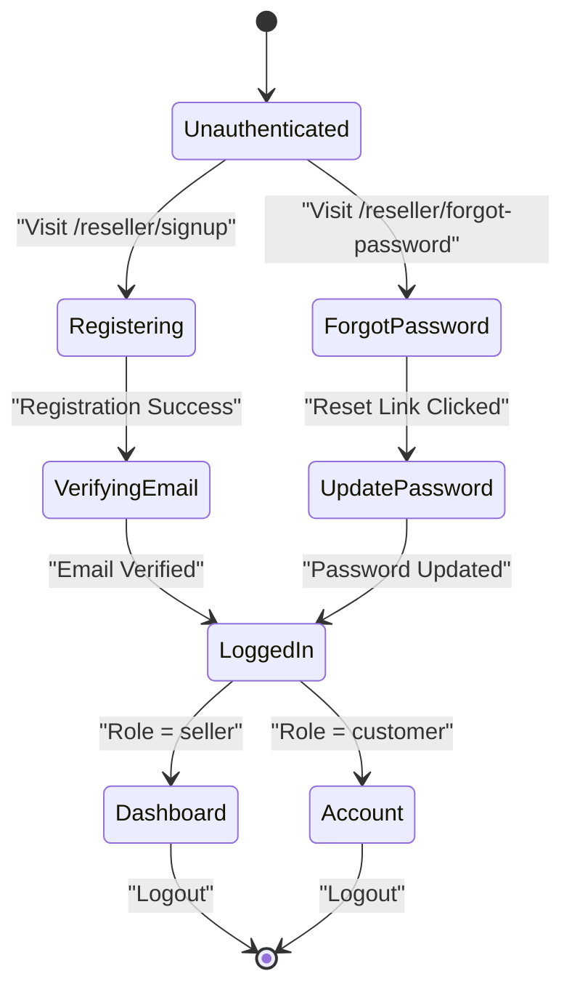
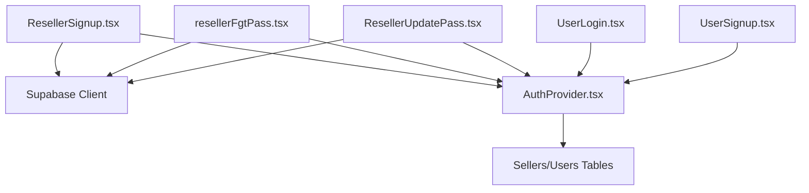

# Reseller Authentication

<cite>
**Referenced Files in This Document**
- [ResellerSignup.tsx](file://components/reseller/ResellerSignup.tsx)
- [resellerFgtPass.tsx](file://components/reseller/resellerFgtPass.tsx)
- [ResellerUpdatePass.tsx](file://components/reseller/ResellerUpdatePass.tsx)
- [page.tsx (reseller signup route)](file://app/reseller/signup/page.tsx)
- [page.tsx (reseller login redirect)](file://app/reseller/login/page.tsx)
- [page.tsx (reseller forgot-password route)](file://app/reseller/forgot-password/page.tsx)
- [page.tsx (reseller update-password route)](file://app/reseller/update-password/page.tsx)
- [AuthProvider.tsx](file://components/context/AuthProvider.tsx)
- [useAuth.ts](file://src/hooks/useAuth.ts)
- [UserLogin.tsx](file://components/users/UserLogin.tsx)
- [UserSignup.tsx](file://components/users/UserSignup.tsx)
- [page.tsx (reseller dashboard route)](file://app/reseller/dashboard/page.tsx)
</cite>

## Table of Contents
1. [Introduction](#introduction)
2. [Project Structure](#project-structure)
3. [Core Components](#core-components)
4. [Architecture Overview](#architecture-overview)
5. [Detailed Component Analysis](#detailed-component-analysis)
6. [Dependency Analysis](#dependency-analysis)
7. [Performance Considerations](#performance-considerations)
8. [Troubleshooting Guide](#troubleshooting-guide)
9. [Conclusion](#conclusion)

## Introduction
This document explains the reseller-specific authentication flows in the application. It focuses on:
- New reseller registration through the `ResellerSignup` component
- Password update functionality for recovered accounts
- Forgot password recovery flow
- Login routing and role-based access control that distinguishes resellers from regular customers
- Session management and security measures specific to seller accounts
- The complete authentication lifecycle from registration to account verification and dashboard access

The implementation uses Next.js App Router pages, Supabase Auth, a React context provider for user state, and client-side validation with error handling.

## Project Structure
Reseller authentication is split into route-level pages and reusable components:
- Route pages handle navigation, redirection, and recovery URL detection
- Components implement form logic, validation, API calls, and UI feedback
- The auth context centralizes session, profile loading, and role resolution

**Diagram sources**
- [page.tsx (reseller signup route):1-39](file://app/reseller/signup/page.tsx#L1-L39)
- [page.tsx (reseller login redirect):1-22](file://app/reseller/login/page.tsx#L1-L22)
- [page.tsx (reseller forgot-password route):1-44](file://app/reseller/forgot-password/page.tsx#L1-L44)
- [page.tsx (reseller update-password route):1-18](file://app/reseller/update-password/page.tsx#L1-L18)
- [page.tsx (reseller dashboard route):1-44](file://app/reseller/dashboard/page.tsx#L1-L44)
- [ResellerSignup.tsx:1-800](file://components/reseller/ResellerSignup.tsx#L1-L800)
- [resellerFgtPass.tsx:1-239](file://components/reseller/resellerFgtPass.tsx#L1-L239)
- [ResellerUpdatePass.tsx:1-273](file://components/reseller/ResellerUpdatePass.tsx#L1-L273)
- [AuthProvider.tsx:1-326](file://components/context/AuthProvider.tsx#L1-L326)
- [useAuth.ts:1-13](file://src/hooks/useAuth.ts#L1-L13)
- [UserLogin.tsx:1-370](file://components/users/UserLogin.tsx#L1-L370)
- [UserSignup.tsx:1-465](file://components/users/UserSignup.tsx#L1-L465)

**Section sources**
- [page.tsx (reseller signup route):1-39](file://app/reseller/signup/page.tsx#L1-L39)
- [page.tsx (reseller login redirect):1-22](file://app/reseller/login/page.tsx#L1-L22)
- [page.tsx (reseller forgot-password route):1-44](file://app/reseller/forgot-password/page.tsx#L1-L44)
- [page.tsx (reseller update-password route):1-18](file://app/reseller/update-password/page.tsx#L1-L18)
- [page.tsx (reseller dashboard route):1-44](file://app/reseller/dashboard/page.tsx#L1-L44)
- [ResellerSignup.tsx:1-800](file://components/reseller/ResellerSignup.tsx#L1-L800)
- [resellerFgtPass.tsx:1-239](file://components/reseller/resellerFgtPass.tsx#L1-L239)
- [ResellerUpdatePass.tsx:1-273](file://components/reseller/ResellerUpdatePass.tsx#L1-L273)
- [AuthProvider.tsx:1-326](file://components/context/AuthProvider.tsx#L1-L326)
- [useAuth.ts:1-13](file://src/hooks/useAuth.ts#L1-L13)
- [UserLogin.tsx:1-370](file://components/users/UserLogin.tsx#L1-L370)
- [UserSignup.tsx:1-465](file://components/users/UserSignup.tsx#L1-L465)

## Core Components
- ResellerSignup: Handles new reseller registration, including email/password creation, duplicate checks, optional CNIC identity upload, and seller profile insertion.
- ResellerFgtPass: Sends a password reset link to the registered reseller email and redirects to the update-password page after successful reset initiation.
- ResellerUpdatePass: Allows setting a new password after recovery, validates input, updates the password via Supabase Auth, and signs out the recovery session.
- AuthProvider: Manages Supabase session, loads reseller and customer profiles, resolves role (`seller` vs `customer`), and exposes logout and refetchProfile.
- useAuth: Provides typed access to the auth context throughout the app.
- UserLogin and UserSignup: Customer-facing flows; they also integrate with the same auth context and role resolution.

Key responsibilities:
- Registration: Validate inputs, pre-check duplicates, create auth user, upload CNIC images if provided, insert seller profile, clear drafts, and navigate to email verification.
- Recovery: Send reset email, redirect to update-password, enforce minimum password length, sign out after update.
- Role-based access: Determine whether a user is a seller or customer based on presence of a seller profile, then route accordingly.

**Section sources**
- [ResellerSignup.tsx:1-800](file://components/reseller/ResellerSignup.tsx#L1-L800)
- [resellerFgtPass.tsx:1-239](file://components/reseller/resellerFgtPass.tsx#L1-L239)
- [ResellerUpdatePass.tsx:1-273](file://components/reseller/ResellerUpdatePass.tsx#L1-L273)
- [AuthProvider.tsx:1-326](file://components/context/AuthProvider.tsx#L1-L326)
- [useAuth.ts:1-13](file://src/hooks/useAuth.ts#L1-L13)
- [UserLogin.tsx:1-370](file://components/users/UserLogin.tsx#L1-L370)
- [UserSignup.tsx:1-465](file://components/users/UserSignup.tsx#L1-L465)

## Architecture Overview
The reseller authentication architecture follows a layered approach:
- Route pages orchestrate navigation and recovery URL detection
- Components encapsulate business logic and UI
- Auth context provides centralized session and profile state
- Supabase Auth handles credentials and sessions
- Database tables store reseller and customer profiles

**Diagram sources**
- [page.tsx (reseller signup route):1-39](file://app/reseller/signup/page.tsx#L1-L39)
- [ResellerSignup.tsx:406-563](file://components/reseller/ResellerSignup.tsx#L406-L563)
- [AuthProvider.tsx:140-229](file://components/context/AuthProvider.tsx#L140-L229)

## Detailed Component Analysis

### Reseller Signup Flow
The `ResellerSignup` component implements a comprehensive registration process:
- Input formatting and validation for CNIC and phone number
- Draft persistence using sessionStorage and localStorage
- Duplicate checks against existing seller records
- Supabase Auth signup with redirect configuration
- Optional CNIC image upload to storage bucket with fallback to base64
- Upsert of seller profile with status set to Active
- Cleanup of draft data and navigation to email verification

**Diagram sources**
- [ResellerSignup.tsx:286-370](file://components/reseller/ResellerSignup.tsx#L286-L370)
- [ResellerSignup.tsx:406-563](file://components/reseller/ResellerSignup.tsx#L406-L563)

**Section sources**
- [ResellerSignup.tsx:1-800](file://components/reseller/ResellerSignup.tsx#L1-L800)
- [page.tsx (reseller signup route):1-39](file://app/reseller/signup/page.tsx#L1-L39)

### Forgot Password Recovery Flow
The `ResellerFgtPass` component sends a password reset email and supports recovery redirection:
- Validates email format
- Checks environment configuration
- Calls Supabase resetPasswordForEmail with redirect to `/reseller/update-password`
- Displays success message and allows returning to login

**Diagram sources**
- [page.tsx (reseller forgot-password route):1-44](file://app/reseller/forgot-password/page.tsx#L1-L44)
- [resellerFgtPass.tsx:38-85](file://components/reseller/resellerFgtPass.tsx#L38-L85)

**Section sources**
- [resellerFgtPass.tsx:1-239](file://components/reseller/resellerFgtPass.tsx#L1-L239)
- [page.tsx (reseller forgot-password route):1-44](file://app/reseller/forgot-password/page.tsx#L1-L44)

### Password Update Flow
The `ResellerUpdatePass` component allows setting a new password after recovery:
- Validates new password and confirmation
- Updates password via Supabase Auth
- Signs out the recovery session to force re-login with new credentials
- Navigates back to login upon success

**Diagram sources**
- [page.tsx (reseller update-password route):1-18](file://app/reseller/update-password/page.tsx#L1-L18)
- [ResellerUpdatePass.tsx:49-88](file://components/reseller/ResellerUpdatePass.tsx#L49-L88)

**Section sources**
- [ResellerUpdatePass.tsx:1-273](file://components/reseller/ResellerUpdatePass.tsx#L1-L273)
- [page.tsx (reseller update-password route):1-18](file://app/reseller/update-password/page.tsx#L1-L18)

### Login Routing and Role-Based Access Control
The login route acts as a redirector:
- If the URL contains recovery parameters, it navigates to `/reseller/update-password`
- Otherwise, it redirects to the main `/login` page where customer and reseller flows are handled

Role-based access control is implemented in the auth context:
- On session initialization, the provider fetches both reseller and customer profiles
- If a reseller profile exists, the role is set to `seller`; otherwise, it is `customer`
- Seller status is derived from the reseller profile’s status field
- Login components check role and status to determine routing and access

**Diagram sources**
- [AuthProvider.tsx:6-57](file://components/context/AuthProvider.tsx#L6-L57)
- [AuthProvider.tsx:85-229](file://components/context/AuthProvider.tsx#L85-L229)

**Section sources**
- [page.tsx (reseller login redirect):1-22](file://app/reseller/login/page.tsx#L1-L22)
- [AuthProvider.tsx:140-229](file://components/context/AuthProvider.tsx#L140-L229)
- [UserLogin.tsx:106-171](file://components/users/UserLogin.tsx#L106-L171)

### Complete Authentication Lifecycle
The lifecycle covers registration, email verification, login, and dashboard access:
- Registration creates an auth user and inserts a seller profile
- After successful registration, users are directed to email verification
- Login routes differentiate between recovery and standard login
- Role resolution determines whether to grant access to the reseller dashboard
- Dashboard route enforces authenticated reseller status

**Diagram sources**
- [page.tsx (reseller signup route):1-39](file://app/reseller/signup/page.tsx#L1-L39)
- [page.tsx (reseller forgot-password route):1-44](file://app/reseller/forgot-password/page.tsx#L1-L44)
- [page.tsx (reseller update-password route):1-18](file://app/reseller/update-password/page.tsx#L1-L18)
- [page.tsx (reseller dashboard route):1-44](file://app/reseller/dashboard/page.tsx#L1-L44)

## Dependency Analysis
Reseller authentication depends on several layers:
- Next.js routes provide navigation and recovery URL detection
- Components depend on Supabase client for auth and database operations
- Auth context centralizes session and profile state
- Customer flows share the same auth context but target different roles

**Diagram sources**
- [ResellerSignup.tsx:1-800](file://components/reseller/ResellerSignup.tsx#L1-L800)
- [resellerFgtPass.tsx:1-239](file://components/reseller/resellerFgtPass.tsx#L1-L239)
- [ResellerUpdatePass.tsx:1-273](file://components/reseller/ResellerUpdatePass.tsx#L1-L273)
- [AuthProvider.tsx:1-326](file://components/context/AuthProvider.tsx#L1-L326)
- [UserLogin.tsx:1-370](file://components/users/UserLogin.tsx#L1-L370)
- [UserSignup.tsx:1-465](file://components/users/UserSignup.tsx#L1-L465)

**Section sources**
- [ResellerSignup.tsx:1-800](file://components/reseller/ResellerSignup.tsx#L1-L800)
- [resellerFgtPass.tsx:1-239](file://components/reseller/resellerFgtPass.tsx#L1-L239)
- [ResellerUpdatePass.tsx:1-273](file://components/reseller/ResellerUpdatePass.tsx#L1-L273)
- [AuthProvider.tsx:1-326](file://components/context/AuthProvider.tsx#L1-L326)
- [UserLogin.tsx:1-370](file://components/users/UserLogin.tsx#L1-L370)
- [UserSignup.tsx:1-465](file://components/users/UserSignup.tsx#L1-L465)

## Performance Considerations
- Form validation is performed client-side before network requests to reduce unnecessary API calls
- Duplicate checks are done early to prevent redundant auth and database operations
- CNIC image uploads are optional and include fallbacks to avoid blocking registration
- Draft persistence uses synchronous writes for text fields and asynchronous writes for base64 images to balance responsiveness and reliability
- Auth context initializes once per session and listens for auth state changes to keep UI consistent

[No sources needed since this section provides general guidance]

## Troubleshooting Guide
Common issues and resolutions:
- Missing Supabase anon key: Ensure `NEXT_PUBLIC_SUPABASE_ANON_KEY` is configured correctly in the environment
- Duplicate registration errors: Check for existing email, CNIC, or phone numbers in the sellers table
- Network errors during registration: Verify internet connectivity and Supabase service availability
- Password reset not received: Confirm email settings in Supabase and check spam folders
- Recovery session not signing out: After updating password, the component explicitly signs out to force re-login

**Section sources**
- [ResellerSignup.tsx:419-425](file://components/reseller/ResellerSignup.tsx#L419-L425)
- [resellerFgtPass.tsx:52-58](file://components/reseller/resellerFgtPass.tsx#L52-L58)
- [ResellerUpdatePass.tsx:67-87](file://components/reseller/ResellerUpdatePass.tsx#L67-L87)

## Conclusion
The reseller authentication system provides a secure and user-friendly experience for seller registration, recovery, and login. It leverages Supabase Auth for credential management, integrates with database tables for profile persistence, and uses a centralized auth context for role-based access control. The design separates concerns between route-level navigation and component-level business logic, ensuring maintainability and clarity across the authentication lifecycle.

[No sources needed since this section summarizes without analyzing specific files]