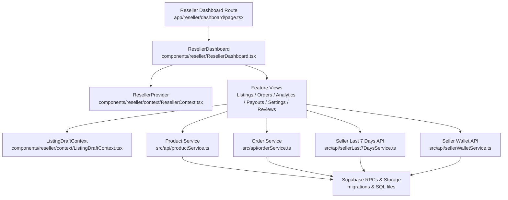
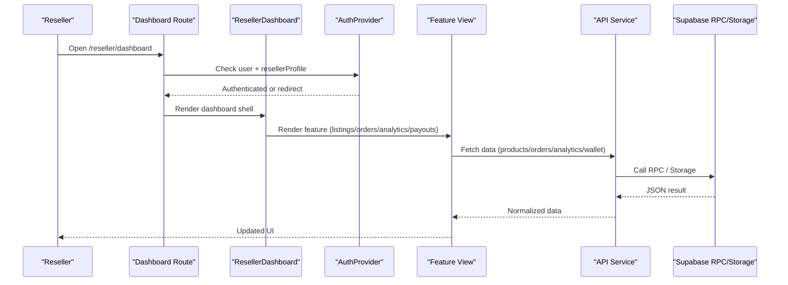
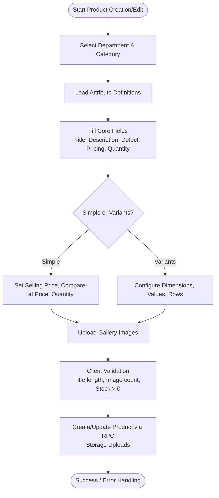
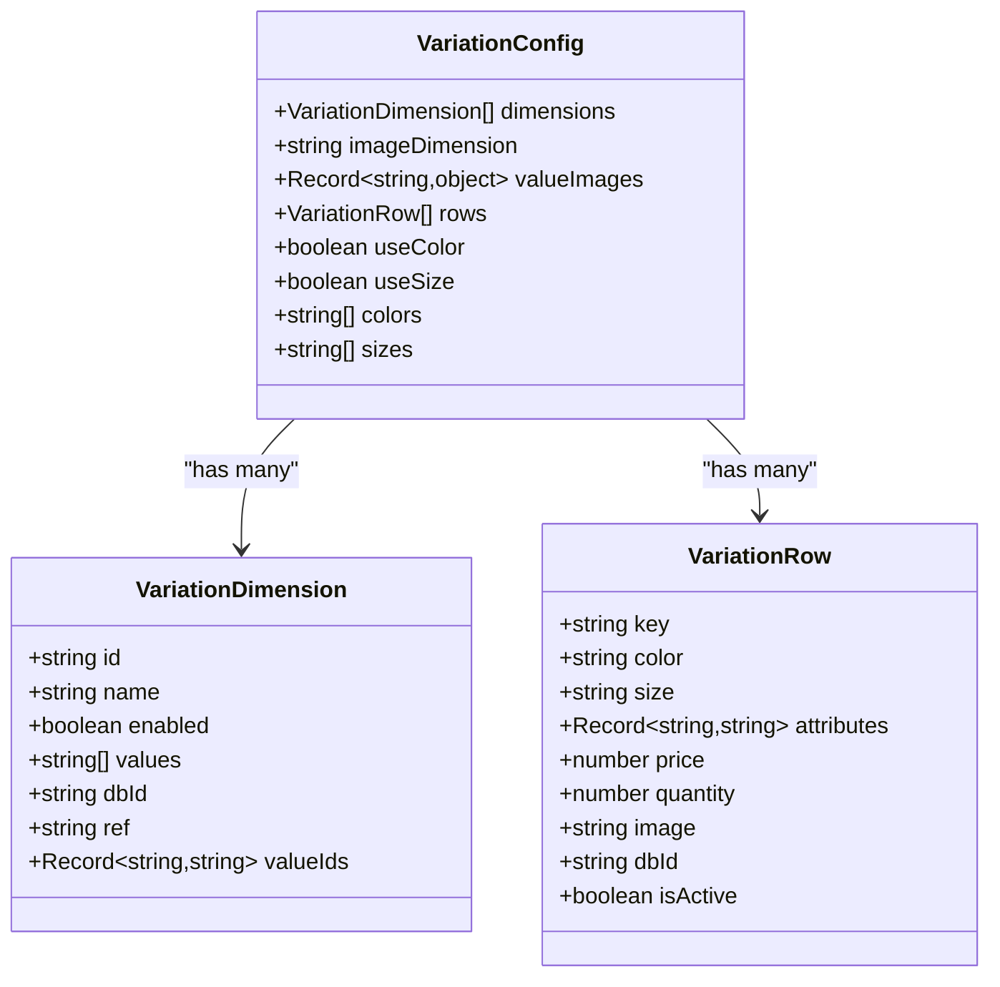
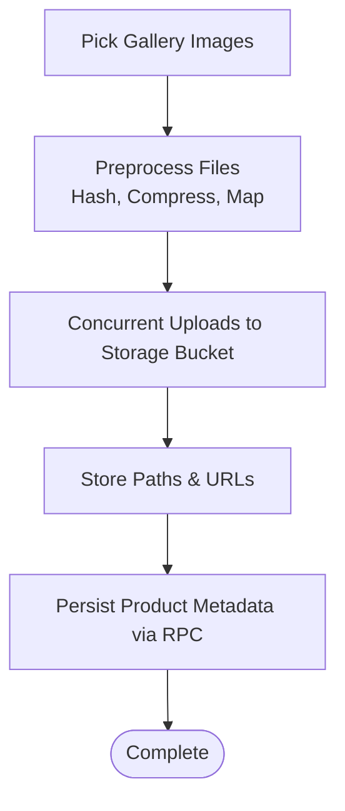
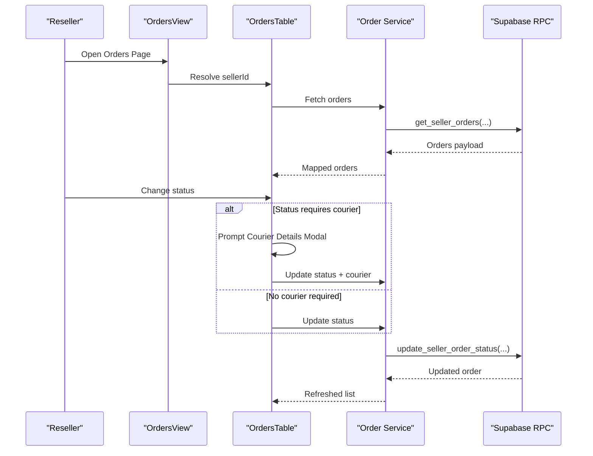
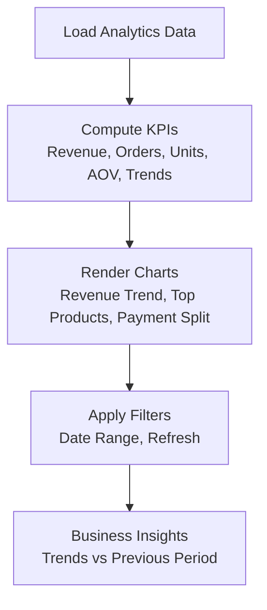
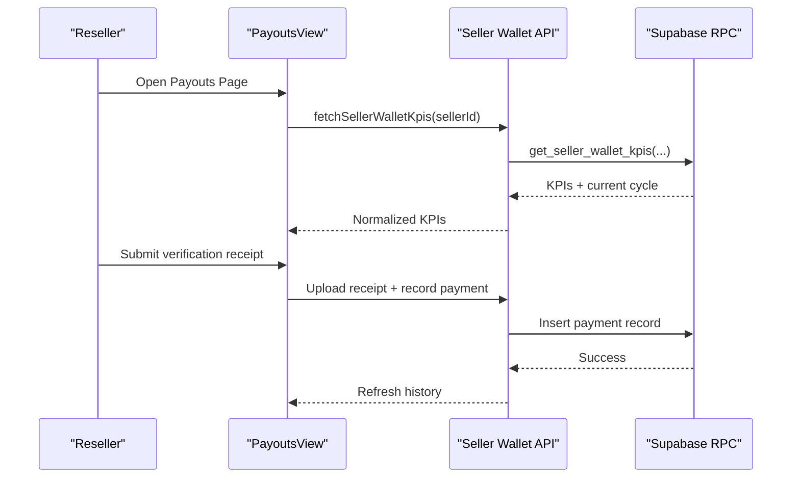
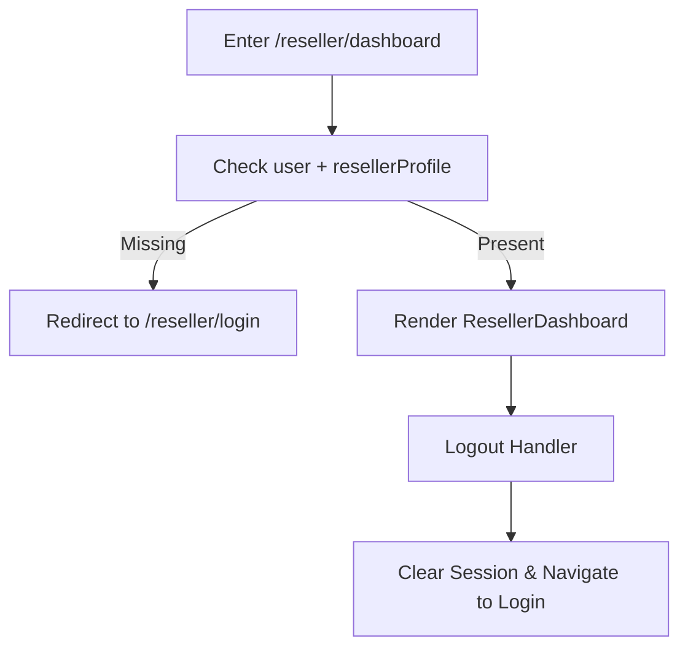
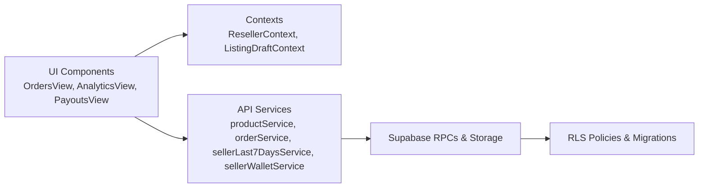

# Reseller Dashboard

<cite>
**Referenced Files in This Document**
- [README.md](file://README.md)
- [ResellerDashboard.tsx](file://components/reseller/ResellerDashboard.tsx)
- [page.tsx](file://app/reseller/dashboard/page.tsx)
- [ResellerContext.tsx](file://components/reseller/context/ResellerContext.tsx)
- [ListingDraftContext.tsx](file://components/reseller/context/ListingDraftContext.tsx)
- [NewListingForm.tsx](file://components/reseller/components/NewListingForm.tsx)
- [productService.ts](file://src/api/productService.ts)
- [computeUpdatePatch.ts](file://src/utils/computeUpdatePatch.ts)
- [OrdersView.tsx](file://components/reseller/components/OrdersView.tsx)
- [OrdersTable.tsx](file://components/reseller/components/OrdersTable.tsx)
- [orderService.ts](file://src/api/orderService.ts)
- [supabase_seller_orders_rpc.sql](file://supabase_seller_orders_rpc.sql)
- [TrackOrderPage.tsx](file://components/TrackOrderPage.tsx)
- [AnalyticsView.tsx](file://components/reseller/components/AnalyticsView.tsx)
- [sellerLast7DaysService.ts](file://src/api/sellerLast7DaysService.ts)
- [supabase_seller_last_7_days_rpc.sql](file://supabase_seller_last_7_days_rpc.sql)
- [PayoutsView.tsx](file://components/reseller/components/PayoutsView.tsx)
- [sellerWalletService.ts](file://src/api/sellerWalletService.ts)
- [mockWalletData.ts](file://components/reseller/data/mockWalletData.ts)
- [useAuth.ts](file://src/hooks/useAuth.ts)
</cite>

## Table of Contents
1. [Introduction](#introduction)
2. [Project Structure](#project-structure)
3. [Core Components](#core-components)
4. [Architecture Overview](#architecture-overview)
5. [Detailed Component Analysis](#detailed-component-analysis)
6. [Dependency Analysis](#dependency-analysis)
7. [Performance Considerations](#performance-considerations)
8. [Troubleshooting Guide](#troubleshooting-guide)
9. [Conclusion](#conclusion)

## Introduction
This document explains the reseller/seller dashboard functionality with a focus on:
- Product management: creation workflows, variant management, inventory control, and image uploads
- Order management: status workflows, shipping integration, and fulfillment tracking
- Analytics and reporting: sales metrics, performance KPIs, revenue trends, and business insights
- Financial management: commission tracking, payout history, wallet system, and payment method configuration
- Authentication and access control for resellers

The project is a Next.js application that uses React components, TanStack Query-based data fetching, Supabase RPC functions, and storage buckets for images and receipts. The reseller dashboard is protected by authentication and redirects unauthenticated users to the reseller login flow.

**Section sources**
- [README.md:1-37](file://README.md#L1-L37)
- [page.tsx:8-43](file://app/reseller/dashboard/page.tsx#L8-L43)

## Project Structure
The reseller dashboard lives under `app/reseller/dashboard` and is composed of:
- A route page that enforces authentication and renders the dashboard shell
- A dashboard component that wraps state providers and displays overview content
- Feature-specific views for listings, orders, analytics, payouts, settings, and reviews
- Shared contexts for reseller-wide state and listing draft state
- API services for products, orders, analytics, and wallet/payout operations
- Database migrations and RPC definitions for product creation, order queries, analytics aggregation, and wallet summaries

**Diagram sources**
- [page.tsx:8-43](file://app/reseller/dashboard/page.tsx#L8-L43)
- [ResellerDashboard.tsx:1-38](file://components/reseller/ResellerDashboard.tsx#L1-L38)
- [ResellerContext.tsx:1-167](file://components/reseller/context/ResellerContext.tsx#L1-L167)
- [ListingDraftContext.tsx:1-416](file://components/reseller/context/ListingDraftContext.tsx#L1-L416)
- [productService.ts:1-400](file://src/api/productService.ts#L1-L400)
- [orderService.ts:917-1043](file://src/api/orderService.ts#L917-L1043)
- [sellerLast7DaysService.ts:212-238](file://src/api/sellerLast7DaysService.ts#L212-L238)
- [sellerWalletService.ts:1-288](file://src/api/sellerWalletService.ts#L1-L288)

**Section sources**
- [page.tsx:8-43](file://app/reseller/dashboard/page.tsx#L8-L43)
- [ResellerDashboard.tsx:1-38](file://components/reseller/ResellerDashboard.tsx#L1-L38)
- [ResellerContext.tsx:1-167](file://components/reseller/context/ResellerContext.tsx#L1-L167)
- [ListingDraftContext.tsx:1-416](file://components/reseller/context/ListingDraftContext.tsx#L1-L416)

## Core Components
- Reseller dashboard route: protects access, handles logout navigation, and renders the dashboard shell.
- Reseller dashboard shell: provides an overview view and integrates with reseller context for listings and orders.
- Reseller context: holds listings, orders, store settings, editing state, and basic actions like deactivate/sold-out/delete.
- Listing draft context: manages multi-step product creation/editing, attributes, variations, option images, and section load states.
- New listing form: orchestrates category selection, attribute fields, variation matrix, image upload, validation, and persistence via product service.
- Orders view/table: resolves seller identity, loads orders, updates statuses, and collects courier details when required.
- Analytics view: shows KPIs, revenue trends, top products, and payment method splits using last-7-days RPC data.
- Payouts view: displays wallet KPIs, current commission cycle, payment instructions, verification workflow, and paginated commission history.

**Section sources**
- [page.tsx:8-43](file://app/reseller/dashboard/page.tsx#L8-L43)
- [ResellerDashboard.tsx:1-38](file://components/reseller/ResellerDashboard.tsx#L1-L38)
- [ResellerContext.tsx:1-167](file://components/reseller/context/ResellerContext.tsx#L1-L167)
- [ListingDraftContext.tsx:1-416](file://components/reseller/context/ListingDraftContext.tsx#L1-L416)
- [NewListingForm.tsx:1-800](file://components/reseller/components/NewListingForm.tsx#L1-L800)
- [OrdersView.tsx:1-19](file://components/reseller/components/OrdersView.tsx#L1-L19)
- [AnalyticsView.tsx:223-531](file://components/reseller/components/AnalyticsView.tsx#L223-L531)
- [PayoutsView.tsx:1-349](file://components/reseller/components/PayoutsView.tsx#L1-L349)

## Architecture Overview
The reseller dashboard follows a layered architecture:
- Presentation layer: Next.js pages and React components for UI flows
- State layer: Context providers for reseller-wide and listing-draft state
- Data layer: API services using TanStack Query hooks to fetch from Supabase RPCs
- Persistence layer: Supabase database tables, RLS policies, storage buckets, and RPC functions

**Diagram sources**
- [page.tsx:8-43](file://app/reseller/dashboard/page.tsx#L8-L43)
- [ResellerDashboard.tsx:1-38](file://components/reseller/ResellerDashboard.tsx#L1-L38)
- [useAuth.ts:1-13](file://src/hooks/useAuth.ts#L1-L13)
- [productService.ts:1-400](file://src/api/productService.ts#L1-L400)
- [orderService.ts:917-1043](file://src/api/orderService.ts#L917-L1043)
- [sellerLast7DaysService.ts:212-238](file://src/api/sellerLast7DaysService.ts#L212-L238)
- [sellerWalletService.ts:1-288](file://src/api/sellerWalletService.ts#L1-L288)

## Detailed Component Analysis

### Product Management System
The product management system supports both simple and variant inventory modes. It includes:
- Category and collection type selection
- Dynamic attribute fields based on category definitions
- Custom specifications
- Image gallery upload with deduplication and concurrency limits
- Variant matrix with per-variant pricing, quantity, and option value images
- Draft state management across sections (core, attributes, variations, option images)
- Atomic creation/update via RPC and storage operations

**Diagram sources**
- [NewListingForm.tsx:1-800](file://components/reseller/components/NewListingForm.tsx#L1-L800)
- [productService.ts:1-400](file://src/api/productService.ts#L1-L400)
- [ListingDraftContext.tsx:1-416](file://components/reseller/context/ListingDraftContext.tsx#L1-L416)
- [computeUpdatePatch.ts:1-51](file://src/utils/computeUpdatePatch.ts#L1-L51)

Key implementation points:
- Product creation input structure includes userId, categoryId, title, description, defect, gallery images, simple pricing/quantity, spec values, custom specs, and variation config.
- Image handling enforces maximum image count, file size limits, SHA-256 hashing for deduplication, and concurrent uploads to a dedicated storage bucket.
- Validation ensures valid category, non-empty title within allowed length, at least one image, and positive stock/pricing constraints.
- Update patch computation tracks expectedUpdatedAt and diffs across core, images, custom specs, attribute values, and variations.

**Section sources**
- [productService.ts:1-400](file://src/api/productService.ts#L1-L400)
- [NewListingForm.tsx:1-800](file://components/reseller/components/NewListingForm.tsx#L1-L800)
- [ListingDraftContext.tsx:1-416](file://components/reseller/context/ListingDraftContext.tsx#L1-L416)
- [computeUpdatePatch.ts:1-51](file://src/utils/computeUpdatePatch.ts#L1-L51)

### Variant Management and Inventory Control
Variant management allows sellers to define dimensions (e.g., color, size), assign values, and create rows representing combinations. Each row can have:
- Per-variant selling price
- Per-variant quantity
- Option value images
- Active/inactive status

Inventory control supports:
- Simple mode: single SKU with global price and quantity
- Variant mode: multiple SKUs with individual prices and quantities
- Conversion between modes during edit
- Deduction of total stock across variants before persisting

**Diagram sources**
- [ListingDraftContext.tsx:34-76](file://components/reseller/context/ListingDraftContext.tsx#L34-L76)

Operational behaviors:
- Section initialization populates dimensions, values, and rows from server data.
- Price range utilities compute min/max across valid row prices.
- Patch computation captures option renames, value renames, new values, removed values, variant changes, new variants, deactivated variants, and option images.

**Section sources**
- [ListingDraftContext.tsx:34-76](file://components/reseller/context/ListingDraftContext.tsx#L34-L76)
- [ListingDraftContext.tsx:371-416](file://components/reseller/context/ListingDraftContext.tsx#L371-L416)
- [computeUpdatePatch.ts:1-51](file://src/utils/computeUpdatePatch.ts#L1-L51)

### Image Upload Capabilities
Image upload capabilities include:
- Gallery image upload with preview URLs and storage paths
- Concurrency-limited uploads to a dedicated bucket
- SHA-256 hashing for deduplication across gallery and variation images
- Safe deletion of storage objects only if no other rows reference them
- Error mapping for storage-related issues (bucket not found, permission denied, network errors)

**Diagram sources**
- [productService.ts:1-400](file://src/api/productService.ts#L1-L400)
- [NewListingForm.tsx:1-800](file://components/reseller/components/NewListingForm.tsx#L1-L800)

**Section sources**
- [productService.ts:1-400](file://src/api/productService.ts#L1-L400)
- [NewListingForm.tsx:1-800](file://components/reseller/components/NewListingForm.tsx#L1-L800)

### Order Management Interface
The order management interface provides:
- Seller identity resolution from profile or logged-in user
- Order list rendering and filtering
- Status transitions with conditional courier detail prompts
- Integration with public order tracking
- Shipping address, payment method, and payment status visibility

**Diagram sources**
- [OrdersView.tsx:1-19](file://components/reseller/components/OrdersView.tsx#L1-L19)
- [OrdersTable.tsx:202-244](file://components/reseller/components/OrdersTable.tsx#L202-L244)
- [orderService.ts:917-1043](file://src/api/orderService.ts#L917-L1043)
- [supabase_seller_orders_rpc.sql:204-241](file://supabase_seller_orders_rpc.sql#L204-L241)

Status workflow highlights:
- Some transitions require courier name and tracking number; the UI intercepts these and opens a modal before executing the update.
- Public order tracking returns sanitized data without sensitive PII and maps backend statuses to customer-facing labels.

**Section sources**
- [OrdersView.tsx:1-19](file://components/reseller/components/OrdersView.tsx#L1-L19)
- [OrdersTable.tsx:202-244](file://components/reseller/components/OrdersTable.tsx#L202-L244)
- [orderService.ts:917-1043](file://src/api/orderService.ts#L917-L1043)
- [supabase_seller_orders_rpc.sql:204-241](file://supabase_seller_orders_rpc.sql#L204-L241)
- [TrackOrderPage.tsx:1-49](file://components/TrackOrderPage.tsx#L1-L49)

### Analytics and Reporting Features
The analytics dashboard presents:
- Key performance indicators including total revenue, orders, units sold, average order value, and trend percentages
- Revenue trend visualization over time intervals
- Top-performing products
- Payment method split analysis
- Date range filtering and refresh controls

**Diagram sources**
- [AnalyticsView.tsx:223-531](file://components/reseller/components/AnalyticsView.tsx#L223-L531)
- [sellerLast7DaysService.ts:212-238](file://src/api/sellerLast7DaysService.ts#L212-L238)
- [supabase_seller_last_7_days_rpc.sql:167-178](file://supabase_seller_last_7_days_rpc.sql#L167-L178)

Data processing notes:
- Daily breakdown aggregates revenue, order counts, units sold, order status distribution, and payment method distribution.
- Current and previous window aggregations compute AOV and percentage trends for revenue and orders.
- Final JSON combines date range label, daily breakdown, summary KPIs, top products, and payment method split.

**Section sources**
- [AnalyticsView.tsx:223-531](file://components/reseller/components/AnalyticsView.tsx#L223-L531)
- [sellerLast7DaysService.ts:212-238](file://src/api/sellerLast7DaysService.ts#L212-L238)
- [supabase_seller_last_7_days_rpc.sql:167-178](file://supabase_seller_last_7_days_rpc.sql#L167-L178)

### Financial Management: Commission, Payouts, Wallet, and Payment Methods
Financial management features include:
- Wallet KPIs: total sales, remaining commission, submitted payments, verified payments, and available payout
- Current commission cycle: month/year, gross amount, commission percentage and amount, due dates, extended dates, and status
- Payment instructions: bank name, IBAN, account title, copy-to-clipboard support
- Verification workflow: submit receipt screenshot, track submission status, view details
- Paginated commission history table with detail modals and screenshot previews

**Diagram sources**
- [PayoutsView.tsx:1-349](file://components/reseller/components/PayoutsView.tsx#L1-L349)
- [sellerWalletService.ts:1-288](file://src/api/sellerWalletService.ts#L1-L288)

Payment method configuration:
- IBAN, bank name, and account title are displayed and can be copied to clipboard.
- Receipt screenshots are uploaded to a dedicated storage bucket for verification.

Mock data structures provide simulation-friendly types for wallet KPIs, related orders, and commission records.

**Section sources**
- [PayoutsView.tsx:1-349](file://components/reseller/components/PayoutsView.tsx#L1-L349)
- [sellerWalletService.ts:1-288](file://src/api/sellerWalletService.ts#L1-L288)
- [mockWalletData.ts:1-43](file://components/reseller/data/mockWalletData.ts#L1-L43)

### User Authentication Flows and Role-Based Access Controls
Authentication flows specific to resellers:
- The dashboard route checks for user and reseller profile presence; if missing, it redirects to `/reseller/login`.
- Logout clears session and navigates back to the reseller login page.
- The reseller context initializes store settings from the reseller profile, including shop name, store image, warehouse address, IBAN, and notification preferences.
- Role-based access is enforced at the route level and through error mappings that restrict editing/restocking to the seller’s own listings.

**Diagram sources**
- [page.tsx:8-43](file://app/reseller/dashboard/page.tsx#L8-L43)
- [ResellerContext.tsx:53-112](file://components/reseller/context/ResellerContext.tsx#L53-L112)
- [useAuth.ts:1-13](file://src/hooks/useAuth.ts#L1-L13)

Access control notes:
- Error parsing maps storage and RLS errors to user-friendly messages indicating permission restrictions.
- Seller status hook integration can restrict certain actions based on seller verification or restriction periods.

**Section sources**
- [page.tsx:8-43](file://app/reseller/dashboard/page.tsx#L8-L43)
- [ResellerContext.tsx:53-112](file://components/reseller/context/ResellerContext.tsx#L53-L112)
- [NewListingForm.tsx:244-266](file://components/reseller/components/NewListingForm.tsx#L244-L266)
- [useAuth.ts:1-13](file://src/hooks/useAuth.ts#L1-L13)

## Dependency Analysis
The dashboard depends on several layers:
- UI components depend on contexts for state management
- Feature views depend on API services for data fetching
- API services depend on Supabase RPCs and storage
- Database schemas and policies enforce data integrity and security

**Diagram sources**
- [OrdersView.tsx:1-19](file://components/reseller/components/OrdersView.tsx#L1-L19)
- [AnalyticsView.tsx:223-531](file://components/reseller/components/AnalyticsView.tsx#L223-L531)
- [PayoutsView.tsx:1-349](file://components/reseller/components/PayoutsView.tsx#L1-L349)
- [ResellerContext.tsx:1-167](file://components/reseller/context/ResellerContext.tsx#L1-L167)
- [ListingDraftContext.tsx:1-416](file://components/reseller/context/ListingDraftContext.tsx#L1-L416)
- [productService.ts:1-400](file://src/api/productService.ts#L1-L400)
- [orderService.ts:917-1043](file://src/api/orderService.ts#L917-L1043)
- [sellerLast7DaysService.ts:212-238](file://src/api/sellerLast7DaysService.ts#L212-L238)
- [sellerWalletService.ts:1-288](file://src/api/sellerWalletService.ts#L1-L288)

Coupling and cohesion:
- High cohesion within each feature view and its associated API service
- Moderate coupling via shared contexts for reseller-wide state and listing draft state
- External dependencies limited to Supabase RPCs and storage APIs

Potential circular dependencies:
- None detected among analyzed files; contexts do not import API services directly, and services are independent modules.

External integration points:
- Supabase RPC functions for product creation, order queries, analytics aggregation, and wallet summaries
- Storage buckets for product images and payment receipts

**Section sources**
- [ResellerContext.tsx:1-167](file://components/reseller/context/ResellerContext.tsx#L1-L167)
- [ListingDraftContext.tsx:1-416](file://components/reseller/context/ListingDraftContext.tsx#L1-L416)
- [productService.ts:1-400](file://src/api/productService.ts#L1-L400)
- [orderService.ts:917-1043](file://src/api/orderService.ts#L917-L1043)
- [sellerLast7DaysService.ts:212-238](file://src/api/sellerLast7DaysService.ts#L212-L238)
- [sellerWalletService.ts:1-288](file://src/api/sellerWalletService.ts#L1-L288)

## Performance Considerations
- Image uploads use concurrency limits and hashing to reduce redundant storage writes and improve throughput.
- Analytics data is aggregated server-side via RPCs, minimizing client-side computation and reducing payload sizes.
- Pagination is used for commission history to avoid large dataset transfers.
- Stale-time caching is applied to wallet KPIs and commission history to reduce unnecessary refetches.
- Section-based loading in product editing avoids loading all data upfront, improving perceived performance.

[No sources needed since this section provides general guidance]

## Troubleshooting Guide
Common issues and resolutions:
- Storage configuration errors: If the product image storage bucket is not found or permissions are denied, the UI surfaces a clear message directing users to contact support or check permissions.
- Network connectivity issues: Network errors are mapped to user-friendly messages prompting users to verify their internet connection.
- Seller verification issues: Errors indicating seller_id foreign key violations suggest re-login to refresh seller profile and permissions.
- Order tracking privacy: Public tracking does not expose sensitive customer data; ensure infrastructure-level rate limiting is configured to prevent enumeration attacks.

Actionable steps:
- Verify Supabase storage bucket existence and RLS policies for product images and payment receipts.
- Confirm seller profile is active and authenticated before creating or editing listings.
- Use the provided error messages to guide users toward corrective actions.

**Section sources**
- [NewListingForm.tsx:244-266](file://components/reseller/components/NewListingForm.tsx#L244-L266)
- [orderService.ts:917-1043](file://src/api/orderService.ts#L917-L1043)

## Conclusion
The reseller dashboard provides a comprehensive suite of tools for managing products, orders, analytics, and finances. It emphasizes robust validation, secure storage handling, clear status workflows, and actionable insights. With strong separation of concerns across UI, state, and data layers, the system scales well and remains maintainable. Future enhancements could include richer real-time updates, advanced filtering, and expanded payment method integrations.

[No sources needed since this section summarizes without analyzing specific files]