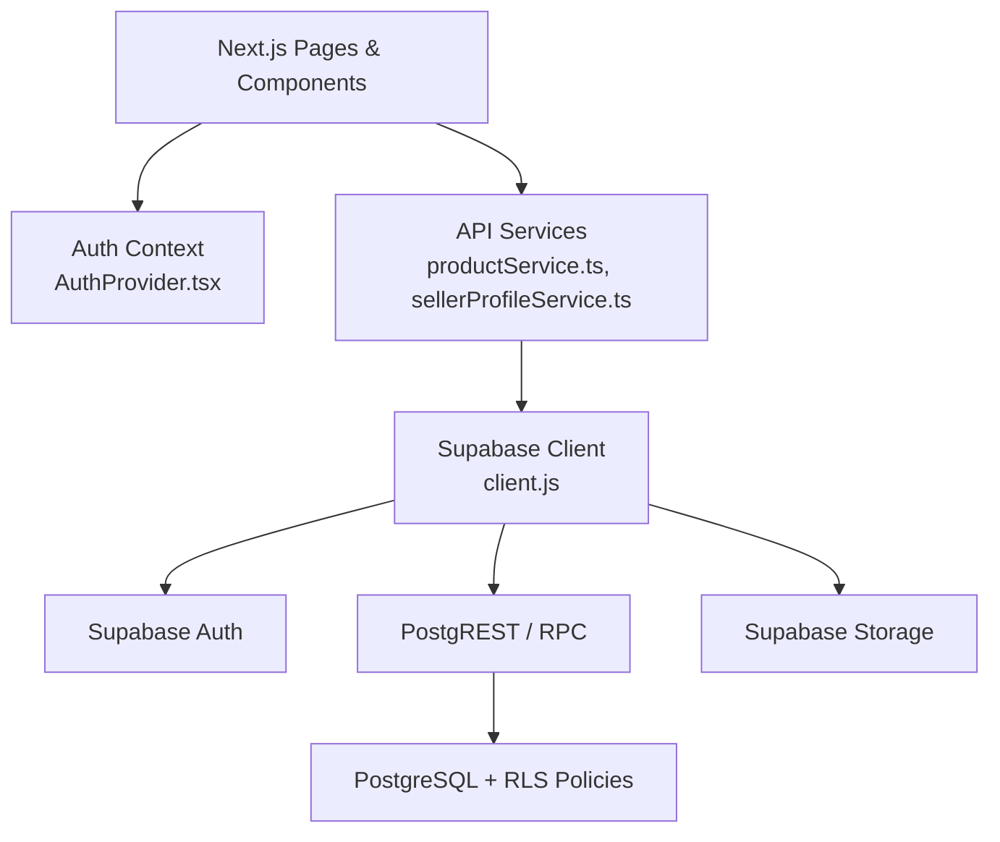
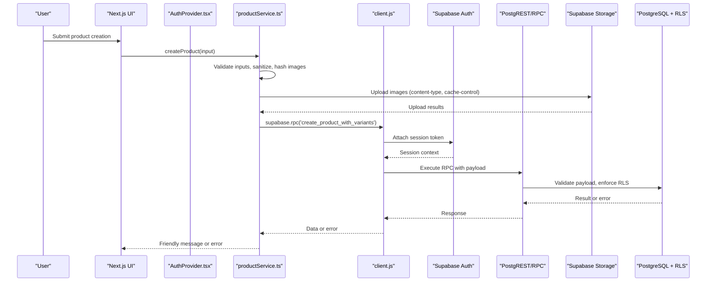
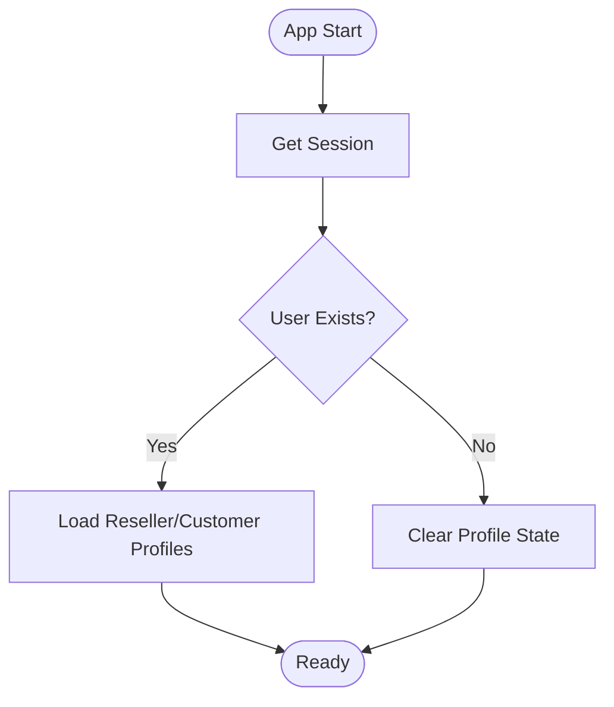
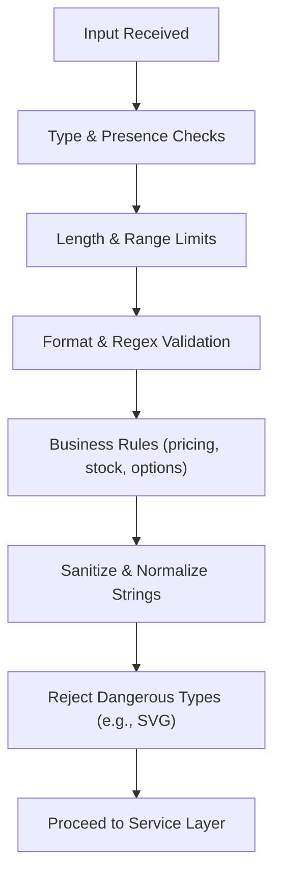
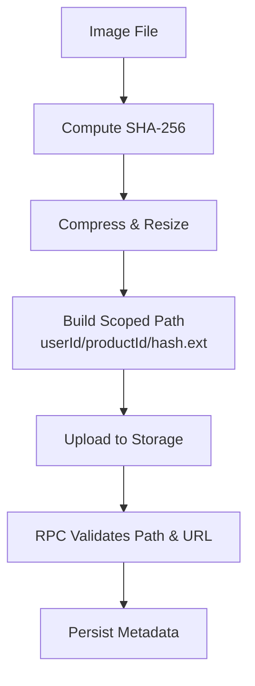
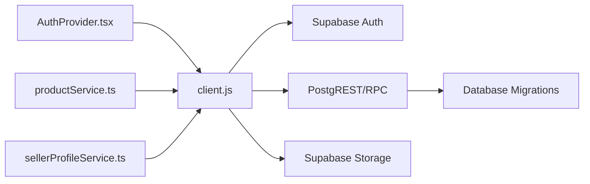

# API Security

<cite>
**Referenced Files in This Document**
- [client.js](file://src/api/client.js)
- [AuthProvider.tsx](file://components/context/AuthProvider.tsx)
- [productService.ts](file://src/api/productService.ts)
- [ResellerSignup.tsx](file://components/reseller/ResellerSignup.tsx)
- [sellerProfileService.ts](file://src/api/sellerProfileService.ts)
- [20261105_all_in_one_product_creation.sql](file://supabase/migrations/20261105_all_in_one_product_creation.sql)
- [next.config.ts](file://next.config.ts)
</cite>

## Table of Contents
1. [Introduction](#introduction)
2. [Project Structure](#project-structure)
3. [Core Components](#core-components)
4. [Architecture Overview](#architecture-overview)
5. [Detailed Component Analysis](#detailed-component-analysis)
6. [Dependency Analysis](#dependency-analysis)
7. [Performance Considerations](#performance-considerations)
8. [Troubleshooting Guide](#troubleshooting-guide)
9. [Conclusion](#conclusion)

## Introduction
This document provides comprehensive API security guidance for the application, focusing on request validation, secure communication with Supabase, authentication handling, input sanitization, output encoding, error handling strategies, CORS and CSRF considerations, XSS prevention, and versioning/deprecation practices. It maps these concepts to the actual codebase components that implement or should be extended to enforce security controls.

## Project Structure
The application is a Next.js frontend that communicates with Supabase (Auth, PostgREST/RPC, Storage). Security-critical areas include:
- Supabase client initialization and environment configuration
- Authentication context and session management
- Client-side input validation and sanitization
- Server-side RPC validations and Row-Level Security enforcement
- Secure storage operations and path validation
- Error mapping to user-friendly messages

**Diagram sources**
- [client.js:1-8](file://src/api/client.js#L1-L8)
- [AuthProvider.tsx:1-326](file://components/context/AuthProvider.tsx#L1-L326)
- [productService.ts:1-800](file://src/api/productService.ts#L1-L800)
- [sellerProfileService.ts:430-514](file://src/api/sellerProfileService.ts#L430-L514)

**Section sources**
- [client.js:1-8](file://src/api/client.js#L1-L8)
- [AuthProvider.tsx:1-326](file://components/context/AuthProvider.tsx#L1-L326)
- [productService.ts:1-800](file://src/api/productService.ts#L1-L800)
- [sellerProfileService.ts:430-514](file://src/api/sellerProfileService.ts#L430-L514)

## Core Components
- Supabase client configuration: Initializes the client using public environment variables. All requests are authenticated via Supabase Auth tokens attached by the SDK when a session exists.
- Authentication provider: Manages sessions, user profiles, role resolution, and profile auto-creation. It uses Supabase Auth APIs and queries protected tables through RLS policies.
- Product service: Implements robust client-side validation, image processing, hashing, concurrent uploads, atomic RPC calls, and friendly error formatting.
- Seller profile service: Validates business rules for shipping/payment configuration and updates seller data securely.
- Database migrations: Enforce server-side validation, constraints, and security isolation checks for images and attributes.

Key responsibilities:
- Request validation: Multi-layered (UI, service layer, database RPCs).
- Secure communication: HTTPS via Supabase endpoints; auth headers injected by SDK; content-type and cache-control set for storage uploads.
- Input sanitization: Stripping whitespace, type coercion, length checks, regex patterns, and disallowing dangerous types (e.g., SVG).
- Output encoding: Not directly in services; handled by React rendering and safe URL generation.
- Error handling: Mapping technical errors to user-safe messages without leaking internals.

**Section sources**
- [client.js:1-8](file://src/api/client.js#L1-L8)
- [AuthProvider.tsx:76-326](file://components/context/AuthProvider.tsx#L76-L326)
- [productService.ts:302-707](file://src/api/productService.ts#L302-L707)
- [sellerProfileService.ts:430-514](file://src/api/sellerProfileService.ts#L430-L514)
- [20261105_all_in_one_product_creation.sql:420-619](file://supabase/migrations/20261105_all_in_one_product_creation.sql#L420-L619)

## Architecture Overview
The security architecture relies on layered validation and strict authorization at each boundary:

**Diagram sources**
- [productService.ts:302-707](file://src/api/productService.ts#L302-L707)
- [client.js:1-8](file://src/api/client.js#L1-L8)
- [AuthProvider.tsx:248-303](file://components/context/AuthProvider.tsx#L248-L303)
- [20261105_all_in_one_product_creation.sql:445-464](file://supabase/migrations/20261105_all_in_one_product_creation.sql#L445-L464)

## Detailed Component Analysis

### Supabase Client Configuration and Secure Communication
- The client is created with public environment variables. The SDK attaches Authorization headers automatically when a session exists.
- No custom interceptors are present; security relies on Supabase Auth and RLS policies.

Recommendations:
- Ensure NEXT_PUBLIC_SUPABASE_URL uses HTTPS.
- Restrict anon key permissions via Supabase dashboard policies.
- Consider adding a custom fetch wrapper if you need centralized logging or rate limiting.

**Section sources**
- [client.js:1-8](file://src/api/client.js#L1-L8)

### Authentication Handling and Session Management
- AuthProvider initializes session, listens to auth state changes, and loads user profiles based on role.
- It safely handles missing tables/schema cache issues and returns null instead of exposing internals.

Security notes:
- Always check for active session before sensitive operations.
- Use refetchProfile after login/signup to ensure consistent state.

**Diagram sources**
- [AuthProvider.tsx:248-303](file://components/context/AuthProvider.tsx#L248-L303)

**Section sources**
- [AuthProvider.tsx:76-326](file://components/context/AuthProvider.tsx#L76-L326)

### Request Validation and Input Sanitization
- Product creation enforces:
  - Required fields presence and types
  - Title length limits
  - Image count and size limits
  - Variation dimensions and values limits
  - Pricing and stock numeric validations
  - Disallowing SVG images
  - Content-addressed storage paths and SHA-256 hashing
- Seller shipping/payment config validates ranges, mutual exclusivity, and conditional bank details requirements.

**Diagram sources**
- [productService.ts:302-707](file://src/api/productService.ts#L302-L707)
- [sellerProfileService.ts:430-514](file://src/api/sellerProfileService.ts#L430-L514)

**Section sources**
- [productService.ts:302-707](file://src/api/productService.ts#L302-L707)
- [sellerProfileService.ts:430-514](file://src/api/sellerProfileService.ts#L430-L514)

### Secure Storage Operations and Path Validation
- Images are hashed (SHA-256), compressed, and uploaded with explicit content-type and cache-control.
- Paths are content-addressed and scoped to userId/productId.
- Server-side RPC validates storagePath and imageUrl to prevent path traversal and cross-user access.

**Diagram sources**
- [productService.ts:394-543](file://src/api/productService.ts#L394-L543)
- [20261105_all_in_one_product_creation.sql:445-464](file://supabase/migrations/20261105_all_in_one_product_creation.sql#L445-L464)

**Section sources**
- [productService.ts:394-543](file://src/api/productService.ts#L394-L543)
- [20261105_all_in_one_product_creation.sql:445-464](file://supabase/migrations/20261105_all_in_one_product_creation.sql#L445-L464)

### Error Handling Strategies and Information Leakage Prevention
- Technical errors are mapped to user-friendly messages:
  - Missing RPC functions due to schema cache
  - Constraint violations and foreign key errors
  - Permission denied scenarios
- Registration flows parse Supabase errors to avoid leaking internal codes and provide actionable feedback.

Best practices:
- Never expose raw stack traces or SQL errors to clients.
- Log detailed errors server-side or in controlled environments only.

**Section sources**
- [productService.ts:255-292](file://src/api/productService.ts#L255-L292)
- [productService.ts:1648-1675](file://src/api/productService.ts#L1648-L1675)
- [ResellerSignup.tsx:67-116](file://components/reseller/ResellerSignup.tsx#L67-L116)

### CORS, CSRF, and XSS Prevention
- CORS:
  - Configure allowed origins in Supabase project settings.
  - Avoid wildcard origins in production.
- CSRF:
  - For browser-based forms, rely on SameSite cookies and CSRF tokens where applicable.
  - For API-only flows, use bearer tokens from Supabase Auth.
- XSS:
  - Render user-generated content safely in React (auto-escapes JSX).
  - Avoid dangerouslySetInnerHTML unless absolutely necessary.
  - Encode URLs and query parameters when constructing navigation links.

Implementation references:
- URL encoding used in router.push calls across pages.

**Section sources**
- [next.config.ts:1-12](file://next.config.ts#L1-L12)

### API Versioning and Deprecation Strategies
- Current code does not implement explicit API versioning.
- Recommendations:
  - Prefix RPC names or endpoints with version (e.g., v1_create_product_with_variants).
  - Maintain backward compatibility during transitions.
  - Deprecate old versions with clear timelines and migration guides.
  - Use feature flags to gradually roll out new schemas.

[No sources needed since this section provides general guidance]

## Dependency Analysis
The following diagram shows how core modules depend on each other and external services:

**Diagram sources**
- [AuthProvider.tsx:1-326](file://components/context/AuthProvider.tsx#L1-L326)
- [productService.ts:1-800](file://src/api/productService.ts#L1-L800)
- [sellerProfileService.ts:430-514](file://src/api/sellerProfileService.ts#L430-L514)
- [client.js:1-8](file://src/api/client.js#L1-L8)
- [20261105_all_in_one_product_creation.sql:420-619](file://supabase/migrations/20261105_all_in_one_product_creation.sql#L420-L619)

**Section sources**
- [client.js:1-8](file://src/api/client.js#L1-L8)
- [AuthProvider.tsx:1-326](file://components/context/AuthProvider.tsx#L1-L326)
- [productService.ts:1-800](file://src/api/productService.ts#L1-L800)
- [sellerProfileService.ts:430-514](file://src/api/sellerProfileService.ts#L430-L514)
- [20261105_all_in_one_product_creation.sql:420-619](file://supabase/migrations/20261105_all_in_one_product_creation.sql#L420-L619)

## Performance Considerations
- Concurrency-limited image uploads reduce network contention and improve reliability.
- Deduplication via SHA-256 prevents redundant storage writes.
- Compression reduces bandwidth and improves load times.
- Atomic RPC calls minimize partial writes and simplify rollback logic.

[No sources needed since this section provides general guidance]

## Troubleshooting Guide
Common issues and resolutions:
- Missing RPC function errors:
  - Indicates schema cache not updated or migration not executed.
  - Action: Run the relevant migration script in Supabase SQL editor.
- Schema cache or table not found:
  - Safe fallbacks return null or skip optional operations.
  - Action: Ensure migrations are applied and schema cache refreshed.
- Permission denied:
  - RLS policy denies access.
  - Action: Review RLS policies and user roles.
- Duplicate key or constraint violations:
  - Business rule conflict detected.
  - Action: Prompt user to adjust input or resolve conflicts.

Operational tips:
- Use friendly error messages in UI while logging detailed diagnostics internally.
- Validate environment variables early to fail fast with clear messages.

**Section sources**
- [productService.ts:255-292](file://src/api/productService.ts#L255-L292)
- [productService.ts:1648-1675](file://src/api/productService.ts#L1648-L1675)
- [ResellerSignup.tsx:67-116](file://components/reseller/ResellerSignup.tsx#L67-L116)

## Conclusion
The application implements strong multi-layered security through client-side validation, secure storage practices, server-side RPC validations, and careful error handling. To further harden the system:
- Centralize CORS and CSRF configurations at the platform level.
- Introduce API versioning and deprecation policies.
- Add rate limiting at the gateway or edge layer.
- Continuously audit RLS policies and storage bucket permissions.

[No sources needed since this section summarizes without analyzing specific files]