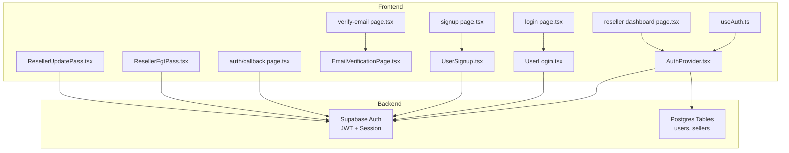
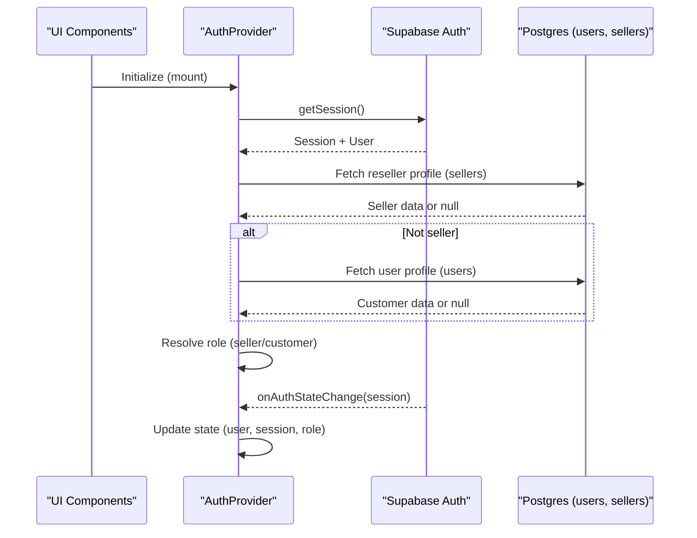
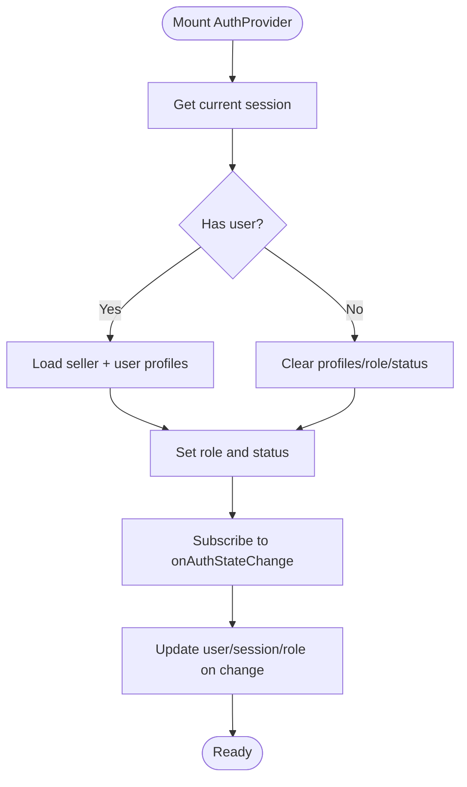
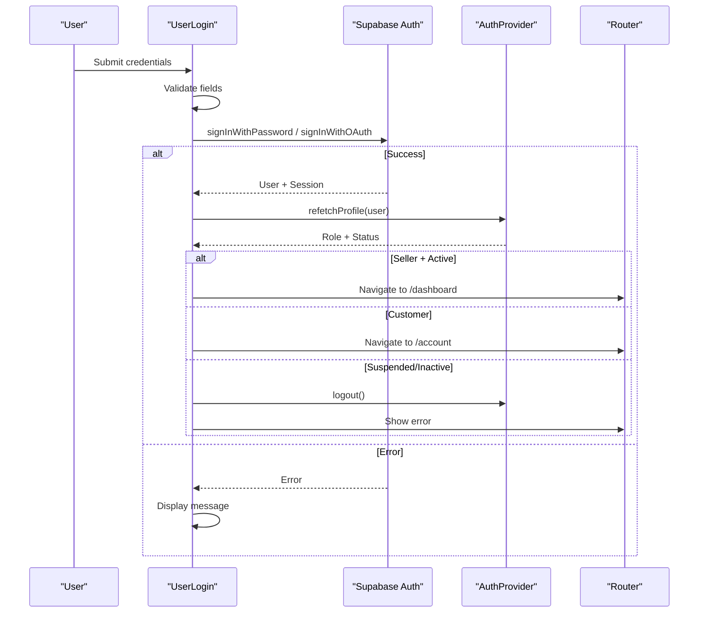
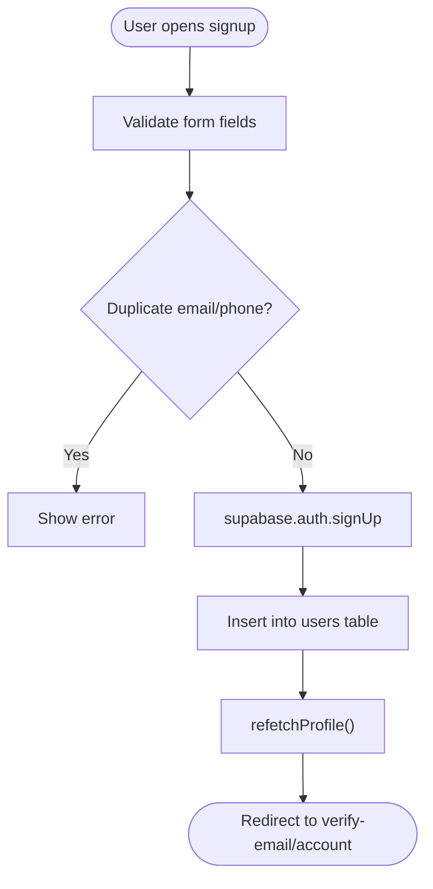
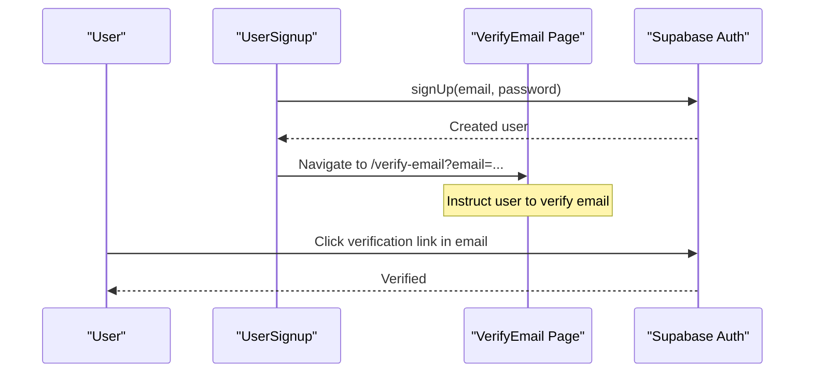
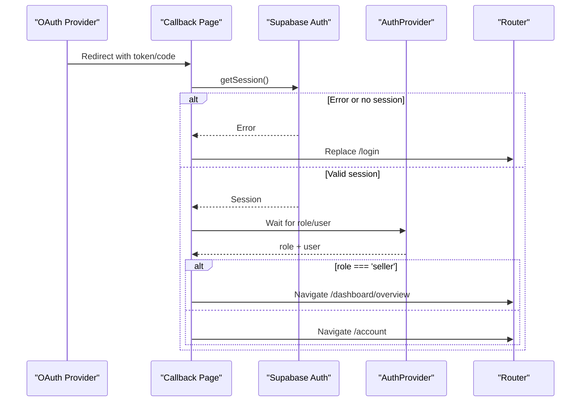
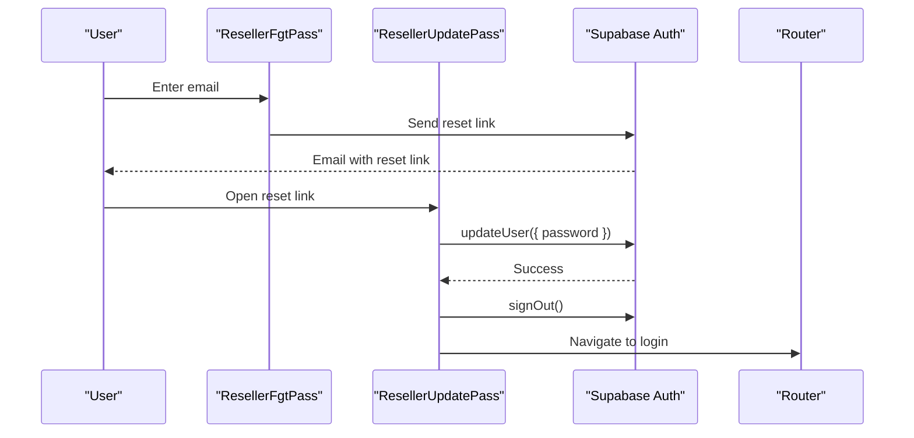
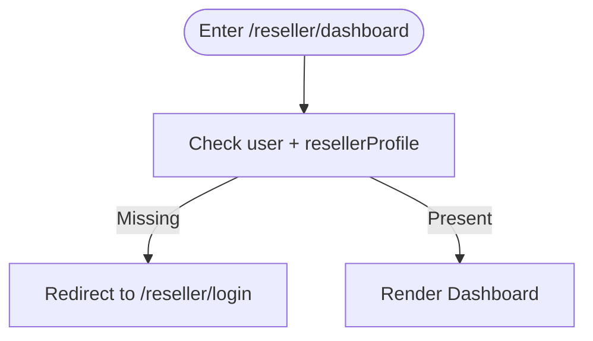
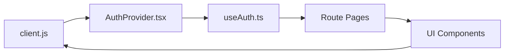

# Authentication Security

<cite>
**Referenced Files in This Document**
- [AuthProvider.tsx](file://components/context/AuthProvider.tsx)
- [useAuth.ts](file://src/hooks/useAuth.ts)
- [client.js](file://src/api/client.js)
- [page.tsx (auth callback)](file://app/auth/callback/page.tsx)
- [page.tsx (login)](file://app/login/page.tsx)
- [UserLogin.tsx](file://components/users/UserLogin.tsx)
- [page.tsx (signup)](file://app/signup/page.tsx)
- [UserSignup.tsx](file://components/users/UserSignup.tsx)
- [page.tsx (verify-email)](file://app/verify-email/page.tsx)
- [EmailVerificationPage.tsx](file://components/EmailVerificationPage.tsx)
- [ResellerDashboardRoutePage.tsx](file://app/reseller/dashboard/page.tsx)
- [page.tsx (reseller forgot-password)](file://app/reseller/forgot-password/page.tsx)
- [page.tsx (reseller update-password)](file://app/reseller/update-password/page.tsx)
- [ResellerFgtPass.tsx](file://components/reseller/resellerFgtPass.tsx)
- [ResellerUpdatePass.tsx](file://components/reseller/ResellerUpdatePass.tsx)
- [sellerProfileService.ts](file://src/api/sellerProfileService.ts)
</cite>

## Table of Contents
1. Introduction
2. Project Structure
3. Core Components
4. Architecture Overview
5. Detailed Component Analysis
6. Dependency Analysis
7. Performance Considerations
8. Troubleshooting Guide
9. Conclusion
10. Appendices

## Introduction
This document explains the authentication and authorization implementation for the application, focusing on:
- Supabase-based authentication flows (email/password and Google OAuth)
- JWT/session handling via Supabase Auth
- Role-based access control (customer vs seller)
- Email verification workflow
- Account recovery and password updates
- Secure logout and session persistence
- Protected routes and middleware patterns
- Common vulnerabilities and mitigations

The system uses a React context provider to manage authentication state and a hook to consume it across components. Routes enforce role checks and redirect users appropriately after login or during recovery flows.

## Project Structure
Authentication-related code is organized into:
- Context and hooks for auth state management
- UI components for login, signup, email verification, and password recovery
- Route pages that enforce redirects and handle callbacks
- API client configuration for Supabase

**Diagram sources**
- [AuthProvider.tsx:76-324](file://components/context/AuthProvider.tsx#L76-L324)
- [useAuth.ts:1-12](file://src/hooks/useAuth.ts#L1-L12)
- [UserLogin.tsx:1-370](file://components/users/UserLogin.tsx#L1-L370)
- [UserSignup.tsx:1-465](file://components/users/UserSignup.tsx#L1-L465)
- [EmailVerificationPage.tsx:1-71](file://components/EmailVerificationPage.tsx#L1-L71)
- [ResellerFgtPass.tsx:1-48](file://components/reseller/resellerFgtPass.tsx#L1-L48)
- [ResellerUpdatePass.tsx:1-273](file://components/reseller/ResellerUpdatePass.tsx#L1-L273)
- [page.tsx (auth callback):1-69](file://app/auth/callback/page.tsx#L1-L69)
- [page.tsx (login):1-62](file://app/login/page.tsx#L1-L62)
- [page.tsx (signup):1-50](file://app/signup/page.tsx#L1-L50)
- [page.tsx (verify-email):1-21](file://app/verify-email/page.tsx#L1-L21)
- [ResellerDashboardRoutePage.tsx:1-44](file://app/reseller/dashboard/page.tsx#L1-L44)

**Section sources**
- [AuthProvider.tsx:76-324](file://components/context/AuthProvider.tsx#L76-L324)
- [useAuth.ts:1-12](file://src/hooks/useAuth.ts#L1-L12)
- [client.js:1-8](file://src/api/client.js#L1-L8)

## Core Components
- AuthProvider: Manages user, session, profiles, role, and loading state; initializes from Supabase session; listens to auth state changes; provides logout and profile refetch.
- useAuth: Hook to access auth context safely with guard against missing provider.
- UserLogin: Handles email/password sign-in and Google OAuth; validates input; handles errors and redirects based on role and seller status.
- UserSignup: Creates customer accounts via Supabase Auth; inserts user profile; handles duplicate detection and validation; supports Google OAuth.
- EmailVerificationPage: Guides users to check email after signup.
- Reseller flows: Forgot password and update password pages integrate with Supabase Auth recovery and secure password update.
- Protected route example: Reseller dashboard enforces authenticated seller presence.

Key responsibilities:
- Session initialization and persistence via Supabase Auth
- Role resolution (seller vs customer) by querying backend tables
- Secure logout clearing local state
- Redirects based on roles and account statuses

**Section sources**
- [AuthProvider.tsx:47-74](file://components/context/AuthProvider.tsx#L47-L74)
- [AuthProvider.tsx:76-324](file://components/context/AuthProvider.tsx#L76-L324)
- [useAuth.ts:1-12](file://src/hooks/useAuth.ts#L1-L12)
- [UserLogin.tsx:106-171](file://components/users/UserLogin.tsx#L106-L171)
- [UserSignup.tsx:162-250](file://components/users/UserSignup.tsx#L162-L250)
- [EmailVerificationPage.tsx:14-68](file://components/EmailVerificationPage.tsx#L14-L68)
- [ResellerDashboardRoutePage.tsx:8-44](file://app/reseller/dashboard/page.tsx#L8-L44)

## Architecture Overview
The authentication architecture centers around Supabase Auth for identity and session management. The frontend maintains a lightweight state tree (user, session, profiles, role) synchronized with Supabase events.

**Diagram sources**
- [AuthProvider.tsx:248-303](file://components/context/AuthProvider.tsx#L248-L303)
- [AuthProvider.tsx:85-216](file://components/context/AuthProvider.tsx#L85-L216)

## Detailed Component Analysis

### Authentication State Management (AuthProvider and useAuth)
- Initializes session on mount using Supabase Auth.
- Subscribes to auth state changes to keep UI in sync.
- Loads seller and customer profiles to determine role and status.
- Provides logout that clears local state and calls Supabase sign-out.
- Exposes refetchProfile to recompute role/profiles.

**Diagram sources**
- [AuthProvider.tsx:248-303](file://components/context/AuthProvider.tsx#L248-L303)
- [AuthProvider.tsx:140-216](file://components/context/AuthProvider.tsx#L140-L216)

**Section sources**
- [AuthProvider.tsx:76-324](file://components/context/AuthProvider.tsx#L76-L324)
- [useAuth.ts:1-12](file://src/hooks/useAuth.ts#L1-L12)

### Login Flow (Email/Password and Google OAuth)
- Validates inputs locally.
- Calls Supabase signInWithPassword or signInWithOAuth (Google).
- On success, refetches profile to resolve role and seller status.
- Blocks access if seller is suspended/inactive.
- Redirects to appropriate portal (dashboard for sellers, account for customers).

**Diagram sources**
- [UserLogin.tsx:106-171](file://components/users/UserLogin.tsx#L106-L171)
- [AuthProvider.tsx:218-229](file://components/context/AuthProvider.tsx#L218-L229)

**Section sources**
- [UserLogin.tsx:1-370](file://components/users/UserLogin.tsx#L1-L370)
- [page.tsx (login):1-62](file://app/login/page.tsx#L1-L62)

### Signup Flow (Customer Registration)
- Pre-checks duplicates in users table.
- Creates user via Supabase Auth.signUp with metadata.
- Inserts user profile into public.users.
- Refetches profile to set role and state.
- Supports Google OAuth signup.

**Diagram sources**
- [UserSignup.tsx:162-250](file://components/users/UserSignup.tsx#L162-L250)

**Section sources**
- [UserSignup.tsx:1-465](file://components/users/UserSignup.tsx#L1-L465)
- [page.tsx (signup):1-50](file://app/signup/page.tsx#L1-L50)

### Email Verification Workflow
- After signup, user is directed to verify-email page with email parameter.
- Page instructs user to check inbox and click verification link.
- If login attempts fail due to unverified email, login flow surfaces a clear message.

**Diagram sources**
- [UserSignup.tsx:196-244](file://components/users/UserSignup.tsx#L196-L244)
- [EmailVerificationPage.tsx:14-68](file://components/EmailVerificationPage.tsx#L14-L68)
- [UserLogin.tsx:123-132](file://components/users/UserLogin.tsx#L123-L132)

**Section sources**
- [page.tsx (verify-email):1-21](file://app/verify-email/page.tsx#L1-L21)
- [EmailVerificationPage.tsx:1-71](file://components/EmailVerificationPage.tsx#L1-L71)

### OAuth Callback Handling
- The callback page retrieves the session from Supabase.
- If no session exists and no code/hash present, redirects to login.
- Uses role and user state from AuthProvider to navigate to correct portal.

**Diagram sources**
- [page.tsx (auth callback):1-69](file://app/auth/callback/page.tsx#L1-L69)

**Section sources**
- [page.tsx (auth callback):1-69](file://app/auth/callback/page.tsx#L1-L69)

### Password Recovery and Update (Reseller)
- Forgot password page validates email and triggers recovery via Supabase Auth.
- Update password page sets new password and signs out recovery session.
- Routes detect recovery links and redirect accordingly.

**Diagram sources**
- [ResellerFgtPass.tsx:38-48](file://components/reseller/resellerFgtPass.tsx#L38-L48)
- [ResellerUpdatePass.tsx:49-87](file://components/reseller/ResellerUpdatePass.tsx#L49-L87)
- [page.tsx (reseller forgot-password):1-43](file://app/reseller/forgot-password/page.tsx#L1-L43)
- [page.tsx (reseller update-password):1-17](file://app/reseller/update-password/page.tsx#L1-L17)

**Section sources**
- [ResellerFgtPass.tsx:1-48](file://components/reseller/resellerFgtPass.tsx#L1-L48)
- [ResellerUpdatePass.tsx:1-273](file://components/reseller/ResellerUpdatePass.tsx#L1-L273)
- [page.tsx (reseller forgot-password):1-43](file://app/reseller/forgot-password/page.tsx#L1-L43)
- [page.tsx (reseller update-password):1-17](file://app/reseller/update-password/page.tsx#L1-L17)

### Protected Routes and Middleware Patterns
- Example: Reseller dashboard route guards require both user and resellerProfile; otherwise redirects to login.
- General pattern: Use useEffect to check auth state and role before rendering protected content.

**Diagram sources**
- [ResellerDashboardRoutePage.tsx:8-44](file://app/reseller/dashboard/page.tsx#L8-L44)

**Section sources**
- [ResellerDashboardRoutePage.tsx:1-44](file://app/reseller/dashboard/page.tsx#L1-L44)

### Token Storage Strategy and Session Persistence
- Supabase Auth manages tokens and sessions internally (browser storage and cookies depending on configuration).
- Frontend does not manually store JWTs; it relies on Supabase client to maintain session and emits onAuthStateChange events.
- Logout clears local state and calls supabase.auth.signOut().

**Section sources**
- [AuthProvider.tsx:231-246](file://components/context/AuthProvider.tsx#L231-L246)
- [AuthProvider.tsx:248-303](file://components/context/AuthProvider.tsx#L248-L303)
- [client.js:1-8](file://src/api/client.js#L1-L8)

### Role-Based Authorization
- Roles are resolved server-side by checking seller records; if none exist, user is treated as customer.
- Seller status (Active/Suspended/Inactive) controls access to seller features.
- UI and routes enforce these checks before granting access.

**Section sources**
- [AuthProvider.tsx:140-216](file://components/context/AuthProvider.tsx#L140-L216)
- [UserLogin.tsx:137-161](file://components/users/UserLogin.tsx#L137-L161)

### Password Security Measures
- Minimum password length enforced at signup and update stages.
- Duplicate email/phone checks reduce risk of accidental overwrites.
- Recovery flow requires explicit password update and signs out recovery session.
- Current password verification before update is implemented in seller profile service.

**Section sources**
- [UserSignup.tsx:115-160](file://components/users/UserSignup.tsx#L115-L160)
- [ResellerUpdatePass.tsx:37-87](file://components/reseller/ResellerUpdatePass.tsx#L37-L87)
- [sellerProfileService.ts:391-418](file://src/api/sellerProfileService.ts#L391-L418)

## Dependency Analysis

**Diagram sources**
- [client.js:1-8](file://src/api/client.js#L1-L8)
- [AuthProvider.tsx:76-324](file://components/context/AuthProvider.tsx#L76-L324)
- [useAuth.ts:1-12](file://src/hooks/useAuth.ts#L1-L12)

**Section sources**
- [client.js:1-8](file://src/api/client.js#L1-L8)
- [AuthProvider.tsx:76-324](file://components/context/AuthProvider.tsx#L76-L324)
- [useAuth.ts:1-12](file://src/hooks/useAuth.ts#L1-L12)

## Performance Considerations
- Profile fetching is done once per auth event; consider caching results where appropriate.
- Avoid redundant refetchProfile calls; batch operations when possible.
- Use optimistic UI updates sparingly; rely on Supabase events for consistency.
- Minimize network calls by deferring non-critical profile queries until needed.

[No sources needed since this section provides general guidance]

## Troubleshooting Guide
Common issues and resolutions:
- OAuth callback errors: Ensure provider is enabled in Supabase dashboard; verify redirect URLs.
- Email not confirmed: Login flow shows specific message directing users to verify email.
- Missing environment variables: Verify NEXT_PUBLIC_SUPABASE_URL and NEXT_PUBLIC_SUPABASE_ANON_KEY are set.
- Duplicate registration: Handle unique constraint errors and guide users to login instead.
- Seller account suspended/inactive: Block access and prompt support contact.

**Section sources**
- [UserLogin.tsx:123-132](file://components/users/UserLogin.tsx#L123-L132)
- [UserLogin.tsx:140-153](file://components/users/UserLogin.tsx#L140-L153)
- [UserSignup.tsx:14-53](file://components/users/UserSignup.tsx#L14-L53)
- [page.tsx (auth callback):14-36](file://app/auth/callback/page.tsx#L14-L36)

## Conclusion
The application implements a robust, secure authentication system leveraging Supabase Auth for session and token management. It enforces role-based access through profile resolution, protects sensitive routes, and provides clear workflows for email verification and password recovery. By relying on Supabase-managed sessions and consistent state synchronization, the system minimizes risks associated with manual token handling while providing a smooth user experience.

[No sources needed since this section summarizes without analyzing specific files]

## Appendices

### API Client Configuration
- Supabase client initialized with environment variables.

**Section sources**
- [client.js:1-8](file://src/api/client.js#L1-L8)