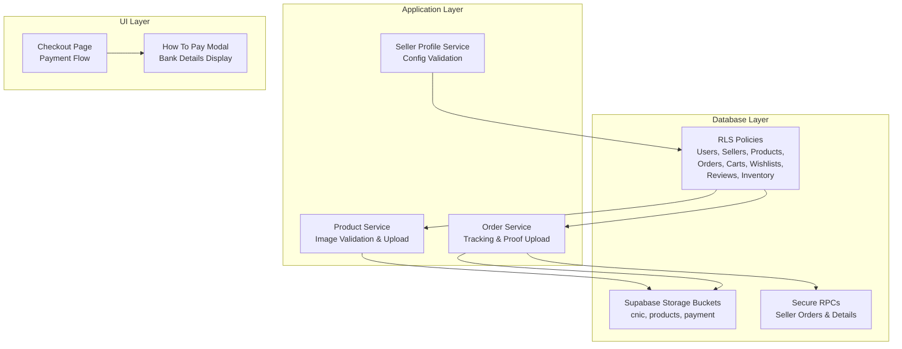
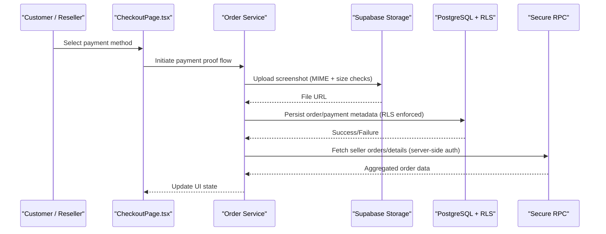
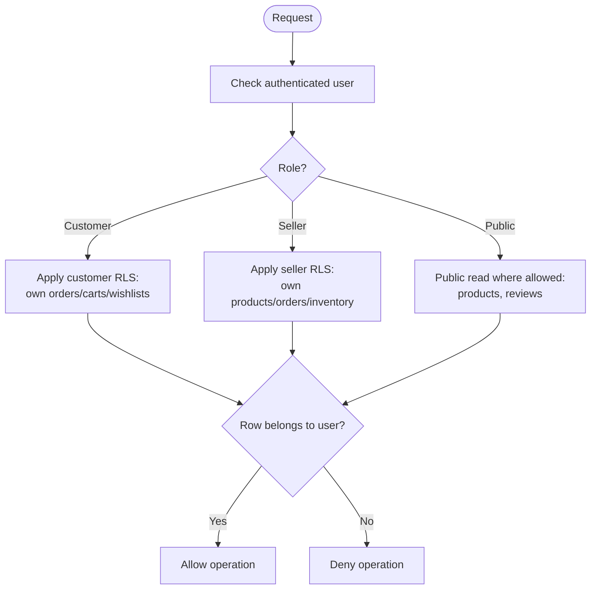
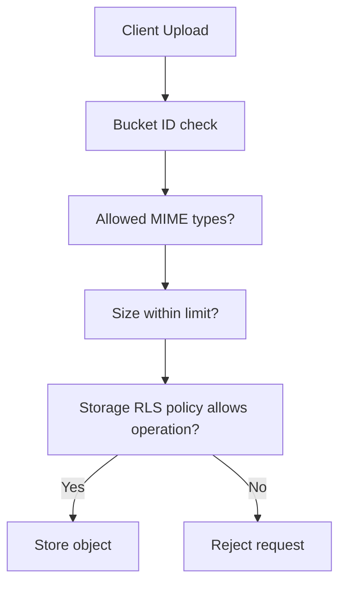
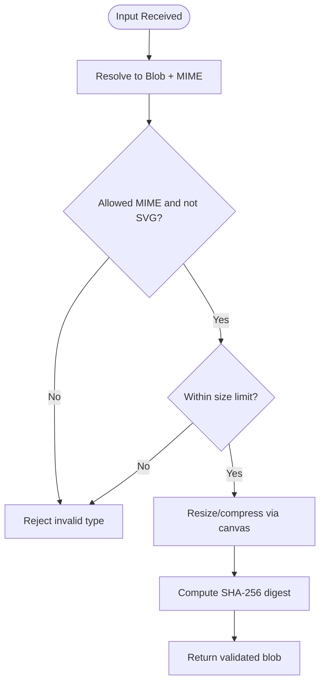
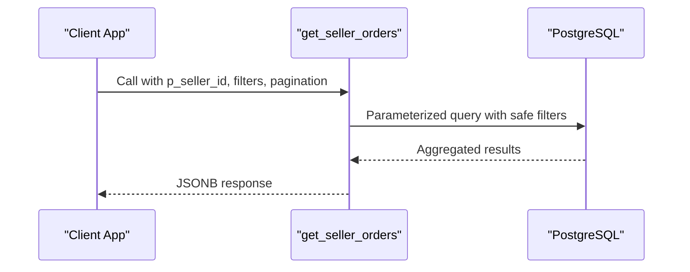
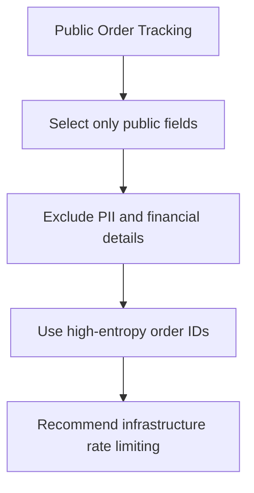
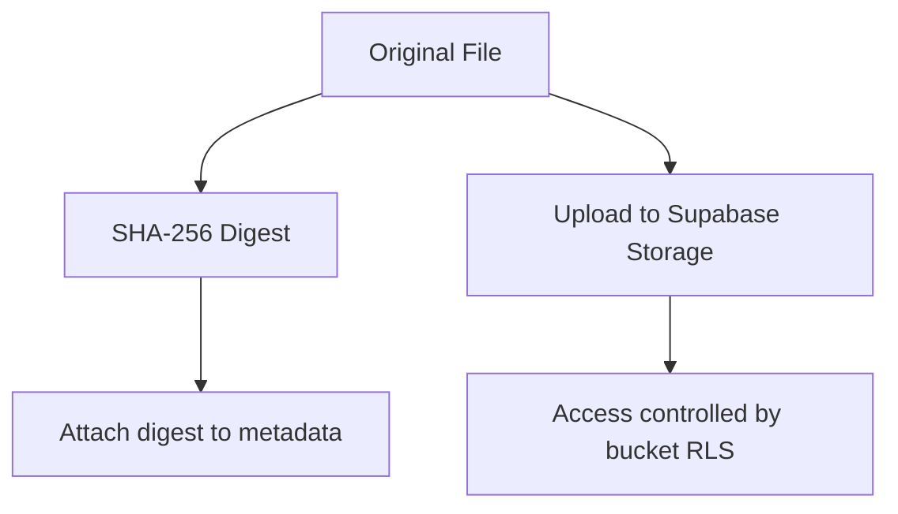
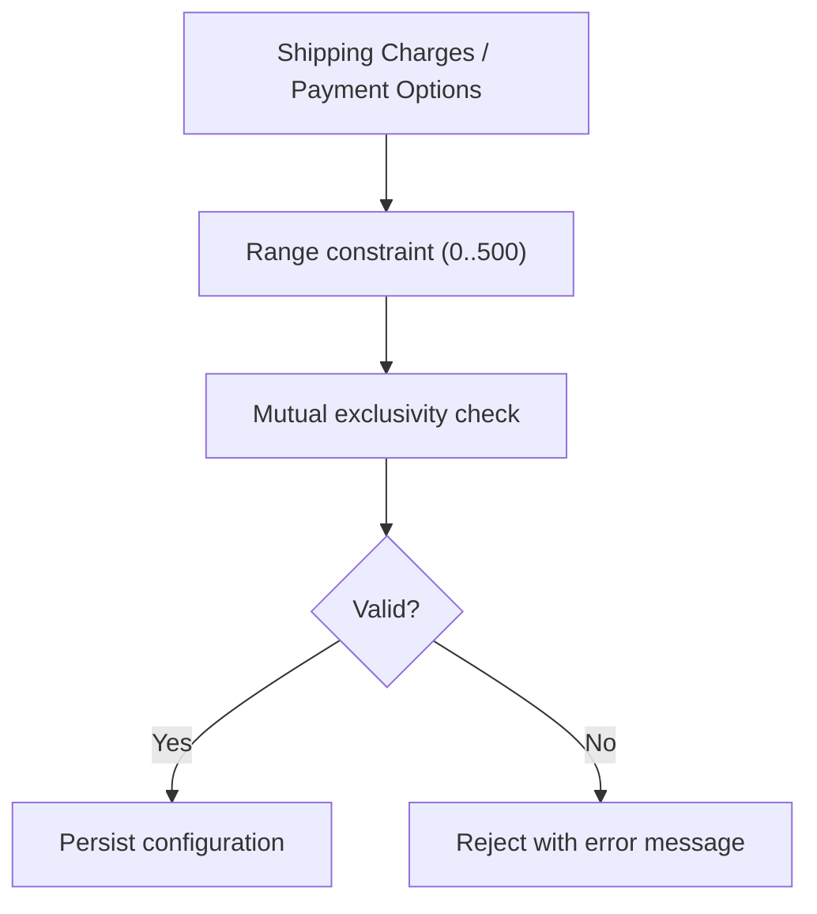
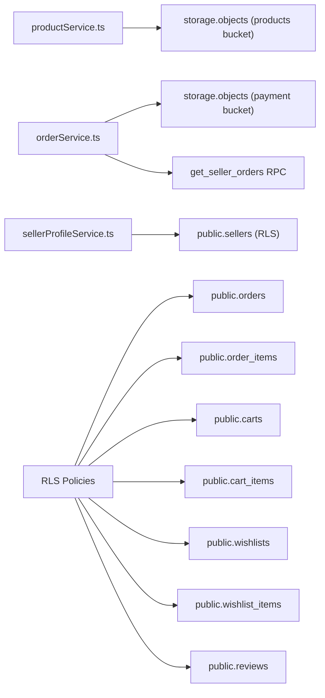

# Data Protection

<cite>
**Referenced Files in This Document**
- [20260814_rls_policies.sql](file://supabase/migrations/20260814_rls_policies.sql)
- [20260829_cnic_storage_rls.sql](file://supabase/migrations/20260829_cnic_storage_rls.sql)
- [20260830_products_storage_rls.sql](file://supabase/migrations/20260830_products_storage_rls.sql)
- [20261008_payment_storage_rls.sql](file://supabase/migrations/20261008_payment_storage_rls.sql)
- [20261106_create_users_table.sql](file://supabase/migrations/20261106_create_users_table.sql)
- [20261107_inventory_movements_delete_policy.sql](file://supabase/migrations/20261107_inventory_movements_delete_policy.sql)
- [supabase_seller_orders_rpc.sql](file://supabase_seller_orders_rpc.sql)
- [productService.ts](file://src/api/productService.ts)
- [orderService.ts](file://src/api/orderService.ts)
- [sellerProfileService.ts](file://src/api/sellerProfileService.ts)
- [CheckoutPage.tsx](file://components/CheckoutPage.tsx)
- [HowToPayModal.tsx](file://components/reseller/components/wallet/HowToPayModal.tsx)
- [PrivacyPolicy.tsx](file://components/PrivacyPolicy.tsx)
</cite>

## Table of Contents
1. [Introduction](#introduction)
2. [Project Structure](#project-structure)
3. [Core Components](#core-components)
4. [Architecture Overview](#architecture-overview)
5. [Detailed Component Analysis](#detailed-component-analysis)
6. [Dependency Analysis](#dependency-analysis)
7. [Performance Considerations](#performance-considerations)
8. [Troubleshooting Guide](#troubleshooting-guide)
9. [Conclusion](#conclusion)

## Introduction
This document explains the data protection model implemented in the project, with a focus on Row Level Security (RLS), database access control, file upload security, input validation, SQL injection prevention, sensitive data handling, encryption strategies, data masking, secure storage practices, privacy compliance, and audit logging considerations. It maps these controls to concrete migration files and application services that enforce them at runtime.

## Project Structure
The data protection surface spans:
- Database migrations defining RLS policies for tables and Supabase Storage buckets.
- Application services validating inputs, sanitizing uploads, and calling secure RPCs.
- UI components guiding users through secure payment workflows and exposing privacy statements.

**Diagram sources**
- [20260814_rls_policies.sql:1-180](file://supabase/migrations/20260814_rls_policies.sql#L1-L180)
- [20260829_cnic_storage_rls.sql:1-42](file://supabase/migrations/20260829_cnic_storage_rls.sql#L1-L42)
- [20260830_products_storage_rls.sql:1-45](file://supabase/migrations/20260830_products_storage_rls.sql#L1-L45)
- [20261008_payment_storage_rls.sql:1-48](file://supabase/migrations/20261008_payment_storage_rls.sql#L1-L48)
- [productService.ts:96-199](file://src/api/productService.ts#L96-L199)
- [orderService.ts:917-940](file://src/api/orderService.ts#L917-L940)
- [sellerProfileService.ts:416-447](file://src/api/sellerProfileService.ts#L416-L447)
- [CheckoutPage.tsx:1001-1025](file://components/CheckoutPage.tsx#L1001-L1025)
- [HowToPayModal.tsx:1-40](file://components/reseller/components/wallet/HowToPayModal.tsx#L1-L40)

**Section sources**
- [20260814_rls_policies.sql:1-180](file://supabase/migrations/20260814_rls_policies.sql#L1-L180)
- [20260829_cnic_storage_rls.sql:1-42](file://supabase/migrations/20260829_cnic_storage_rls.sql#L1-L42)
- [20260830_products_storage_rls.sql:1-45](file://supabase/migrations/20260830_products_storage_rls.sql#L1-L45)
- [20261008_payment_storage_rls.sql:1-48](file://supabase/migrations/20261008_payment_storage_rls.sql#L1-L48)
- [productService.ts:96-199](file://src/api/productService.ts#L96-L199)
- [orderService.ts:917-940](file://src/api/orderService.ts#L917-L940)
- [sellerProfileService.ts:416-447](file://src/api/sellerProfileService.ts#L416-L447)
- [CheckoutPage.tsx:1001-1025](file://components/CheckoutPage.tsx#L1001-L1025)
- [HowToPayModal.tsx:1-40](file://components/reseller/components/wallet/HowToPayModal.tsx#L1-L40)

## Core Components
- Row Level Security (RLS) policies restrict table access by user identity and ownership.
- Supabase Storage RLS policies restrict bucket operations by bucket name and MIME types.
- Secure RPCs encapsulate complex queries and apply server-side authorization.
- Client-side validation and compression protect against malicious or oversized uploads.
- Sensitive data exposure is minimized via selective field projection and random order identifiers.

Key responsibilities:
- Enforce least privilege per role: customers, resellers (sellers), and public readers.
- Validate and constrain inputs before persistence.
- Restrict storage operations to specific buckets and allowed MIME types.
- Avoid leaking PII in public endpoints.

**Section sources**
- [20260814_rls_policies.sql:1-180](file://supabase/migrations/20260814_rls_policies.sql#L1-L180)
- [20260829_cnic_storage_rls.sql:1-42](file://supabase/migrations/20260829_cnic_storage_rls.sql#L1-L42)
- [20260830_products_storage_rls.sql:1-45](file://supabase/migrations/20260830_products_storage_rls.sql#L1-L45)
- [20261008_payment_storage_rls.sql:1-48](file://supabase/migrations/20261008_payment_storage_rls.sql#L1-L48)
- [supabase_seller_orders_rpc.sql:36-91](file://supabase_seller_orders_rpc.sql#L36-L91)
- [productService.ts:96-199](file://src/api/productService.ts#L96-L199)
- [orderService.ts:917-940](file://src/api/orderService.ts#L917-L940)

## Architecture Overview
The system enforces data protection across three layers:
- Database layer: RLS policies and constraints ensure only authorized rows are accessible.
- Storage layer: Bucket-level policies limit who can upload, read, update, or delete files.
- Application layer: Services validate inputs, sanitize data, and call secure RPCs.

**Diagram sources**
- [CheckoutPage.tsx:1001-1025](file://components/CheckoutPage.tsx#L1001-L1025)
- [orderService.ts:917-940](file://src/api/orderService.ts#L917-L940)
- [20261008_payment_storage_rls.sql:1-48](file://supabase/migrations/20261008_payment_storage_rls.sql#L1-L48)
- [20260814_rls_policies.sql:1-180](file://supabase/migrations/20260814_rls_policies.sql#L1-L180)
- [supabase_seller_orders_rpc.sql:36-91](file://supabase_seller_orders_rpc.sql#L36-L91)

## Detailed Component Analysis

### Row Level Security (RLS) Policies
RLS policies define fine-grained access rules for core entities:
- Users: Customers can view, insert, and update only their own profile rows.
- Sellers: Sellers manage their own profiles; active sellers may be visible depending on policy conditions.
- Products: Public reads are limited to non-deactivated products; sellers manage their own products.
- Orders and Order Items: Customers see only their own orders; sellers can view order items tied to their products.
- Carts and Cart Items: Customers manage only their own carts and cart items.
- Wishlists and Wishlist Items: Customers manage only their own wishlists and items.
- Reviews: Public read access; inserts restricted to the author.
- Inventory Movements: Sellers can delete inventory movements for their own products.

**Diagram sources**
- [20260814_rls_policies.sql:1-180](file://supabase/migrations/20260814_rls_policies.sql#L1-L180)
- [20261107_inventory_movements_delete_policy.sql:1-15](file://supabase/migrations/20261107_inventory_movements_delete_policy.sql#L1-L15)

**Section sources**
- [20260814_rls_policies.sql:1-180](file://supabase/migrations/20260814_rls_policies.sql#L1-L180)
- [20261106_create_users_table.sql:1-39](file://supabase/migrations/20261106_create_users_table.sql#L1-L39)
- [20261107_inventory_movements_delete_policy.sql:1-15](file://supabase/migrations/20261107_inventory_movements_delete_policy.sql#L1-L15)

### Supabase Storage Security
Three buckets are configured with explicit RLS policies:
- cnic: Allows uploading CNIC images with strict MIME type restrictions and size limits.
- products: Allows product image uploads with MIME and size constraints.
- payment: Allows both guest and authenticated users to upload payment screenshots; read access is public for viewing proofs.

**Diagram sources**
- [20260829_cnic_storage_rls.sql:1-42](file://supabase/migrations/20260829_cnic_storage_rls.sql#L1-L42)
- [20260830_products_storage_rls.sql:1-45](file://supabase/migrations/20260830_products_storage_rls.sql#L1-L45)
- [20261008_payment_storage_rls.sql:1-48](file://supabase/migrations/20261008_payment_storage_rls.sql#L1-L48)

**Section sources**
- [20260829_cnic_storage_rls.sql:1-42](file://supabase/migrations/20260829_cnic_storage_rls.sql#L1-L42)
- [20260830_products_storage_rls.sql:1-45](file://supabase/migrations/20260830_products_storage_rls.sql#L1-L45)
- [20261008_payment_storage_rls.sql:1-48](file://supabase/migrations/20261008_payment_storage_rls.sql#L1-L48)

### Input Validation and Image Handling
The product service validates and processes images:
- Resolves multiple input formats (File, Blob, URLs).
- Disallows SVG and enforces maximum file size.
- Compresses and resizes images using canvas to reduce payload size.
- Generates content hashes for integrity tracking.

**Diagram sources**
- [productService.ts:96-199](file://src/api/productService.ts#L96-L199)

**Section sources**
- [productService.ts:96-199](file://src/api/productService.ts#L96-L199)

### SQL Injection Prevention and Secure Queries
- All client interactions use parameterized calls to Supabase clients and RPC functions rather than string concatenation.
- The seller orders RPC uses SECURITY DEFINER functions with explicit parameters and server-side filtering, reducing injection risk.
- Public order tracking avoids selecting sensitive fields and uses high-entropy order numbers to mitigate enumeration attacks.

**Diagram sources**
- [supabase_seller_orders_rpc.sql:36-91](file://supabase_seller_orders_rpc.sql#L36-L91)
- [orderService.ts:917-940](file://src/api/orderService.ts#L917-L940)

**Section sources**
- [supabase_seller_orders_rpc.sql:36-91](file://supabase_seller_orders_rpc.sql#L36-L91)
- [orderService.ts:917-940](file://src/api/orderService.ts#L917-L940)

### Sensitive Data Handling and Privacy
- Public order tracking excludes PII such as names, emails, phone numbers, and addresses.
- Payment flows guide users to securely submit bank details and upload proof images.
- Privacy policy documents technical and organizational measures for protecting seller data.

**Diagram sources**
- [orderService.ts:917-940](file://src/api/orderService.ts#L917-L940)

**Section sources**
- [orderService.ts:917-940](file://src/api/orderService.ts#L917-L940)
- [CheckoutPage.tsx:1001-1025](file://components/CheckoutPage.tsx#L1001-L1025)
- [HowToPayModal.tsx:1-40](file://components/reseller/components/wallet/HowToPayModal.tsx#L1-L40)
- [PrivacyPolicy.tsx:191-205](file://components/PrivacyPolicy.tsx#L191-L205)

### Encryption Strategies and Secure Storage
- Client-side hashing: SHA-256 digests are computed for uploaded assets to support integrity checks.
- Secure storage: Supabase Storage buckets enforce MIME type and size constraints via RLS policies.
- No plaintext secrets in code: Bank details are presented via modal and copied safely to clipboard when needed.

**Diagram sources**
- [productService.ts:247-247](file://src/api/productService.ts#L247-L247)
- [20260830_products_storage_rls.sql:1-45](file://supabase/migrations/20260830_products_storage_rls.sql#L1-L45)

**Section sources**
- [productService.ts:247-247](file://src/api/productService.ts#L247-L247)
- [20260830_products_storage_rls.sql:1-45](file://supabase/migrations/20260830_products_storage_rls.sql#L1-L45)

### Data Validation Rules and Business Constraints
- Shipping charges constrained to a defined range via database CHECK constraint.
- Mutual exclusivity between advance payment options enforced at the database level.
- Server-side validation in the seller profile service ensures consistent business rules.

**Diagram sources**
- [20261007_seller_shipping_payment.sql:1-35](file://supabase/migrations/20261007_seller_shipping_payment.sql#L1-L35)
- [sellerProfileService.ts:416-447](file://src/api/sellerProfileService.ts#L416-L447)

**Section sources**
- [20261007_seller_shipping_payment.sql:1-35](file://supabase/migrations/20261007_seller_shipping_payment.sql#L1-L35)
- [sellerProfileService.ts:416-447](file://src/api/sellerProfileService.ts#L416-L447)

### Audit Logging Mechanisms
- The repository does not include dedicated audit logging tables or middleware in the analyzed files.
- Recommended approach: Implement PostgreSQL triggers or an audit log table capturing row changes, user identity, timestamps, and operation types for sensitive tables (orders, payments, user profiles).
- For compliance reporting, aggregate audit events into time-bounded snapshots and protect them with RLS.

[No sources needed since this section provides general guidance]

## Dependency Analysis
The following diagram shows how application services depend on database RLS and storage policies:

**Diagram sources**
- [productService.ts:96-199](file://src/api/productService.ts#L96-L199)
- [orderService.ts:917-940](file://src/api/orderService.ts#L917-L940)
- [sellerProfileService.ts:416-447](file://src/api/sellerProfileService.ts#L416-L447)
- [20260814_rls_policies.sql:1-180](file://supabase/migrations/20260814_rls_policies.sql#L1-L180)
- [20260830_products_storage_rls.sql:1-45](file://supabase/migrations/20260830_products_storage_rls.sql#L1-L45)
- [20261008_payment_storage_rls.sql:1-48](file://supabase/migrations/20261008_payment_storage_rls.sql#L1-L48)
- [supabase_seller_orders_rpc.sql:36-91](file://supabase_seller_orders_rpc.sql#L36-L91)

**Section sources**
- [productService.ts:96-199](file://src/api/productService.ts#L96-L199)
- [orderService.ts:917-940](file://src/api/orderService.ts#L917-L940)
- [sellerProfileService.ts:416-447](file://src/api/sellerProfileService.ts#L416-L447)
- [20260814_rls_policies.sql:1-180](file://supabase/migrations/20260814_rls_policies.sql#L1-L180)
- [20260830_products_storage_rls.sql:1-45](file://supabase/migrations/20260830_products_storage_rls.sql#L1-L45)
- [20261008_payment_storage_rls.sql:1-48](file://supabase/migrations/20261008_payment_storage_rls.sql#L1-L48)
- [supabase_seller_orders_rpc.sql:36-91](file://supabase_seller_orders_rpc.sql#L36-L91)

## Performance Considerations
- RLS policies add minimal overhead but provide strong security guarantees; prefer them over application-level checks.
- Storage bucket policies restrict operations early, reducing unnecessary processing.
- Image compression reduces bandwidth and storage costs while maintaining acceptable quality.
- RPCs perform server-side aggregation and filtering, minimizing client-side computation and network round-trips.

[No sources needed since this section provides general guidance]

## Troubleshooting Guide
Common issues and resolutions:
- StorageApiError on uploads: Ensure the correct bucket exists and RLS policies allow the requested operation. Verify MIME types and size limits.
- Permission denied on table access: Confirm the user’s role and that RLS policies match the intended access pattern (e.g., customers vs sellers).
- Invalid shipping/payment config: Validate ranges and mutual exclusivity constraints; review server-side validation messages.
- Public tracking errors: Ensure order_number is valid and not empty; consider adding infrastructure-level rate limiting to prevent enumeration.

**Section sources**
- [20260829_cnic_storage_rls.sql:1-42](file://supabase/migrations/20260829_cnic_storage_rls.sql#L1-L42)
- [20260830_products_storage_rls.sql:1-45](file://supabase/migrations/20260830_products_storage_rls.sql#L1-L45)
- [20261008_payment_storage_rls.sql:1-48](file://supabase/migrations/20261008_payment_storage_rls.sql#L1-L48)
- [20260814_rls_policies.sql:1-180](file://supabase/migrations/20260814_rls_policies.sql#L1-L180)
- [sellerProfileService.ts:416-447](file://src/api/sellerProfileService.ts#L416-L447)
- [orderService.ts:917-940](file://src/api/orderService.ts#L917-L940)

## Conclusion
The project implements a robust data protection model centered on RLS policies for database tables and Supabase Storage buckets, complemented by client-side validation and secure RPCs. Sensitive data is minimized in public interfaces, and storage operations are tightly constrained. While encryption at rest and comprehensive audit logging are not present in the analyzed files, the current controls establish a strong foundation for privacy and security. Future enhancements should include encryption for sensitive fields, structured audit logging, and infrastructure-level rate limiting to further harden the system.