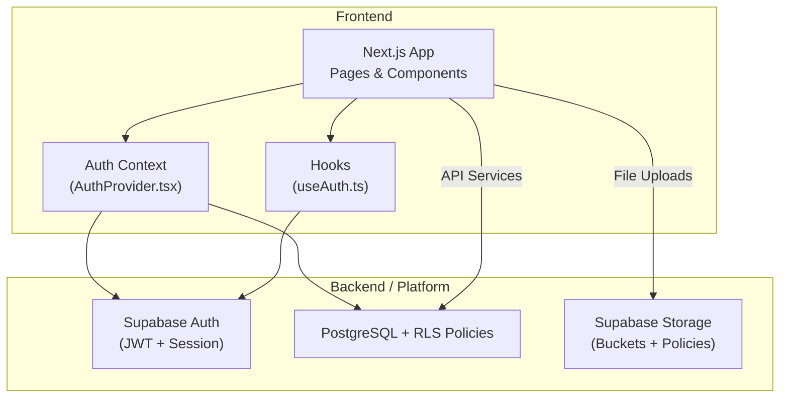
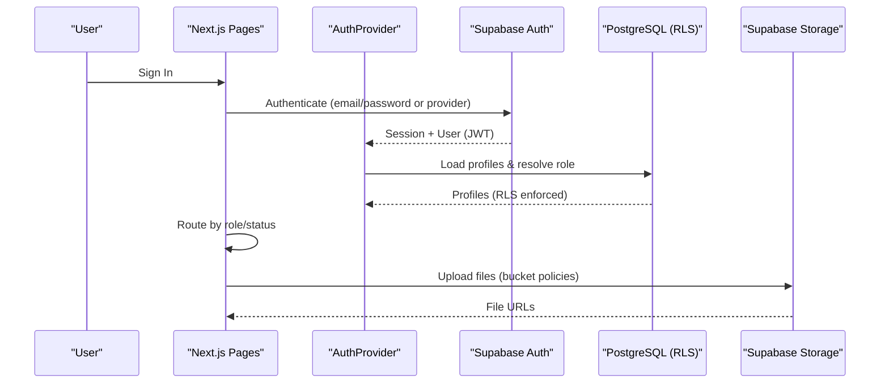
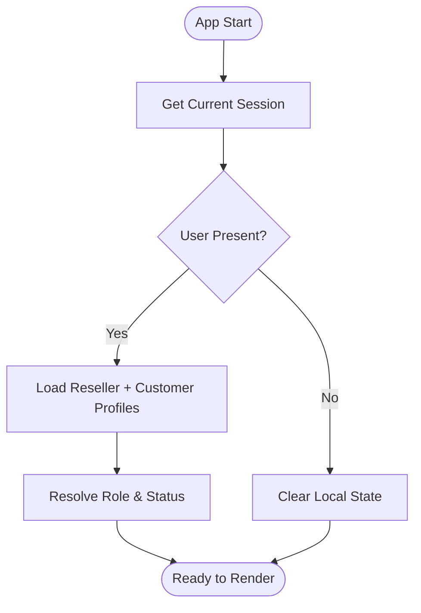
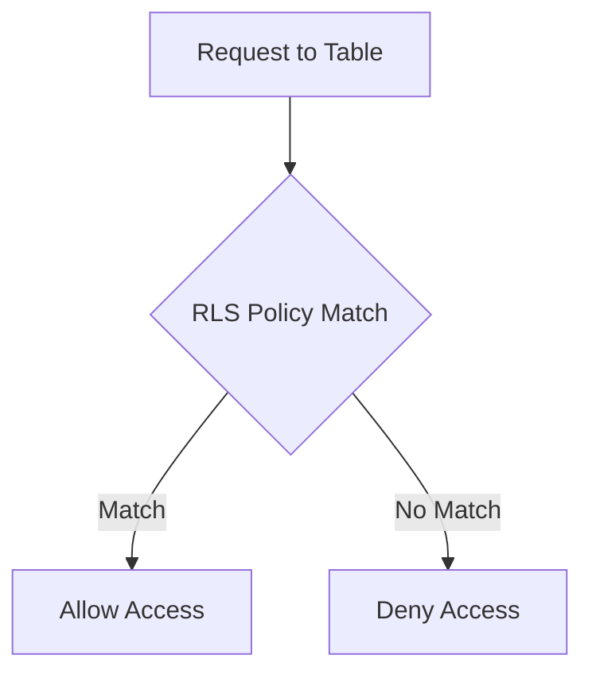
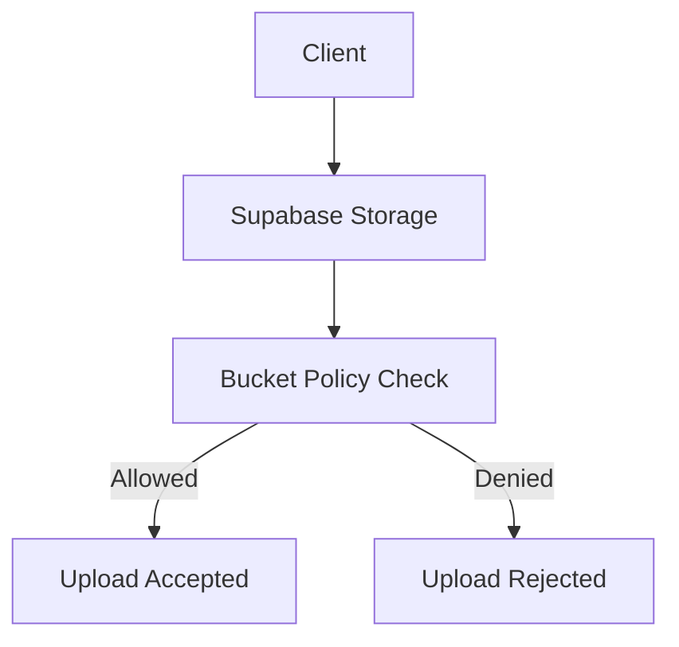
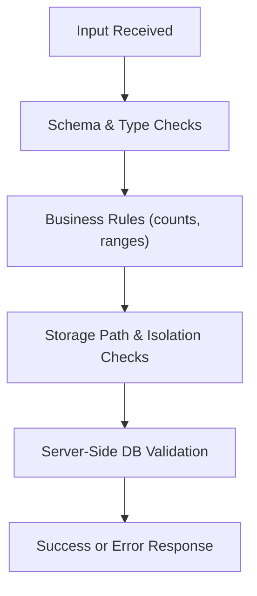
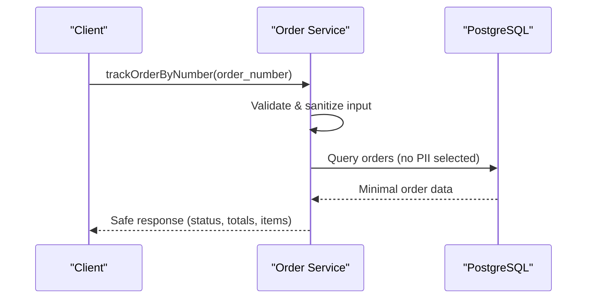
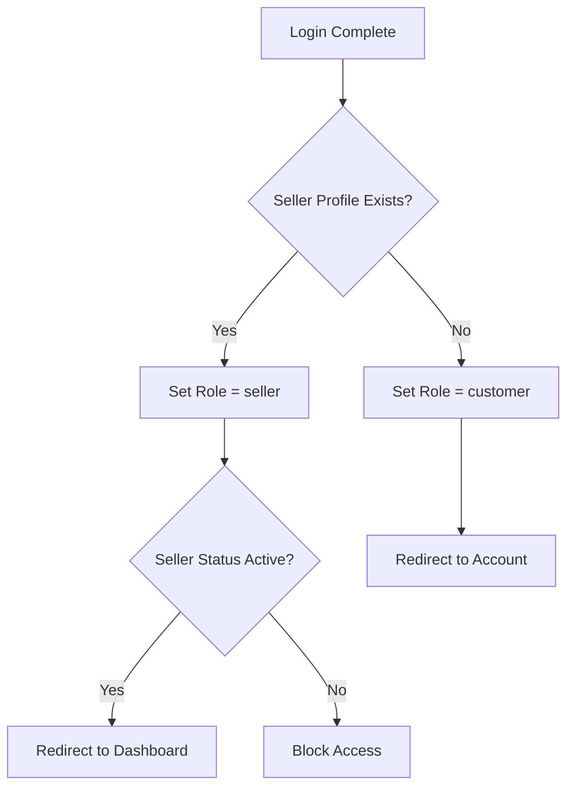
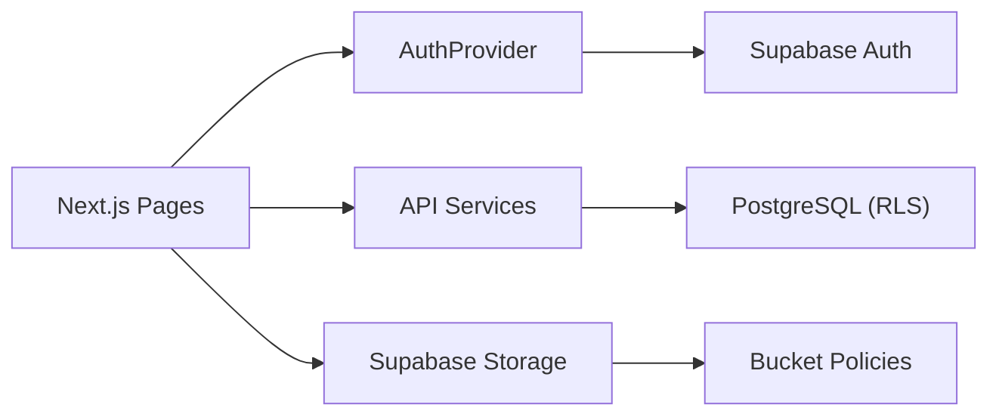

# Security Considerations

<cite>
**Referenced Files in This Document**
- [README.md](file://README.md)
- [AuthProvider.tsx](file://components/context/AuthProvider.tsx)
- [useAuth.ts](file://src/hooks/useAuth.ts)
- [page.tsx (login)](file://app/login/page.tsx)
- [page.tsx (auth callback)](file://app/auth/callback/page.tsx)
- [20260814_rls_policies.sql](file://supabase/migrations/20260814_rls_policies.sql)
- [20260829_cnic_storage_rls.sql](file://supabase/migrations/20260829_cnic_storage_rls.sql)
- [20260830_products_storage_rls.sql](file://supabase/migrations/20260830_products_storage_rls.sql)
- [20261008_payment_storage_rls.sql](file://supabase/migrations/20261008_payment_storage_rls.sql)
- [20261105_all_in_one_product_creation.sql](file://supabase/migrations/20261105_all_in_one_product_creation.sql)
- [productService.ts](file://src/api/productService.ts)
- [orderService.ts](file://src/api/orderService.ts)
</cite>

## Table of Contents
1. [Introduction](#introduction)
2. [Project Structure](#project-structure)
3. [Core Components](#core-components)
4. [Architecture Overview](#architecture-overview)
5. [Detailed Component Analysis](#detailed-component-analysis)
6. [Dependency Analysis](#dependency-analysis)
7. [Performance Considerations](#performance-considerations)
8. [Troubleshooting Guide](#troubleshooting-guide)
9. [Conclusion](#conclusion)

## Introduction
This document provides a comprehensive security analysis for the application, focusing on authentication security, data protection, API security, and Row Level Security (RLS) policies implemented in Supabase. It explains JWT token handling, session management, role-based authorization patterns, input validation, SQL injection prevention, file upload security, rate limiting considerations, request validation, error handling strategies, and compliance considerations for sensitive user and business data.

The project is a Next.js application that integrates with Supabase for authentication, database access, and storage. The security model relies on:
- Supabase Auth for identity and sessions
- Database-level RLS policies to enforce fine-grained access control
- Storage bucket policies to secure file uploads
- Server-side validation in stored procedures and RPCs
- Client-side validation and safe public APIs

**Section sources**
- [README.md:1-37](file://README.md#L1-L37)

## Project Structure
Security-relevant areas are distributed across:
- Authentication UI and context providers
- Supabase migrations defining RLS and storage policies
- API services implementing validation and safe queries
- Pages orchestrating post-login flows and redirects

**Diagram sources**
- [AuthProvider.tsx:1-326](file://components/context/AuthProvider.tsx#L1-L326)
- [useAuth.ts:1-13](file://src/hooks/useAuth.ts#L1-L13)
- [20260814_rls_policies.sql:1-180](file://supabase/migrations/20260814_rls_policies.sql#L1-L180)
- [20260829_cnic_storage_rls.sql:1-42](file://supabase/migrations/20260829_cnic_storage_rls.sql#L1-L42)
- [20260830_products_storage_rls.sql:1-45](file://supabase/migrations/20260830_products_storage_rls.sql#L1-L45)
- [20261008_payment_storage_rls.sql:1-47](file://supabase/migrations/20261008_payment_storage_rls.sql#L1-L47)

**Section sources**
- [AuthProvider.tsx:1-326](file://components/context/AuthProvider.tsx#L1-L326)
- [useAuth.ts:1-13](file://src/hooks/useAuth.ts#L1-L13)

## Core Components
- Authentication Provider: Manages Supabase session lifecycle, user state, role resolution, and profile loading.
- Hooks: Provide typed access to auth context throughout the app.
- Login and Callback Pages: Handle post-authentication routing based on roles and seller status.
- Supabase Migrations: Define RLS policies for tables and storage buckets.
- API Services: Implement input validation, safe queries, and error mapping.

Key responsibilities:
- Enforce least privilege via RLS at the database layer.
- Validate inputs both client-side and server-side.
- Secure file uploads using bucket policies and MIME/type checks.
- Minimize PII exposure in public endpoints.

**Section sources**
- [AuthProvider.tsx:76-326](file://components/context/AuthProvider.tsx#L76-L326)
- [useAuth.ts:1-13](file://src/hooks/useAuth.ts#L1-L13)
- [page.tsx (login):1-39](file://app/login/page.tsx#L1-L39)
- [page.tsx (auth callback):39-68](file://app/auth/callback/page.tsx#L39-L68)

## Architecture Overview
The security architecture combines frontend controls with platform-enforced policies:

**Diagram sources**
- [AuthProvider.tsx:248-303](file://components/context/AuthProvider.tsx#L248-L303)
- [20260814_rls_policies.sql:1-180](file://supabase/migrations/20260814_rls_policies.sql#L1-L180)
- [20260829_cnic_storage_rls.sql:1-42](file://supabase/migrations/20260829_cnic_storage_rls.sql#L1-L42)
- [20260830_products_storage_rls.sql:1-45](file://supabase/migrations/20260830_products_storage_rls.sql#L1-L45)
- [20261008_payment_storage_rls.sql:1-47](file://supabase/migrations/20261008_payment_storage_rls.sql#L1-L47)

## Detailed Component Analysis

### Authentication and Session Management
- Session lifecycle:
  - On mount, the provider retrieves the current session and user, then loads profiles and resolves roles.
  - An auth state change listener updates session/user and re-resolves roles when the session changes.
- Role resolution:
  - If a seller profile exists, the role is set to seller; otherwise, it defaults to customer.
  - Seller status is carried from the seller profile to gate dashboard access.
- Logout:
  - Clears local state and calls Supabase sign-out.

**Diagram sources**
- [AuthProvider.tsx:248-303](file://components/context/AuthProvider.tsx#L248-L303)
- [AuthProvider.tsx:140-216](file://components/context/AuthProvider.tsx#L140-L216)

**Section sources**
- [AuthProvider.tsx:76-326](file://components/context/AuthProvider.tsx#L76-L326)
- [useAuth.ts:1-13](file://src/hooks/useAuth.ts#L1-L13)
- [page.tsx (login):13-28](file://app/login/page.tsx#L13-L28)
- [page.tsx (auth callback):42-50](file://app/auth/callback/page.tsx#L42-L50)

### Row Level Security (RLS) Policies
RLS enforces data isolation at the database level:
- Sellers: view/update own profile; insert own profile.
- Users: view/update/insert own profile.
- Products: public read active products; sellers manage own products.
- Orders and Order Items: customers view/insert own orders; order items visibility tied to owning order or seller.
- Carts and Cart Items: customers manage own cart and items.
- Wishlists and Wishlist Items: customers manage own wishlists and items.
- Reviews: public read; customers insert own reviews.

**Diagram sources**
- [20260814_rls_policies.sql:1-180](file://supabase/migrations/20260814_rls_policies.sql#L1-L180)

**Section sources**
- [20260814_rls_policies.sql:1-180](file://supabase/migrations/20260814_rls_policies.sql#L1-L180)

### File Upload Security
Storage buckets are configured with explicit policies and constraints:
- CNIC bucket: allows uploads for public and authenticated users; restricts MIME types; size limit applied.
- Products bucket: similar configuration for product images.
- Payment bucket: allows guest and authenticated uploads for payment screenshots; read access for public; delete allowed for cleanup.
- ProductImages bucket: authenticated-only uploads; public read; authenticated delete.

**Diagram sources**
- [20260829_cnic_storage_rls.sql:1-42](file://supabase/migrations/20260829_cnic_storage_rls.sql#L1-L42)
- [20260830_products_storage_rls.sql:1-45](file://supabase/migrations/20260830_products_storage_rls.sql#L1-L45)
- [20261008_payment_storage_rls.sql:1-47](file://supabase/migrations/20261008_payment_storage_rls.sql#L1-L47)
- [20261105_all_in_one_product_creation.sql:1190-1227](file://supabase/migrations/20261105_all_in_one_product_creation.sql#L1190-L1227)

**Section sources**
- [20260829_cnic_storage_rls.sql:1-42](file://supabase/migrations/20260829_cnic_storage_rls.sql#L1-L42)
- [20260830_products_storage_rls.sql:1-45](file://supabase/migrations/20260830_products_storage_rls.sql#L1-L45)
- [20261008_payment_storage_rls.sql:1-47](file://supabase/migrations/20261008_payment_storage_rls.sql#L1-L47)
- [20261105_all_in_one_product_creation.sql:1190-1227](file://supabase/migrations/20261105_all_in_one_product_creation.sql#L1190-L1227)

### Input Validation and SQL Injection Prevention
- Stored procedure validations:
  - Variation combinations count bounds enforced.
  - Image gallery count limits and required fields validated.
  - Storage path presence validated to ensure secure isolation.
  - Attribute values validated per type (text/select, number, boolean, multi-select).
- Client-side validations:
  - Image type restrictions (e.g., SVG disallowed), size limits, variation dimension/value caps, pricing/stock rules.
  - Error messages mapped to friendly user-facing text.

**Diagram sources**
- [20261105_all_in_one_product_creation.sql:425-453](file://supabase/migrations/20261105_all_in_one_product_creation.sql#L425-L453)
- [productService.ts:155-168](file://src/api/productService.ts#L155-L168)
- [productService.ts:318-390](file://src/api/productService.ts#L318-L390)

**Section sources**
- [20261105_all_in_one_product_creation.sql:425-453](file://supabase/migrations/20261105_all_in_one_product_creation.sql#L425-L453)
- [productService.ts:155-168](file://src/api/productService.ts#L155-L168)
- [productService.ts:318-390](file://src/api/productService.ts#L318-L390)

### API Security: Public Order Tracking
- The public tracking endpoint:
  - Accepts an order number and returns minimal, non-sensitive data.
  - Avoids selecting PII such as customer name/email/phone/shipping address/postal code.
  - Uses high-entropy order numbers to mitigate enumeration risks.
  - Includes a recommendation for infrastructure-level rate limiting to prevent automated abuse.

**Diagram sources**
- [orderService.ts:927-1046](file://src/api/orderService.ts#L927-L1046)

**Section sources**
- [orderService.ts:927-1046](file://src/api/orderService.ts#L927-L1046)

### Role-Based Authorization Patterns
- Role determination:
  - Presence of a seller profile sets role to seller; otherwise customer.
- Post-login routing:
  - Sellers are routed to dashboard if not suspended; customers to account page.
- RLS enforcement:
  - All table operations are guarded by RLS policies matching the authenticated user’s identity and ownership.

**Diagram sources**
- [AuthProvider.tsx:140-216](file://components/context/AuthProvider.tsx#L140-L216)
- [page.tsx (login):13-28](file://app/login/page.tsx#L13-L28)

**Section sources**
- [AuthProvider.tsx:140-216](file://components/context/AuthProvider.tsx#L140-L216)
- [page.tsx (login):13-28](file://app/login/page.tsx#L13-L28)

## Dependency Analysis
Security dependencies span multiple layers:

**Diagram sources**
- [AuthProvider.tsx:1-326](file://components/context/AuthProvider.tsx#L1-L326)
- [productService.ts:155-168](file://src/api/productService.ts#L155-L168)
- [20260814_rls_policies.sql:1-180](file://supabase/migrations/20260814_rls_policies.sql#L1-L180)
- [20260829_cnic_storage_rls.sql:1-42](file://supabase/migrations/20260829_cnic_storage_rls.sql#L1-L42)

**Section sources**
- [AuthProvider.tsx:1-326](file://components/context/AuthProvider.tsx#L1-L326)
- [productService.ts:155-168](file://src/api/productService.ts#L155-L168)
- [20260814_rls_policies.sql:1-180](file://supabase/migrations/20260814_rls_policies.sql#L1-L180)
- [20260829_cnic_storage_rls.sql:1-42](file://supabase/migrations/20260829_cnic_storage_rls.sql#L1-L42)

## Performance Considerations
- RLS policies add database-level checks; keep policies simple and indexed where appropriate to minimize overhead.
- Public tracking query joins multiple tables; ensure indexes on frequently filtered columns (e.g., order_number).
- Storage bucket policies are evaluated per operation; avoid overly broad permissions—prefer least privilege.
- Client-side validation reduces unnecessary network requests and server load.

[No sources needed since this section provides general guidance]

## Troubleshooting Guide
Common issues and mitigations:
- Permission denied errors during product creation:
  - Indicates RLS policy violation; ensure the authenticated user matches the seller_id.
  - Friendly error mapping guides users to correct their seller context.
- Schema cache or missing table errors:
  - Gracefully handled by returning null and avoiding crashes when tables are not yet created.
- Storage upload failures:
  - Verify bucket policies allow the intended actor (public/authenticated) and MIME types.
  - Confirm file size limits and bucket configuration.

Actionable references:
- RLS permission errors mapped to user-friendly messages.
- Handling of schema cache and missing table errors in profile fetching.
- Storage bucket policies for CNIC, products, payment, and productImages.

**Section sources**
- [productService.ts:274-289](file://src/api/productService.ts#L274-L289)
- [AuthProvider.tsx:104-138](file://components/context/AuthProvider.tsx#L104-L138)
- [20260829_cnic_storage_rls.sql:1-42](file://supabase/migrations/20260829_cnic_storage_rls.sql#L1-L42)
- [20260830_products_storage_rls.sql:1-45](file://supabase/migrations/20260830_products_storage_rls.sql#L1-L45)
- [20261008_payment_storage_rls.sql:1-47](file://supabase/migrations/20261008_payment_storage_rls.sql#L1-L47)
- [20261105_all_in_one_product_creation.sql:1190-1227](file://supabase/migrations/20261105_all_in_one_product_creation.sql#L1190-L1227)

## Conclusion
This application implements a robust security posture through layered controls:
- Authentication and session management via Supabase Auth with clear role resolution.
- Strong data isolation enforced by RLS policies across all critical tables.
- Secure file uploads governed by explicit bucket policies and type/size constraints.
- Comprehensive input validation both client-side and server-side to prevent injection and malformed data.
- Careful design of public APIs to minimize PII exposure and mitigate enumeration risks.

For production hardening:
- Add infrastructure-level rate limiting for public endpoints.
- Continuously audit RLS policies and storage bucket permissions.
- Monitor and alert on permission denials and storage policy violations.
- Maintain strict separation between public and private data in API responses.

[No sources needed since this section summarizes without analyzing specific files]