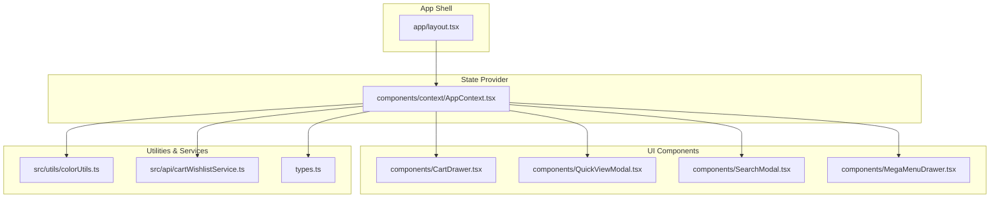
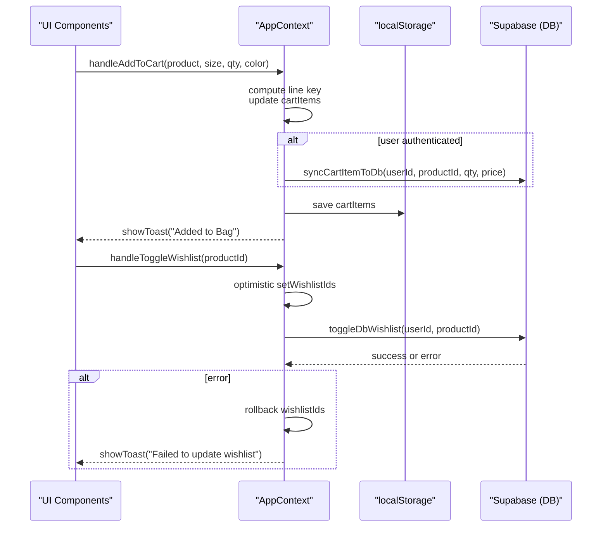
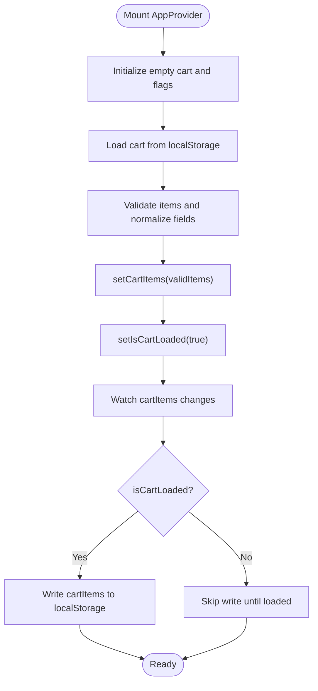
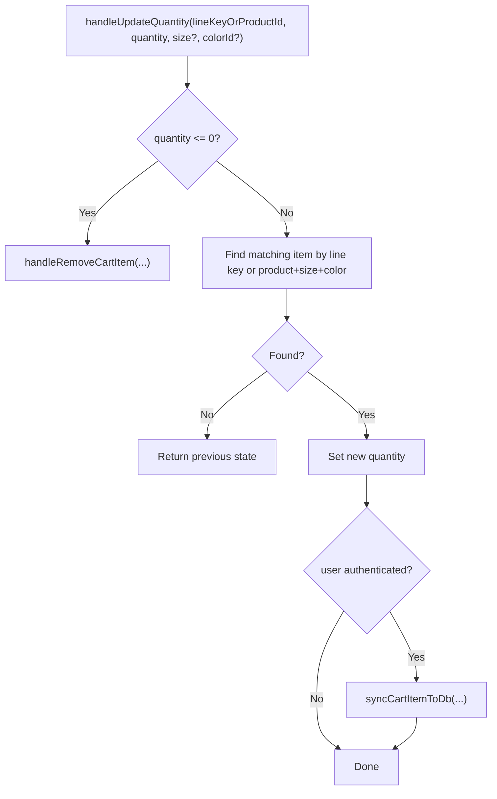
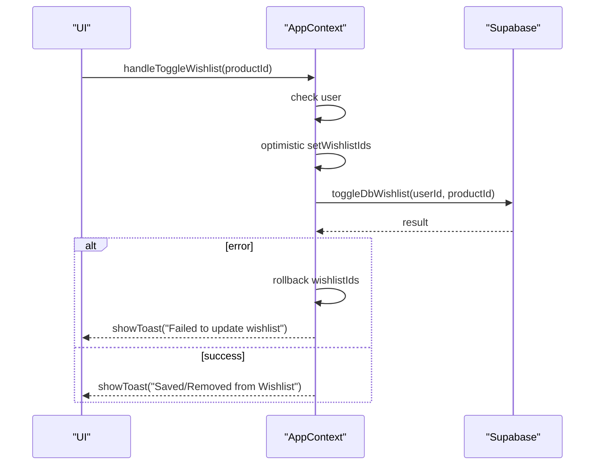
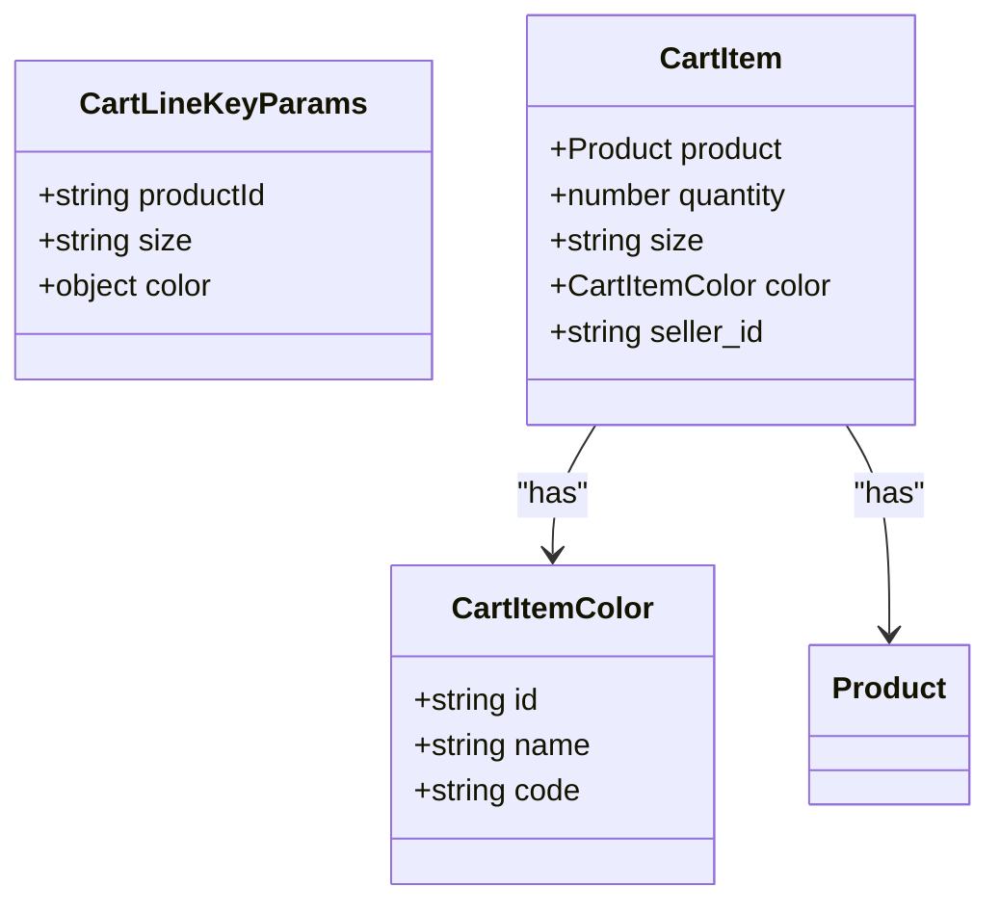
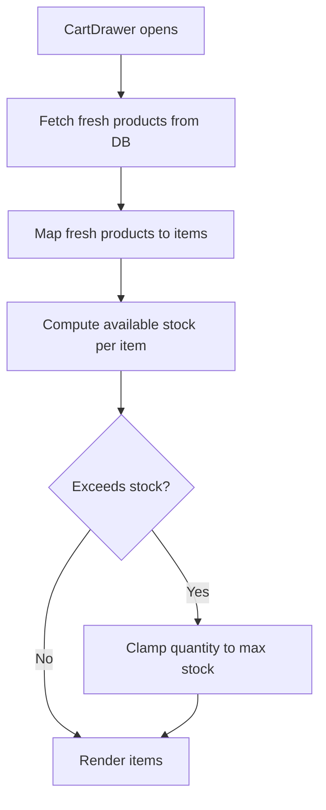
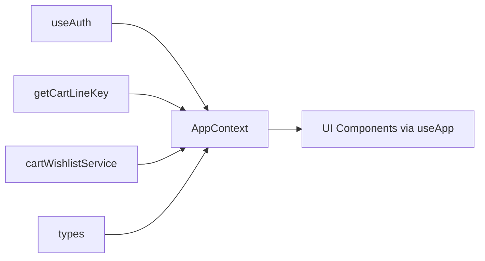

# AppContext - Shopping & UI State

<cite>
**Referenced Files in This Document**
- [AppContext.tsx](file://components/context/AppContext.tsx)
- [colorUtils.ts](file://src/utils/colorUtils.ts)
- [cartWishlistService.ts](file://src/api/cartWishlistService.ts)
- [types.ts](file://types.ts)
- [CartDrawer.tsx](file://components/CartDrawer.tsx)
- [QuickViewModal.tsx](file://components/QuickViewModal.tsx)
- [SearchModal.tsx](file://components/SearchModal.tsx)
- [MegaMenuDrawer.tsx](file://components/MegaMenuDrawer.tsx)
- [layout.tsx](file://app/layout.tsx)
</cite>

## Table of Contents
1. [Introduction](#introduction)
2. [Project Structure](#project-structure)
3. [Core Components](#core-components)
4. [Architecture Overview](#architecture-overview)
5. [Detailed Component Analysis](#detailed-component-analysis)
6. [Dependency Analysis](#dependency-analysis)
7. [Performance Considerations](#performance-considerations)
8. [Troubleshooting Guide](#troubleshooting-guide)
9. [Conclusion](#conclusion)

## Introduction
This document explains the AppContext implementation that centralizes shopping cart, wishlist, and UI interaction state for the application. It covers:
- Cart management with add/remove operations, quantity updates, size and color variants, localStorage persistence, and database synchronization.
- Wishlist system with optimistic local updates and database sync.
- UI state for mega menu, search modal, quick view product, and toast notifications.
- Usage patterns through the useApp hook.
- SSR hydration considerations, error handling for localStorage, and performance guidance for cart state updates.

## Project Structure
The AppContext lives under components/context and is provided at the app root. Consumers access it via the useApp hook. Supporting utilities and services are located under src/utils and src/api.

**Diagram sources**
- [layout.tsx:1-20](file://app/layout.tsx#L1-L20)
- [AppContext.tsx:1-30](file://components/context/AppContext.tsx#L1-L30)
- [CartDrawer.tsx:1-20](file://components/CartDrawer.tsx#L1-L20)
- [QuickViewModal.tsx:1-20](file://components/QuickViewModal.tsx#L1-L20)
- [SearchModal.tsx:1-20](file://components/SearchModal.tsx#L1-L20)
- [MegaMenuDrawer.tsx:1-20](file://components/MegaMenuDrawer.tsx#L1-L20)
- [colorUtils.ts:1-20](file://src/utils/colorUtils.ts#L1-L20)
- [cartWishlistService.ts:1-20](file://src/api/cartWishlistService.ts#L1-L20)
- [types.ts:1-20](file://types.ts#L1-L20)

**Section sources**
- [layout.tsx:1-20](file://app/layout.tsx#L1-L20)
- [AppContext.tsx:1-30](file://components/context/AppContext.tsx#L1-L30)

## Core Components
- AppProvider: React context provider exposing cart, wishlist, UI drawer/modal state, and toast helpers.
- useApp: Hook to consume AppContext safely within components.
- colorUtils.getCartLineKey: Stable line key generator for cart items based on product id, size, and color id.
- cartWishlistService: Database operations for wishlist and cart synchronization.
- types: Shared TypeScript interfaces including Product, CartItem, CartItemColor.

Key responsibilities:
- Cart: Add/remove/update items, persist to localStorage, sync to DB when authenticated.
- Wishlist: Optimistic toggle with DB sync and rollback on failure.
- UI State: Manage mega menu, search modal, quick view product, and toast messages.

**Section sources**
- [AppContext.tsx:14-53](file://components/context/AppContext.tsx#L14-L53)
- [AppContext.tsx:59-82](file://components/context/AppContext.tsx#L59-L82)
- [colorUtils.ts:116-126](file://src/utils/colorUtils.ts#L116-L126)
- [cartWishlistService.ts:9-31](file://src/api/cartWishlistService.ts#L9-L31)
- [cartWishlistService.ts:36-88](file://src/api/cartWishlistService.ts#L36-L88)
- [cartWishlistService.ts:96-163](file://src/api/cartWishlistService.ts#L96-L163)
- [cartWishlistService.ts:168-222](file://src/api/cartWishlistService.ts#L168-L222)
- [types.ts:258-270](file://types.ts#L258-L270)

## Architecture Overview
AppContext orchestrates client-side state and integrates with Supabase for persistent data. The flow includes:
- Local storage load and validation on mount.
- DB wishlist fetch and guest cart merge upon authentication.
- Cart operations update local state and optionally sync to DB.
- Wishlist toggles optimistically update UI then sync to DB with rollback on error.
- UI state controls drawers/modals and toast notifications.

**Diagram sources**
- [AppContext.tsx:165-210](file://components/context/AppContext.tsx#L165-L210)
- [AppContext.tsx:304-331](file://components/context/AppContext.tsx#L304-L331)
- [cartWishlistService.ts:96-163](file://src/api/cartWishlistService.ts#L96-L163)
- [cartWishlistService.ts:36-88](file://src/api/cartWishlistService.ts#L36-L88)

## Detailed Component Analysis

### AppContext Provider and Hooks
Responsibilities:
- Initialize empty cart to avoid SSR hydration mismatch.
- Load and validate cart from localStorage after hydration.
- Persist cart changes to localStorage.
- Fetch wishlist IDs and merge guest cart when user authenticates.
- Provide cart actions: add, update quantity, remove, clear.
- Provide wishlist action: toggle with optimistic updates and DB sync.
- Provide UI state: mega menu open/close, search modal open/close, quick view product, toast message.

SSR Hydration Pattern:
- Cart state starts empty on server and client initial render.
- After hydration, a useEffect loads localStorage and sets isCartLoaded flag.
- Subsequent localStorage writes only occur after isCartLoaded is true.

Error Handling:
- localStorage read/write wrapped in try/catch; errors logged and fallback applied.
- DB operations catch errors and log; wishlist rollback on failure.

Performance:
- Cart updates use functional setState to minimize re-renders.
- DB sync triggered conditionally for authenticated users.
- Toast auto-dismisses after a fixed duration.

**Diagram sources**
- [AppContext.tsx:62-82](file://components/context/AppContext.tsx#L62-L82)
- [AppContext.tsx:84-145](file://components/context/AppContext.tsx#L84-L145)

**Section sources**
- [AppContext.tsx:59-82](file://components/context/AppContext.tsx#L59-L82)
- [AppContext.tsx:84-145](file://components/context/AppContext.tsx#L84-L145)
- [AppContext.tsx:147-163](file://components/context/AppContext.tsx#L147-L163)
- [AppContext.tsx:360-366](file://components/context/AppContext.tsx#L360-L366)

### Cart Management
- Add to cart:
  - Computes seller_id from product fields.
  - Generates stable line key using getCartLineKey.
  - Merges quantities if same line key exists.
  - Syncs to DB for authenticated users.
  - Shows toast and opens cart drawer.
- Update quantity:
  - Accepts either full line key or product id with optional size and color id.
  - Normalizes size defaults and color ids.
  - Removes item if quantity <= 0.
  - Syncs to DB for authenticated users.
- Remove item:
  - Supports removal by line key or by product id with size/color filters.
  - Syncs to DB with zero quantity to remove.
  - Shows toast.
- Clear cart:
  - Clears local state and removes localStorage entry.

**Diagram sources**
- [AppContext.tsx:212-254](file://components/context/AppContext.tsx#L212-L254)
- [AppContext.tsx:256-295](file://components/context/AppContext.tsx#L256-L295)
- [cartWishlistService.ts:96-163](file://src/api/cartWishlistService.ts#L96-L163)

**Section sources**
- [AppContext.tsx:165-210](file://components/context/AppContext.tsx#L165-L210)
- [AppContext.tsx:212-295](file://components/context/AppContext.tsx#L212-L295)
- [AppContext.tsx:297-302](file://components/context/AppContext.tsx#L297-L302)

### Wishlist System
- Requires authentication; otherwise shows a toast prompting login.
- Optimistically updates local wishlistIds array.
- Calls toggleDbWishlist to sync with DB.
- On DB error, rolls back local state and shows an error toast.

**Diagram sources**
- [AppContext.tsx:304-331](file://components/context/AppContext.tsx#L304-L331)
- [cartWishlistService.ts:36-88](file://src/api/cartWishlistService.ts#L36-L88)

**Section sources**
- [AppContext.tsx:304-331](file://components/context/AppContext.tsx#L304-L331)

### UI State Management
- Mega menu: boolean flag isMegaMenuOpen and setter setIsMegaMenuOpen exposed via context.
- Search modal: boolean flag isSearchOpen and setter setIsSearchOpen exposed via context.
- Quick view product: quickViewProduct object and setter setQuickViewProduct exposed via context.
- Toast notifications: toastMessage string and showToast function exposed via context.

These states are consumed by UI components such as MegaMenuDrawer, SearchModal, QuickViewModal, and layout-level elements.

**Section sources**
- [AppContext.tsx:42-52](file://components/context/AppContext.tsx#L42-L52)
- [AppContext.tsx:71-82](file://components/context/AppContext.tsx#L71-L82)
- [MegaMenuDrawer.tsx:1-20](file://components/MegaMenuDrawer.tsx#L1-L20)
- [SearchModal.tsx:1-20](file://components/SearchModal.tsx#L1-L20)
- [QuickViewModal.tsx:1-20](file://components/QuickViewModal.tsx#L1-L20)

### Cart Line Keys and Color Variants
- getCartLineKey generates a stable identifier combining product id, size, and color id.
- Default size normalization ensures consistent keys even when size is missing.
- Color variant support uses CartItemColor with id, name, and code.

**Diagram sources**
- [colorUtils.ts:105-126](file://src/utils/colorUtils.ts#L105-L126)
- [types.ts:258-270](file://types.ts#L258-L270)

**Section sources**
- [colorUtils.ts:116-126](file://src/utils/colorUtils.ts#L116-L126)
- [types.ts:258-270](file://types.ts#L258-L270)

### Cart Drawer Stock Validation
- On open, fetches fresh product stock from DB and maps to local items.
- Adjusts quantities if exceeding available stock and displays notices.
- Clamps user input to max allowed stock.

**Diagram sources**
- [CartDrawer.tsx:29-105](file://components/CartDrawer.tsx#L29-L105)
- [CartDrawer.tsx:109-136](file://components/CartDrawer.tsx#L109-L136)

**Section sources**
- [CartDrawer.tsx:29-105](file://components/CartDrawer.tsx#L29-L105)
- [CartDrawer.tsx:109-136](file://components/CartDrawer.tsx#L109-L136)

## Dependency Analysis
AppContext depends on:
- useAuth for current user identity.
- colorUtils.getCartLineKey for stable cart line identification.
- cartWishlistService for DB operations.
- types for shared interfaces.

Consumers depend on AppContext via useApp.

**Diagram sources**
- [AppContext.tsx:3-12](file://components/context/AppContext.tsx#L3-L12)
- [AppContext.tsx:360-366](file://components/context/AppContext.tsx#L360-L366)

**Section sources**
- [AppContext.tsx:3-12](file://components/context/AppContext.tsx#L3-L12)
- [AppContext.tsx:360-366](file://components/context/AppContext.tsx#L360-L366)

## Performance Considerations
- Avoid unnecessary re-renders by using functional setState for cart updates.
- Defer localStorage writes until after initial load to prevent hydration mismatches.
- Trigger DB sync only for authenticated users to reduce network overhead.
- Use stable line keys to minimize diffing cost during cart updates.
- Debounce or throttle frequent UI interactions if needed (e.g., rapid quantity changes).
- Keep toast durations reasonable to avoid blocking user interactions.

[No sources needed since this section provides general guidance]

## Troubleshooting Guide
Common issues and resolutions:
- Hydration mismatch: Ensure cart state initializes empty and loads from localStorage after hydration.
- localStorage errors: Wrapped in try/catch; check console logs and verify storage permissions.
- Wishlist sync failures: Rollback occurs automatically; retry operation and confirm authentication.
- Cart DB sync failures: Logged; verify user session and network connectivity.
- Out-of-stock adjustments: CartDrawer clamps quantities; review notices and adjust accordingly.

**Section sources**
- [AppContext.tsx:84-145](file://components/context/AppContext.tsx#L84-L145)
- [AppContext.tsx:304-331](file://components/context/AppContext.tsx#L304-L331)
- [CartDrawer.tsx:29-105](file://components/CartDrawer.tsx#L29-L105)

## Conclusion
AppContext provides a robust, centralized state layer for shopping cart, wishlist, and UI interactions. It balances immediate user feedback with reliable persistence through localStorage and database synchronization. With careful attention to SSR hydration, error handling, and performance, it supports scalable shopping experiences across the application.

[No sources needed since this section summarizes without analyzing specific files]