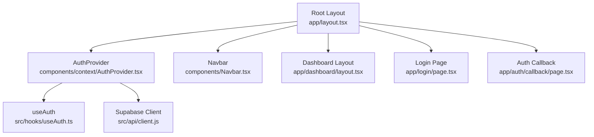
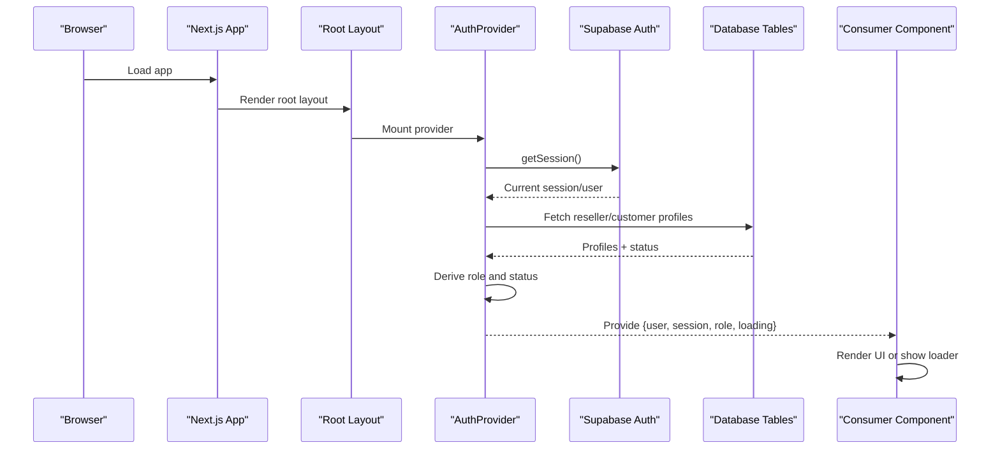
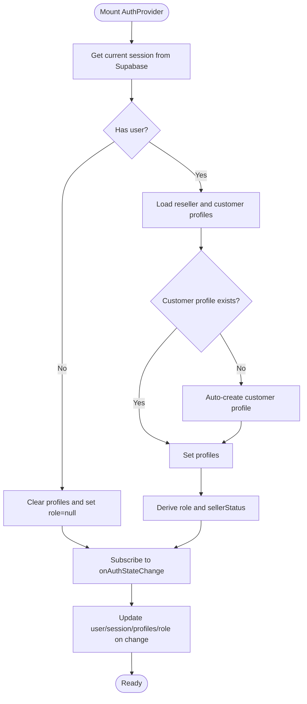
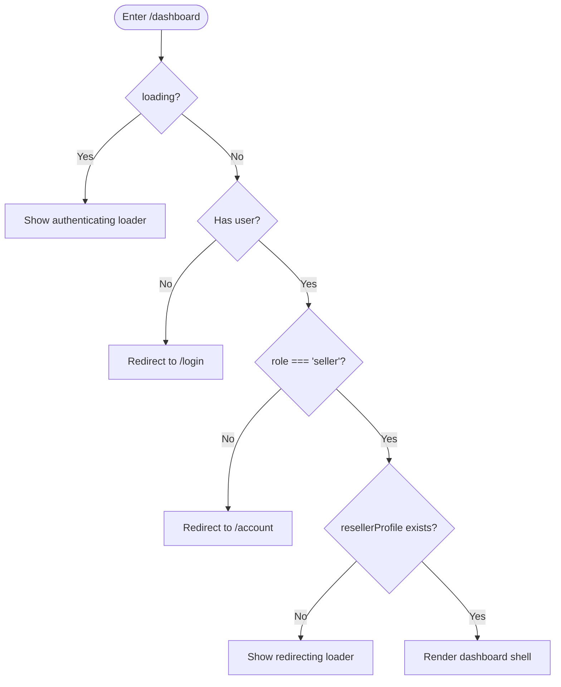
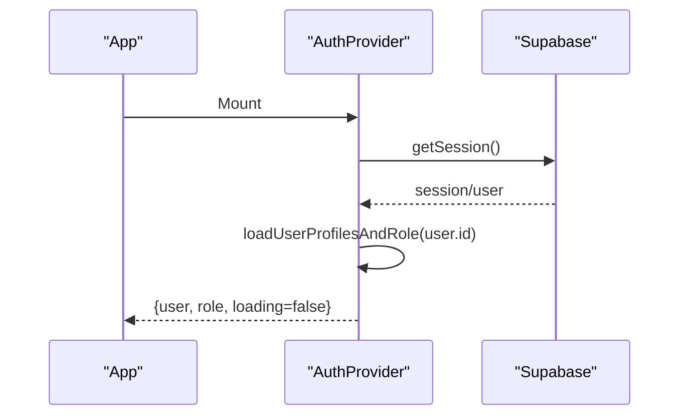
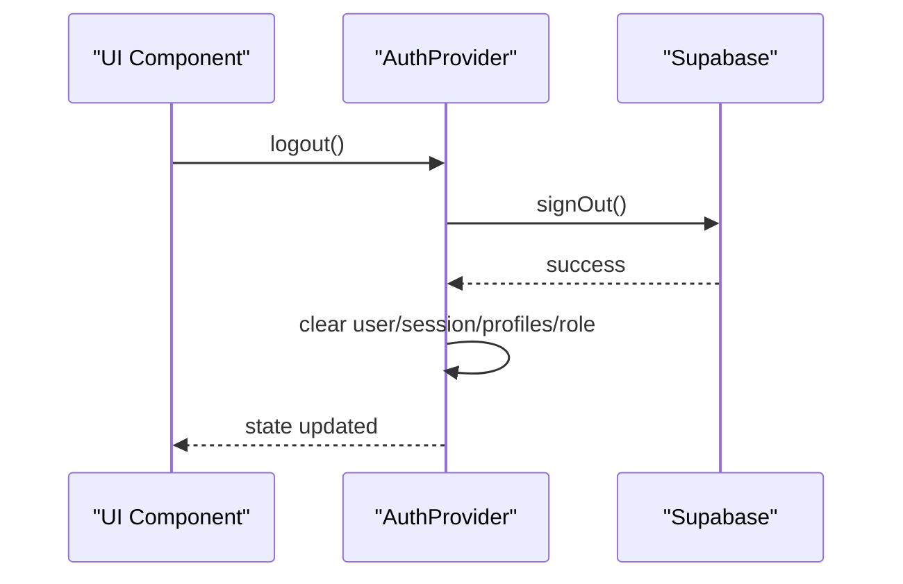
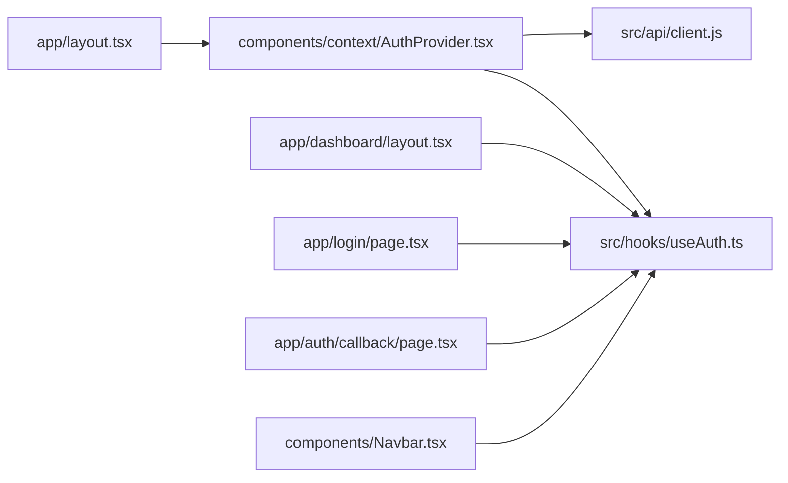

# AuthProvider - Authentication State

<cite>
**Referenced Files in This Document**
- [AuthProvider.tsx](file://components/context/AuthProvider.tsx)
- [useAuth.ts](file://src/hooks/useAuth.ts)
- [layout.tsx](file://app/layout.tsx)
- [client.js](file://src/api/client.js)
- [dashboard layout.tsx](file://app/dashboard/layout.tsx)
- [login page.tsx](file://app/login/page.tsx)
- [auth callback page.tsx](file://app/auth/callback/page.tsx)
- [Navbar.tsx](file://components/Navbar.tsx)
</cite>

## Table of Contents
1. [Introduction](#introduction)
2. [Project Structure](#project-structure)
3. [Core Components](#core-components)
4. [Architecture Overview](#architecture-overview)
5. [Detailed Component Analysis](#detailed-component-analysis)
6. [Dependency Analysis](#dependency-analysis)
7. [Performance Considerations](#performance-considerations)
8. [Troubleshooting Guide](#troubleshooting-guide)
9. [Conclusion](#conclusion)

## Introduction
This document explains the AuthProvider implementation that manages authentication state and session lifecycle for the application. It wraps the app to provide a centralized authentication context, integrates with Supabase for session persistence, resolves user roles and profiles, and exposes a simple useAuth hook for components to consume auth state. It also documents protected route patterns, role-based access control, error handling, and security considerations for client-side auth state management.

## Project Structure
The authentication system is composed of:
- A React Context provider (AuthProvider) that owns auth state and profile resolution.
- A lightweight hook (useAuth) for consuming the context.
- A root layout that mounts the provider at the app boundary.
- A Supabase client configured via environment variables.
- Pages and layouts that enforce protected routes and redirect based on role.

**Diagram sources**
- [layout.tsx:20-49](file://app/layout.tsx#L20-L49)
- [AuthProvider.tsx:76-322](file://components/context/AuthProvider.tsx#L76-L322)
- [useAuth.ts:4-10](file://src/hooks/useAuth.ts#L4-L10)
- [client.js:1-8](file://src/api/client.js#L1-L8)
- [dashboard layout.tsx:12-80](file://app/dashboard/layout.tsx#L12-L80)
- [login page.tsx:9-61](file://app/login/page.tsx#L9-L61)
- [auth callback page.tsx:9-40](file://app/auth/callback/page.tsx#L9-L40)
- [Navbar.tsx:68-70](file://components/Navbar.tsx#L68-L70)

**Section sources**
- [layout.tsx:20-49](file://app/layout.tsx#L20-L49)
- [AuthProvider.tsx:76-322](file://components/context/AuthProvider.tsx#L76-L322)
- [useAuth.ts:4-10](file://src/hooks/useAuth.ts#L4-L10)
- [client.js:1-8](file://src/api/client.js#L1-L8)

## Core Components
- AuthProvider: Owns user/session state, loads profiles, derives role, handles logout, and subscribes to Supabase auth events.
- useAuth: Consumes AuthContext and enforces usage within an AuthProvider.
- Root Layout: Mounts AuthProvider at the app root so all pages can consume auth state.
- Supabase Client: Creates a Supabase instance using environment variables.

Key responsibilities:
- Session initialization and persistence via Supabase.
- Profile resolution for sellers and customers.
- Role derivation and seller status tracking.
- Centralized logout and state reset.

**Section sources**
- [AuthProvider.tsx:47-74](file://components/context/AuthProvider.tsx#L47-L74)
- [AuthProvider.tsx:76-322](file://components/context/AuthProvider.tsx#L76-L322)
- [useAuth.ts:4-10](file://src/hooks/useAuth.ts#L4-L10)
- [layout.tsx:38-46](file://app/layout.tsx#L38-L46)
- [client.js:1-8](file://src/api/client.js#L1-L8)

## Architecture Overview
The authentication architecture follows a provider-composition pattern:
- The root layout wraps the app with QueryProvider, AuthProvider, AppProvider, and UI shell.
- AuthProvider initializes the session from Supabase, listens for auth state changes, and resolves user profiles and roles.
- Components consume auth state through useAuth.
- Protected routes (e.g., dashboard) guard access by checking user presence and role.

**Diagram sources**
- [layout.tsx:38-46](file://app/layout.tsx#L38-L46)
- [AuthProvider.tsx:248-303](file://components/context/AuthProvider.tsx#L248-L303)
- [AuthProvider.tsx:140-216](file://components/context/AuthProvider.tsx#L140-L216)

## Detailed Component Analysis

### AuthProvider Implementation
AuthProvider manages:
- User and session state derived from Supabase.
- Reseller and customer profile data fetched from database tables.
- Role derivation ('seller' vs 'customer') and seller status.
- Logout flow that clears local state and calls Supabase sign-out.
- Lifecycle hooks that initialize auth and subscribe to auth state changes.

Key behaviors:
- On mount, it retrieves the current session and sets user/session state.
- If a user exists, it fetches reseller and customer profiles, auto-creates a customer profile if missing, and derives role/status.
- It subscribes to onAuthStateChange to keep state in sync across tabs and sessions.
- It exposes refetchProfile to recompute profiles for a given user.

**Diagram sources**
- [AuthProvider.tsx:248-303](file://components/context/AuthProvider.tsx#L248-L303)
- [AuthProvider.tsx:140-216](file://components/context/AuthProvider.tsx#L140-L216)

**Section sources**
- [AuthProvider.tsx:76-322](file://components/context/AuthProvider.tsx#L76-L322)

### useAuth Hook
A thin wrapper around useContext that returns the full AuthContextType and throws if used outside AuthProvider.

Usage pattern:
- Import useAuth in any component under the provider tree.
- Destructure fields like user, role, loading, logout, refetchProfile.

Error handling:
- Throws a descriptive error if used without AuthProvider, aiding development-time debugging.

**Section sources**
- [useAuth.ts:4-10](file://src/hooks/useAuth.ts#L4-L10)

### Root Layout Integration
The root layout mounts AuthProvider near the top of the component tree, ensuring all pages have access to auth state. It also composes other providers such as QueryProvider and AppProvider.

Behavior:
- AuthProvider wraps children before rendering MainLayoutShell.
- Analytics and global styles are applied alongside providers.

**Section sources**
- [layout.tsx:38-46](file://app/layout.tsx#L38-L46)

### Supabase Client Configuration
The Supabase client is created using environment variables for URL and anon key. This client is used by AuthProvider to manage sessions and fetch profiles.

Security note:
- Ensure NEXT_PUBLIC_SUPABASE_URL and NEXT_PUBLIC_SUPABASE_ANON_KEY are correctly set.
- Use Row Level Security policies on the server side to protect data; do not rely solely on client checks.

**Section sources**
- [client.js:1-8](file://src/api/client.js#L1-L8)

### Protected Routes and Role-Based Access Control

#### Dashboard Layout Guard
The dashboard layout enforces:
- Redirect unauthenticated users to login.
- Redirect authenticated customers to account.
- Show a loading indicator while auth state is initializing.
- Only render dashboard content when user is a seller with a valid reseller profile.

**Diagram sources**
- [dashboard layout.tsx:18-54](file://app/dashboard/layout.tsx#L18-L54)

**Section sources**
- [dashboard layout.tsx:12-80](file://app/dashboard/layout.tsx#L12-L80)

#### Login Page Post-Login Routing
After successful login:
- Sellers are redirected to /dashboard unless suspended.
- Customers are redirected to /account.
- While loading or already authenticated, it shows a loader and redirects accordingly.

**Section sources**
- [login page.tsx:9-61](file://app/login/page.tsx#L9-L61)

#### Auth Callback Handling
The OAuth callback page:
- Retrieves the session from Supabase.
- Handles errors and redirects back to login on failure.
- Uses useAuth to read role and user after session establishment.

**Section sources**
- [auth callback page.tsx:9-40](file://app/auth/callback/page.tsx#L9-L40)

#### Navbar Account Link Behavior
The navbar computes the account link based on auth state:
- Unauthenticated users go to /login.
- Sellers go to /dashboard.
- Customers go to /account.

**Section sources**
- [Navbar.tsx:68-70](file://components/Navbar.tsx#L68-L70)

### Authentication Flow Patterns

#### Initial Session Initialization
- On app start, AuthProvider calls getSession to restore the persisted session.
- If a user exists, it loads profiles and derives role/status.
- Subscribes to onAuthStateChange to react to login/logout events.

**Diagram sources**
- [AuthProvider.tsx:248-303](file://components/context/AuthProvider.tsx#L248-L303)
- [AuthProvider.tsx:140-216](file://components/context/AuthProvider.tsx#L140-L216)

#### Logout Flow
- Components call logout from useAuth.
- AuthProvider calls supabase.auth.signOut and resets local state.
- Protected routes detect no user and redirect to login.

**Diagram sources**
- [AuthProvider.tsx:231-246](file://components/context/AuthProvider.tsx#L231-L246)

### Data Models and Types
- ResellerProfile: Seller-specific attributes including shop details, payment info, and status.
- UserProfile: Customer attributes including name, email, phone.
- UserRole: Enumerated role type ('seller' | 'customer' | null).
- ProfileResult: Aggregated result containing role, profiles, and sellerStatus.
- AuthContextType: Public API surface exposed by AuthProvider.

These types ensure consistent shape for consumers and services.

**Section sources**
- [AuthProvider.tsx:6-57](file://components/context/AuthProvider.tsx#L6-L57)

## Dependency Analysis
The following diagram maps dependencies between core files:

**Diagram sources**
- [layout.tsx:38-46](file://app/layout.tsx#L38-L46)
- [AuthProvider.tsx:76-322](file://components/context/AuthProvider.tsx#L76-L322)
- [useAuth.ts:4-10](file://src/hooks/useAuth.ts#L4-L10)
- [dashboard layout.tsx:12-80](file://app/dashboard/layout.tsx#L12-L80)
- [login page.tsx:9-61](file://app/login/page.tsx#L9-L61)
- [auth callback page.tsx:9-40](file://app/auth/callback/page.tsx#L9-L40)
- [Navbar.tsx:68-70](file://components/Navbar.tsx#L68-L70)

**Section sources**
- [AuthProvider.tsx:76-322](file://components/context/AuthProvider.tsx#L76-L322)
- [useAuth.ts:4-10](file://src/hooks/useAuth.ts#L4-L10)
- [layout.tsx:38-46](file://app/layout.tsx#L38-L46)

## Performance Considerations
- Minimize unnecessary re-renders by destructuring only needed fields from useAuth in components.
- Avoid heavy computations inside useEffect that depend on frequently changing auth state.
- Consider debouncing profile refetches if called frequently by multiple components.
- Keep Supabase queries efficient; leverage RLS policies to reduce payload size and improve security.

[No sources needed since this section provides general guidance]

## Troubleshooting Guide
Common issues and resolutions:
- Missing AuthProvider:
  - Symptom: useAuth throws an error indicating it must be used within an AuthProvider.
  - Resolution: Ensure AuthProvider wraps your component tree at the root layout.

- Session not restored:
  - Symptom: Users appear logged out on refresh.
  - Resolution: Verify Supabase environment variables and that getSession is called during initialization.

- Profile not found:
  - Symptom: role remains null or profiles are empty.
  - Resolution: Confirm database tables exist and RLS policies allow reads; check error codes for schema cache or missing table messages.

- OAuth callback failures:
  - Symptom: Redirected back to login after OAuth.
  - Resolution: Inspect callback error logs and ensure session retrieval succeeds.

- Logout not clearing state:
  - Symptom: UI still shows logged-in state after logout.
  - Resolution: Ensure logout calls supabase.auth.signOut and that components respond to state changes.

**Section sources**
- [useAuth.ts:4-10](file://src/hooks/useAuth.ts#L4-L10)
- [AuthProvider.tsx:231-246](file://components/context/AuthProvider.tsx#L231-L246)
- [auth callback page.tsx:14-40](file://app/auth/callback/page.tsx#L14-L40)

## Conclusion
AuthProvider centralizes authentication state, integrates with Supabase for session persistence, resolves user roles and profiles, and exposes a clean useAuth interface. Protected routes enforce role-based access, and the provider composition pattern ensures consistent behavior across the app. For robust security, combine client-side checks with server-side Row Level Security policies and validate sensitive operations on the backend.

[No sources needed since this section summarizes without analyzing specific files]