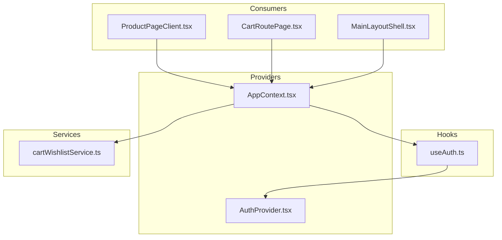
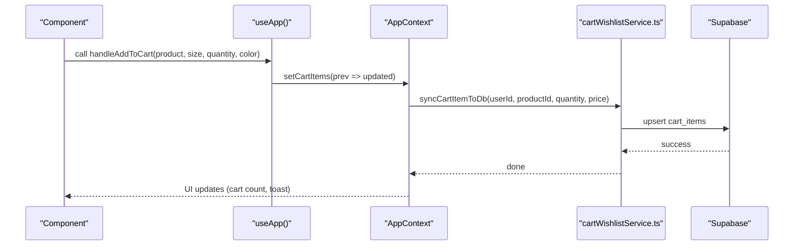
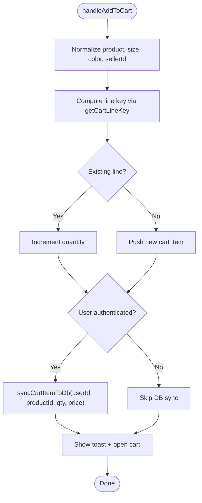
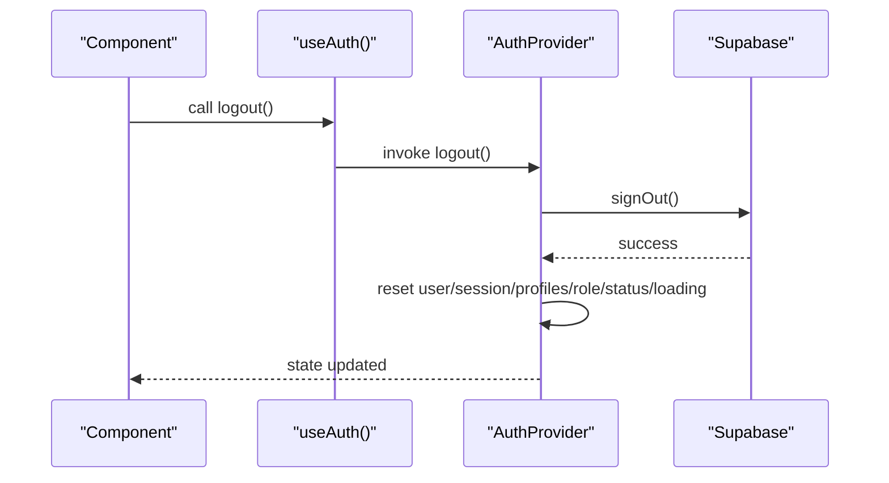
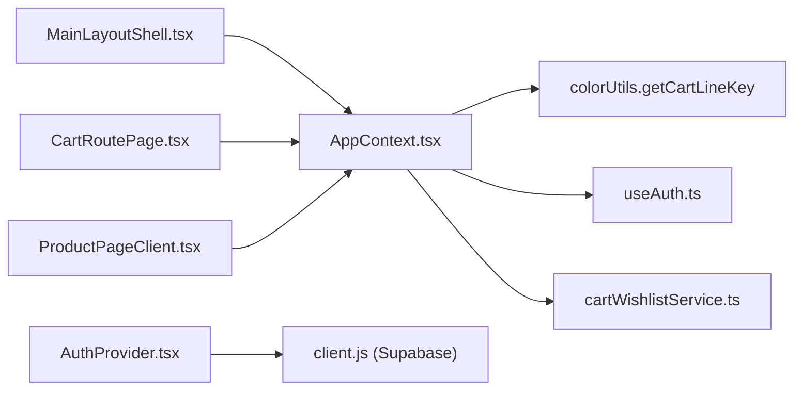

# Context API State Management

<cite>
**Referenced Files in This Document**
- [AppContext.tsx](file://components/context/AppContext.tsx)
- [AuthProvider.tsx](file://components/context/AuthProvider.tsx)
- [useAuth.ts](file://src/hooks/useAuth.ts)
- [cartWishlistService.ts](file://src/api/cartWishlistService.ts)
- [MainLayoutShell.tsx](file://components/MainLayoutShell.tsx)
- [CartRoutePage.tsx](file://app/cart/page.tsx)
- [ProductPageClient.tsx](file://app/product/[id]/ProductPageClient.tsx)
</cite>

## Table of Contents
1. [Introduction](#introduction)
2. [Project Structure](#project-structure)
3. [Core Components](#core-components)
4. [Architecture Overview](#architecture-overview)
5. [Detailed Component Analysis](#detailed-component-analysis)
6. [Dependency Analysis](#dependency-analysis)
7. [Performance Considerations](#performance-considerations)
8. [Troubleshooting Guide](#troubleshooting-guide)
9. [Conclusion](#conclusion)

## Introduction
This document explains the client-side state management implementation using React Context for cart, wishlist, UI interactions, and authentication. It focuses on:
- AppContext for managing cart items, wishlist synchronization, UI drawers/modals, and toast notifications.
- AuthProvider for handling user session, profile loading, role resolution, and logout.
- Provider composition patterns, context dispatchers, selectors, and performance considerations such as memoization.
- Common update patterns, error handling strategies, and debugging techniques.

## Project Structure
The relevant parts of the codebase are organized around two primary providers and their consumers:
- Providers:
  - AppContext: central client state for cart, wishlist, UI controls, and toasts.
  - AuthProvider: authentication session, profiles, roles, and lifecycle hooks.
- Consumers:
  - Layout and pages consume context via useApp and useAuth hooks.
  - Services encapsulate Supabase operations for cart and wishlist persistence.

**Diagram sources**
- [AppContext.tsx:1-367](file://components/context/AppContext.tsx#L1-L367)
- [AuthProvider.tsx:1-326](file://components/context/AuthProvider.tsx#L1-L326)
- [useAuth.ts:1-12](file://src/hooks/useAuth.ts#L1-L12)
- [cartWishlistService.ts:1-223](file://src/api/cartWishlistService.ts#L1-L223)
- [MainLayoutShell.tsx:1-145](file://components/MainLayoutShell.tsx#L1-L145)
- [CartRoutePage.tsx:1-34](file://app/cart/page.tsx#L1-L34)
- [ProductPageClient.tsx:1-88](file://app/product/[id]/ProductPageClient.tsx#L1-L88)

**Section sources**
- [AppContext.tsx:1-367](file://components/context/AppContext.tsx#L1-L367)
- [AuthProvider.tsx:1-326](file://components/context/AuthProvider.tsx#L1-L326)
- [useAuth.ts:1-12](file://src/hooks/useAuth.ts#L1-L12)
- [cartWishlistService.ts:1-223](file://src/api/cartWishlistService.ts#L1-L223)
- [MainLayoutShell.tsx:1-145](file://components/MainLayoutShell.tsx#L1-L145)
- [CartRoutePage.tsx:1-34](file://app/cart/page.tsx#L1-L34)
- [ProductPageClient.tsx:1-88](file://app/product/[id]/ProductPageClient.tsx#L1-L88)

## Core Components
- AppContext
  - Manages cart items with local storage persistence and optional database sync for authenticated users.
  - Manages wishlist IDs with optimistic updates and database synchronization.
  - Controls UI state: mega menu, search modal, quick view product, and toast messages.
  - Exposes a typed hook useApp for consuming context values.
- AuthProvider
  - Initializes and listens to Supabase auth sessions.
  - Loads reseller and customer profiles, resolves role and seller status.
  - Provides logout and refetchProfile methods.
  - Exposes a typed hook useAuth for consuming auth state.

Key responsibilities:
- Cart: add/remove/update quantities, clear cart, open/close cart drawer, persist to localStorage, merge guest cart to DB, sync changes to DB.
- Wishlist: toggle item, fetch DB wishlist IDs, optimistic UI updates with rollback on failure.
- Auth: session initialization, profile fetching/creation, role-based access control, logout cleanup.

**Section sources**
- [AppContext.tsx:14-53](file://components/context/AppContext.tsx#L14-L53)
- [AppContext.tsx:59-367](file://components/context/AppContext.tsx#L59-L367)
- [AuthProvider.tsx:47-74](file://components/context/AuthProvider.tsx#L47-L74)
- [AuthProvider.tsx:76-326](file://components/context/AuthProvider.tsx#L76-L326)
- [useAuth.ts:1-12](file://src/hooks/useAuth.ts#L1-L12)

## Architecture Overview
The application uses a layered provider architecture:
- AuthProvider wraps the app to provide authentication state and profile data.
- AppContext depends on AuthProvider through useAuth to conditionally sync cart/wishlist to the database.
- Consumers (pages and layout components) subscribe to context via useApp or useAuth.

**Diagram sources**
- [AppContext.tsx:166-210](file://components/context/AppContext.tsx#L166-L210)
- [cartWishlistService.ts:96-163](file://src/api/cartWishlistService.ts#L96-L163)

**Section sources**
- [AppContext.tsx:59-367](file://components/context/AppContext.tsx#L59-L367)
- [cartWishlistService.ts:1-223](file://src/api/cartWishlistService.ts#L1-L223)

## Detailed Component Analysis

### AppContext: Client-Side State Manager
Responsibilities:
- Cart state and persistence:
  - Initialize empty cart to avoid SSR hydration mismatch.
  - Load from localStorage after hydration; validate and normalize items.
  - Persist changes to localStorage after initial load.
  - Merge guest cart into DB when user authenticates.
  - Sync individual cart changes to DB for authenticated users.
- Wishlist state and synchronization:
  - Fetch wishlist IDs from DB when user is available.
  - Optimistically update local wishlistIds and revert on failure.
- UI state:
  - Manage mega menu, search modal, quick view product, and toast message.
- Dispatchers:
  - handleAddToCart, handleUpdateQuantity, handleRemoveCartItem, clearCart.
  - handleToggleWishlist.
  - setIsCartOpen, setIsMegaMenuOpen, setIsSearchOpen, setQuickViewProduct, showToast.

Data flow highlights:
- LocalStorage key: 'zebaish_cart_items'.
- Color-aware line keys via getCartLineKey ensure correct merging of variants.
- Seller ID normalization across product objects for consistent cart entries.

Error handling:
- Try/catch around localStorage read/write.
- Graceful fallback to empty cart on parse errors.
- Toast feedback for user actions and failures.

**Diagram sources**
- [AppContext.tsx:166-210](file://components/context/AppContext.tsx#L166-L210)
- [cartWishlistService.ts:96-163](file://src/api/cartWishlistService.ts#L96-L163)

State selectors and usage patterns:
- Consumers typically destructure needed fields from useApp to minimize re-renders.
- Example consumers:
  - MainLayoutShell consumes cart counts, wishlist counts, and UI toggles.
  - CartRoutePage consumes cart items and mutation handlers.
  - ProductPageClient consumes add-to-cart and wishlist toggles.

Common patterns:
- Use functional setState to compute next state based on previous state.
- Guard DB calls with user presence checks.
- Provide immediate UI feedback via toasts.

**Section sources**
- [AppContext.tsx:59-367](file://components/context/AppContext.tsx#L59-L367)
- [MainLayoutShell.tsx:17-33](file://components/MainLayoutShell.tsx#L17-L33)
- [CartRoutePage.tsx:10-14](file://app/cart/page.tsx#L10-L14)
- [ProductPageClient.tsx:21-25](file://app/product/[id]/ProductPageClient.tsx#L21-L25)

### AuthProvider: Authentication and Role-Based Access Control
Responsibilities:
- Session management:
  - Initialize session on mount and listen to auth state changes.
  - Set user/session state and trigger profile loading.
- Profile loading and role resolution:
  - Fetch reseller profile if exists.
  - If not a reseller, fetch/create customer profile.
  - Resolve role ('seller' | 'customer' | null) and sellerStatus.
- Logout:
  - Sign out via Supabase and reset all auth-related state.
- Refetch profile:
  - Allow manual refresh of profiles and role.

Error handling:
- Handle missing tables gracefully (e.g., public.users not yet created).
- Warn and return null for failed profile fetches without breaking UI.

**Diagram sources**
- [AuthProvider.tsx:231-246](file://components/context/AuthProvider.tsx#L231-L246)
- [useAuth.ts:1-12](file://src/hooks/useAuth.ts#L1-L12)

Role-based access control:
- Consumers can check role and sellerStatus to gate features or routes.
- The provider sets role to 'seller' when a reseller profile exists; otherwise 'customer'.

**Section sources**
- [AuthProvider.tsx:76-326](file://components/context/AuthProvider.tsx#L76-L326)
- [useAuth.ts:1-12](file://src/hooks/useAuth.ts#L1-L12)

### Context Provider Composition Patterns
- Composition order:
  - Wrap the application root with AuthProvider first so that useAuth is available inside AppContext.
  - Then wrap with AppProvider to expose cart/wishlist/UI state.
- Dependency direction:
  - AppContext depends on AuthProvider via useAuth.
  - Consumers depend on both providers but only import their respective hooks.

Best practices:
- Keep providers close to the app root to ensure availability.
- Avoid deep nesting of multiple contexts in leaf components; prefer hooks at component boundaries.

[No sources needed since this section provides general guidance]

### Context Value Updates and Dispatchers
- Cart dispatchers:
  - handleAddToCart: merges by line key, updates quantity, optionally syncs to DB, shows toast, opens cart.
  - handleUpdateQuantity: supports removal when quantity <= 0, normalizes size/color matching, syncs to DB.
  - handleRemoveCartItem: removes by line key or product id with size/color filters, syncs deletion to DB.
  - clearCart: clears state and localStorage.
- Wishlist dispatcher:
  - handleToggleWishlist: requires authentication, optimistic update, DB sync with rollback on failure, toast feedback.
- UI dispatchers:
  - setIsCartOpen, setIsMegaMenuOpen, setIsSearchOpen, setQuickViewProduct, showToast.

Usage examples:
- MainLayoutShell passes handlers to CartDrawer, MegaMenuDrawer, SearchModal, QuickViewModal.
- ProductPageClient passes handleAddToCart and handleToggleWishlist to ProductDetailPage.
- CartRoutePage passes cart items and handlers to CartPage.

**Section sources**
- [AppContext.tsx:166-331](file://components/context/AppContext.tsx#L166-L331)
- [MainLayoutShell.tsx:93-133](file://components/MainLayoutShell.tsx#L93-L133)
- [ProductPageClient.tsx:74-85](file://app/product/[id]/ProductPageClient.tsx#L74-L85)
- [CartRoutePage.tsx:24-31](file://app/cart/page.tsx#L24-L31)

### Performance Optimization Techniques
- Memoization recommendations:
  - Wrap expensive derived computations (e.g., cart totals, filtered lists) with useMemo in consuming components.
  - Memoize callbacks passed to child components with useCallback to prevent unnecessary re-renders.
- Selector pattern:
  - Prefer destructuring only required fields from useApp/useAuth to limit re-renders.
  - Consider creating small selector hooks (e.g., useCartTotal, useIsWishlisted) that derive values and memoize them.
- State shape:
  - Keep cart items normalized and stable; avoid recreating arrays unnecessarily.
  - Use functional setState to reduce dependency on stale closures.
- Rendering optimization:
  - Split heavy UI into separate components and pass memoized props.
  - Avoid passing large objects down the tree; pass identifiers and fetch data where needed.

[No sources needed since this section provides general guidance]

### Error Handling and Debugging
- AppContext:
  - Try/catch around localStorage operations; logs errors and falls back to empty cart.
  - Toast messages for user feedback on add/remove/toggle actions.
  - Wishlist rollback on DB sync failure.
- AuthProvider:
  - Handles missing schema/table errors gracefully during profile fetch/creation.
  - Logs warnings/errors for unexpected failures.
  - Resets state on logout.
- Debugging tips:
  - Inspect localStorage key 'zebaish_cart_items' to verify persistence.
  - Check Supabase tables: wishlists, wishlist_items, carts, cart_items.
  - Use browser dev tools to monitor context updates and network requests.

**Section sources**
- [AppContext.tsx:84-145](file://components/context/AppContext.tsx#L84-L145)
- [AppContext.tsx:305-331](file://components/context/AppContext.tsx#L305-L331)
- [AuthProvider.tsx:104-138](file://components/context/AuthProvider.tsx#L104-L138)
- [AuthProvider.tsx:231-246](file://components/context/AuthProvider.tsx#L231-L246)

## Dependency Analysis
Relationships between core modules:
- AppContext imports:
  - Types from @/types.
  - Utility getCartLineKey from @/src/utils/colorUtils.
  - useAuth from @/src/hooks/useAuth.
  - Services from @/src/api/cartWishlistService.
- AuthProvider imports:
  - Supabase client from @/src/api/client.
- Consumers import:
  - useApp from @/components/context/AppContext.
  - useAuth from @/src/hooks/useAuth.

**Diagram sources**
- [AppContext.tsx:1-12](file://components/context/AppContext.tsx#L1-L12)
- [AuthProvider.tsx:1-5](file://components/context/AuthProvider.tsx#L1-L5)
- [MainLayoutShell.tsx:11-33](file://components/MainLayoutShell.tsx#L11-L33)
- [CartRoutePage.tsx:6-14](file://app/cart/page.tsx#L6-L14)
- [ProductPageClient.tsx:6-25](file://app/product/[id]/ProductPageClient.tsx#L6-L25)

**Section sources**
- [AppContext.tsx:1-12](file://components/context/AppContext.tsx#L1-L12)
- [AuthProvider.tsx:1-5](file://components/context/AuthProvider.tsx#L1-L5)
- [MainLayoutShell.tsx:11-33](file://components/MainLayoutShell.tsx#L11-L33)
- [CartRoutePage.tsx:6-14](file://app/cart/page.tsx#L6-L14)
- [ProductPageClient.tsx:6-25](file://app/product/[id]/ProductPageClient.tsx#L6-L25)

## Performance Considerations
- Minimize context re-renders:
  - Destructure only necessary fields from useApp/useAuth.
  - Memoize derived values and callbacks in consumers.
- Optimize list rendering:
  - Use stable keys for cart items and wishlist entries.
  - Avoid unnecessary array allocations; prefer immutable updates.
- Debounce rapid updates:
  - Consider debouncing frequent quantity changes if needed.
- Network efficiency:
  - Batch DB operations where possible; current design already batches guest cart merge on login.

[No sources needed since this section provides general guidance]

## Troubleshooting Guide
Common issues and resolutions:
- Hydration mismatch:
  - Ensure cart state initializes to empty on server and loads from localStorage only on client.
- Missing tables:
  - If public.users table is not created, profile creation will be skipped; ensure migrations are applied.
- Wishlist sync failures:
  - Check network requests to wishlists and wishlist_items; rollback occurs automatically on error.
- Cart persistence:
  - Verify localStorage key 'zebaish_cart_items'; inspect parsed structure for required fields.
- Role not resolving:
  - Confirm reseller profile exists; role defaults to 'customer' if no reseller record found.

Debugging steps:
- Log context values in consumers temporarily to verify state shape.
- Inspect Supabase queries and responses in network tab.
- Use console warnings/errors from providers to identify failing operations.

**Section sources**
- [AppContext.tsx:84-145](file://components/context/AppContext.tsx#L84-L145)
- [AuthProvider.tsx:104-138](file://components/context/AuthProvider.tsx#L104-L138)
- [AuthProvider.tsx:231-246](file://components/context/AuthProvider.tsx#L231-L246)

## Conclusion
The Context API implementation provides a robust foundation for client-side state management:
- AppContext centralizes cart, wishlist, UI, and toast state with persistence and optional DB sync.
- AuthProvider manages authentication lifecycle, profiles, and roles, enabling role-based access control.
- Consumers interact via typed hooks, following best practices for performance and maintainability.
- Clear error handling and debugging strategies support reliable operation and easier troubleshooting.

[No sources needed since this section summarizes without analyzing specific files]