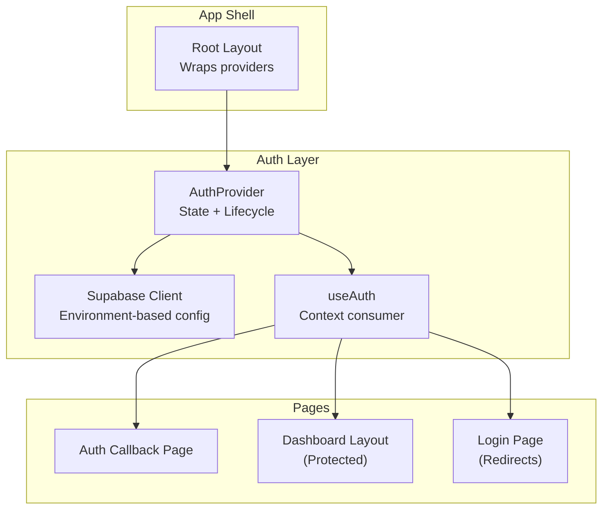
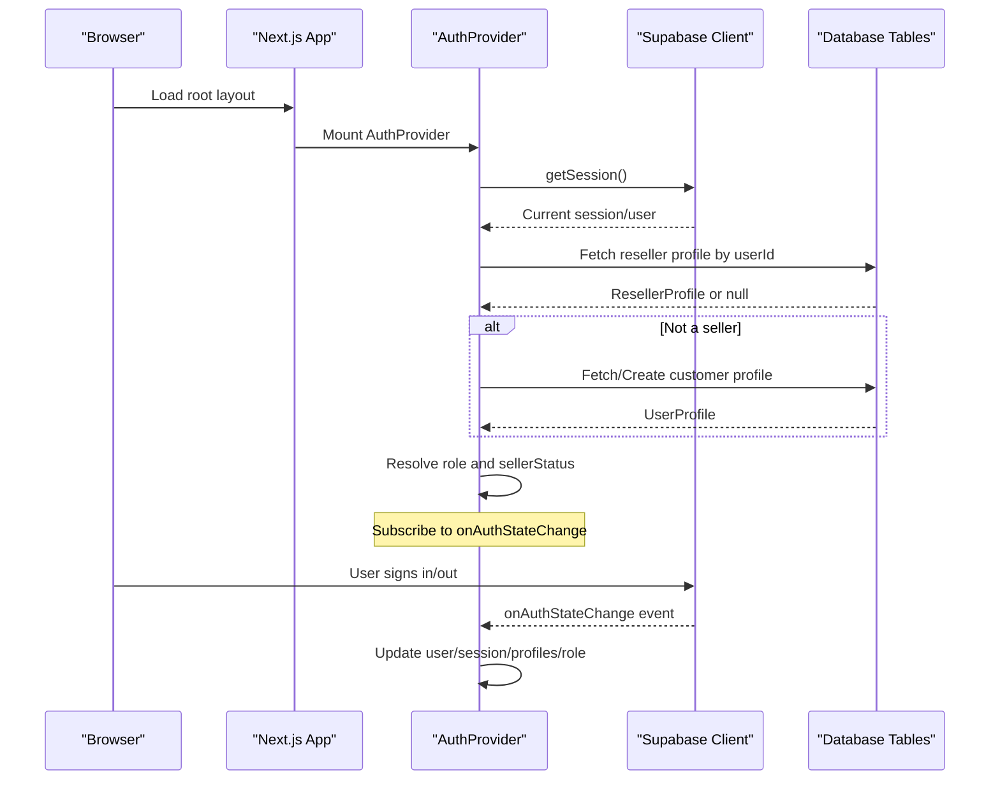
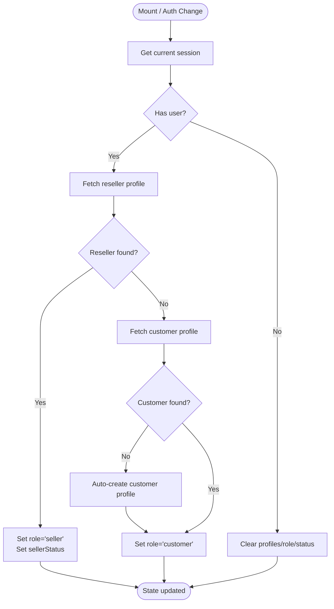
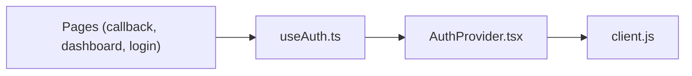

# Authentication Hooks

<cite>
**Referenced Files in This Document**
- [useAuth.ts](file://src/hooks/useAuth.ts)
- [AuthProvider.tsx](file://components/context/AuthProvider.tsx)
- [client.js](file://src/api/client.js)
- [layout.tsx](file://app/layout.tsx)
- [page.tsx (auth callback)](file://app/auth/callback/page.tsx)
- [page.tsx (dashboard layout)](file://app/dashboard/layout.tsx)
- [page.tsx (login)](file://app/login/page.tsx)
</cite>

## Table of Contents
1. [Introduction](#introduction)
2. [Project Structure](#project-structure)
3. [Core Components](#core-components)
4. [Architecture Overview](#architecture-overview)
5. [Detailed Component Analysis](#detailed-component-analysis)
6. [Dependency Analysis](#dependency-analysis)
7. [Performance Considerations](#performance-considerations)
8. [Troubleshooting Guide](#troubleshooting-guide)
9. [Conclusion](#conclusion)

## Introduction
This document explains the authentication system centered around the useAuth hook and AuthProvider context. It covers how user login/logout, session management, role-based access control, and profile data are handled with Supabase. It also provides guidance for implementing protected routes, checking permissions, handling errors, and following security best practices.

## Project Structure
The authentication implementation is split across a few key files:
- A client that initializes Supabase using environment variables.
- An AuthProvider component that manages auth state, profiles, roles, and lifecycle events.
- A lightweight useAuth hook to consume the context.
- App-level layout that wraps the application with AuthProvider.
- Pages that demonstrate usage patterns such as auth callbacks, dashboard protection, and login redirects.

**Diagram sources**
- [layout.tsx:38-46](file://app/layout.tsx#L38-L46)
- [client.js:1-8](file://src/api/client.js#L1-L8)
- [AuthProvider.tsx:76-322](file://components/context/AuthProvider.tsx#L76-L322)
- [useAuth.ts:1-12](file://src/hooks/useAuth.ts#L1-L12)
- [page.tsx (auth callback):1-40](file://app/auth/callback/page.tsx#L1-L40)
- [page.tsx (dashboard layout):1-50](file://app/dashboard/layout.tsx#L1-L50)
- [page.tsx (login):1-50](file://app/login/page.tsx#L1-L50)

**Section sources**
- [layout.tsx:38-46](file://app/layout.tsx#L38-L46)
- [client.js:1-8](file://src/api/client.js#L1-L8)

## Core Components
- useAuth hook: Provides typed access to the authentication context. It throws if used outside AuthProvider.
- AuthProvider: Manages Supabase session, user, profiles, role, seller status, loading state, logout, and profile refetch. It subscribes to auth state changes and initializes state on mount.
- Supabase client: Initializes the Supabase JS client from environment variables.

Key responsibilities:
- Session persistence via Supabase’s built-in persistence.
- Role resolution between seller and customer based on database presence.
- Profile synchronization for both reseller and customer tables.
- Centralized logout that clears local state.

**Section sources**
- [useAuth.ts:1-12](file://src/hooks/useAuth.ts#L1-L12)
- [AuthProvider.tsx:47-74](file://components/context/AuthProvider.tsx#L47-L74)
- [AuthProvider.tsx:76-322](file://components/context/AuthProvider.tsx#L76-L322)
- [client.js:1-8](file://src/api/client.js#L1-L8)

## Architecture Overview
The authentication flow integrates Next.js app shell, Supabase, and React context:

**Diagram sources**
- [AuthProvider.tsx:248-303](file://components/context/AuthProvider.tsx#L248-L303)
- [AuthProvider.tsx:85-216](file://components/context/AuthProvider.tsx#L85-L216)
- [client.js:1-8](file://src/api/client.js#L1-L8)

## Detailed Component Analysis

### useAuth Hook
- Purpose: Consume AuthContext and provide strongly-typed access to authentication state and operations.
- Behavior: Throws an error if used outside AuthProvider to prevent silent failures.

Usage pattern:
- Import useAuth in components/pages.
- Destructure fields like user, session, role, loading, logout, refetchProfile.

Error handling:
- Missing provider results in a thrown error during render.

**Section sources**
- [useAuth.ts:1-12](file://src/hooks/useAuth.ts#L1-L12)

### AuthProvider Context
Responsibilities:
- State shape: user, session, resellerProfile, userProfile, role, sellerStatus, loading.
- Profile fetching:
  - Reseller profile lookup from sellers table.
  - Customer profile lookup from users table; auto-create if missing.
- Role resolution:
  - If reseller profile exists -> role = 'seller', sellerStatus derived from reseller.status.
  - Otherwise -> role = 'customer'.
- Session lifecycle:
  - On mount: getSession(), set user/session, load profiles, then resolve role/status.
  - Listener: onAuthStateChange updates state and triggers profile sync when user changes.
- Logout:
  - Calls supabase.auth.signOut().
  - Clears all local state (user, session, profiles, role, sellerStatus).
- Refetch profile:
  - Allows re-fetching profiles for a given user or current user.

Data models:
- ResellerProfile: Seller-specific fields including shop details, payment info, and status.
- UserProfile: Customer-specific fields including name, email, phone.
- UserRole: 'seller' | 'customer' | null.
- ProfileResult: Aggregates role, profiles, and sellerStatus returned by refetchProfile.

Security considerations:
- Relies on Supabase RLS policies at the database layer for row-level security.
- Avoids exposing sensitive tokens directly; uses Supabase client methods.

**Diagram sources**
- [AuthProvider.tsx:85-216](file://components/context/AuthProvider.tsx#L85-L216)
- [AuthProvider.tsx:248-303](file://components/context/AuthProvider.tsx#L248-L303)

**Section sources**
- [AuthProvider.tsx:6-57](file://components/context/AuthProvider.tsx#L6-L57)
- [AuthProvider.tsx:85-216](file://components/context/AuthProvider.tsx#L85-L216)
- [AuthProvider.tsx:231-246](file://components/context/AuthProvider.tsx#L231-L246)
- [AuthProvider.tsx:248-303](file://components/context/AuthProvider.tsx#L248-L303)

### Supabase Client
- Initializes the Supabase client using NEXT_PUBLIC_SUPABASE_URL and NEXT_PUBLIC_SUPABASE_ANON_KEY.
- Used throughout AuthProvider for session and profile operations.

Best practices:
- Keep anon key in environment variables only.
- Enforce Row Level Security (RLS) policies server-side.

**Section sources**
- [client.js:1-8](file://src/api/client.js#L1-L8)

### App-Level Integration
- The root layout wraps the entire app with QueryProvider, AuthProvider, and AppProvider.
- Ensures all pages/components have access to authentication context.

**Section sources**
- [layout.tsx:38-46](file://app/layout.tsx#L38-L46)

### Usage Patterns in Pages

#### Auth Callback Page
- Reads current session after OAuth flows.
- Uses useAuth to get role and user for post-login routing decisions.
- Handles errors and redirects to login on failure.

Typical flow:
- Check session validity.
- If no session, attempt code exchange or redirect.
- Use role to determine navigation.

**Section sources**
- [page.tsx (auth callback):1-40](file://app/auth/callback/page.tsx#L1-L40)

#### Dashboard Layout (Protected Route Example)
- Consumes useAuth to guard access.
- Redirects non-sellers or unauthenticated users away from the dashboard.
- Displays appropriate UI based on role and seller status.

Guard logic highlights:
- Require user and role === 'seller'.
- Optionally require resellerProfile to exist.

**Section sources**
- [page.tsx (dashboard layout):1-50](file://app/dashboard/layout.tsx#L1-L50)

#### Login Page
- Uses role and sellerStatus to handle redirects and restrictions.
- Prevents access for suspended sellers.
- Redirects authenticated users to appropriate dashboards.

**Section sources**
- [page.tsx (login):1-50](file://app/login/page.tsx#L1-L50)

## Dependency Analysis
The authentication subsystem has clear boundaries:
- useAuth depends on AuthProvider context.
- AuthProvider depends on Supabase client for session and profile operations.
- Pages depend on useAuth for state and actions.

**Diagram sources**
- [useAuth.ts:1-12](file://src/hooks/useAuth.ts#L1-L12)
- [AuthProvider.tsx:76-322](file://components/context/AuthProvider.tsx#L76-L322)
- [client.js:1-8](file://src/api/client.js#L1-L8)
- [page.tsx (auth callback):1-40](file://app/auth/callback/page.tsx#L1-L40)
- [page.tsx (dashboard layout):1-50](file://app/dashboard/layout.tsx#L1-L50)
- [page.tsx (login):1-50](file://app/login/page.tsx#L1-L50)

**Section sources**
- [useAuth.ts:1-12](file://src/hooks/useAuth.ts#L1-L12)
- [AuthProvider.tsx:76-322](file://components/context/AuthProvider.tsx#L76-L322)
- [client.js:1-8](file://src/api/client.js#L1-L8)

## Performance Considerations
- Minimize redundant profile fetches:
  - Cache role and profiles in context; avoid refetching unless necessary.
- Debounce or throttle frequent UI updates driven by auth state changes.
- Prefer server-side checks where possible (e.g., middleware or route guards) to reduce client-side re-renders.
- Ensure Supabase RLS policies are efficient to avoid heavy queries.

[No sources needed since this section provides general guidance]

## Troubleshooting Guide
Common issues and resolutions:
- Error: "useAuth must be used within an AuthProvider"
  - Cause: Using the hook outside the provider tree.
  - Fix: Wrap your app with AuthProvider at the root layout.
- Profile not loading or role remains null
  - Cause: Database tables missing or RLS blocking access.
  - Fix: Verify migrations and RLS policies; ensure user id matches records.
- Auto-create customer profile fails
  - Cause: Schema cache or missing users table.
  - Fix: Apply migrations and refresh schema cache; handle PGRST205/42P01 gracefully.
- Logout does not clear UI state
  - Cause: Local state not reset after signOut.
  - Fix: Ensure logout resets user, session, profiles, role, and sellerStatus.

Operational tips:
- Log Supabase errors and network issues for faster debugging.
- Validate environment variables for Supabase URL and anon key.
- Use browser devtools to inspect Supabase client events and sessions.

**Section sources**
- [useAuth.ts:4-9](file://src/hooks/useAuth.ts#L4-L9)
- [AuthProvider.tsx:104-138](file://components/context/AuthProvider.tsx#L104-L138)
- [AuthProvider.tsx:231-246](file://components/context/AuthProvider.tsx#L231-L246)

## Conclusion
The useAuth hook and AuthProvider provide a robust foundation for managing authentication in the application. They integrate seamlessly with Supabase for session persistence, profile synchronization, and role resolution. By leveraging these primitives, you can implement secure, role-aware routes, manage user sessions effectively, and maintain consistent UI states across the application. Follow the provided patterns for protected routes, permission checks, and error handling to ensure a reliable and secure authentication flow.

[No sources needed since this section summarizes without analyzing specific files]