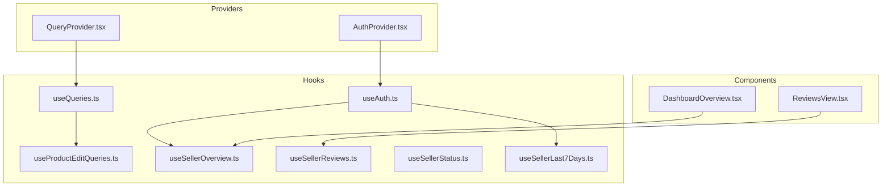
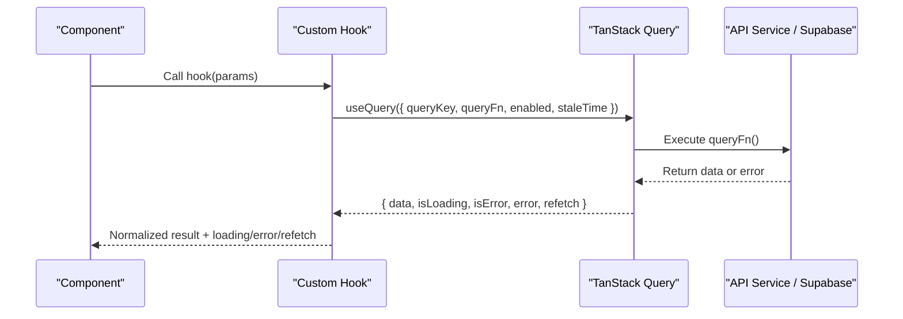
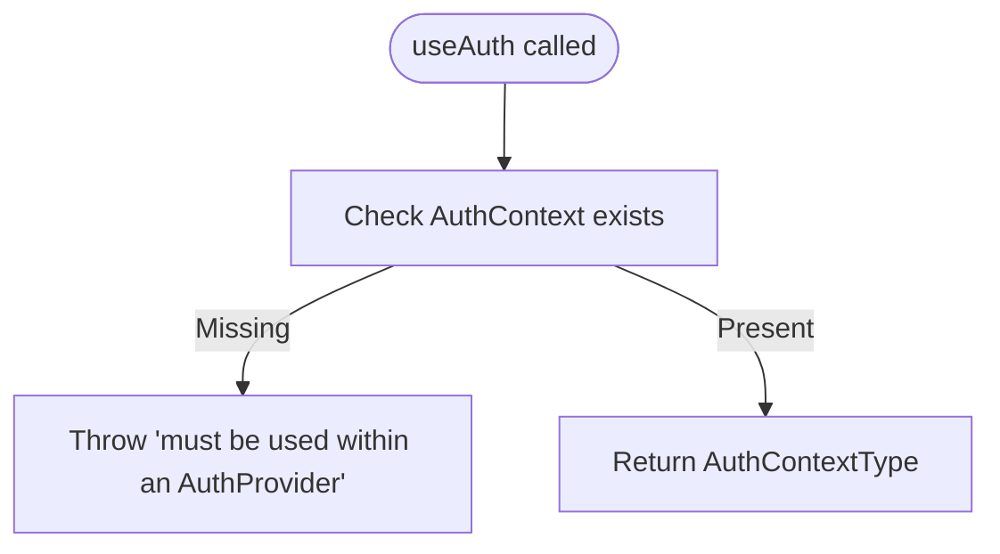
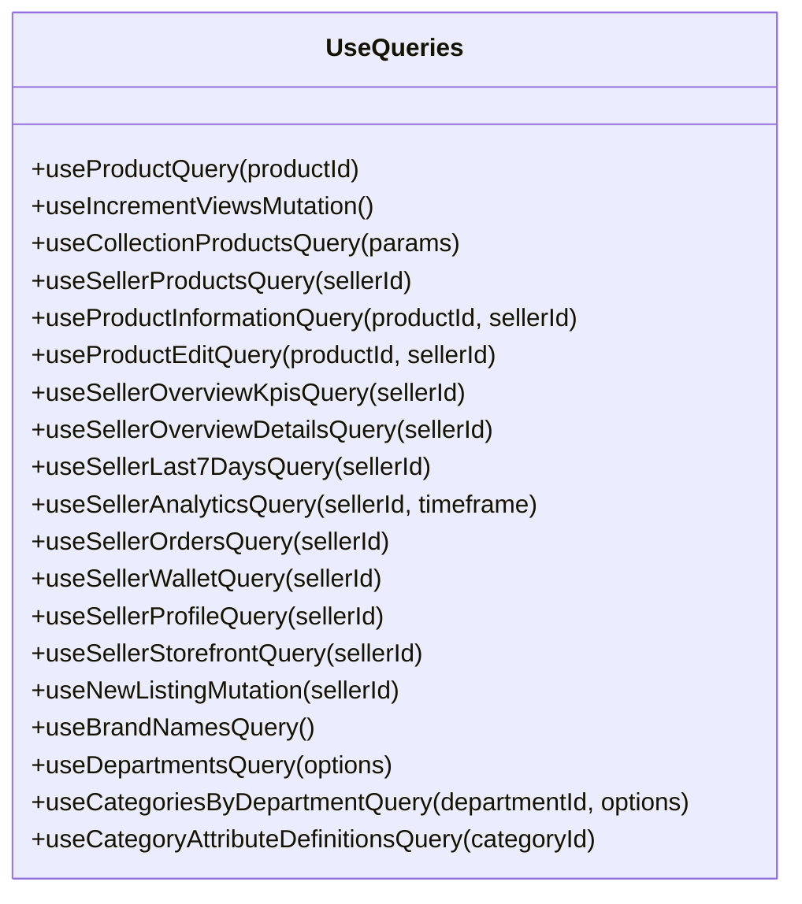
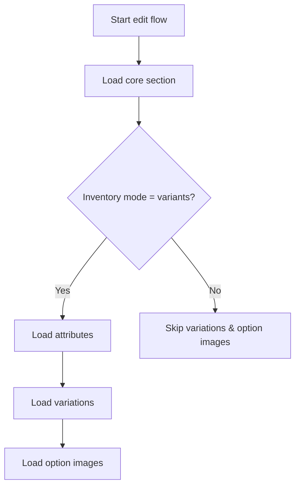
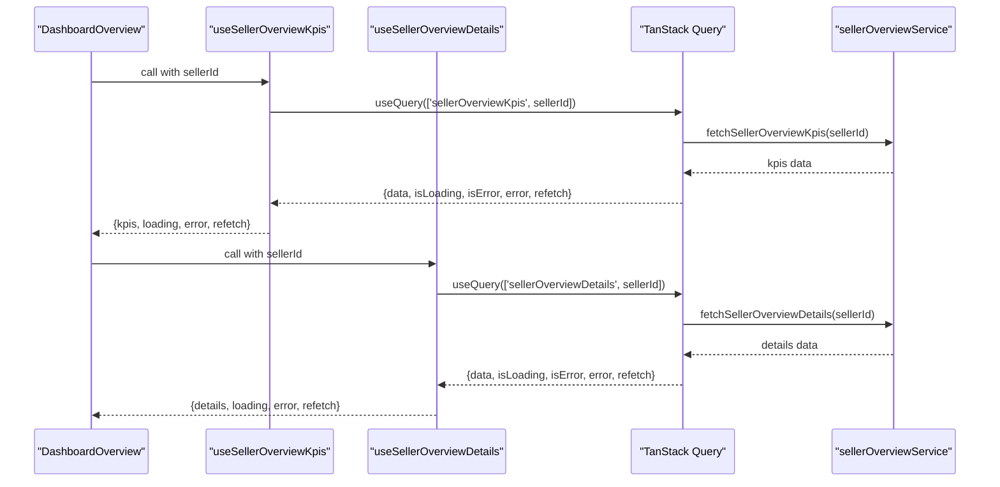
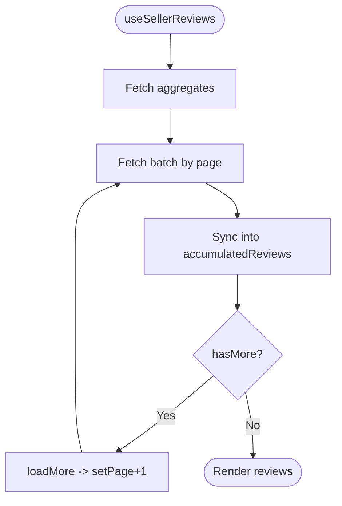
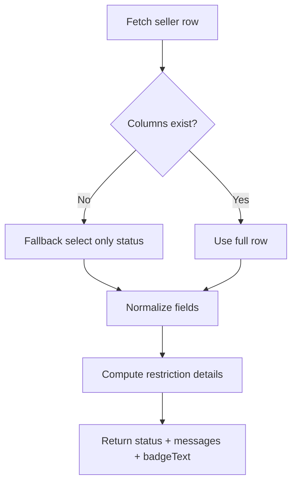
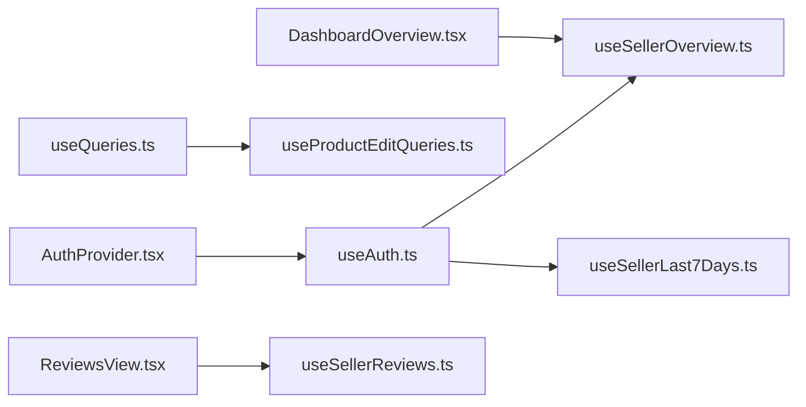

# Custom Hooks

<cite>
**Referenced Files in This Document**
- [useAuth.ts](file://src/hooks/useAuth.ts)
- [AuthProvider.tsx](file://components/context/AuthProvider.tsx)
- [QueryProvider.tsx](file://src/providers/QueryProvider.tsx)
- [useQueries.ts](file://src/hooks/useQueries.ts)
- [useProductEditQueries.ts](file://src/hooks/useProductEditQueries.ts)
- [useSellerOverview.ts](file://src/hooks/useSellerOverview.ts)
- [useSellerReviews.ts](file://src/hooks/useSellerReviews.ts)
- [useSellerStatus.ts](file://src/hooks/useSellerStatus.ts)
- [useSellerLast7Days.ts](file://src/hooks/useSellerLast7Days.ts)
- [DashboardOverview.tsx](file://components/reseller/components/DashboardOverview.tsx)
- [ReviewsView.tsx](file://components/reseller/components/ReviewsView.tsx)
</cite>

## Table of Contents
1. [Introduction](#introduction)
2. [Project Structure](#project-structure)
3. [Core Components](#core-components)
4. [Architecture Overview](#architecture-overview)
5. [Detailed Component Analysis](#detailed-component-analysis)
6. [Dependency Analysis](#dependency-analysis)
7. [Performance Considerations](#performance-considerations)
8. [Troubleshooting Guide](#troubleshooting-guide)
9. [Conclusion](#conclusion)

## Introduction
This document explains the custom React hooks that encapsulate authentication, data fetching, and business logic for the seller/reseller features. It covers:
- Authentication hook useAuth
- General data fetching with TanStack Query via useQueries
- Specialized hooks: useProductEditQueries, useSellerOverview, useSellerReviews, useSellerStatus, useSellerLast7Days
It also documents composition patterns, error handling, loading states, caching strategies, usage examples, testing approaches, performance considerations, and best practices for reusable logic extraction.

## Project Structure
The hooks live under src/hooks and integrate with:
- Auth context from components/context/AuthProvider.tsx
- TanStack Query provider from src/providers/QueryProvider.tsx
- API services under src/api/* (not detailed here)
- UI components that consume these hooks

**Diagram sources**
- [QueryProvider.tsx:1-25](file://src/providers/QueryProvider.tsx#L1-L25)
- [AuthProvider.tsx:1-326](file://components/context/AuthProvider.tsx#L1-L326)
- [useAuth.ts:1-13](file://src/hooks/useAuth.ts#L1-L13)
- [useQueries.ts:1-360](file://src/hooks/useQueries.ts#L1-L360)
- [useProductEditQueries.ts:1-121](file://src/hooks/useProductEditQueries.ts#L1-L121)
- [useSellerOverview.ts:1-73](file://src/hooks/useSellerOverview.ts#L1-L73)
- [useSellerReviews.ts:1-214](file://src/hooks/useSellerReviews.ts#L1-L214)
- [useSellerStatus.ts:1-172](file://src/hooks/useSellerStatus.ts#L1-L172)
- [useSellerLast7Days.ts:1-38](file://src/hooks/useSellerLast7Days.ts#L1-L38)
- [DashboardOverview.tsx:1-42](file://components/reseller/components/DashboardOverview.tsx#L1-L42)
- [ReviewsView.tsx:1-46](file://components/reseller/components/ReviewsView.tsx#L1-L46)

**Section sources**
- [QueryProvider.tsx:1-25](file://src/providers/QueryProvider.tsx#L1-L25)
- [AuthProvider.tsx:1-326](file://components/context/AuthProvider.tsx#L1-L326)
- [useAuth.ts:1-13](file://src/hooks/useAuth.ts#L1-L13)
- [useQueries.ts:1-360](file://src/hooks/useQueries.ts#L1-L360)
- [useProductEditQueries.ts:1-121](file://src/hooks/useProductEditQueries.ts#L1-L121)
- [useSellerOverview.ts:1-73](file://src/hooks/useSellerOverview.ts#L1-L73)
- [useSellerReviews.ts:1-214](file://src/hooks/useSellerReviews.ts#L1-L214)
- [useSellerStatus.ts:1-172](file://src/hooks/useSellerStatus.ts#L1-L172)
- [useSellerLast7Days.ts:1-38](file://src/hooks/useSellerLast7Days.ts#L1-L38)
- [DashboardOverview.tsx:1-42](file://components/reseller/components/DashboardOverview.tsx#L1-L42)
- [ReviewsView.tsx:1-46](file://components/reseller/components/ReviewsView.tsx#L1-L46)

## Core Components
- useAuth: Thin wrapper around AuthContext to access user, session, profiles, role, and auth actions. Throws if used outside AuthProvider.
- useQueries: Centralized TanStack Query hooks for product details, collections, seller products, product information, product edit sections, overview KPIs/details, last 7 days, analytics, orders, wallet, profile, storefront, brand names, categories, and attributes. Includes mutations like new listing creation with query invalidation.
- useProductEditQueries: Sectioned queries for product editing with explicit key factories and stale/gc times.
- useSellerOverview: Business-focused hooks returning normalized results with loading/error/refetch.
- useSellerReviews: Paginated reviews with aggregate ratings, accumulation, and infinite scroll support.
- useSellerStatus: Seller status computation with fallbacks and restriction messaging.
- useSellerLast7Days: Last 7 days metrics hook with normalized return shape.

Key responsibilities:
- Encapsulate data fetching and caching via TanStack Query
- Normalize errors and loading states for UI consumption
- Provide refetch helpers for manual refreshes
- Derive business rules (e.g., restrictions, aggregates) inside hooks

**Section sources**
- [useAuth.ts:1-13](file://src/hooks/useAuth.ts#L1-L13)
- [useQueries.ts:1-360](file://src/hooks/useQueries.ts#L1-L360)
- [useProductEditQueries.ts:1-121](file://src/hooks/useProductEditQueries.ts#L1-L121)
- [useSellerOverview.ts:1-73](file://src/hooks/useSellerOverview.ts#L1-L73)
- [useSellerReviews.ts:1-214](file://src/hooks/useSellerReviews.ts#L1-L214)
- [useSellerStatus.ts:1-172](file://src/hooks/useSellerStatus.ts#L1-L172)
- [useSellerLast7Days.ts:1-38](file://src/hooks/useSellerLast7Days.ts#L1-L38)

## Architecture Overview
The application uses a layered approach:
- Providers: QueryClient configuration and Auth context
- Hooks: Data fetching, state normalization, and business logic
- Components: UI that consumes hooks and renders data

**Diagram sources**
- [useQueries.ts:1-360](file://src/hooks/useQueries.ts#L1-L360)
- [useSellerOverview.ts:1-73](file://src/hooks/useSellerOverview.ts#L1-L73)
- [useSellerReviews.ts:1-214](file://src/hooks/useSellerReviews.ts#L1-L214)
- [useSellerStatus.ts:1-172](file://src/hooks/useSellerStatus.ts#L1-L172)
- [useSellerLast7Days.ts:1-38](file://src/hooks/useSellerLast7Days.ts#L1-L38)

## Detailed Component Analysis

### Authentication Hook: useAuth
Purpose:
- Access authenticated user, session, reseller/customer profiles, role, and seller status
- Provide logout and profile refetch capabilities

Behavior:
- Throws when used outside AuthProvider
- Returns full AuthContextType

Usage pattern:
- Destructure fields such as user, resellerProfile, role, loading, logout
- Guard UI based on loading and role

Error handling:
- Throws clear error if not within AuthProvider

Caching:
- Not applicable; this is a context-based hook

Composition:
- Used by other hooks to derive sellerId and role-dependent behavior

**Diagram sources**
- [useAuth.ts:1-13](file://src/hooks/useAuth.ts#L1-L13)

**Section sources**
- [useAuth.ts:1-13](file://src/hooks/useAuth.ts#L1-L13)
- [AuthProvider.tsx:1-326](file://components/context/AuthProvider.tsx#L1-L326)

### General Data Fetching: useQueries
Responsibilities:
- Product detail and view increment mutation
- Collection products
- Seller products and product information
- Product edit section queries
- Seller overview KPIs and details
- Last 7 days, analytics, orders, wallet, profile, storefront
- Brand names, departments, categories, attribute definitions
- New listing mutation with query invalidation

Caching strategy:
- Per-hook staleTime values tuned per domain (e.g., 3 minutes for product/collection, 5–10 minutes for seller products, 1 minute for product info/edit)
- gcTime configured where appropriate
- Global defaults set in QueryProvider

Error handling:
- Exposes isLoading, isError, error, and refetch
- Some hooks normalize errors into user-friendly messages

Mutation example:
- useNewListingMutation invalidates relevant seller-products keys on success

**Diagram sources**
- [useQueries.ts:1-360](file://src/hooks/useQueries.ts#L1-L360)

**Section sources**
- [useQueries.ts:1-360](file://src/hooks/useQueries.ts#L1-L360)
- [QueryProvider.tsx:1-25](file://src/providers/QueryProvider.tsx#L1-L25)

### Product Edit Queries: useProductEditQueries
Responsibilities:
- Provide sectioned queries for product editing: core, attributes, variations, option images
- Define stable query keys via productEditKeys factory
- Configure staleTime and gcTime for edit flows
- Disable window focus/reconnect refetches for edit stability

Composition:
- Enabled conditionally based on productId, sellerId, and inventory mode

**Diagram sources**
- [useProductEditQueries.ts:1-121](file://src/hooks/useProductEditQueries.ts#L1-L121)

**Section sources**
- [useProductEditQueries.ts:1-121](file://src/hooks/useProductEditQueries.ts#L1-L121)

### Seller Overview: useSellerOverview
Responsibilities:
- Normalize KPI and details queries into consistent shapes with loading, error, and refetch
- Resolve sellerId from explicit prop, resellerProfile, or user id

Usage in components:
- DashboardOverview consumes both KPIs and details, enabling parallel refetch

**Diagram sources**
- [useSellerOverview.ts:1-73](file://src/hooks/useSellerOverview.ts#L1-L73)
- [DashboardOverview.tsx:1-42](file://components/reseller/components/DashboardOverview.tsx#L1-L42)

**Section sources**
- [useSellerOverview.ts:1-73](file://src/hooks/useSellerOverview.ts#L1-L73)
- [DashboardOverview.tsx:1-42](file://components/reseller/components/DashboardOverview.tsx#L1-L42)

### Seller Reviews: useSellerReviews
Responsibilities:
- Aggregate rating counts and average rating
- Paginate review items and accumulate them for infinite scroll
- Reset state on parameter changes
- Provide loadMore and refetch helpers

Data flow:
- Two queries: one for aggregates, one for paginated batch
- Local state manages page and accumulated reviews

**Diagram sources**
- [useSellerReviews.ts:1-214](file://src/hooks/useSellerReviews.ts#L1-L214)

Usage in components:
- ReviewsView consumes reviews, averageRating, totalCount, ratingCounts, productTitle, isLoading, isLoadingMore, hasMore, error, loadMore

**Section sources**
- [useSellerReviews.ts:1-214](file://src/hooks/useSellerReviews.ts#L1-L214)
- [ReviewsView.tsx:1-46](file://components/reseller/components/ReviewsView.tsx#L1-L46)

### Seller Status: useSellerStatus
Responsibilities:
- Fetch seller status and related flags
- Compute restriction details and messages
- Provide fallbacks for missing columns
- Expose refetchStatus helper

Error handling:
- Converts DB errors to safe fallbacks
- Normalizes error message for UI

**Diagram sources**
- [useSellerStatus.ts:1-172](file://src/hooks/useSellerStatus.ts#L1-L172)

**Section sources**
- [useSellerStatus.ts:1-172](file://src/hooks/useSellerStatus.ts#L1-L172)

### Last 7 Days Metrics: useSellerLast7Days
Responsibilities:
- Fetch last 7 days performance metrics
- Normalize result with loading, error, and refetch

Usage:
- Consumed by dashboard or analytics views

**Section sources**
- [useSellerLast7Days.ts:1-38](file://src/hooks/useSellerLast7Days.ts#L1-L38)

## Dependency Analysis
- useAuth depends on AuthProvider context
- All specialized hooks depend on TanStack Query and often on useAuth for identity resolution
- useQueries centralizes many data-fetching concerns and re-exports product edit queries
- UI components depend on hooks for data and control

**Diagram sources**
- [AuthProvider.tsx:1-326](file://components/context/AuthProvider.tsx#L1-L326)
- [useAuth.ts:1-13](file://src/hooks/useAuth.ts#L1-L13)
- [useQueries.ts:1-360](file://src/hooks/useQueries.ts#L1-L360)
- [useProductEditQueries.ts:1-121](file://src/hooks/useProductEditQueries.ts#L1-L121)
- [useSellerOverview.ts:1-73](file://src/hooks/useSellerOverview.ts#L1-L73)
- [useSellerLast7Days.ts:1-38](file://src/hooks/useSellerLast7Days.ts#L1-L38)
- [DashboardOverview.tsx:1-42](file://components/reseller/components/DashboardOverview.tsx#L1-L42)
- [ReviewsView.tsx:1-46](file://components/reseller/components/ReviewsView.tsx#L1-L46)

**Section sources**
- [useAuth.ts:1-13](file://src/hooks/useAuth.ts#L1-L13)
- [useQueries.ts:1-360](file://src/hooks/useQueries.ts#L1-L360)
- [useProductEditQueries.ts:1-121](file://src/hooks/useProductEditQueries.ts#L1-L121)
- [useSellerOverview.ts:1-73](file://src/hooks/useSellerOverview.ts#L1-L73)
- [useSellerReviews.ts:1-214](file://src/hooks/useSellerReviews.ts#L1-L214)
- [useSellerStatus.ts:1-172](file://src/hooks/useSellerStatus.ts#L1-L172)
- [useSellerLast7Days.ts:1-38](file://src/hooks/useSellerLast7Days.ts#L1-L38)
- [DashboardOverview.tsx:1-42](file://components/reseller/components/DashboardOverview.tsx#L1-L42)
- [ReviewsView.tsx:1-46](file://components/reseller/components/ReviewsView.tsx#L1-L46)

## Performance Considerations
- Stale time tuning:
  - Product and collection queries use longer cache windows to reduce network calls
  - Product information and edit sections use shorter or zero stale time to ensure freshness during editing
  - Seller overview and analytics use moderate stale times for balance between freshness and cost
- Garbage collection:
  - gcTime configured for long-lived caches (e.g., seller products) to free memory
- Refetch policies:
  - Disabled refetchOnWindowFocus for edit flows to avoid accidental overwrites
- Mutation-driven cache updates:
  - useNewListingMutation invalidates seller-products keys to keep listings fresh without full refetch
- Parallel data loading:
  - Components can trigger multiple refetches concurrently (e.g., KPIs and details)

[No sources needed since this section provides general guidance]

## Troubleshooting Guide
Common issues and resolutions:
- Using useAuth outside AuthProvider:
  - Symptom: Error thrown indicating missing context
  - Resolution: Ensure app tree wraps content with AuthProvider
- Missing sellerId:
  - Symptom: Queries disabled or empty data
  - Resolution: Pass explicitSellerId or ensure resellerProfile/user are available
- Database schema differences:
  - Symptom: Errors referencing missing columns or tables
  - Resolution: Hooks include fallbacks; verify migrations and RLS policies
- Infinite scroll not loading more:
  - Symptom: No additional reviews after scrolling
  - Resolution: Verify hasMore and isLoading/isFetching guards; check pageSize and pagination logic
- Manual refresh not working:
  - Symptom: UI does not update after calling refetch
  - Resolution: Ensure refetch is awaited and component re-renders; confirm queryKey matches

**Section sources**
- [useAuth.ts:1-13](file://src/hooks/useAuth.ts#L1-L13)
- [useSellerReviews.ts:1-214](file://src/hooks/useSellerReviews.ts#L1-L214)
- [useSellerStatus.ts:1-172](file://src/hooks/useSellerStatus.ts#L1-L172)

## Conclusion
These hooks provide a robust foundation for authentication, data fetching, and business logic across the application. They leverage TanStack Query for efficient caching, enable predictable loading and error states, and expose clean APIs for components. By following the composition patterns, error handling strategies, and performance guidelines outlined here, teams can extend and reuse logic consistently while maintaining high performance and reliability.

[No sources needed since this section summarizes without analyzing specific files]