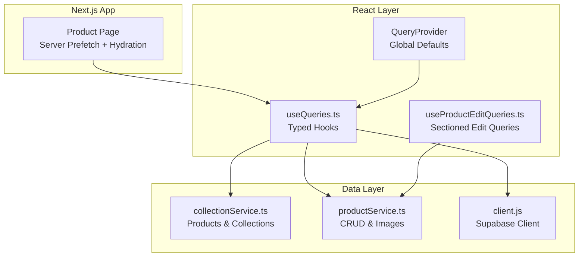
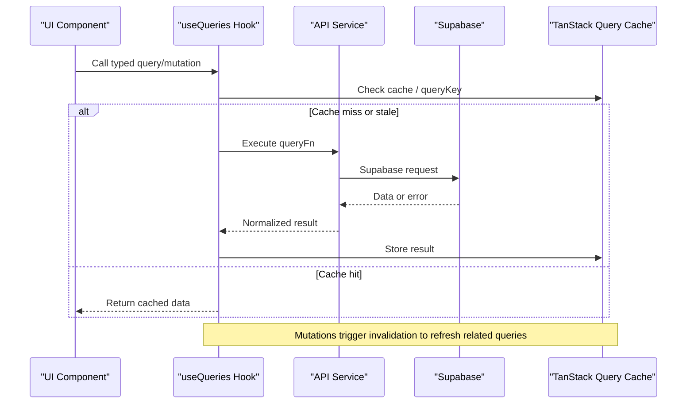
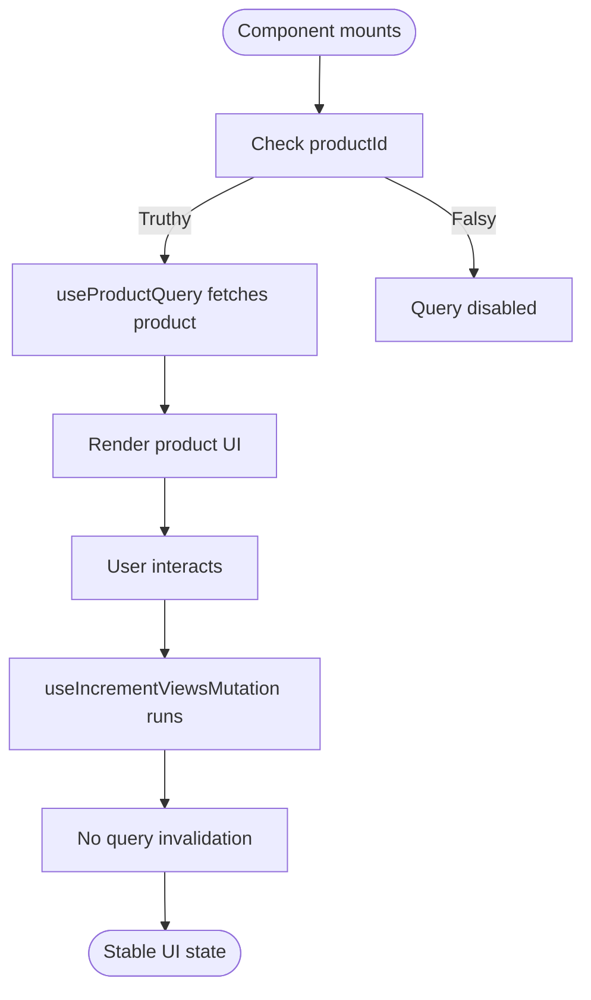
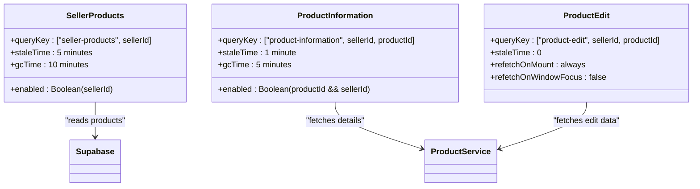
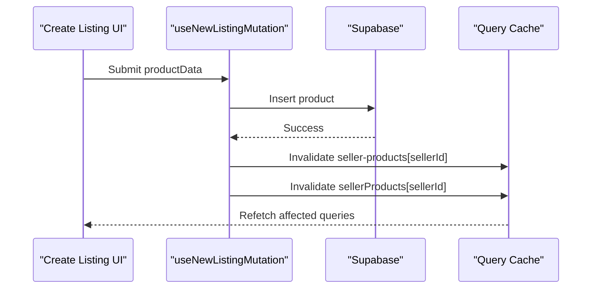
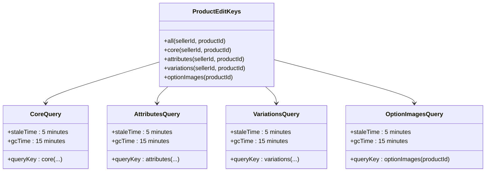
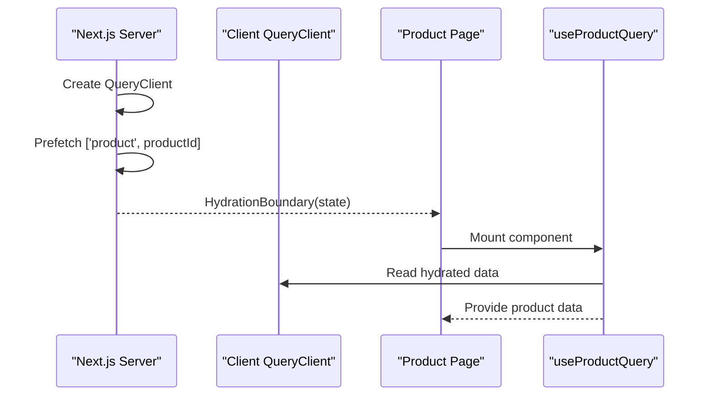
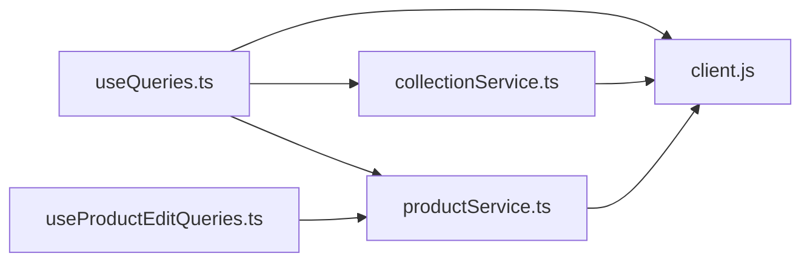

# Data Fetching Hooks

<cite>
**Referenced Files in This Document**
- [useQueries.ts](file://src/hooks/useQueries.ts)
- [useProductEditQueries.ts](file://src/hooks/useProductEditQueries.ts)
- [QueryProvider.tsx](file://src/providers/QueryProvider.tsx)
- [client.js](file://src/api/client.js)
- [collectionService.ts](file://src/api/collectionService.ts)
- [productService.ts](file://src/api/productService.ts)
- [page.tsx](file://app/product/[id]/page.tsx)
</cite>

## Table of Contents
1. [Introduction](#introduction)
2. [Project Structure](#project-structure)
3. [Core Components](#core-components)
4. [Architecture Overview](#architecture-overview)
5. [Detailed Component Analysis](#detailed-component-analysis)
6. [Dependency Analysis](#dependency-analysis)
7. [Performance Considerations](#performance-considerations)
8. [Troubleshooting Guide](#troubleshooting-guide)
9. [Conclusion](#conclusion)

## Introduction
This document explains the data fetching layer built around TanStack Query and Supabase. It focuses on the centralized hooks that wrap queries and mutations, how query keys are designed, how caching is configured, how errors are handled, and how cache invalidation keeps UI state consistent after writes. It also covers server-side prefetching for Next.js product pages, composition patterns for product editing, and practical guidance for real-time synchronization and performance optimization.

## Project Structure
The data fetching implementation is organized into:
- A React Query provider that sets global defaults.
- A central hook file that exports typed query and mutation hooks.
- API service modules that encapsulate Supabase calls and data transformation.
- A Next.js page that performs server-side prefetching and hydration.

**Diagram sources**
- [page.tsx:10-29](file://app/product/[id]/page.tsx#L10-L29)
- [QueryProvider.tsx:6-23](file://src/providers/QueryProvider.tsx#L6-L23)
- [useQueries.ts:1-28](file://src/hooks/useQueries.ts#L1-L28)
- [collectionService.ts:1-25](file://src/api/collectionService.ts#L1-L25)
- [productService.ts:1-8](file://src/api/productService.ts#L1-L8)
- [client.js:1-8](file://src/api/client.js#L1-L8)

**Section sources**
- [QueryProvider.tsx:6-23](file://src/providers/QueryProvider.tsx#L6-L23)
- [useQueries.ts:1-28](file://src/hooks/useQueries.ts#L1-L28)
- [client.js:1-8](file://src/api/client.js#L1-L8)

## Core Components
- QueryProvider configures a shared QueryClient with global defaults such as stale time and refetch behavior.
- useQueries.ts provides domain-specific hooks for products, collections, seller dashboards, orders, wallet, profile, storefront, categories, brands, and new listing creation.
- useProductEditQueries.ts provides sectioned queries for product editing with a key factory for precise cache targeting.
- collectionService.ts and productService.ts encapsulate Supabase queries, error handling, and data shaping.
- client.js exposes the Supabase client instance used by services and hooks.

Key responsibilities:
- Centralized query configuration through hooks.
- Consistent query key design for predictable cache behavior.
- Explicit staleTime and gcTime tuning per data domain.
- Mutation-driven cache invalidation to keep lists fresh.
- Server-side prefetching for fast initial product page loads.

**Section sources**
- [QueryProvider.tsx:6-23](file://src/providers/QueryProvider.tsx#L6-L23)
- [useQueries.ts:30-360](file://src/hooks/useQueries.ts#L30-L360)
- [useProductEditQueries.ts:13-121](file://src/hooks/useProductEditQueries.ts#L13-L121)
- [collectionService.ts:156-321](file://src/api/collectionService.ts#L156-L321)
- [productService.ts:302-707](file://src/api/productService.ts#L302-L707)
- [client.js:1-8](file://src/api/client.js#L1-L8)

## Architecture Overview
The architecture follows a layered approach:
- Presentation layers call typed hooks.
- Hooks delegate to API services.
- Services perform Supabase operations and return normalized data.
- TanStack Query manages caching, background updates, and lifecycle.
- Mutations update the server and invalidate relevant queries.

**Diagram sources**
- [useQueries.ts:48-66](file://src/hooks/useQueries.ts#L48-L66)
- [useQueries.ts:251-266](file://src/hooks/useQueries.ts#L251-L266)
- [collectionService.ts:156-321](file://src/api/collectionService.ts#L156-L321)
- [productService.ts:302-707](file://src/api/productService.ts#L302-L707)

## Detailed Component Analysis

### Global Query Configuration
- The QueryProvider creates a single QueryClient with:
  - Global default staleTime set to 60 seconds.
  - Window focus refetch disabled globally.
- Individual hooks can override these defaults using their own staleTime and gcTime values.

Best practices demonstrated:
- Keep global defaults conservative.
- Tune per-query caching based on data volatility (e.g., product details vs dashboard KPIs).

**Section sources**
- [QueryProvider.tsx:6-23](file://src/providers/QueryProvider.tsx#L6-L23)

### Product Detail Query and View Increment Mutation
- useProductQuery fetches product detail data with a stable query key ['product', productId] and a 3-minute staleTime.
- useIncrementViewsMutation increments views without invalidating the product query, avoiding unnecessary refetches.

Design notes:
- The view increment is intentionally fire-and-forget to preserve performance.
- Consumers should not rely on immediate view count updates in the same query scope.

**Diagram sources**
- [useQueries.ts:48-66](file://src/hooks/useQueries.ts#L48-L66)

**Section sources**
- [useQueries.ts:48-66](file://src/hooks/useQueries.ts#L48-L66)
- [collectionService.ts:332-476](file://src/api/collectionService.ts#L332-L476)

### Collection and Shop Products Query
- useCollectionProductsQuery wraps fetchCollectionProducts with a query key including the full params object.
- StaleTime is set to 3 minutes to balance freshness and performance.

Caching strategy:
- Params become part of the query key, ensuring separate caches for different filters, sorting, and pagination states.
- Database-level filtering and sorting reduce client-side processing overhead.

**Section sources**
- [useQueries.ts:76-82](file://src/hooks/useQueries.ts#L76-L82)
- [collectionService.ts:156-321](file://src/api/collectionService.ts#L156-L321)

### Seller Products and Product Information Queries
- useSellerProductsQuery fetches a seller’s listed products directly via Supabase with thumbnail embedding and ordering.
- useProductInformationQuery lazily fetches detailed product information when both productId and sellerId are present.
- useProductEditQuery forces fresh reads on mount for edit screens.

Caching characteristics:
- Seller products: 5-minute staleTime, 10-minute gcTime.
- Product information: 1-minute staleTime, 5-minute gcTime.
- Edit query: no cache, always refetch on mount, window focus disabled.

**Diagram sources**
- [useQueries.ts:94-151](file://src/hooks/useQueries.ts#L94-L151)
- [productService.ts:759-800](file://src/api/productService.ts#L759-L800)

**Section sources**
- [useQueries.ts:94-151](file://src/hooks/useQueries.ts#L94-L151)
- [productService.ts:759-800](file://src/api/productService.ts#L759-L800)

### Dashboard, Analytics, Orders, Wallet, Profile, and Storefront Queries
- Dedicated hooks exist for seller overview KPIs and details, last 7 days analytics, analytics by timeframe, orders, wallet, profile, and storefront data.
- Most use a 1-minute staleTime and enable only when sellerId is present.

Patterns:
- Stable query keys include sellerId to isolate caches per seller.
- Timeframe parameters are included in analytics query keys to avoid cross-contamination.

**Section sources**
- [useQueries.ts:159-245](file://src/hooks/useQueries.ts#L159-L245)

### New Listing Mutation and Cache Invalidation
- useNewListingMutation inserts a product via Supabase and invalidates seller product lists upon success.
- It targets both legacy and current query keys to ensure all consumers refresh.

Invalidation strategy:
- Invalidate specific seller-scoped lists rather than global keys to minimize unnecessary refetches.
- Avoid optimistic updates here; prefer reliable invalidation for list consistency.

**Diagram sources**
- [useQueries.ts:251-266](file://src/hooks/useQueries.ts#L251-L266)

**Section sources**
- [useQueries.ts:251-266](file://src/hooks/useQueries.ts#L251-L266)

### Brand Names, Categories, Departments, and Attribute Definitions
- useBrandNamesQuery fetches brand names with a fallback table name and robust error handling.
- useDepartmentsQuery and useCategoriesByDepartmentQuery manage hierarchical category navigation.
- useCategoryAttributeDefinitionsQuery retrieves attribute definitions for selected categories.

Robustness:
- Fallback logic handles schema differences gracefully.
- Long staleTime reduces repeated network requests for static reference data.

**Section sources**
- [useQueries.ts:276-357](file://src/hooks/useQueries.ts#L276-L357)

### Product Editing Sectioned Queries
- useProductEditQueries.ts defines a key factory for precise cache targeting across core, attributes, variations, and option images.
- Each sectioned query uses consistent staleTime and gcTime, and disables refetch triggers that could cause unnecessary work.

Composition pattern:
- Parent components can compose multiple sectioned queries and gate them based on availability of productId and sellerId.
- Keys allow targeted invalidation if edits occur at the section level.

**Diagram sources**
- [useProductEditQueries.ts:17-28](file://src/hooks/useProductEditQueries.ts#L17-L28)
- [useProductEditQueries.ts:42-120](file://src/hooks/useProductEditQueries.ts#L42-L120)

**Section sources**
- [useProductEditQueries.ts:13-121](file://src/hooks/useProductEditQueries.ts#L13-L121)

### Server-Side Prefetching and Hydration
- The product page creates a per-request QueryClient, prefetches product data using the same query key as the client hook, and hydrates the boundary.

Benefits:
- Faster initial paint and reduced client-side waterfalls.
- Consistent query keys between server and client ensure seamless handoff.

**Diagram sources**
- [page.tsx:10-29](file://app/product/[id]/page.tsx#L10-L29)
- [useQueries.ts:48-55](file://src/hooks/useQueries.ts#L48-L55)

**Section sources**
- [page.tsx:10-29](file://app/product/[id]/page.tsx#L10-L29)

## Dependency Analysis
The following diagram shows how hooks depend on services and the Supabase client.

**Diagram sources**
- [useQueries.ts:1-28](file://src/hooks/useQueries.ts#L1-L28)
- [useProductEditQueries.ts:1-11](file://src/hooks/useProductEditQueries.ts#L1-L11)
- [collectionService.ts:1-2](file://src/api/collectionService.ts#L1-L2)
- [productService.ts:1-2](file://src/api/productService.ts#L1-L2)
- [client.js:1-8](file://src/api/client.js#L1-L8)

**Section sources**
- [useQueries.ts:1-28](file://src/hooks/useQueries.ts#L1-L28)
- [useProductEditQueries.ts:1-11](file://src/hooks/useProductEditQueries.ts#L1-L11)
- [collectionService.ts:1-2](file://src/api/collectionService.ts#L1-L2)
- [productService.ts:1-2](file://src/api/productService.ts#L1-L2)
- [client.js:1-8](file://src/api/client.js#L1-L8)

## Performance Considerations
- Prefer database-level filtering, sorting, and pagination to reduce payload size and client-side computation.
- Use appropriate staleTime per data domain:
  - Product details: moderate staleness to reduce re-fetches during browsing.
  - Dashboard metrics: short staleness for near-real-time insights.
  - Static reference data (brands, departments): longer staleness.
- Avoid unnecessary invalidation:
  - Background mutations like view increments should not invalidate read queries.
  - List mutations should target only relevant seller-scoped keys.
- Leverage server-side prefetching for critical routes to improve perceived performance.
- Use gcTime to control memory usage for inactive queries.

[No sources needed since this section provides general guidance]

## Troubleshooting Guide
Common issues and strategies:
- Missing or inconsistent query keys:
  - Ensure query keys include all variables that affect results (e.g., sellerId, productId, timeframe).
- Unexpected refetches:
  - Check refetchOnWindowFocus and refetchOnReconnect settings.
  - Confirm mutations do not invalidate unrelated queries.
- Schema or RPC mismatches:
  - Some services provide friendly error messages indicating missing migrations or functions.
  - Verify Supabase migrations and RPC functions are deployed.
- Storage upload failures:
  - Inspect cleanup logs and retry flows.
  - Validate image constraints and bucket permissions.

Operational tips:
- Use console warnings and errors from services to diagnose Supabase responses.
- For product creation, check whether storage cleanup occurred after failed RPC calls.
- For reviews and relationships, note fallback mechanisms when joins fail.

**Section sources**
- [productService.ts:255-292](file://src/api/productService.ts#L255-L292)
- [productService.ts:638-707](file://src/api/productService.ts#L638-L707)
- [collectionService.ts:479-566](file://src/api/collectionService.ts#L479-L566)

## Conclusion
The data fetching layer combines TanStack Query’s caching and lifecycle management with Supabase-backed services to deliver efficient, maintainable data access. Key strengths include:
- Clear separation of concerns between hooks, services, and the client.
- Predictable query key design enabling precise cache control.
- Tuned caching strategies aligned with data volatility.
- Robust error handling and fallbacks in services.
- Server-side prefetching for improved user experience.

Adopting these patterns ensures scalable data fetching, predictable state synchronization, and strong performance across product browsing, seller dashboards, and content editing workflows.

[No sources needed since this section summarizes without analyzing specific files]