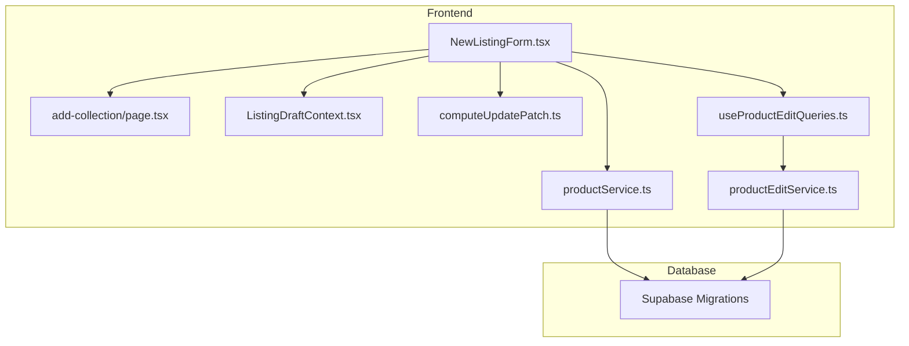
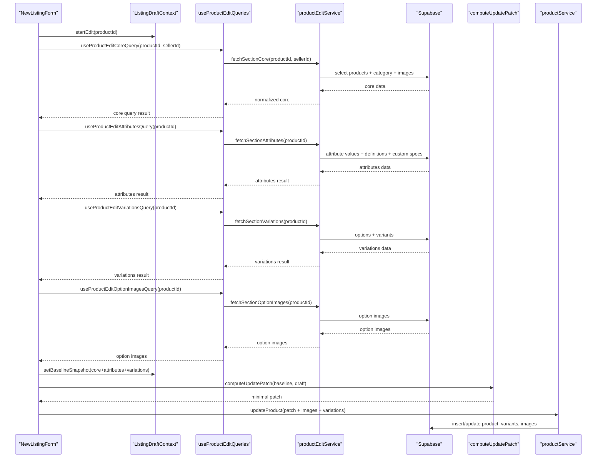
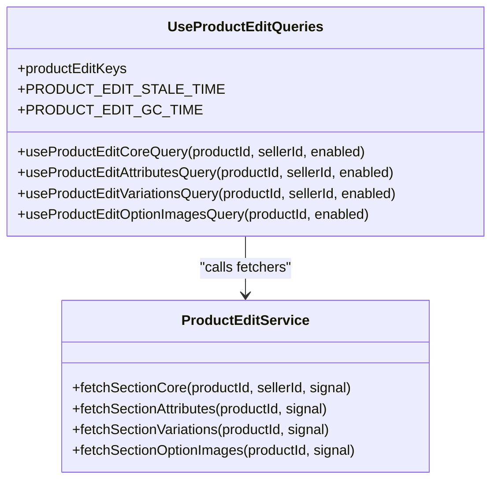
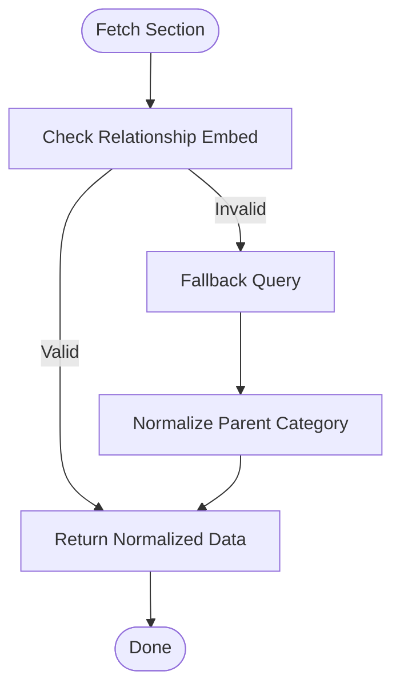
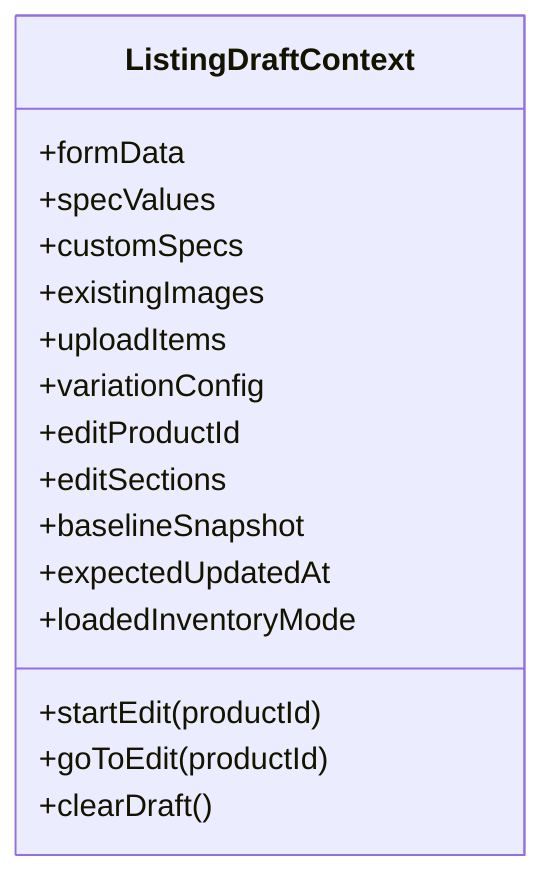
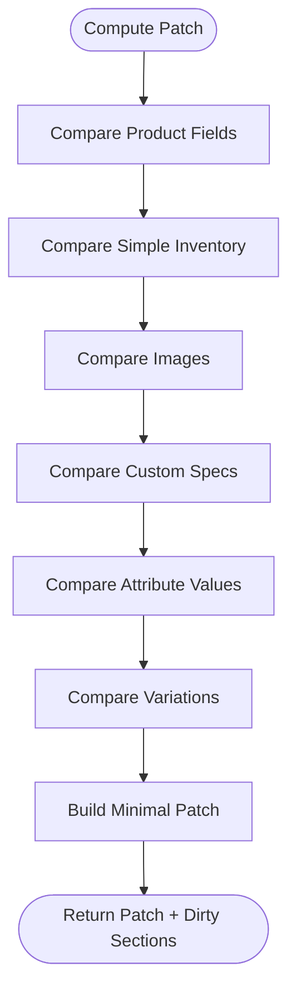
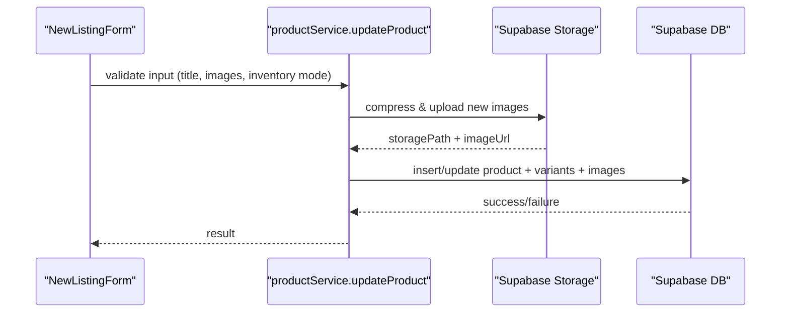
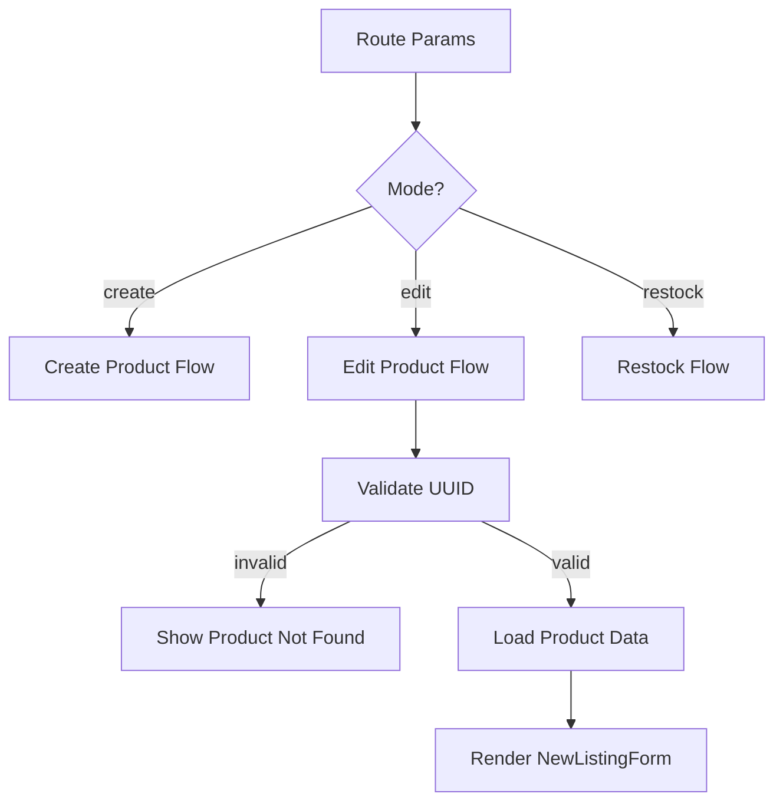
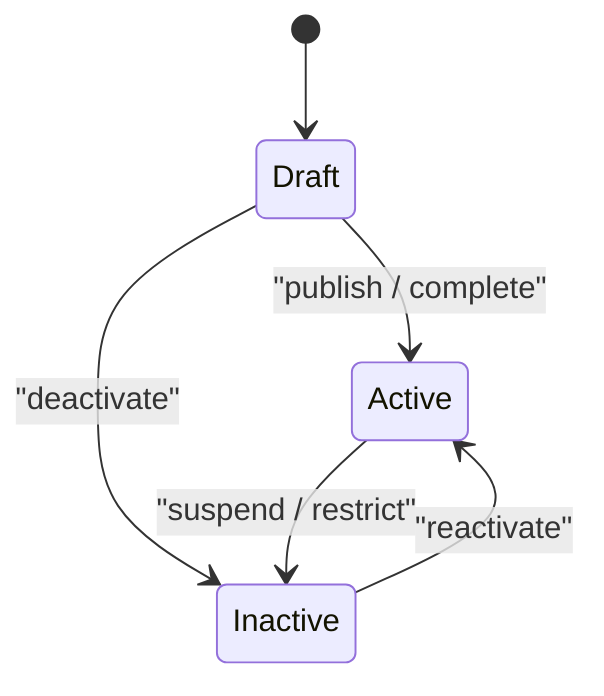
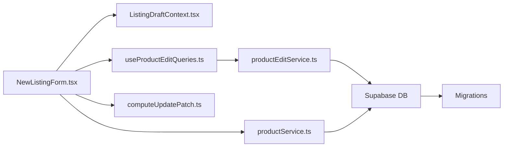

# Product Management Hooks

<cite>
**Referenced Files in This Document**
- [useProductEditQueries.ts](file://src/hooks/useProductEditQueries.ts)
- [productEditService.ts](file://src/api/productEditService.ts)
- [computeUpdatePatch.ts](file://src/utils/computeUpdatePatch.ts)
- [ListingDraftContext.tsx](file://components/reseller/context/ListingDraftContext.tsx)
- [productService.ts](file://src/api/productService.ts)
- [NewListingForm.tsx](file://components/reseller/components/NewListingForm.tsx)
- [add-collection page.tsx](file://app/dashboard/add-collection/page.tsx)
- [20261105_all_in_one_product_creation.sql](file://supabase/migrations/20261105_all_in_one_product_creation.sql)
- [20261106_fix_on_conflict_rpc.sql](file://supabase/migrations/20261106_fix_on_conflict_rpc.sql)
</cite>

## Table of Contents
1. [Introduction](#introduction)
2. [Project Structure](#project-structure)
3. [Core Components](#core-components)
4. [Architecture Overview](#architecture-overview)
5. [Detailed Component Analysis](#detailed-component-analysis)
6. [Dependency Analysis](#dependency-analysis)
7. [Performance Considerations](#performance-considerations)
8. [Troubleshooting Guide](#troubleshooting-guide)
9. [Conclusion](#conclusion)

## Introduction
This document explains the product management hooks and supporting services that power product creation, editing, variant management, inventory handling, image uploads, validation, and draft-to-publish workflows. The primary entry point for reading product edit data is `useProductEditQueries`, which exposes sectioned queries for core product details, attributes, variations, and option images. Editing state, patch computation, and persistence are handled by a layered system:

- React Query hooks read product sections efficiently.
- A listing draft context holds form state, variation configuration, and baseline snapshots.
- A pure patch calculator computes minimal server updates.
- A product service validates and persists changes, including images and variants.
- Database migrations enforce security, status transitions, and relational integrity.

The goal is to make it easy to implement product forms, manage complex product data structures, handle sizes, colors, and custom attributes, and optimize performance for large catalogs.

## Project Structure
The product management feature spans hooks, API services, utilities, UI components, and database migrations:

**Diagram sources**
- [NewListingForm.tsx:2765-2815](file://components/reseller/components/NewListingForm.tsx#L2765-L2815)
- [add-collection page.tsx:1-47](file://app/dashboard/add-collection/page.tsx#L1-L47)
- [ListingDraftContext.tsx:1-416](file://components/reseller/context/ListingDraftContext.tsx#L1-L416)
- [computeUpdatePatch.ts:1-565](file://src/utils/computeUpdatePatch.ts#L1-L565)
- [useProductEditQueries.ts:1-121](file://src/hooks/useProductEditQueries.ts#L1-L121)
- [productEditService.ts:1-362](file://src/api/productEditService.ts#L1-L362)
- [productService.ts:1200-1400](file://src/api/productService.ts#L1200-L1400)
- [20261105_all_in_one_product_creation.sql:451-503](file://supabase/migrations/20261105_all_in_one_product_creation.sql#L451-L503)
- [20261106_fix_on_conflict_rpc.sql:269-321](file://supabase/migrations/20261106_fix_on_conflict_rpc.sql#L269-L321)

**Section sources**
- [NewListingForm.tsx:2765-2815](file://components/reseller/components/NewListingForm.tsx#L2765-L2815)
- [add-collection page.tsx:1-47](file://app/dashboard/add-collection/page.tsx#L1-L47)
- [ListingDraftContext.tsx:1-416](file://components/reseller/context/ListingDraftContext.tsx#L1-L416)
- [computeUpdatePatch.ts:1-565](file://src/utils/computeUpdatePatch.ts#L1-L565)
- [useProductEditQueries.ts:1-121](file://src/hooks/useProductEditQueries.ts#L1-L121)
- [productEditService.ts:1-362](file://src/api/productEditService.ts#L1-L362)
- [productService.ts:1200-1400](file://src/api/productService.ts#L1200-L1400)
- [20261105_all_in_one_product_creation.sql:451-503](file://supabase/migrations/20261105_all_in_one_product_creation.sql#L451-L503)
- [20261106_fix_on_conflict_rpc.sql:269-321](file://supabase/migrations/20261106_fix_on_conflict_rpc.sql#L269-L321)

## Core Components
- **useProductEditQueries**: Provides TanStack Query hooks for product edit sections:
  - Core product details, category, parent, and images.
  - Attribute values with category definitions and custom specifications.
  - Variations: options, option values, and active variants.
  - Option images for variation values.
- **productEditService**: Data fetchers for each section, with fallbacks for PostgREST embedding issues and normalized responses.
- **ListingDraftContext**: Holds form data, variation configuration, image state, baseline snapshots, and edit-mode lifecycle helpers.
- **computeUpdatePatch**: Pure function that compares baseline snapshot against draft state and returns minimal update patches per section.
- **productService**: Validates inputs, processes images, enforces inventory mode rules, and persists products and variants.
- **NewListingForm and add-collection page**: UI entry points for create/edit modes, routing, and integration with draft context and services.

**Section sources**
- [useProductEditQueries.ts:17-121](file://src/hooks/useProductEditQueries.ts#L17-L121)
- [productEditService.ts:3-362](file://src/api/productEditService.ts#L3-L362)
- [ListingDraftContext.tsx:6-173](file://components/reseller/context/ListingDraftContext.tsx#L6-L173)
- [computeUpdatePatch.ts:3-565](file://src/utils/computeUpdatePatch.ts#L3-L565)
- [productService.ts:1200-1400](file://src/api/productService.ts#L1200-L1400)
- [NewListingForm.tsx:2765-2815](file://components/reseller/components/NewListingForm.tsx#L2765-L2815)
- [add-collection page.tsx:1-47](file://app/dashboard/add-collection/page.tsx#L1-L47)

## Architecture Overview
The product edit architecture follows a layered approach:

- UI layer (form pages and components) manages user interactions and displays loading/error states.
- Context layer maintains draft state, baseline snapshots, and edit-mode flags.
- Hook layer reads product sections via TanStack Query with stable keys and caching.
- Service layer performs data fetching and normalization.
- Utility layer computes minimal diffs between baseline and draft.
- Persistence layer validates and writes changes to the database, including images and variants.

**Diagram sources**
- [useProductEditQueries.ts:42-121](file://src/hooks/useProductEditQueries.ts#L42-L121)
- [productEditService.ts:60-362](file://src/api/productEditService.ts#L60-L362)
- [ListingDraftContext.tsx:177-369](file://components/reseller/context/ListingDraftContext.tsx#L177-L369)
- [computeUpdatePatch.ts:195-565](file://src/utils/computeUpdatePatch.ts#L195-L565)
- [productService.ts:1200-1400](file://src/api/productService.ts#L1200-L1400)

## Detailed Component Analysis

### Product Edit Queries (`useProductEditQueries`)
`useProductEditQueries` provides four focused hooks:

- **useProductEditCoreQuery**: Fetches product core data, category, parent category, and product images. It uses a key factory for cache isolation and sets stale/gc times for efficient caching.
- **useProductEditAttributesQuery**: Fetches attribute values with category definitions and custom specifications. It handles missing relationship data by falling back to separate queries.
- **useProductEditVariationsQuery**: Fetches product options, option values, and active variants. It is intended for variant-based inventory modes.
- **useProductEditOptionImagesQuery**: Fetches images associated with variation option values.

Key behaviors:
- Keys include sellerId and productId where applicable, ensuring proper cache separation.
- Stale time and garbage collection time are configured to reduce unnecessary refetches.
- Abort signals are passed through to cancel in-flight requests on unmount or dependency change.

**Diagram sources**
- [useProductEditQueries.ts:17-121](file://src/hooks/useProductEditQueries.ts#L17-L121)
- [productEditService.ts:60-362](file://src/api/productEditService.ts#L60-L362)

**Section sources**
- [useProductEditQueries.ts:17-121](file://src/hooks/useProductEditQueries.ts#L17-L121)
- [productEditService.ts:60-362](file://src/api/productEditService.ts#L60-L362)

### Product Edit Service (`productEditService`)
The service encapsulates all data fetching logic for product edits:

- **Core Section**: Retrieves product, category, parent category, and images. Includes fallback logic when PostgREST embeds return arrays instead of objects for self-referencing relationships.
- **Attributes Section**: Retrieves attribute values with category definitions and custom specifications. Handles missing definitions by performing additional queries and mapping them into the response.
- **Variations Section**: Retrieves product options and variants, including option values and variant-option mappings.
- **Option Images Section**: Retrieves images linked to option values.

Error handling:
- Detects specific PostgREST error codes and messages indicating relationship issues and falls back to safer queries.
- Normalizes category parent data to ensure consistent structure.

**Diagram sources**
- [productEditService.ts:60-146](file://src/api/productEditService.ts#L60-L146)
- [productEditService.ts:200-306](file://src/api/productEditService.ts#L200-L306)
- [productEditService.ts:311-362](file://src/api/productEditService.ts#L311-L362)

**Section sources**
- [productEditService.ts:3-362](file://src/api/productEditService.ts#L3-L362)

### Listing Draft Context (`ListingDraftContext`)
The context manages:

- Form fields for product title, description, defect, pricing, quantity, and other attributes.
- Custom specifications and attribute values.
- Existing images and upload items.
- Variation configuration including dimensions, values, rows, and option images.
- Edit-mode state: product ID, section load states, baseline snapshots, expected updated timestamps, and inventory mode.
- Lifecycle helpers: `startEdit`, `goToEdit`, `clearDraft`.

It also exports utility functions for price range calculation and formatting, aiding UI display of variation prices.

**Diagram sources**
- [ListingDraftContext.tsx:6-173](file://components/reseller/context/ListingDraftContext.tsx#L6-L173)
- [ListingDraftContext.tsx:177-369](file://components/reseller/context/ListingDraftContext.tsx#L177-L369)

**Section sources**
- [ListingDraftContext.tsx:6-173](file://components/reseller/context/ListingDraftContext.tsx#L6-L173)
- [ListingDraftContext.tsx:177-369](file://components/reseller/context/ListingDraftContext.tsx#L177-L369)

### Patch Computation (`computeUpdatePatch`)
`computeUpdatePatch` compares a baseline snapshot with current draft state and produces a minimal patch containing only changed sections:

- **Product Details**: Title, description, defect.
- **Simple Inventory**: Selling price, compare-at price, and stock quantity changes using compare-and-set semantics.
- **Images**: Desired image order and new uploads; existing images are preserved by ID.
- **Custom Specifications**: Upsert and removal by ID.
- **Attribute Values**: Upsert and removal by attribute ID, with equality checks across types.
- **Variations**: Option renames, value renames, new values, removed values, variant changes, new variants, deactivated variants, and option images.

It returns a patch object, an empty flag, and a set of dirty section names.

**Diagram sources**
- [computeUpdatePatch.ts:195-565](file://src/utils/computeUpdatePatch.ts#L195-L565)

**Section sources**
- [computeUpdatePatch.ts:3-565](file://src/utils/computeUpdatePatch.ts#L3-L565)

### Product Creation and Editing (`productService`)
`updateProduct` orchestrates validation, image processing, and persistence:

- **Validation**:
  - Requires product ID, seller ID, category, and title length constraints.
  - Enforces at least one image and maximum image count.
  - Derives inventory mode from enabled variation dimensions.
  - For variant mode: limits dimensions and values, requires at least one row, caps rows, validates per-row price and quantity, and ensures total stock > 0.
  - For simple mode: requires selling price, optional compare-at price, and integer quantity >= 0.
- **Image Processing**:
  - Deduplicates new files by SHA-256 hash.
  - Compresses images and generates storage paths scoped to seller and product.
  - Builds gallery image references and tracks thumbnail selection.
  - Processes variation option images similarly.
- **Persistence**:
  - Inserts or updates product records.
  - Manages variants, option values, and option images.
  - Uses database RPCs and triggers to enforce status transitions and security policies.

**Diagram sources**
- [productService.ts:1200-1400](file://src/api/productService.ts#L1200-L1400)

**Section sources**
- [productService.ts:1200-1400](file://src/api/productService.ts#L1200-L1400)

### Product Forms and Pages (`NewListingForm` and `add-collection/page.tsx`)
- **NewListingForm**:
  - Supports create, edit, and restock modes.
  - Validates UUID format in edit mode and shows a “Product Not Found” state for malformed IDs.
  - Integrates with draft context and services for data binding and submission.
- **add-collection/page.tsx**:
  - Resolves route parameters (`productId`, `mode`).
  - Renders `NewListingForm` with appropriate props and navigation on success/cancel.

**Diagram sources**
- [NewListingForm.tsx:2765-2815](file://components/reseller/components/NewListingForm.tsx#L2765-L2815)
- [add-collection page.tsx:1-47](file://app/dashboard/add-collection/page.tsx#L1-L47)

**Section sources**
- [NewListingForm.tsx:2765-2815](file://components/reseller/components/NewListingForm.tsx#L2765-L2815)
- [add-collection page.tsx:1-47](file://app/dashboard/add-collection/page.tsx#L1-L47)

### Draft/Publish Workflows and Status Transitions
Products are initially created with status `'draft'` to satisfy database triggers and then transition to active upon successful completion. Migrations enforce:

- Initial product insertion with status `'draft'`.
- Security isolation for image storage paths and URLs.
- Validation of image storage path prefixes and URL suffixes.

**Diagram sources**
- [20261105_all_in_one_product_creation.sql:451-503](file://supabase/migrations/20261105_all_in_one_product_creation.sql#L451-L503)
- [20261106_fix_on_conflict_rpc.sql:269-321](file://supabase/migrations/20261106_fix_on_conflict_rpc.sql#L269-L321)

**Section sources**
- [20261105_all_in_one_product_creation.sql:451-503](file://supabase/migrations/20261105_all_in_one_product_creation.sql#L451-L503)
- [20261106_fix_on_conflict_rpc.sql:269-321](file://supabase/migrations/20261106_fix_on_conflict_rpc.sql#L269-L321)

## Dependency Analysis
The product management system has clear dependencies:

- UI depends on context for state and hooks for data.
- Hooks depend on service for data fetching.
- Services depend on Supabase client and database schema.
- Utilities provide pure functions for diffing and normalization.
- Migrations define schema constraints and security policies.

**Diagram sources**
- [NewListingForm.tsx:2765-2815](file://components/reseller/components/NewListingForm.tsx#L2765-L2815)
- [ListingDraftContext.tsx:177-369](file://components/reseller/context/ListingDraftContext.tsx#L177-L369)
- [useProductEditQueries.ts:17-121](file://src/hooks/useProductEditQueries.ts#L17-L121)
- [productEditService.ts:60-362](file://src/api/productEditService.ts#L60-L362)
- [computeUpdatePatch.ts:195-565](file://src/utils/computeUpdatePatch.ts#L195-L565)
- [productService.ts:1200-1400](file://src/api/productService.ts#L1200-L1400)

**Section sources**
- [NewListingForm.tsx:2765-2815](file://components/reseller/components/NewListingForm.tsx#L2765-L2815)
- [ListingDraftContext.tsx:177-369](file://components/reseller/context/ListingDraftContext.tsx#L177-L369)
- [useProductEditQueries.ts:17-121](file://src/hooks/useProductEditQueries.ts#L17-L121)
- [productEditService.ts:60-362](file://src/api/productEditService.ts#L60-L362)
- [computeUpdatePatch.ts:195-565](file://src/utils/computeUpdatePatch.ts#L195-L565)
- [productService.ts:1200-1400](file://src/api/productService.ts#L1200-L1400)

## Performance Considerations
- **Caching Strategy**:
  - Use stable query keys per product and seller to avoid cross-contamination.
  - Configure stale time and garbage collection time to balance freshness and network usage.
- **Sectioned Loading**:
  - Load core, attributes, variations, and option images independently to improve perceived performance.
  - Enable/disable queries based on availability of required IDs and inventory mode.
- **Minimal Patches**:
  - Compute diffs to send only changed fields, reducing payload size and conflict risk.
- **Image Optimization**:
  - Deduplicate uploads by hash to avoid redundant storage operations.
  - Compress images before upload to reduce bandwidth.
- **Large Catalogs**:
  - Prefer pagination and filtering at the API level if needed.
  - Avoid eager-loading heavy relationships unless necessary; use fallback queries selectively.
- **Abort Signals**:
  - Pass abort signals to cancel in-flight requests when components unmount or dependencies change.

[No sources needed since this section provides general guidance]

## Troubleshooting Guide
Common issues and resolutions:

- **PostgREST Relationship Errors**:
  - Symptom: Missing category parent or attribute definition data.
  - Resolution: Service includes fallback queries and normalization to resolve embedded arrays and missing relationships.
- **Malformed Product ID in Edit Mode**:
  - Symptom: Edit form shows “Product Not Found”.
  - Resolution: Ensure UUID format is valid; otherwise, redirect to listings.
- **Image Upload Failures**:
  - Symptom: Storage path or URL mismatch errors.
  - Resolution: Verify storage path prefix and URL suffix enforced by migrations; ensure correct seller/product scoping.
- **Variant Validation Errors**:
  - Symptom: Errors about dimension count, value count, row count, price, or quantity.
  - Resolution: Adjust variation configuration to meet constraints; ensure at least one combination row and positive total stock.
- **Simple Product Validation Errors**:
  - Symptom: Missing pricing or invalid quantity.
  - Resolution: Provide selling price and optional compare-at price; ensure integer quantity >= 0.

**Section sources**
- [productEditService.ts:82-108](file://src/api/productEditService.ts#L82-L108)
- [productEditService.ts:216-255](file://src/api/productEditService.ts#L216-L255)
- [NewListingForm.tsx:2780-2801](file://components/reseller/components/NewListingForm.tsx#L2780-L2801)
- [productService.ts:1226-1293](file://src/api/productService.ts#L1226-L1293)
- [20261106_fix_on_conflict_rpc.sql:269-282](file://supabase/migrations/20261106_fix_on_conflict_rpc.sql#L269-L282)

## Conclusion
The product management hooks and services provide a robust foundation for creating and editing products with support for simple and variant inventory models. The architecture emphasizes efficient data loading, minimal updates, strong validation, and secure storage. By leveraging sectioned queries, draft contexts, and pure patch computation, the system scales well for complex product catalogs while maintaining clarity and reliability. Implementing product forms involves integrating these hooks and services, managing variation configurations, and adhering to validation rules defined in the product service and database migrations.

[No sources needed since this section summarizes without analyzing specific files]