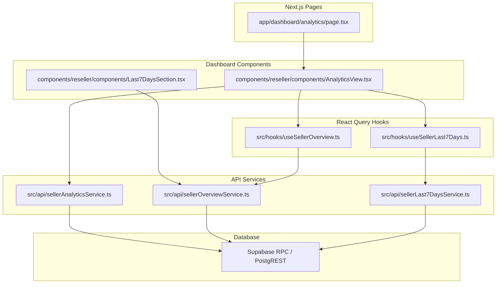
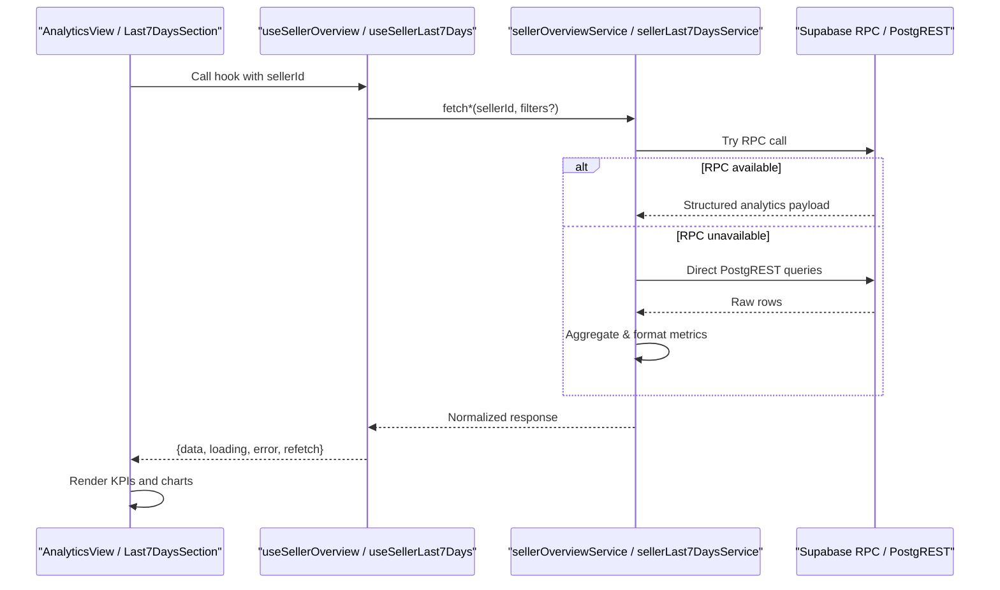
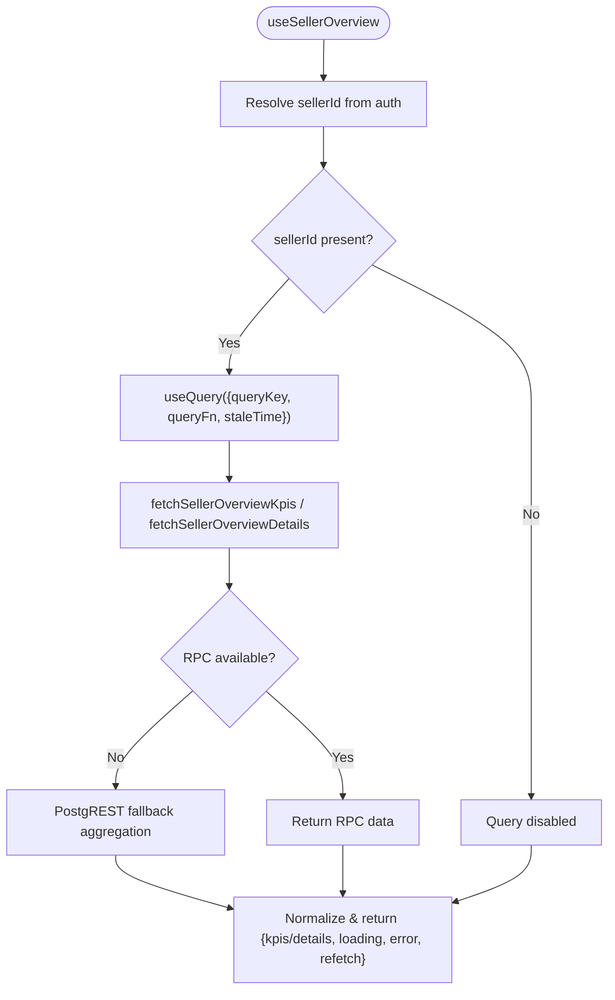
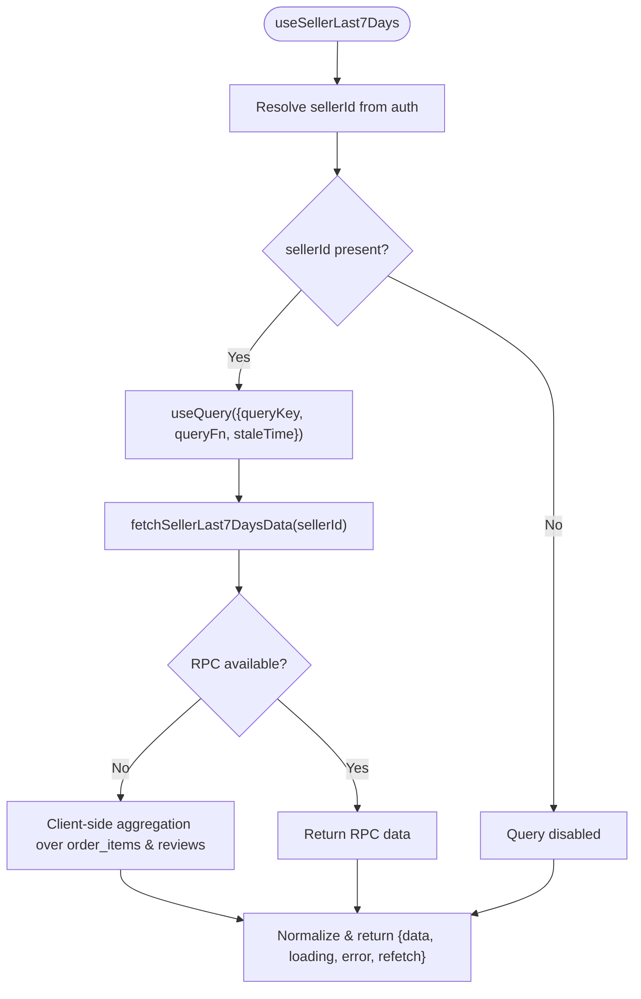
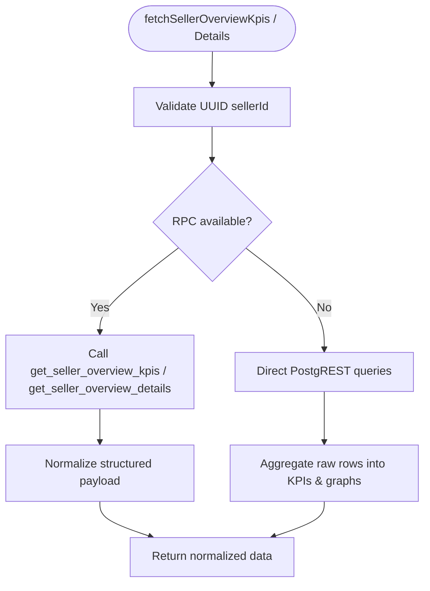
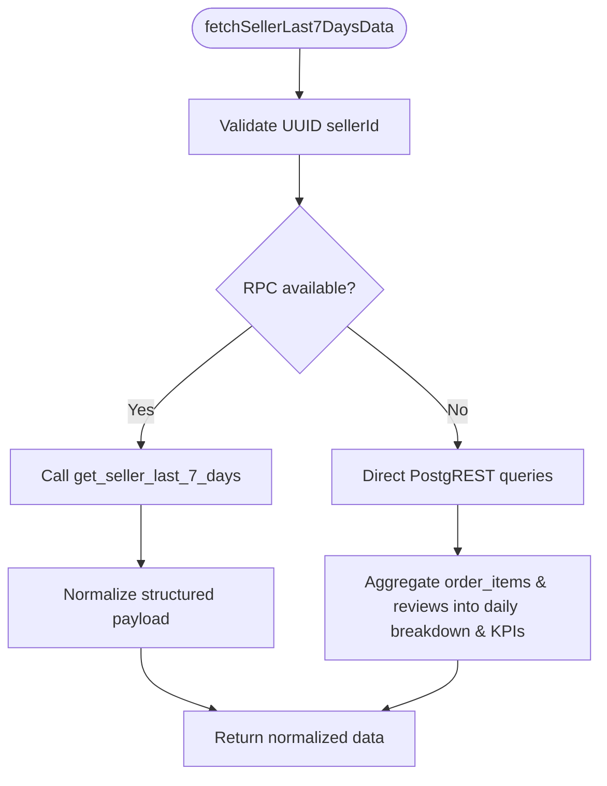
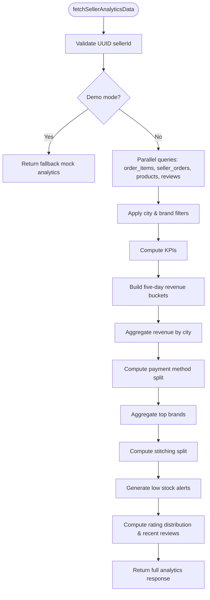
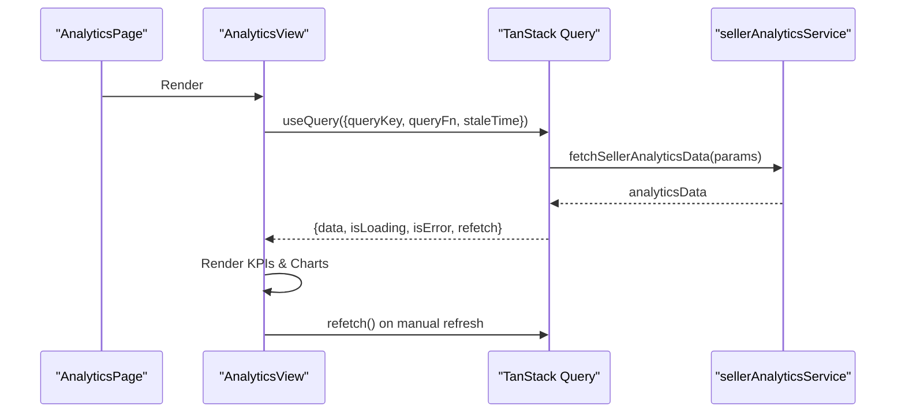
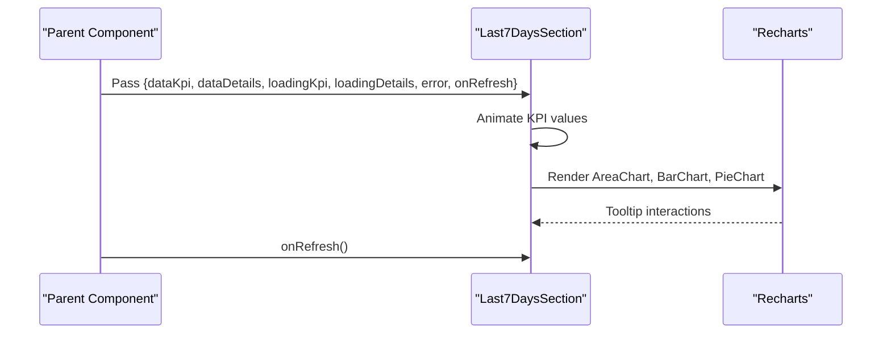
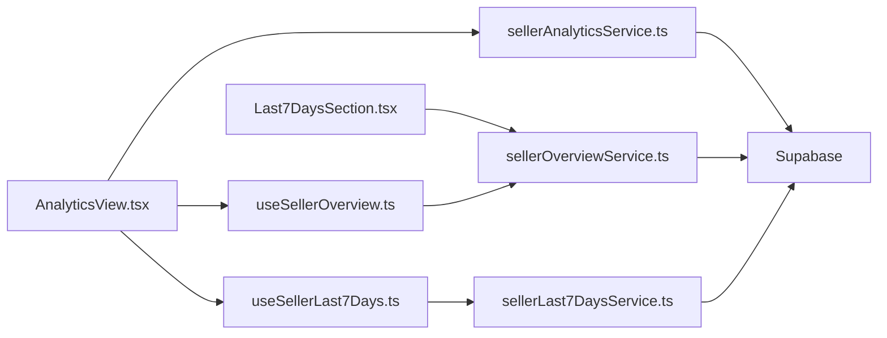

# Seller Analytics Hooks

<cite>
**Referenced Files in This Document**
- [useSellerOverview.ts](file://src/hooks/useSellerOverview.ts)
- [useSellerLast7Days.ts](file://src/hooks/useSellerLast7Days.ts)
- [sellerAnalyticsService.ts](file://src/api/sellerAnalyticsService.ts)
- [sellerOverviewService.ts](file://src/api/sellerOverviewService.ts)
- [sellerLast7DaysService.ts](file://src/api/sellerLast7DaysService.ts)
- [AnalyticsView.tsx](file://components/reseller/components/AnalyticsView.tsx)
- [Last7DaysSection.tsx](file://components/reseller/components/Last7DaysSection.tsx)
- [analytics page.tsx](file://app/dashboard/analytics/page.tsx)
</cite>

## Table of Contents
1. [Introduction](#introduction)
2. [Project Structure](#project-structure)
3. [Core Components](#core-components)
4. [Architecture Overview](#architecture-overview)
5. [Detailed Component Analysis](#detailed-component-analysis)
6. [Dependency Analysis](#dependency-analysis)
7. [Performance Considerations](#performance-considerations)
8. [Troubleshooting Guide](#troubleshooting-guide)
9. [Conclusion](#conclusion)

## Introduction
This document explains the seller analytics hooks and their supporting services, focusing on:
- `useSellerOverview` for fast KPI cards and detailed overview graphs
- `useSellerLast7Days` for trailing seven-day performance metrics
- Sales metrics calculation, revenue tracking, performance KPIs, and time-based aggregation
- Data visualization preparation, chart data formatting, and real-time metric updates
- Dashboard implementation examples, large dataset handling, query optimization, caching strategies, refresh intervals, and error handling

The system uses TanStack Query for caching and refetching, Supabase RPC calls with PostgREST fallbacks, and Recharts for visualization.

## Project Structure
The seller analytics feature is composed of:
- React hooks that encapsulate data fetching and state
- API services that call Supabase RPC or fall back to direct queries
- Dashboard components that render KPIs, charts, and tables
- A Next.js page that mounts the analytics dashboard

**Diagram sources**
- [analytics page.tsx:1-9](file://app/dashboard/analytics/page.tsx#L1-L9)
- [AnalyticsView.tsx:183-204](file://components/reseller/components/AnalyticsView.tsx#L183-L204)
- [Last7DaysSection.tsx:79-87](file://components/reseller/components/Last7DaysSection.tsx#L79-L87)
- [useSellerOverview.ts:27-72](file://src/hooks/useSellerOverview.ts#L27-L72)
- [useSellerLast7Days.ts:15-35](file://src/hooks/useSellerLast7Days.ts#L15-L35)
- [sellerAnalyticsService.ts:195-207](file://src/api/sellerAnalyticsService.ts#L195-L207)
- [sellerOverviewService.ts:90-139](file://src/api/sellerOverviewService.ts#L90-L139)
- [sellerLast7DaysService.ts:83-114](file://src/api/sellerLast7DaysService.ts#L83-L114)

**Section sources**
- [analytics page.tsx:1-9](file://app/dashboard/analytics/page.tsx#L1-L9)
- [AnalyticsView.tsx:183-204](file://components/reseller/components/AnalyticsView.tsx#L183-L204)
- [Last7DaysSection.tsx:79-87](file://components/reseller/components/Last7DaysSection.tsx#L79-L87)
- [useSellerOverview.ts:27-72](file://src/hooks/useSellerOverview.ts#L27-L72)
- [useSellerLast7Days.ts:15-35](file://src/hooks/useSellerLast7Days.ts#L15-L35)
- [sellerAnalyticsService.ts:195-207](file://src/api/sellerAnalyticsService.ts#L195-L207)
- [sellerOverviewService.ts:90-139](file://src/api/sellerOverviewService.ts#L90-L139)
- [sellerLast7DaysService.ts:83-114](file://src/api/sellerLast7DaysService.ts#L83-L114)

## Core Components
- `useSellerOverviewKpis`: Returns Section 1 and Section 2 KPIs (fast path). Uses a 60-second stale time cache.
- `useSellerOverviewDetails`: Returns detailed graphs and recent orders (Phase 2). Also cached for 60 seconds.
- `useSellerLast7Days`: Returns last seven days breakdown, summary KPIs, top products, payment split, best/worst day. Cached for 60 seconds.
- `fetchSellerOverviewKpis` / `fetchSellerOverviewDetails`: Prefer Supabase RPC; fall back to client-side PostgREST queries if RPC is unavailable.
- `fetchSellerLast7DaysData`: Prefer Supabase RPC; fall back to client-side aggregation over order items and reviews.
- `fetchSellerAnalyticsData`: Full analytics including KPIs, five-day revenue buckets, city revenue, payment method split, top brands, stitching split, low stock alerts, rating distribution, and recent reviews. Includes date range and filter support.

Key responsibilities:
- Resolve seller ID from authentication context
- Fetch data via RPC or PostgREST
- Aggregate metrics in memory when necessary
- Provide stable interfaces for UI components
- Expose refetch functions for manual refresh

**Section sources**
- [useSellerOverview.ts:27-72](file://src/hooks/useSellerOverview.ts#L27-L72)
- [useSellerLast7Days.ts:15-35](file://src/hooks/useSellerLast7Days.ts#L15-L35)
- [sellerOverviewService.ts:90-139](file://src/api/sellerOverviewService.ts#L90-L139)
- [sellerLast7DaysService.ts:83-114](file://src/api/sellerLast7DaysService.ts#L83-L114)
- [sellerAnalyticsService.ts:195-207](file://src/api/sellerAnalyticsService.ts#L195-L207)

## Architecture Overview
The architecture follows a layered approach:
- Presentation layer: Dashboard components render KPIs and charts
- Hook layer: Encapsulates TanStack Query configuration and data normalization
- Service layer: Handles RPC vs PostgREST strategy and in-memory aggregation
- Database layer: Supabase RPC functions or direct table joins

**Diagram sources**
- [AnalyticsView.tsx:183-204](file://components/reseller/components/AnalyticsView.tsx#L183-L204)
- [Last7DaysSection.tsx:79-87](file://components/reseller/components/Last7DaysSection.tsx#L79-L87)
- [useSellerOverview.ts:27-72](file://src/hooks/useSellerOverview.ts#L27-L72)
- [useSellerLast7Days.ts:15-35](file://src/hooks/useSellerLast7Days.ts#L15-L35)
- [sellerOverviewService.ts:90-139](file://src/api/sellerOverviewService.ts#L90-L139)
- [sellerLast7DaysService.ts:83-114](file://src/api/sellerLast7DaysService.ts#L83-L114)

## Detailed Component Analysis

### useSellerOverview Hook
Responsibilities:
- Resolve seller ID from auth context
- Fetch KPIs and details using TanStack Query
- Provide loading, error, and refetch states
- Cache results for 60 seconds

Data returned:
- KPIs: Section 1 and Section 2 metrics
- Details: Graphs and recent orders

Error handling:
- Converts errors to user-friendly messages
- Provides refetch wrapper returning data

**Diagram sources**
- [useSellerOverview.ts:27-72](file://src/hooks/useSellerOverview.ts#L27-L72)
- [sellerOverviewService.ts:90-139](file://src/api/sellerOverviewService.ts#L90-L139)

**Section sources**
- [useSellerOverview.ts:27-72](file://src/hooks/useSellerOverview.ts#L27-L72)
- [sellerOverviewService.ts:90-139](file://src/api/sellerOverviewService.ts#L90-L139)

### useSellerLast7Days Hook
Responsibilities:
- Resolve seller ID from auth context
- Fetch last seven days metrics using TanStack Query
- Provide loading, error, and refetch states
- Cache results for 60 seconds

Data returned:
- Daily breakdown with revenue, orders, units sold, status counts, payment method counts
- Summary KPIs including trends and averages
- Top products and payment method split
- Best and worst day

Error handling:
- Converts errors to user-friendly messages
- Provides refetch wrapper returning data

**Diagram sources**
- [useSellerLast7Days.ts:15-35](file://src/hooks/useSellerLast7Days.ts#L15-L35)
- [sellerLast7DaysService.ts:83-114](file://src/api/sellerLast7DaysService.ts#L83-L114)

**Section sources**
- [useSellerLast7Days.ts:15-35](file://src/hooks/useSellerLast7Days.ts#L15-L35)
- [sellerLast7DaysService.ts:83-114](file://src/api/sellerLast7DaysService.ts#L83-L114)

### Seller Overview Service
Responsibilities:
- Attempt RPC first for fast KPIs and details
- Fall back to PostgREST queries if RPC fails
- Compute Section 1 and Section 2 KPIs
- Build daily revenue trajectory, order volume, status breakdown, top products, payment share, and recent orders

Key calculations:
- Total revenue from shipped/delivered orders
- Available payout based on pending payments
- Active listings count
- Pending dispatch and delivered orders
- Average rating from approved reviews
- Seven-day windows for revenue, orders, average order value, pending fulfillment, new reviews, units sold

**Diagram sources**
- [sellerOverviewService.ts:90-139](file://src/api/sellerOverviewService.ts#L90-L139)
- [sellerOverviewService.ts:145-268](file://src/api/sellerOverviewService.ts#L145-L268)
- [sellerOverviewService.ts:270-440](file://src/api/sellerOverviewService.ts#L270-L440)

**Section sources**
- [sellerOverviewService.ts:90-139](file://src/api/sellerOverviewService.ts#L90-L139)
- [sellerOverviewService.ts:145-268](file://src/api/sellerOverviewService.ts#L145-L268)
- [sellerOverviewService.ts:270-440](file://src/api/sellerOverviewService.ts#L270-L440)

### Seller Last 7 Days Service
Responsibilities:
- Attempt RPC first for last seven days metrics
- Fall back to PostgREST queries if RPC fails
- Build daily breakdown with revenue, orders, units sold, order status counts, and payment method counts
- Compute summary KPIs including previous window comparison and trend percentages
- Identify best and worst days by revenue

Key calculations:
- Current and previous seven-day revenue and orders
- Average order value
- Revenue and orders trend percentages
- Units sold and pending fulfillment count
- New reviews and average rating
- Top five products by units sold
- Payment method split percentages

**Diagram sources**
- [sellerLast7DaysService.ts:83-114](file://src/api/sellerLast7DaysService.ts#L83-L114)
- [sellerLast7DaysService.ts:116-311](file://src/api/sellerLast7DaysService.ts#L116-L311)

**Section sources**
- [sellerLast7DaysService.ts:83-114](file://src/api/sellerLast7DaysService.ts#L83-L114)
- [sellerLast7DaysService.ts:116-311](file://src/api/sellerLast7DaysService.ts#L116-L311)

### Seller Analytics Service
Responsibilities:
- Fetch comprehensive analytics across multiple dimensions
- Support date range filtering (7D, 30D, 90D, ALL)
- Support city and brand filters
- Compute KPIs, five-day revenue buckets, city revenue, payment method split, top brands, stitching split, low stock alerts, rating distribution, and recent reviews
- Provide fallback mock data for demo mode or empty sellers

Key calculations:
- Total revenue and total orders
- Average order value
- Active and sold-out product counts
- Pending and cancelled orders
- Cancellation rate
- Average rating and approved review count
- Five-day revenue buckets with COD and online splits
- Top six cities and brands with default fallbacks
- Stitching category split including ready-to-wear
- Low stock and sold out alerts
- Rating distribution and recent reviews

**Diagram sources**
- [sellerAnalyticsService.ts:195-207](file://src/api/sellerAnalyticsService.ts#L195-L207)
- [sellerAnalyticsService.ts:209-330](file://src/api/sellerAnalyticsService.ts#L209-L330)
- [sellerAnalyticsService.ts:331-567](file://src/api/sellerAnalyticsService.ts#L331-L567)
- [sellerAnalyticsService.ts:572-619](file://src/api/sellerAnalyticsService.ts#L572-L619)
- [sellerAnalyticsService.ts:624-720](file://src/api/sellerAnalyticsService.ts#L624-L720)

**Section sources**
- [sellerAnalyticsService.ts:195-207](file://src/api/sellerAnalyticsService.ts#L195-L207)
- [sellerAnalyticsService.ts:209-330](file://src/api/sellerAnalyticsService.ts#L209-L330)
- [sellerAnalyticsService.ts:331-567](file://src/api/sellerAnalyticsService.ts#L331-L567)
- [sellerAnalyticsService.ts:572-619](file://src/api/sellerAnalyticsService.ts#L572-L619)
- [sellerAnalyticsService.ts:624-720](file://src/api/sellerAnalyticsService.ts#L624-L720)

### Dashboard Components

#### AnalyticsView
Responsibilities:
- Mount the analytics dashboard
- Manage filters: date range, city, brand
- Render KPI cards, charts, tabs, and export functionality
- Use TanStack Query to fetch analytics data with 60-second stale time
- Provide manual refresh via refetch

Visualization preparation:
- Revenue trend area chart with COD and online series
- Revenue by city bar chart
- Payment method pie chart
- Top brands bar chart
- Stitching split pie chart
- Low stock alert widget
- Rating distribution bars and recent reviews list

Real-time updates:
- Manual refresh button triggers refetch
- Stale time ensures periodic background refresh

Large dataset handling:
- Filters reduce dataset size before rendering
- Horizontal scroll containers prevent layout overflow

**Diagram sources**
- [analytics page.tsx:1-9](file://app/dashboard/analytics/page.tsx#L1-L9)
- [AnalyticsView.tsx:183-204](file://components/reseller/components/AnalyticsView.tsx#L183-L204)
- [sellerAnalyticsService.ts:195-207](file://src/api/sellerAnalyticsService.ts#L195-L207)

**Section sources**
- [analytics page.tsx:1-9](file://app/dashboard/analytics/page.tsx#L1-L9)
- [AnalyticsView.tsx:183-204](file://components/reseller/components/AnalyticsView.tsx#L183-L204)
- [AnalyticsView.tsx:208-221](file://components/reseller/components/AnalyticsView.tsx#L208-L221)
- [AnalyticsView.tsx:377-485](file://components/reseller/components/AnalyticsView.tsx#L377-L485)
- [AnalyticsView.tsx:512-635](file://components/reseller/components/AnalyticsView.tsx#L512-L635)
- [AnalyticsView.tsx:638-732](file://components/reseller/components/AnalyticsView.tsx#L638-L732)
- [AnalyticsView.tsx:734-782](file://components/reseller/components/AnalyticsView.tsx#L734-L782)

#### Last7DaysSection
Responsibilities:
- Display last seven days KPI cards with animated counters
- Render daily revenue trajectory, order volume, status breakdown, top products, and payment method share
- Accept props for data, loading, error, and callbacks
- Provide custom tooltips for charts

Data visualization preparation:
- Map service data to chart formats
- Ensure all status categories are represented
- Format payment method split with percentages

Real-time updates:
- Props-driven refresh via parent component
- Loading states show skeleton placeholders

**Diagram sources**
- [Last7DaysSection.tsx:79-87](file://components/reseller/components/Last7DaysSection.tsx#L79-L87)
- [Last7DaysSection.tsx:96-121](file://components/reseller/components/Last7DaysSection.tsx#L96-L121)
- [Last7DaysSection.tsx:173-241](file://components/reseller/components/Last7DaysSection.tsx#L173-L241)
- [Last7DaysSection.tsx:246-420](file://components/reseller/components/Last7DaysSection.tsx#L246-L420)

**Section sources**
- [Last7DaysSection.tsx:79-87](file://components/reseller/components/Last7DaysSection.tsx#L79-L87)
- [Last7DaysSection.tsx:96-121](file://components/reseller/components/Last7DaysSection.tsx#L96-L121)
- [Last7DaysSection.tsx:173-241](file://components/reseller/components/Last7DaysSection.tsx#L173-L241)
- [Last7DaysSection.tsx:246-420](file://components/reseller/components/Last7DaysSection.tsx#L246-L420)

## Dependency Analysis
Component relationships:
- `AnalyticsView` depends on `sellerAnalyticsService` and uses TanStack Query
- `Last7DaysSection` depends on `sellerOverviewService` types and renders charts
- Hooks depend on authentication context and respective services
- Services depend on Supabase RPC or PostgREST

**Diagram sources**
- [AnalyticsView.tsx:183-204](file://components/reseller/components/AnalyticsView.tsx#L183-L204)
- [Last7DaysSection.tsx:79-87](file://components/reseller/components/Last7DaysSection.tsx#L79-L87)
- [useSellerOverview.ts:27-72](file://src/hooks/useSellerOverview.ts#L27-L72)
- [useSellerLast7Days.ts:15-35](file://src/hooks/useSellerLast7Days.ts#L15-L35)
- [sellerAnalyticsService.ts:195-207](file://src/api/sellerAnalyticsService.ts#L195-L207)
- [sellerOverviewService.ts:90-139](file://src/api/sellerOverviewService.ts#L90-L139)
- [sellerLast7DaysService.ts:83-114](file://src/api/sellerLast7DaysService.ts#L83-L114)

**Section sources**
- [AnalyticsView.tsx:183-204](file://components/reseller/components/AnalyticsView.tsx#L183-L204)
- [Last7DaysSection.tsx:79-87](file://components/reseller/components/Last7DaysSection.tsx#L79-L87)
- [useSellerOverview.ts:27-72](file://src/hooks/useSellerOverview.ts#L27-L72)
- [useSellerLast7Days.ts:15-35](file://src/hooks/useSellerLast7Days.ts#L15-L35)
- [sellerAnalyticsService.ts:195-207](file://src/api/sellerAnalyticsService.ts#L195-L207)
- [sellerOverviewService.ts:90-139](file://src/api/sellerOverviewService.ts#L90-L139)
- [sellerLast7DaysService.ts:83-114](file://src/api/sellerLast7DaysService.ts#L83-L114)

## Performance Considerations
- Caching strategy: All hooks use TanStack Query with a 60-second stale time to balance freshness and performance
- RPC-first strategy: Services attempt Supabase RPC first for atomic aggregations; fallback to PostgREST ensures resilience
- Parallel queries: Analytics service runs multiple queries concurrently to reduce latency
- In-memory aggregation: When RPC is unavailable, services aggregate raw rows efficiently using Maps and Sets
- Filtered datasets: City and brand filters reduce dataset size before computation
- Visualization efficiency: Recharts components receive preformatted data; horizontal scroll containers prevent layout thrashing
- Skeleton placeholders: Loading states avoid jank during data fetches

Recommendations:
- Increase stale time for less volatile metrics if needed
- Debounce filter changes to avoid excessive refetches
- Paginate or limit large lists (e.g., recent reviews)
- Use server-side pagination for very large datasets
- Monitor RPC availability and optimize database indexes for frequent queries

[No sources needed since this section provides general guidance]

## Troubleshooting Guide
Common issues and resolutions:
- RPC unavailable: Services log warnings and fall back to PostgREST; verify RPC deployment and permissions
- Empty or demo seller IDs: Non-UUID seller IDs trigger mock data; ensure authenticated seller ID is resolved correctly
- Network errors: Hooks convert errors to user-friendly messages; provide manual refresh via refetch
- Stale data: Adjust staleTime or trigger refetch on user actions
- Large datasets: Apply filters to reduce load; consider pagination or server-side aggregation

Error handling patterns:
- Hooks wrap errors and expose them as strings for UI display
- Services catch exceptions and return safe fallback data
- UI components show error banners and skeleton loaders

**Section sources**
- [useSellerOverview.ts:41-46](file://src/hooks/useSellerOverview.ts#L41-L46)
- [useSellerOverview.ts:66-71](file://src/hooks/useSellerOverview.ts#L66-L71)
- [useSellerLast7Days.ts:29-34](file://src/hooks/useSellerLast7Days.ts#L29-L34)
- [sellerOverviewService.ts:107-113](file://src/api/sellerOverviewService.ts#L107-L113)
- [sellerOverviewService.ts:132-138](file://src/api/sellerOverviewService.ts#L132-L138)
- [sellerLast7DaysService.ts:112-114](file://src/api/sellerLast7DaysService.ts#L112-L114)
- [sellerLast7DaysService.ts:307-310](file://src/api/sellerLast7DaysService.ts#L307-L310)
- [AnalyticsView.tsx:206-207](file://components/reseller/components/AnalyticsView.tsx#L206-L207)

## Conclusion
The seller analytics hooks and services provide a robust, resilient foundation for dashboards:
- Fast KPIs and detailed graphs via RPC-first strategy
- Comprehensive analytics with flexible filtering
- Clear separation of concerns between hooks, services, and components
- Strong error handling and fallback mechanisms
- Optimized for performance through caching, parallel queries, and efficient aggregation

By following the recommended practices and troubleshooting steps, developers can build responsive, accurate, and maintainable seller analytics experiences.

[No sources needed since this section summarizes without analyzing specific files]