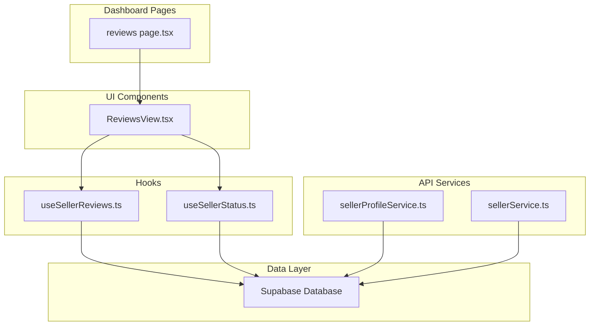
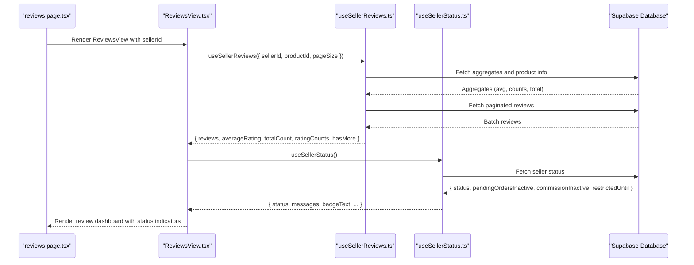
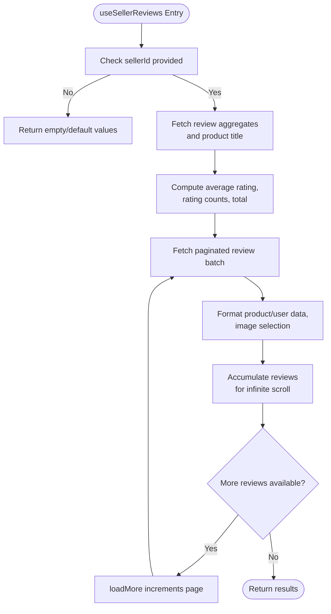
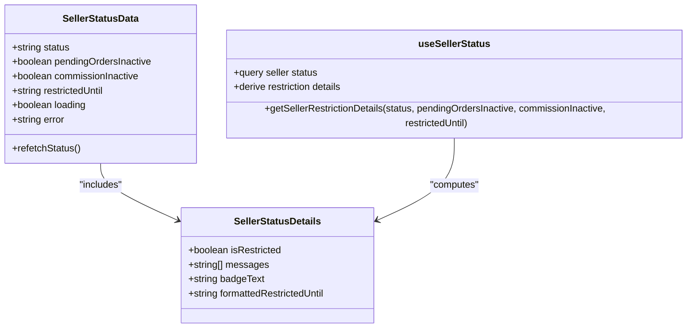
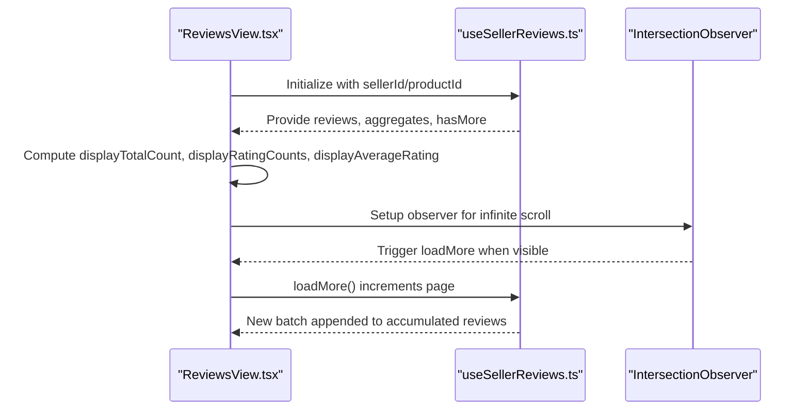
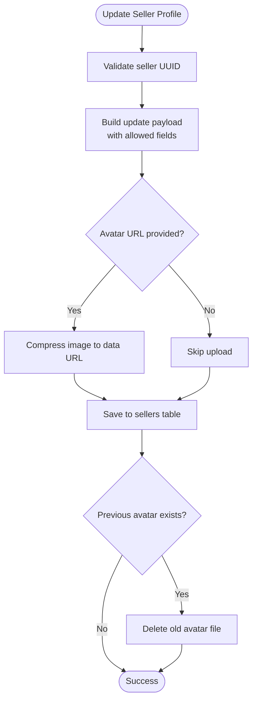
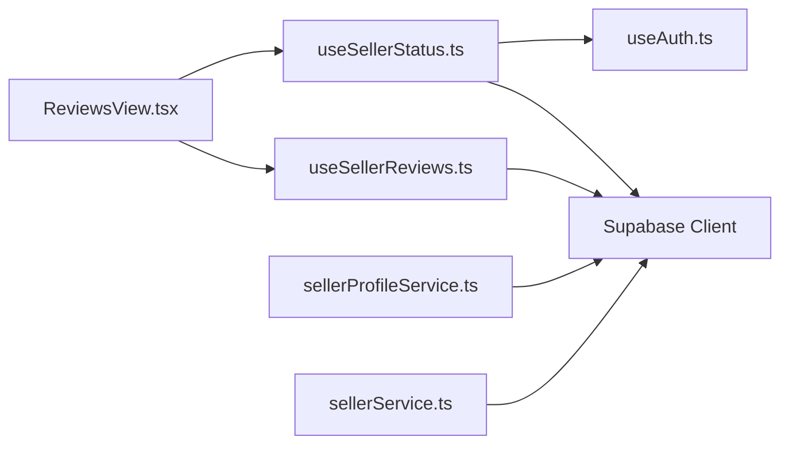

# Seller Operations Hooks

<cite>
**Referenced Files in This Document**
- [useSellerReviews.ts](file://src/hooks/useSellerReviews.ts)
- [useSellerStatus.ts](file://src/hooks/useSellerStatus.ts)
- [ReviewsView.tsx](file://components/reseller/components/ReviewsView.tsx)
- [reviews page.tsx](file://app/dashboard/reviews/page.tsx)
- [sellerProfileService.ts](file://src/api/sellerProfileService.ts)
- [sellerService.ts](file://src/api/sellerService.ts)
</cite>

## Table of Contents
1. [Introduction](#introduction)
2. [Project Structure](#project-structure)
3. [Core Components](#core-components)
4. [Architecture Overview](#architecture-overview)
5. [Detailed Component Analysis](#detailed-component-analysis)
6. [Dependency Analysis](#dependency-analysis)
7. [Performance Considerations](#performance-considerations)
8. [Troubleshooting Guide](#troubleshooting-guide)
9. [Conclusion](#conclusion)

## Introduction
This document explains the seller operations hooks used to manage reviews and seller status across the dashboard and storefront. It focuses on:
- Review management: fetching, filtering by product, rating calculations, pagination, and review moderation states.
- Seller status tracking: account state monitoring, restriction messaging, and status change indicators.
- Profile management: reading and updating seller profile data and shipping/payment configuration.
- Real-time updates and performance optimization strategies for seller data operations.

The documentation is designed for both technical and non-technical readers, with progressive complexity layers, diagrams, and practical examples.

## Project Structure
The seller operations are implemented through React hooks and UI components:
- `useSellerReviews` provides review aggregation, paginated review batches, and infinite scroll support.
- `useSellerStatus` provides seller account status, restriction details, and formatted messages.
- `ReviewsView` renders a review dashboard with average ratings, distribution bars, and per-review badges.
- The dashboard reviews page composes `ReviewsView` with authentication context.
- `sellerProfileService` handles profile reads and updates, including avatar uploads and payment/shipping settings.
- `sellerService` contains legacy review aggregation and mapping logic used elsewhere in the app.

**Diagram sources**
- [reviews page.tsx:1-31](file://app/dashboard/reviews/page.tsx#L1-L31)
- [ReviewsView.tsx:1-323](file://components/reseller/components/ReviewsView.tsx#L1-L323)
- [useSellerReviews.ts:1-214](file://src/hooks/useSellerReviews.ts#L1-L214)
- [useSellerStatus.ts:1-172](file://src/hooks/useSellerStatus.ts#L1-L172)
- [sellerProfileService.ts:1-514](file://src/api/sellerProfileService.ts#L1-L514)
- [sellerService.ts:307-508](file://src/api/sellerService.ts#L307-L508)

**Section sources**
- [reviews page.tsx:1-31](file://app/dashboard/reviews/page.tsx#L1-L31)
- [ReviewsView.tsx:1-323](file://components/reseller/components/ReviewsView.tsx#L1-L323)
- [useSellerReviews.ts:1-214](file://src/hooks/useSellerReviews.ts#L1-L214)
- [useSellerStatus.ts:1-172](file://src/hooks/useSellerStatus.ts#L1-L172)
- [sellerProfileService.ts:1-514](file://src/api/sellerProfileService.ts#L1-L514)
- [sellerService.ts:307-508](file://src/api/sellerService.ts#L307-L508)

## Core Components
- useSellerReviews: Provides review aggregation (average rating, total count, rating counts), paginated review batches, infinite scroll, and error handling.
- useSellerStatus: Provides seller status, restriction details, formatted dates, and refetch capability.
- ReviewsView: Renders review dashboards with summary metrics, distribution bars, per-review cards, and moderation badges.
- sellerProfileService: Reads and updates seller profiles, avatars, and shipping/payment configurations.
- sellerService: Legacy review aggregation and mapping utilities used in other parts of the application.

Key responsibilities:
- Fetching and caching review data via TanStack Query.
- Calculating aggregate metrics client-side when API aggregates are unavailable.
- Managing pagination and infinite scroll using IntersectionObserver.
- Deriving restriction messages from seller status fields.
- Validating and persisting seller profile changes.

**Section sources**
- [useSellerReviews.ts:1-214](file://src/hooks/useSellerReviews.ts#L1-L214)
- [useSellerStatus.ts:1-172](file://src/hooks/useSellerStatus.ts#L1-L172)
- [ReviewsView.tsx:1-323](file://components/reseller/components/ReviewsView.tsx#L1-L323)
- [sellerProfileService.ts:1-514](file://src/api/sellerProfileService.ts#L1-L514)
- [sellerService.ts:307-508](file://src/api/sellerService.ts#L307-L508)

## Architecture Overview
The seller operations architecture follows a layered approach:
- Presentation layer: Dashboard pages and components render user interfaces.
- Hook layer: React hooks encapsulate data fetching, state management, and business logic.
- Service layer: API services abstract database interactions and validation.
- Data layer: Supabase database stores sellers, products, reviews, and users.

**Diagram sources**
- [reviews page.tsx:1-31](file://app/dashboard/reviews/page.tsx#L1-L31)
- [ReviewsView.tsx:1-323](file://components/reseller/components/ReviewsView.tsx#L1-L323)
- [useSellerReviews.ts:1-214](file://src/hooks/useSellerReviews.ts#L1-L214)
- [useSellerStatus.ts:1-172](file://src/hooks/useSellerStatus.ts#L1-L172)

## Detailed Component Analysis

### useSellerReviews Hook
Responsibilities:
- Fetches review aggregates (average rating, total count, rating counts) and optional product title.
- Fetches paginated review batches with product and user details.
- Accumulates reviews for infinite scroll and resets state on parameter changes.
- Exposes loading states, error handling, and refetch functionality.

Key implementation patterns:
- Uses TanStack Query for caching and background refetching with staleTime.
- Computes rating distributions and averages client-side if needed.
- Formats product images and customer names from related tables.
- Manages pagination state and hasMore detection.

Complexity analysis:
- Aggregate computation: O(n) over fetched reviews for counts and sum.
- Pagination: O(1) per page load; accumulation uses Set for duplicate prevention.
- Memory usage: Scales linearly with accumulated reviews.

Error handling:
- Throws errors from batch query and surfaces them as user-facing messages.
- Gracefully handles missing product or user data with fallbacks.

Optimization opportunities:
- Server-side aggregation could reduce client computation.
- Debounce loadMore calls to prevent rapid pagination.
- Virtualize long review lists for large datasets.

**Diagram sources**
- [useSellerReviews.ts:32-214](file://src/hooks/useSellerReviews.ts#L32-L214)

**Section sources**
- [useSellerReviews.ts:1-214](file://src/hooks/useSellerReviews.ts#L1-L214)

### useSellerStatus Hook
Responsibilities:
- Fetches seller status and restriction-related fields from the sellers table.
- Derives restriction messages and badge text based on status and flags.
- Formats restrictedUntil date for display.
- Provides refetch capability and error handling.

Key implementation patterns:
- Uses TanStack Query with enabled flag tied to authenticated user.
- Implements fallback logic for missing columns or schema mismatches.
- Centralizes restriction message generation via a helper function.

Complexity analysis:
- Status resolution: O(1) per fetch.
- Message derivation: O(k) where k is number of active restrictions.

Error handling:
- Handles database errors gracefully and falls back to minimal status data.
- Returns structured error messages for UI consumption.

Optimization opportunities:
- Cache status longer if restrictions rarely change.
- Add optimistic updates for status changes triggered by admin actions.

**Diagram sources**
- [useSellerStatus.ts:5-172](file://src/hooks/useSellerStatus.ts#L5-L172)

**Section sources**
- [useSellerStatus.ts:1-172](file://src/hooks/useSellerStatus.ts#L1-L172)

### ReviewsView Component
Responsibilities:
- Renders the review dashboard with summary metrics and distribution bars.
- Displays per-review cards with moderation badges and product information.
- Implements infinite scroll using IntersectionObserver.
- Provides dynamic fallbacks for rating calculations when API aggregates are unavailable.

Key implementation patterns:
- Uses useMemo for efficient recalculations of totals and distributions.
- Integrates with useSellerReviews and useSellerStatus for data and status.
- Handles loading, empty, and error states with clear UI feedback.

Complexity analysis:
- Rendering: O(n) for review list; distribution bars O(1) per star level.
- Infinite scroll: O(1) per intersection event; accumulates reviews incrementally.

Error handling:
- Shows error banners when review fetch fails.
- Gracefully handles missing product titles and images.

Optimization opportunities:
- Memoize expensive computations further with selectors.
- Lazy-load review images to improve initial render performance.

**Diagram sources**
- [ReviewsView.tsx:1-323](file://components/reseller/components/ReviewsView.tsx#L1-L323)
- [useSellerReviews.ts:1-214](file://src/hooks/useSellerReviews.ts#L1-L214)

**Section sources**
- [ReviewsView.tsx:1-323](file://components/reseller/components/ReviewsView.tsx#L1-L323)

### Seller Profile Management
Responsibilities:
- Fetches seller profile data with specific column selection for security and performance.
- Updates editable profile fields and image URLs.
- Validates and uploads avatars with size and MIME type checks.
- Updates shipping charges and payment options with server-side validation.

Key implementation patterns:
- Strict column selection avoids exposing sensitive fields.
- Image upload pipeline includes storage bucket operations and cleanup.
- Payment configuration enforces mutual exclusivity and conditional bank details.

Complexity analysis:
- Profile fetch: O(1).
- Avatar upload: O(1) network call plus canvas processing.
- Configuration update: O(1) with validation overhead.

Error handling:
- Returns structured success/error responses.
- Cleans up orphaned files on DB failure.

Optimization opportunities:
- Defer avatar compression until necessary.
- Batch multiple profile updates into a single mutation.

**Diagram sources**
- [sellerProfileService.ts:158-215](file://src/api/sellerProfileService.ts#L158-L215)
- [sellerProfileService.ts:277-378](file://src/api/sellerProfileService.ts#L277-L378)

**Section sources**
- [sellerProfileService.ts:1-514](file://src/api/sellerProfileService.ts#L1-L514)

### Legacy Review Aggregation (sellerService)
Responsibilities:
- Filters approved reviews and groups by product.
- Maps raw reviews to UI-friendly structures.
- Calculates overall seller metrics including weighted average ratings.

Key implementation patterns:
- Uses Map for grouping reviews by product_id.
- Applies formatting helpers for dates and names.

Complexity analysis:
- Grouping: O(n).
- Mapping: O(n).
- Metrics calculation: O(n).

Error handling:
- Logs warnings and continues with partial data.

Optimization opportunities:
- Move aggregation to server-side SQL functions.
- Cache aggregated metrics in a separate table.

**Section sources**
- [sellerService.ts:307-508](file://src/api/sellerService.ts#L307-L508)

## Dependency Analysis
The seller operations have clear dependency boundaries:
- ReviewsView depends on useSellerReviews and useSellerStatus.
- useSellerReviews depends on Supabase for data access.
- useSellerStatus depends on Supabase and useAuth for user context.
- sellerProfileService depends on Supabase for profile operations.
- sellerService is used elsewhere but not directly by the hooks.

**Diagram sources**
- [ReviewsView.tsx:1-323](file://components/reseller/components/ReviewsView.tsx#L1-L323)
- [useSellerReviews.ts:1-214](file://src/hooks/useSellerReviews.ts#L1-L214)
- [useSellerStatus.ts:1-172](file://src/hooks/useSellerStatus.ts#L1-L172)
- [sellerProfileService.ts:1-514](file://src/api/sellerProfileService.ts#L1-L514)
- [sellerService.ts:307-508](file://src/api/sellerService.ts#L307-L508)

**Section sources**
- [ReviewsView.tsx:1-323](file://components/reseller/components/ReviewsView.tsx#L1-L323)
- [useSellerReviews.ts:1-214](file://src/hooks/useSellerReviews.ts#L1-L214)
- [useSellerStatus.ts:1-172](file://src/hooks/useSellerStatus.ts#L1-L172)
- [sellerProfileService.ts:1-514](file://src/api/sellerProfileService.ts#L1-L514)
- [sellerService.ts:307-508](file://src/api/sellerService.ts#L307-L508)

## Performance Considerations
- Caching: Both hooks use TanStack Query with staleTime to reduce redundant network requests.
- Pagination: useSellerReviews implements range-based pagination to limit payload sizes.
- Infinite Scroll: ReviewsView uses IntersectionObserver to load more reviews only when needed.
- Client-side Computation: Rating distributions and averages are computed efficiently with useMemo.
- Image Handling: sellerProfileService compresses images before upload to reduce bandwidth.
- Column Selection: sellerProfileService selects only required columns to minimize data transfer.

Recommendations:
- Implement virtualization for long review lists.
- Debounce loadMore calls to prevent excessive re-renders.
- Consider server-side aggregation for large datasets.
- Optimize image loading with lazy loading and placeholders.

[No sources needed since this section provides general guidance]

## Troubleshooting Guide
Common issues and resolutions:
- Missing sellerId: Ensure the hook is called within an authenticated context and sellerId is provided.
- Empty reviews: Verify that the seller has products with reviews and that filters are correct.
- Status errors: Check database schema for new columns like pending_orders_inactive and commission_inactive.
- Profile update failures: Validate input fields and ensure proper UUID format.
- Image upload errors: Confirm MIME types and size limits, and check storage bucket permissions.

Debugging steps:
- Inspect query keys and cache invalidation in TanStack Query DevTools.
- Log Supabase responses to verify data structure.
- Use browser dev tools to monitor network requests and payloads.

**Section sources**
- [useSellerReviews.ts:96-166](file://src/hooks/useSellerReviews.ts#L96-L166)
- [useSellerStatus.ts:92-142](file://src/hooks/useSellerStatus.ts#L92-L142)
- [sellerProfileService.ts:158-215](file://src/api/sellerProfileService.ts#L158-L215)

## Conclusion
The seller operations hooks provide a robust foundation for managing reviews and seller status. They combine efficient data fetching, client-side computation, and user-friendly UI patterns. By following the recommended optimizations and troubleshooting steps, developers can build scalable and responsive seller dashboards that handle real-world data volumes and edge cases effectively.

[No sources needed since this section summarizes without analyzing specific files]