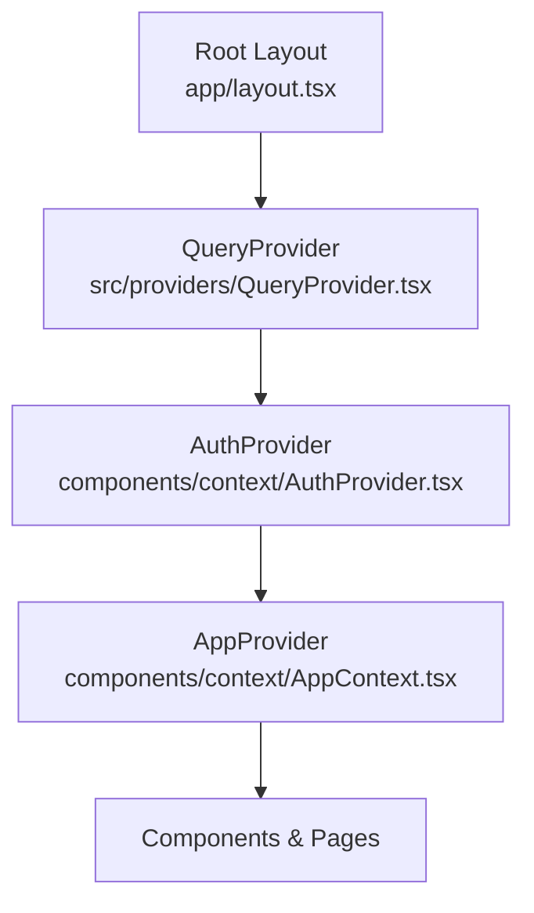
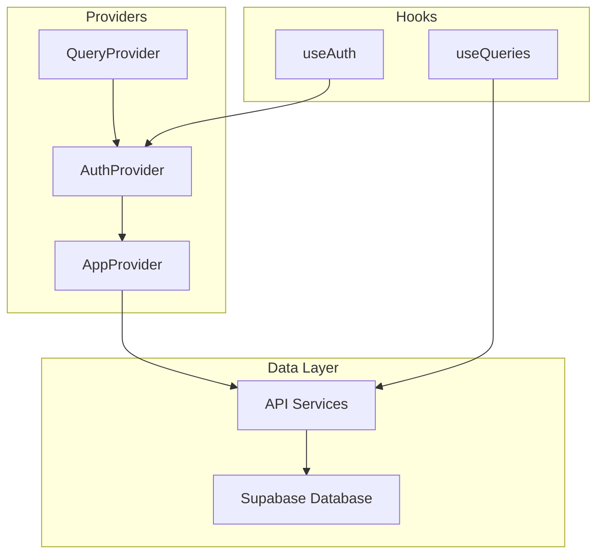
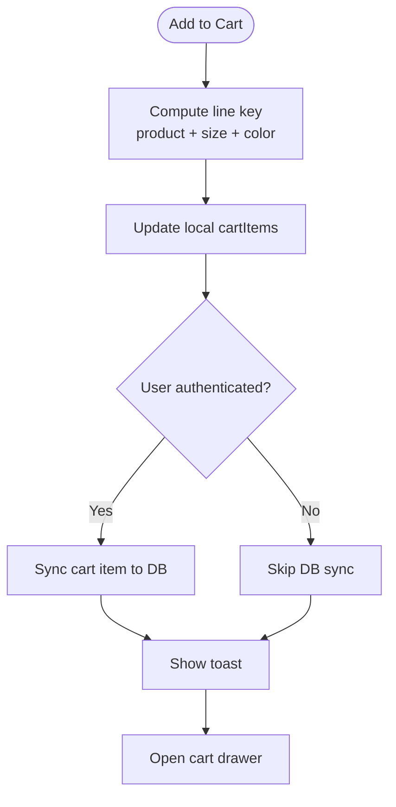
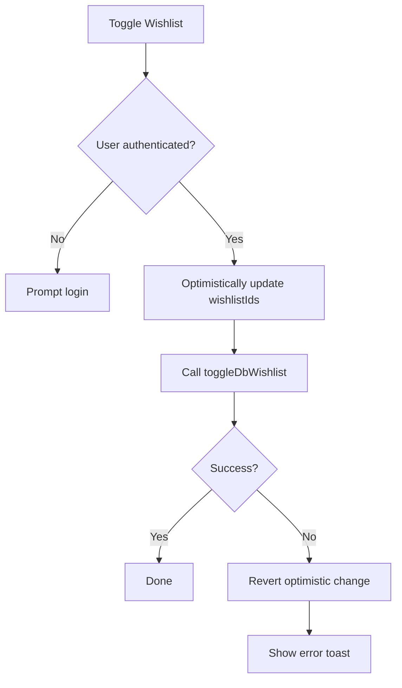
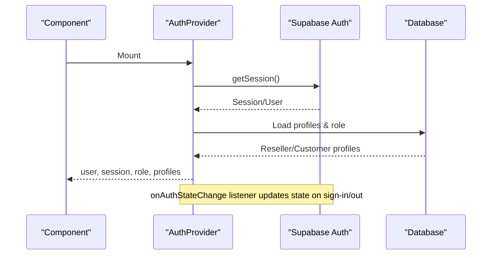
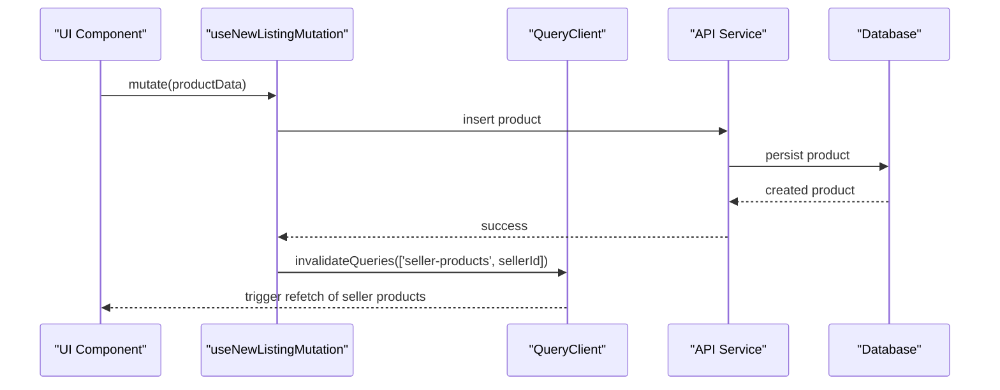
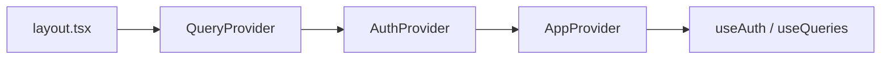

# State Management

<cite>
**Referenced Files in This Document**
- [layout.tsx](file://app/layout.tsx)
- [AppContext.tsx](file://components/context/AppContext.tsx)
- [AuthProvider.tsx](file://components/context/AuthProvider.tsx)
- [useAuth.ts](file://src/hooks/useAuth.ts)
- [useQueries.ts](file://src/hooks/useQueries.ts)
- [QueryProvider.tsx](file://src/providers/QueryProvider.tsx)
</cite>

## Table of Contents
1. [Introduction](#introduction)
2. [Project Structure](#project-structure)
3. [Core Components](#core-components)
4. [Architecture Overview](#architecture-overview)
5. [Detailed Component Analysis](#detailed-component-analysis)
6. [Dependency Analysis](#dependency-analysis)
7. [Performance Considerations](#performance-considerations)
8. [Troubleshooting Guide](#troubleshooting-guide)
9. [Conclusion](#conclusion)

## Introduction
This document explains the application’s state management architecture, focusing on how React Context and TanStack React Query are combined to manage client state (cart, wishlist, UI drawers/modals, toast) and server state (products, collections, seller dashboards, orders, wallet, categories). It also documents the composition of providers at the root layout, the role of custom hooks like useAuth and useQueries, and patterns for synchronizing local state with the database.

## Project Structure
The root layout composes three top-level providers:
- QueryProvider wraps the app with TanStack React Query.
- AuthProvider manages authentication session, user profile, and role.
- AppProvider manages cart, wishlist, UI drawers, modals, and toast.

**Diagram sources**
- [layout.tsx:39-46](file://app/layout.tsx#L39-L46)
- [QueryProvider.tsx:6-23](file://src/providers/QueryProvider.tsx#L6-L23)
- [AuthProvider.tsx:76-321](file://components/context/AuthProvider.tsx#L76-L321)
- [AppContext.tsx:59-357](file://components/context/AppContext.tsx#L59-L357)

**Section sources**
- [layout.tsx:39-46](file://app/layout.tsx#L39-L46)

## Core Components
- AppProvider (React Context): Holds global client state for cart items, wishlist IDs, drawer/modal flags, quick view product, and toast messages. It persists cart to localStorage, merges guest cart to DB when authenticated, and syncs cart/wishlist changes to the backend.
- AuthProvider (React Context): Manages Supabase auth session, user/reseller/customer profiles, role, and seller status. It initializes auth on mount, listens to auth state changes, and provides logout and refetchProfile utilities.
- useAuth (Custom Hook): A thin wrapper around AuthContext that enforces usage within AuthProvider and returns typed auth state and methods.
- useQueries (Custom Hooks): A collection of TanStack React Query hooks for fetching and mutating server data across products, collections, seller dashboards, orders, wallet, categories, and more.
- QueryProvider (TanStack React Query): Provides a QueryClient instance with default query options such as staleTime and refetchOnWindowFocus.

**Section sources**
- [AppContext.tsx:14-53](file://components/context/AppContext.tsx#L14-L53)
- [AuthProvider.tsx:47-57](file://components/context/AuthProvider.tsx#L47-L57)
- [useAuth.ts:4-10](file://src/hooks/useAuth.ts#L4-L10)
- [useQueries.ts:48-357](file://src/hooks/useQueries.ts#L48-L357)
- [QueryProvider.tsx:6-23](file://src/providers/QueryProvider.tsx#L6-L23)

## Architecture Overview
The system separates concerns between:
- Client state: Managed by React Context (AppProvider) for ephemeral UI state and cart/wishlist synchronization.
- Server state: Managed by TanStack React Query (useQueries) for caching, background updates, and mutations.
- Authentication state: Managed by AuthProvider and consumed via useAuth.

**Diagram sources**
- [layout.tsx:39-46](file://app/layout.tsx#L39-L46)
- [AuthProvider.tsx:76-321](file://components/context/AuthProvider.tsx#L76-L321)
- [AppContext.tsx:59-357](file://components/context/AppContext.tsx#L59-L357)
- [useAuth.ts:4-10](file://src/hooks/useAuth.ts#L4-L10)
- [useQueries.ts:48-357](file://src/hooks/useQueries.ts#L48-L357)

## Detailed Component Analysis

### AppProvider: Cart, Wishlist, UI State, and Sync
Responsibilities:
- Cart persistence to localStorage with validation and safe defaults.
- Synchronization of cart changes to the database when authenticated.
- Wishlist state synced with the database; optimistic updates with rollback on failure.
- Global UI state for mega menu, search drawer, quick view modal, and toast notifications.

Key behaviors:
- On mount, loads cart from localStorage and validates structure before setting state.
- When user becomes authenticated, fetches wishlist IDs from DB and merges guest cart into DB.
- Add/update/remove cart operations compute line keys based on product, size, and color, then update local state and optionally call DB sync.
- Wishlist toggle performs optimistic update and reverts on error.

**Diagram sources**
- [AppContext.tsx:165-210](file://components/context/AppContext.tsx#L165-L210)

Wishlist toggle flow:

**Diagram sources**
- [AppContext.tsx:305-331](file://components/context/AppContext.tsx#L305-L331)

**Section sources**
- [AppContext.tsx:59-357](file://components/context/AppContext.tsx#L59-L357)

### AuthProvider: Session, Profiles, Role, and Status
Responsibilities:
- Initialize Supabase session and user on mount.
- Listen to auth state changes and update user/session state.
- Fetch reseller and customer profiles, auto-create customer profile if missing.
- Derive role and seller status from fetched profiles.
- Provide logout and refetchProfile functions.

**Diagram sources**
- [AuthProvider.tsx:248-303](file://components/context/AuthProvider.tsx#L248-L303)
- [AuthProvider.tsx:140-216](file://components/context/AuthProvider.tsx#L140-L216)

**Section sources**
- [AuthProvider.tsx:76-321](file://components/context/AuthProvider.tsx#L76-L321)

### useAuth: Typed Access to Auth Context
- Encapsulates useContext(AuthContext) and throws if used outside AuthProvider.
- Returns typed AuthContextType including user, session, profiles, role, loading, logout, and refetchProfile.

Usage pattern:
- Consume in components or other hooks to access current user and role.

**Section sources**
- [useAuth.ts:4-10](file://src/hooks/useAuth.ts#L4-L10)
- [AuthProvider.tsx:47-57](file://components/context/AuthProvider.tsx#L47-L57)

### useQueries: Centralized Server State Hooks
Provides a comprehensive set of hooks for:
- Product detail and views increment mutation.
- Collection/shop products query.
- Seller products, product information, and edit queries.
- Dashboard overview KPIs/details, last 7 days analytics, overall analytics.
- Orders, wallet, profile, storefront queries.
- New listing mutation with cache invalidation.
- Brand names, departments, child categories, and attribute definitions.

Key patterns:
- Each hook defines a stable queryKey and optional enabled flag.
- Stale times vary per domain (e.g., 3 minutes for product/collection, 1 minute for dashboard metrics, 10 minutes for categories/brands).
- Mutations invalidate related queries to keep caches consistent.

Example flows:

Product detail query:
- useProductQuery(productId) fetches product details with a 3-minute stale time.

Views increment mutation:
- useIncrementViewsMutation() triggers a fire-and-forget request without invalidating product cache to avoid unnecessary refetches.

Seller products query:
- useSellerProductsQuery(sellerId) fetches thumbnail-embedded products with 5-minute stale time and 10-minute GC time.

New listing mutation:
- useNewListingMutation(sellerId) inserts a product and invalidates seller-products caches.

**Diagram sources**
- [useQueries.ts:251-266](file://src/hooks/useQueries.ts#L251-L266)

**Section sources**
- [useQueries.ts:48-357](file://src/hooks/useQueries.ts#L48-L357)

### QueryProvider: Global QueryClient Configuration
- Creates a single QueryClient instance with default options:
  - Global staleTime: 60 seconds.
  - refetchOnWindowFocus disabled globally.
- Wraps the app tree so all useQueries hooks share the same cache.

**Section sources**
- [QueryProvider.tsx:6-23](file://src/providers/QueryProvider.tsx#L6-L23)

## Dependency Analysis
Top-level provider composition order matters:
- QueryProvider must wrap AuthProvider and AppProvider so that hooks can access QueryClient.
- AuthProvider should wrap AppProvider because AppContext uses useAuth to determine authentication state for DB sync.

**Diagram sources**
- [layout.tsx:39-46](file://app/layout.tsx#L39-L46)

Coupling and cohesion:
- AppProvider depends on useAuth for user presence checks during DB sync.
- useQueries is independent of AuthProvider but often used alongside it to gate queries by sellerId/userId.
- Providers are cohesive around their domains: auth/session vs. client UI/cart/wishlist vs. server data caching.

Potential circular dependencies:
- None observed among these files; imports are one-directional from components/hooks/providers to API services.

External integration points:
- Supabase client used by AuthProvider and some useQueries hooks.
- API services encapsulate network calls for cart/wishlist, collections, seller features, categories, and products.

**Section sources**
- [layout.tsx:39-46](file://app/layout.tsx#L39-L46)
- [AppContext.tsx:60-60](file://components/context/AppContext.tsx#L60-L60)
- [useQueries.ts:1-28](file://src/hooks/useQueries.ts#L1-L28)

## Performance Considerations
- LocalStorage hydration guard: AppProvider defers localStorage reads until after initial load to prevent SSR hydration mismatches.
- Optimistic UI: Wishlist toggling updates local state immediately and rolls back on failure.
- Cache tuning:
  - Product and collection queries use 3-minute staleTime to reduce network churn.
  - Seller dashboard metrics use 1-minute staleTime for near-real-time updates.
  - Categories and brand names use 10-minute staleTime for long-lived static data.
- Mutation-driven invalidation: New listing mutation invalidates seller-products caches to reflect new entries without full-page reloads.
- View count mutation intentionally avoids invalidating product query to prevent unnecessary refetches.

[No sources needed since this section provides general guidance]

## Troubleshooting Guide
Common issues and resolutions:
- Using useAuth outside AuthProvider:
  - Symptom: Error thrown indicating useAuth must be used within an AuthProvider.
  - Resolution: Ensure components using useAuth are rendered under AuthProvider.
- Using useApp outside AppProvider:
  - Symptom: Error thrown indicating useApp must be used within an AppProvider.
  - Resolution: Ensure components using useApp are rendered under AppProvider.
- Cart not persisting:
  - Symptom: Cart resets after refresh.
  - Resolution: Verify localStorage availability and that isCartLoaded is true before writes; check try/catch logs for storage errors.
- Wishlist revert on failure:
  - Symptom: Wishlist state reverts after failed toggle.
  - Resolution: This is expected behavior; ensure network connectivity and correct user ID.
- Queries not refetching:
  - Symptom: Data appears stale.
  - Resolution: Check staleTime settings and whether refetchOnWindowFocus is disabled globally; consider calling queryClient.invalidateQueries or enabling refetch on demand.

**Section sources**
- [useAuth.ts:4-10](file://src/hooks/useAuth.ts#L4-L10)
- [AppContext.tsx:360-366](file://components/context/AppContext.tsx#L360-L366)
- [QueryProvider.tsx:6-23](file://src/providers/QueryProvider.tsx#L6-L23)

## Conclusion
The application adopts a clear separation between client state (React Context in AppProvider), authentication state (AuthProvider), and server state (TanStack React Query via useQueries). The root layout composes providers in the correct order to enable consistent state access throughout the app. Custom hooks encapsulate business logic and data-fetching patterns, while optimistic updates and cache invalidation provide responsive UX and reliable synchronization with the backend.